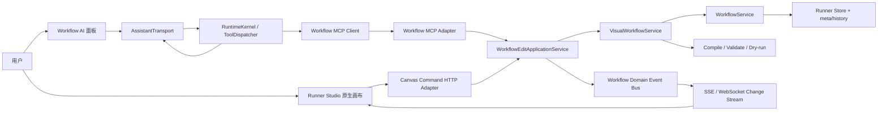
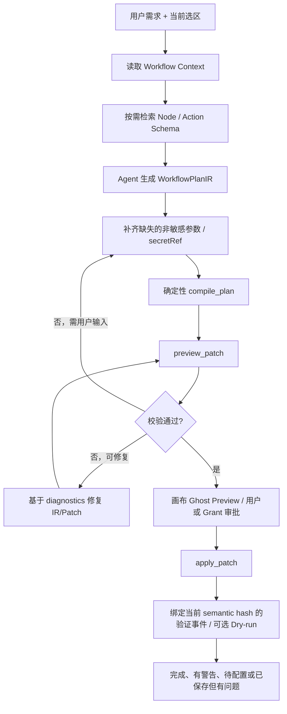
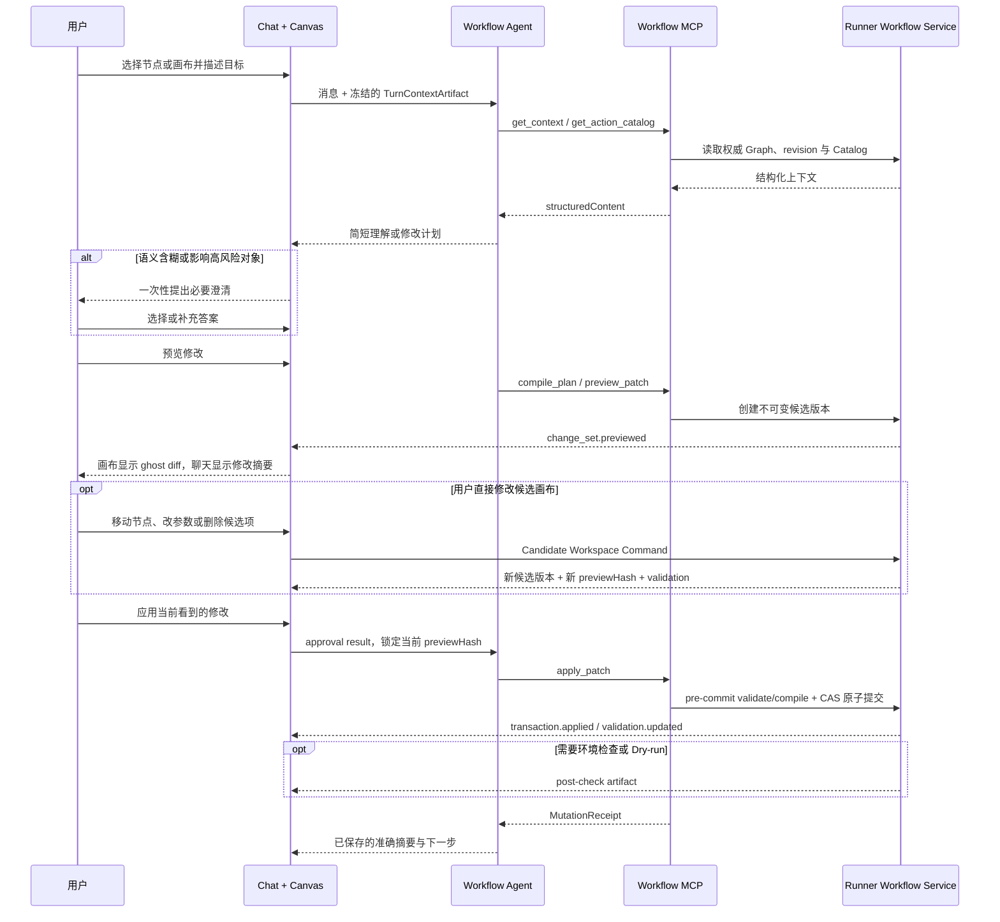

# aiops-v2 Workflow 画布 MCP 控制面与实时协作设计方案

> 日期：2026-07-21
>
> 状态：设计提案（待评审）
>
> 适用范围：aiops-v2 Runner Studio、Workflow AI Drawer、Workflow Agent、Runner Workflow Runtime
>
> 参考基线：[AI 控制 Workflow 画布.md](./AI%20控制%20Workflow%20画布.md)

## 0. 执行摘要

### 0.1 结论

可以、也应该把 AI 修改 Workflow 的能力设计成一组 MCP 工具，但不能把 MCP 当成画布鼠标事件或前端状态同步协议。

本方案的核心判断是：

1. **MCP 是 AI 的语义控制面**：负责读取真实 Workflow、检索节点能力、编译结构化计划、预览原子变更、应用变更、校验、布局、Dry-run、撤销和发布。
2. **Runner 是唯一事实源**：`visual.Graph + VisualWorkflowService + WorkflowService` 负责持久化、并发控制、编译、校验、历史和发布门禁。
3. **画布是事实源的响应式投影**：React Flow 负责拖拽、选区、预览样式和视口；真实 MCP 调用结果和 Workflow 领域事件驱动画布更新。
4. **Agent 负责意图和计划，MCP 工具负责确定性执行**：删除“AI 调用另一个 AI 来 propose patch”的模糊层，避免无法验证的二次生成。
5. **复杂生成先生成 Workflow Plan IR，再由确定性编译器转成 Patch**：Action Catalog、端口、参数 Schema、校验器和 Dry-run 必须进入生成闭环，不能再把每个计划项机械转换成通用 Python 节点。
6. **一次计划确认可以签发有边界的候选编辑授权**：在已确认计划范围内连续修订 Candidate，但不提前写入 committed Graph；用户最终显式“应用修改”时才原子提交一次。删除、大范围替换、发布和执行仍精确确认。
7. **页面只让用户理解“描述、查看、应用、验证”**：Chat、Review 与 Canvas 使用统一状态机和变更轨迹；MCP 名称、JSON 和 revision 默认进入技术详情。
8. **体验质量是发布门禁，不是后续美化**：真实浏览器旅程、Candidate 生命周期、故障恢复、响应式、无障碍、生成准确性和首次用户可用性都有编号测试与硬门槛。

一句话架构：

```text
用户意图
  → Workflow Agent 生成结构化计划
  → MCP 读取/编译/预览/应用原子 ChangeSet
  → Runner 校验并持久化新 revision
  → Workflow 事件流推送 graph delta
  → React Flow 在下一帧展示真实变化
```

### 0.2 为什么现在“看起来能生成”，实际体验仍然弱

当前生产路径不是“Agent 调 MCP 修改真实 Workflow”，而是：LLM 只返回计划，浏览器逐项把计划转换成 `script.python` 占位节点，人工等待 700ms 后写入本地状态，再伪造工具日志和完成状态。

这直接导致：

- 生成结果缺少真实 Action、条件、审批、异常分支和端口语义；
- 用户看到的是模拟进度，不是真实工具执行；
- AI 与用户同时修改时可能互相覆盖；
- 页面显示“完成”时并未通过真实校验或 Dry-run；
- 刷新后 AI 会话、撤销点和工具状态无法可靠恢复；
- Workflow AI 内存状态与 Runner 持久化状态存在 split brain。

### 0.3 本方案与旧文档的关系

旧文档提出的以下原则继续成立：

- AI 修改领域状态，不控制 DOM 或像素；
- Agent 事件流与画布命令流分离；
- Patch 必须带 revision、幂等键、校验和撤销能力；
- 服务端权威优于浏览器权威；
- 画布“看起来正确”不等于 Workflow 可执行。

本方案新增的是 aiops-v2 代码级落地决策：

- 明确当前三条割裂链路及其根因；
- 指定 Runner 现有服务为唯一事实源；
- 重新定义 MCP 工具集合和逐工具 Contract；
- 增加 Workflow Plan IR 与生成质量闭环；
- 定义真实事件驱动的画布 UX；
- 给出已有代码的迁移映射、阶段顺序和验收指标。

若两份文档在 aiops-v2 的具体实现路径上冲突，以本方案为准。

## 1. 目标、非目标与设计约束

### 1.1 目标

本方案需要同时解决四类问题：

1. **生成质量**
   - 使用真实 Node Type、Action Catalog、参数 Schema、输入输出和端口；
   - 能生成条件、并行、Join、Loop、人工审批、Subflow、错误分支；
   - 生成后必须通过真实 compile/validate，必要时执行 bounded repair；
   - 缺少环境或凭据时明确标记“待配置”，不能生成假脚本冒充完成。

2. **实时可视化体验**
   - 每个真实 MCP 事务完成后，画布立即呈现对应 delta；
   - 支持新增、修改、删除、冲突四种视觉语义；
   - 支持“跟随 AI”、点击变更聚焦、暂停、取消和恢复；
   - 对话面板不遮挡正在变化的画布。

3. **一致性与可恢复性**
   - 手工编辑与 AI 编辑经过同一个 command/transaction 层；
   - revision 冲突不静默覆盖；
   - 每次 mutation 可审计、幂等、可撤销、可重做；
   - 刷新或重连后可恢复 committed graph、pending preview 和 transaction history。

4. **MCP 可复用性**
   - 内置 Workflow Agent、外部 MCP Client 和原生页面复用同一领域 Contract；
   - Tool 有完整 `inputSchema`、`outputSchema` 和结构化错误；
   - 大图和大 Catalog 支持按需读取，不把全量数据永久塞进 prompt；
   - 发布、执行和高风险变更有独立权限边界。

### 1.2 非目标

本阶段不做：

- 用 MCP Tool 传输每一帧鼠标移动、节点拖动或 viewport 变化；
- 让模型直接生成或修改 React Flow 内部对象；
- 用一个 `replace_full_graph` 工具覆盖所有编辑场景；
- 在 Workflow Editor 工具包中直接执行生产 Workflow；
- 一开始就引入完整离线优先多人 CRDT；
- 用 Tool Annotation 代替服务端权限、锁、审批和审计；
- 将 API Key、SSH 密码或云凭据暴露给模型或 Tool 参数。

### 1.3 约束

- 真实执行图必须继续使用 `pkg/runner/workflow/visual.Graph`；
- 必须复用 Runner 已有 compile、validate、dry-run、guard 和 publish 规则；
- 不能再维护一份行为不同的 WorkflowEditor Graph 语义；
- 原生页面中的用户修改可以即时乐观显示，但服务端 revision 是最终权威；
- AI mutation 必须经过 RuntimeKernel/ToolDispatcher 的锁、幂等、审批和审计边界；
- 所有失败必须能让模型和用户理解下一步，而不是只返回通用 400 或一段英文文本。

## 2. 当前实现审计

### 2.1 当前存在三条不同的 Workflow 路径

| 路径 | 当前事实源 | 主要用途 | 问题 |
|---|---|---|---|
| Runner 手工画布 | 浏览器 `workflows[]` + localStorage，保存时才进入 Runner | 用户拖拽、连线、配置 | 页面在保存前是权威，无法与 AI 服务端事务可靠并发 |
| Workflow AI HTTP | `workfloweditor.NewService(nil)` 的内存 Store | AI plan/patch/apply/undo API | 与真实 Runner 持久化状态分离，重启丢失 |
| Runner Visual Workflow | `VisualWorkflowService + WorkflowService` | 真正保存、校验、编译、Dry-run、发布 | 已具备正确能力，但 AI 编辑没有接入 |

生产启动中的直接证据：

- `cmd/ai-server/main.go:344-364` 创建 file-backed `runnerRuntime`，同时又创建 `workfloweditor.NewService(nil, ...)`；
- `internal/workfloweditor/service.go:88-99` 中 `nil` Store 会退回 `MemoryWorkflowStore`；
- `internal/server/http.go:174-178` 的默认 WorkflowEditor 也是独立内存实例；
- `/api/runner-studio/workflow-ai/*` 直接调用该 editor service，而非真实 Runner command service。

这意味着同一个 Workflow 可能同时存在：浏览器草稿、WorkflowEditor 内存副本、Runner YAML 三个版本。

### 2.2 前端所谓“实时生成”是模拟流程

当前 AI 编辑主流程位于 `web/src/pages/RunnerStudioPage.tsx`：

1. 调用 session 和 plan HTTP API；
2. 用户确认计划；
3. 浏览器遍历 `plan.items`；
4. 每项等待固定 700ms；
5. 浏览器本地生成 Patch、Node 和 Edge；
6. 写入 `workflows[]` 和 localStorage；
7. 浏览器自行合成 `workflow.generate_step` 日志；
8. 没有真实 validate/dry-run 就进入完成态。

关键代码证据：

| 证据 | 位置 | 影响 |
|---|---|---|
| 人为延时 700ms | `RunnerStudioPage.tsx:501-503` | 进度不是服务端事实 |
| 缺省 Action 为 `script.python` | `RunnerStudioPage.tsx:543-545` | 业务语义被降级为占位脚本 |
| 占位脚本要求用户后补真实动作 | `RunnerStudioPage.tsx:580-599` | 生成物不能算可执行 Workflow |
| 浏览器循环应用计划 | `RunnerStudioPage.tsx:3184-3256` | 模型没有调用真实 Patch 工具 |
| 伪造工具日志 | `RunnerStudioPage.tsx:3193-3233` | UI 无法关联真实 `toolCallId` |
| Apply 失败后吞错并本地继续 | `RunnerStudioPage.tsx:3340-3372` | 用户无法知道服务端未接受变更 |
| Undo 依赖单个内存 Graph 快照 | `RunnerStudioPage.tsx:3380-3418` | 刷新丢失、无 redo、易覆盖手工修改 |

此外：

- `runnerStudioClient.js` 虽声明 snapshot/patch/validate/preview/effect API，但生产页面没有真正走通该链；
- `workflowAiPreviewGraph` 从未形成有效的真实预览 owner；
- `WorkflowAiDrawer` 的 permission UI 没有生产开启路径；
- 页面持有十多个 Workflow AI `useState`，而 `workflowAiViewModel` reducer 仅在测试中使用；
- `RunnerStudioPage.tsx` 已超过 3700 行，继续叠加职责会放大状态漂移。

当前页面体验还存在以下可复现问题：

| 问题 | 当前代码事实 | 用户影响 |
|---|---|---|
| 生命周期操作层级错误 | `保存/运行/运行详情/AI` 是顶部主操作，而校验、发布前检查、发布位于“更多” | 用户容易在未理解检查/发布状态时直接运行 |
| 多个面板覆盖画布 | AI Drawer 使用 absolute overlay，节点配置和运行详情也有独立覆盖层 | 节点、端口和 Diff 被遮挡，窄屏更明显 |
| Preview 整图替换 | 页面使用 `workflowAiPreviewGraph || graph` 选择单一 Graph | 用户无法同时辨认 committed 与 candidate，也无法可靠审阅字段 Diff |
| 连线双击即删除 | `RunnerCanvas` 的 `onEdgeDoubleClick` 直接删除边 | 容易误操作，且没有先展示业务影响 |
| 执行期输入完全禁用 | `WorkflowAiDrawer` 在 `isBusy` 时禁用 textarea 和发送按钮 | 用户无法停止、补充约束或排队修正方向 |
| 文案混用内部语言 | 主路径出现 `Ready to apply`、`Validation needed`、`Conflict`、`Send` 和“图层操作” | 用户必须理解技术状态，中英文体验不一致 |
| 移动端只是缩窄 Drawer | CSS 主要把现有绝对定位面板改成满宽 | 缺少适合触摸、软键盘和小屏审阅的任务流 |

这些问题不是单纯调整颜色或间距可以解决，必须同时重构状态所有权、页面信息架构和操作生命周期。

### 2.3 当前 MCP 工具面是声明完整、实现残缺

`internal/integrations/workfloweditor/tools.go` 当前声明 21 个工具，但存在以下问题：

1. 所有工具共用 `{"type":"object"}`，模型不知道必填字段、枚举和 Patch 结构；
2. `workflow.list`、`workflow.get_action_catalog`、`workflow.get_manual_binding`、`workflow.save_draft`、`workflow.attach_manual_candidate` 等没有 executor，最终返回假成功；
3. `workflow.propose_patch` 只写 `last_ai_plan_item` 元数据，不生成真实节点或边；
4. `ValidatePatch` 只校验 Patch 外壳，不调用真实 Visual Workflow validator；
5. `update_node` 只可靠处理 label/type，其他字段落到 `node.UI`；
6. undo、patch queue、applied IDs 和 session 全在内存；
7. mutation 工具缺少 RuntimeKernel 所要求的 ResourceLock、幂等和 Rollback 元数据；
8. 生产启动代码未把该工具包注册进实际 Workflow Agent 工具面。

所以当前的“IsMCP”更多是内部工具元数据标记，还不是一个完整、可互操作、可安全调用的 Workflow MCP Server。

### 2.4 真实 Runner 已具备可复用能力

不需要重造的能力如下：

| 能力 | 现有实现 | 复用方式 |
|---|---|---|
| 完整 Graph 类型 | `pkg/runner/workflow/visual/model.go` | 直接作为领域模型与 Patch 目标 |
| 结构化校验 | `pkg/runner/workflow/visual/validate.go` | preview/apply/final validate 全部调用 |
| Action Catalog | `pkg/runner/server/service/action_catalog.go` | MCP Resource/Tool 按需暴露 Schema、风险、端口和示例 |
| 乐观并发检查 | `VisualWorkflowService.SaveGraphWithOptions` | `resource_version` 可作为 expected revision；Store 原子 CAS 仍需补齐 |
| 语义/布局双 Hash | `VisualWorkflowGraphHashes` | 作为冲突分类起点；上线前需审计字段归类 |
| Compile | `VisualWorkflowService.Compile` | 任何“完成”前必须通过 |
| Dry-run/路径模拟 | Runner Visual Workflow service | 生成质量闭环与发布门禁 |
| 持久历史/回滚 | `WorkflowService` meta/history | durable transaction undo/redo 的底座 |
| OpsManual Guard | Runner workflow guard | MCP 不复制规则，调用统一门禁 |

注意：这些能力是可复用底座，不代表当前已经形成完整事务。`SaveGraphWithOptions` 当前是 `Get` 后比较版本再 `Update`，尚未把 Graph、幂等 Receipt、Audit 和 Event Outbox 做成一个存储层原子提交；本方案在 ADR-7 和 11.3 节专门补齐该缺口。

### 2.5 生成质量差的直接根因

当前质量问题不是简单的“模型不够强”，而是输入、约束和验证链缺失：

- planner 只看到节点数量和 ID，没看到完整语义；
- Action Catalog 没进入模型可按需读取的上下文；
- Tool Schema 为空对象，模型无法形成合法参数；
- 浏览器把计划项统一变成 Action 节点和顺序连线；
- 条件、失败、审批、Join、Loop 和端口没有中间表示；
- 生成后没有真实 compile/validate/repair；
- 固定 AI draft 仍是“主机资源检查”模板，而非按需求生成。

因此，仅把现有 `add_node` 包装成 MCP 不会显著提升质量。必须一起改造生成中间表示、Capability Grounding、Patch Compiler 和验证闭环。

## 3. 关键架构决策

### ADR-1：Runner 服务端是唯一事实源

选择：

- committed Workflow 只存在于 Runner `WorkflowService`；
- `VisualWorkflowService` 是所有 Graph 读写、校验和编译的入口；
- 人工画布命令与 AI MCP mutation 共用 `WorkflowEditApplicationService`；
- 生产环境禁用 WorkflowEditor 的独立 `MemoryWorkflowStore`。

不选择：浏览器权威、WorkflowEditor 内存权威、MCP Server 再维护一套 Graph 数据库。

### ADR-2：MCP 是语义事务控制面，不是实时 UI 数据面

一次 MCP mutation 对应一个可审计 Workflow ChangeSet，而不是一个鼠标动作。

适合 MCP 的操作：

- 读取当前 Workflow 和选区上下文；
- 检索 Action/Node Schema；
- 编译结构化计划；
- 预览一组原子 Operations；
- 应用、校验、布局、Dry-run、撤销、发布。

不适合 MCP 的操作：

- 拖动中的每一个坐标；
- hover、selection、viewport；
- 光标和 resize 中间帧；
- React Flow DOM 测量状态。

原因：MCP Tool 是离散调用；Progress 和 Resource Subscription 都是可选能力，资源更新通知也只通知 URI 失效，不携带细粒度领域 Patch。把高频 UI 事件做成 Tool 会造成延迟、乱序、重复调用和上下文噪声。

### ADR-3：Agent 计划与 MCP 领域工具分离

删除 MCP 中的 `propose_edit_plan`、`propose_patch` 这类“AI 调 AI”工具职责。

- Workflow Agent 负责理解需求、提出假设、生成 `WorkflowPlanIR`；
- `workflow.compile_plan` 是确定性编译器，不调用 LLM；
- MCP Server 负责规范化、Schema 解析、Patch、校验、权限和持久化；
- 模型不能声称“已验证”，验证结果必须来自工具回执。

### ADR-4：Preview 和 Apply 是同一个不可变 ChangeSet 的两个阶段

`workflow.preview_patch` 生成并存储不可变候选：

- normalized operations；
- base revision；
- candidate graph hash；
- diff 和 risk；
- validation；
- `previewHash`。

`workflow.apply_patch` 只接受 `changeSetId + previewHash + expectedRevision + idempotencyKey + candidateGrantId + applyApprovalId`，不能偷偷换一组 Operations。

这样可以避免“用户预览 A，服务端应用 B”的 TOCTOU 问题。

不可变不等于用户不能在画布上修改候选。Preview 使用“版本化 Candidate Workspace”模型：

- 当前 `changeSetId` 对应的候选版本不可变；
- 用户拖动 ghost 节点、修改参数、删除候选节点或补连线时，前端发送 `RevisePreviewCommand`；
- `workflow.preview_patch` 接受可选 `baseChangeSetId + additionalOperations`，在候选 Graph 上生成一个新的不可变 ChangeSet；
- 新版本重新计算 validation、risk 和 previewHash，并使旧审批结果失效；
- Candidate Workspace 只影响 Preview，不改变 committed Workflow revision；
- MVP 中，Preview 打开时对 committed Graph 的语义修改会让候选变 stale 并触发重算；只有明确 allowlist 的 committed layout-only 修改可以安全 rebase。

这样用户可以“在画布上直接修 AI 的候选结果”，同时仍能保证最终 Apply 的内容与最后一次审阅完全一致。

### ADR-5：语义版本与布局版本分开判断冲突

Runner 已能计算 `semanticHash` 与 `layoutHash`。本方案将其作为并发协议的基础，但不能未经审计就直接把现有 Hash 等同于完整语义边界：

- `resourceVersion`：持久化 CAS 的最终权威；
- `semanticHash`：步骤、参数、条件、变量、边语义；
- `layoutHash`：坐标、折叠、标签、视图布局。

当前实现会从 semantic hash 输入中移除 Node Ports 以及 Edge Source/Target Ports，而这些字段至少参与 Graph 校验和编译。实施前必须建立字段分类表和 golden tests：凡是可能改变编译结果、路由、变量绑定或运行行为的字段都归入 semantic/contract hash；只有纯坐标、viewport、折叠和明确的展示字段才能归入 layout hash。必要时新增 `contractHash`，不要为了复用现有函数而把端口变化误判为纯布局变化。

安全 rebase 规则：

1. AI 修改语义，而当前只发生经过 allowlist 确认的纯展示布局变化：在最新 Graph 上重放 AI 语义 Patch 并保留用户位置；
2. AI 修改布局，而当前只发生语义变化：重新确认节点 ID 后计算布局；
3. 双方触及同一语义路径：返回结构化冲突，不自动覆盖；
4. 删除节点与任何对该节点的并发修改：始终视为冲突；
5. Apply 最终仍在跨进程 workflow lock 内，由 ADR-7 的 CommitStore 基于最新 `resourceVersion` 原子 CAS 并可恢复提交。

MVP 只需实现“字段级 diff 证明只改了纯布局 allowlist 时可安全 rebase”，不能只看两个 Hash 是否相等；其他情况先返回冲突，不要一开始实现任意三方合并。

### ADR-6：MVP 采用服务端权威事件流，CRDT 作为后续能力

用户所说的“实时修改”首先要解决的是：AI 的真实变更即时映射到当前画布，并与手工编辑不丢失。现阶段采用：

- 服务端权威 revision；
- WebSocket/SSE Workflow domain event stream；
- 客户端 optimistic UI + server reconciliation；
- 拖拽中间态仅在本地，drag stop 提交 layout transaction。

当产品明确需要多人同时编辑、长时间离线编辑、远端光标和自动合并时，再引入 Yjs/CRDT。CRDT 只能保证数据收敛，仍不能替代 Workflow 端口、DAG、引用和权限校验。

### ADR-7：Graph、Transaction 与 Event 必须使用可恢复的提交协议

当前 `SaveGraphWithOptions` 的 revision 检查是先 `Get` 再 `Update`，并不是存储层原子 CAS；进程内 workflow lock 也不能防止多进程或旧写入口绕过。Graph 保存后、transaction/idempotency receipt 写入前若崩溃，会出现“图已变化但没有可重放 Receipt”的不一致。

因此“原子 Apply”是目标能力，不是当前代码已具备的事实。Application Service 下层必须新增 `WorkflowCommitStore`：

- 数据库存储：Graph、Transaction、Idempotency Receipt 和 Outbox 在一个数据库事务中提交；
- 当前文件存储：使用 per-workflow 跨进程锁、原子 Compare-And-Swap、durable WAL/manifest、临时文件 + rename、transactional outbox 和启动恢复；
- commit state 至少包含 `prepared → graph_committed → committed`，恢复程序能补写 Receipt/Outbox 或安全回滚；
- Event 只从 committed outbox 投递，重复投递按 event/transaction ID 去重；
- 所有旧写入口收口到同一 CommitStore 之前，不能宣称多进程下具有完整原子性。

单纯“先保存 Graph，再 best-effort 写审计”不满足本方案的一致性目标。

## 4. 目标架构



### 4.1 适配器边界

领域核心不能依赖 MCP、HTTP 或 React Flow：

```text
WorkflowEditApplicationService
  ├─ GetContext
  ├─ CompilePlan
  ├─ PreviewChangeSet
  ├─ ApplyChangeSet
  ├─ Validate
  ├─ ComputeLayout
  ├─ UndoTransaction / RedoTransaction
  ├─ DryRun
  └─ Publish

Adapters
  ├─ MCP Tool Adapter
  ├─ Runner Studio HTTP Command Adapter
  ├─ AssistantTransport Artifact Projector
  └─ Workflow Event Stream Adapter
```

原生浏览器不直接充当 MCP Client：

- AI 操作：用户消息 → AssistantTransport → RuntimeKernel → MCP；
- 手工操作：Canvas command HTTP/WebSocket → 同一个 Application Service；
- 展示：前端消费真实 Tool block、Mutation Receipt 和 Workflow event。

这样既保留 MCP 的 Agent 可复用性，也避免把权限凭证和 Tool 调度逻辑下放到浏览器。

### 4.2 三层画布状态

前端必须显式区分：

| 层 | 内容 | 是否持久化 | Owner |
|---|---|---|---|
| Committed | 已被 Runner 接受的 Graph + revision | 是 | 服务端 |
| Preview | 待确认 ChangeSet 的 ghost nodes/edges/diff | 短期 | 服务端 ChangeSet + 前端投影 |
| Ephemeral | 拖动中位置、hover、selection、viewport、连接预览 | 否 | 当前浏览器 |

禁止再用一个 `graph` 对象同时表示这三类状态。

### 4.3 Turn-scoped Selection Context

Selection 是浏览器 ephemeral 状态，MCP Server 不能在工具调用时猜“用户现在选中了什么”。用户发送消息的瞬间，AssistantTransport 必须冻结一个上下文 Artifact：

```ts
type WorkflowTurnContextArtifact = {
  id: string;
  canvasSessionId: string;
  workflowId: string;
  resourceVersion: string;
  semanticHash: string;
  selectedNodeIds: string[];
  selectedEdgeIds: string[];
  createdAt: string;
};
```

规则：

- Artifact 绑定 turn，后续用户改变选区不会改写它；
- Workflow Agent 收到 `turnContextArtifactId`，再据此调用 `workflow.get_context`；
- Tool 仍由服务端读取完整领域 Graph，Artifact 只提供选择范围，不携带可信 Graph 内容；
- Artifact 的 revision 与当前 revision 不同时，返回 `selectionContextStale=true` 和差异摘要；
- 选中节点已删除时返回 typed diagnostic，由 Agent 重新读取或询问用户；
- Artifact 有 session/tenant 校验和短期 TTL，不能跨用户复用。

## 5. Workflow ChangeSet 领域模型

### 5.1 ChangeSet

```ts
type WorkflowChangeSet = {
  id: string;
  workflowId: string;
  candidateWorkspaceId: string;
  candidateRevision: number;
  parentChangeSetId?: string;
  canvasSessionId: string;
  agentSessionId?: string;
  turnId?: string;
  toolCallId?: string;
  actor: "user" | "agent" | "system";
  intent: string;
  base: {
    resourceVersion: string;
    semanticHash: string;
    layoutHash: string;
  };
  operations: WorkflowOperation[];
  normalizedOperations: WorkflowOperation[];
  previewHash: string;
  planHash?: string;
  candidateGrantId?: string;
  risk: WorkflowRiskSummary;
  validation: WorkflowValidationResult;
  state:
    | "proposed"
    | "previewed"
    | "approved"
    | "applying"
    | "applied"
    | "rejected"
    | "conflict"
    | "superseded"
    | "undone";
  createdAt: string;
  expiresAt: string;
};
```

### 5.2 Typed Operations

Operation 必须是可穷举 discriminated union，不能继续使用 `op: string + fields: Record<string, unknown>`。

第一版支持：

```text
add_node
update_node
delete_node
add_edge
update_edge
delete_edge
update_workflow
update_layout
attach_manual_binding
```

关键约束：

- `add_node.node` 使用完整 `visual.Node` 语义，Node Type 必须来自 Runner registry；
- 同一 ChangeSet 内新节点使用 `clientRef`，服务端分配最终 ID，并允许 Edge 引用该 `clientRef`；
- `update_node.set` 是强类型 `NodePatch`，支持 step/condition/approval/subflow/aggregator/join/loop/ports/inputs/outputs/position；
- `delete_node` 必须明确 `cascadeEdges: true|false`；默认拒绝存在关联边的删除；
- Edge 必须包含 source/target/sourcePort/targetPort/kind/condition；
- `update_layout` 与语义操作分开，便于冲突分类和校验缓存；
- 默认禁止 `replace_full_graph`；仅 import/migration/create 场景开放，并要求二次确认；
- secret 只允许 `secretRef`，禁止内联明文凭据。

示例：

```json
{
  "workflowId": "disk-capacity-guard",
  "turnContextArtifactId": "wfctx_01...",
  "baseChangeSetId": "optional chg_01...",
  "expectedRevision": "sha256:...",
  "intent": "磁盘使用率超过 85% 时创建告警并等待人工确认",
  "operations": [
    {
      "op": "add_node",
      "clientRef": "disk_check",
      "node": {
        "type": "action",
        "label": "检查根分区",
        "step": {
          "name": "check_root_disk",
          "targets": ["selected-host"],
          "action": "script.shell",
          "args": { "script": "df -P /" }
        }
      }
    },
    {
      "op": "add_node",
      "clientRef": "usage_gate",
      "node": {
        "type": "condition",
        "label": "使用率超过 85%",
        "condition": { "if": "${steps.check_root_disk.outputs.usage_percent >= 85}", "else": true }
      }
    },
    {
      "op": "add_edge",
      "edge": {
        "sourceRef": "disk_check",
        "targetRef": "usage_gate",
        "sourcePort": "next",
        "targetPort": "in",
        "kind": "next"
      }
    }
  ]
}
```

上例只演示 Contract 形态；真实 Action 名称和参数必须由 Action Catalog 决定，Agent 不得猜测。

### 5.3 Transaction Receipt

所有 mutation 返回统一结构：

```ts
type WorkflowMutationReceipt = {
  transactionId: string;
  changeSetId: string;
  workflowId: string;
  status: "applied" | "no_effect" | "conflict" | "rejected";
  revisionBefore: string;
  revisionAfter?: string;
  semanticHashBefore: string;
  semanticHashAfter?: string;
  layoutHashBefore: string;
  layoutHashAfter?: string;
  graphDelta: {
    addedNodeIds: string[];
    updatedNodeIds: string[];
    deletedNodeIds: string[];
    addedEdgeIds: string[];
    updatedEdgeIds: string[];
    deletedEdgeIds: string[];
  };
  validation: WorkflowValidationResult;
  checkpointId?: string;
  inverseTransactionId?: string;
  auditId: string;
  presentation: {
    focusNodeIds?: string[];
    fitView?: boolean;
    message?: string;
  };
};
```

`presentation` 只是 UI 建议，不影响 Graph revision，也不能替代前端自己的视口决策。

### 5.4 结构化错误

业务错误使用 MCP Tool Result 的 `isError: true` 和 `structuredContent` 返回，使模型可以修正后重试：

```text
STALE_REVISION
STALE_CHANGESET
PREVIEW_MISMATCH
INVALID_PATCH
UNKNOWN_ACTION
SCHEMA_VIOLATION
INVALID_EDGE
WOULD_CREATE_CYCLE
REFERENCE_LOCKED
APPROVAL_REQUIRED
APPROVAL_SCOPE_EXCEEDED
DUPLICATE_TRANSACTION
NO_EFFECT
MISSING_CONFIGURATION
PUBLISH_GATE_FAILED
```

统一错误字段：

```json
{
  "errorCode": "STALE_REVISION",
  "message": "Workflow 在预览后已被修改",
  "currentRevision": "sha256:new",
  "baseRevision": "sha256:old",
  "conflictingPaths": ["nodes/check_disk/step/args/threshold"],
  "changedBy": "user",
  "retryHint": "重新读取 context，并在保留当前修改的基础上重新生成 ChangeSet"
}
```

JSON-RPC protocol error 仅用于未知工具、Malformed Request 等协议错误；可修正的领域错误不要丢成通用 HTTP 400。

## 6. MCP 工具设计

### 6.1 设计原则

- 工具数量要小而语义完整；不要为每个 Node Type 创建一个 mutation tool；
- 复杂输入用严格 JSON Schema 和 discriminator；
- 每个工具同时提供 `inputSchema`、`outputSchema`、简短 `content` 和完整 `structuredContent`；
- 读工具可并发，mutation 按 `workflow:<id>` 加锁；
- mutation 必须幂等；
- Tool Annotation 只用于发现和 UI 提示，不参与最终授权；
- Core 工具常驻，历史、布局、Dry-run、发布按需加载；
- Tool 描述必须写清“何时使用、何时不要使用、失败后怎么恢复”。

### 6.2 Core 工具

目标工具面共 6 个 Core 能力，但分两步上线：Phase 2 先交付 5 个基础工具；`workflow.compile_plan` 依赖 WorkflowPlanIR 和确定性编译器，在 Phase 4 加入 generation core。Phase 2 的首个切片由 Agent 直接构造严格 typed operations。

| Tool | 作用 | 是否修改 Workflow | 加载策略 |
|---|---|---:|---|
| `workflow.get_context` | 读取摘要、选区、revision、校验和能力 | 否 | Core |
| `workflow.get_action_catalog` | 按名称/类别检索 Action Schema、I/O、端口、风险和示例 | 否 | Core |
| `workflow.compile_plan` | 将 `WorkflowPlanIR` 确定性编译为 typed operations | 否 | Generation Core（Phase 4） |
| `workflow.preview_patch` | 规范化、模拟应用、Diff、风险、真实 Validate，生成不可变 ChangeSet | 否 | Core |
| `workflow.apply_patch` | 原子应用已预览 ChangeSet 并持久化 | 是 | Core |
| `workflow.validate` | 对 committed revision 或 candidate 执行真实 compile/validate | 否 | Core |

#### `workflow.get_context`

合并现有 `get_snapshot + describe + get_step + get_manual_binding`：

```json
{
  "workflowId": "disk-capacity-guard",
  "turnContextArtifactId": "wfctx_01...",
  "revision": "optional historical revision",
  "view": "summary | selection | neighborhood | full",
  "nodeIds": ["check_disk"],
  "edgeDepth": 1,
  "include": ["graph", "validation", "status", "manualBinding", "historySummary"],
  "cursor": "optional",
  "limit": 100
}
```

大图默认返回 summary + selection neighborhood；只有模型确实需要时才读取 full graph。

输出必须包含：

- `resourceVersion/semanticHash/layoutHash`；
- 完整领域 Graph 或有边界的子图，而不是 React Flow 可见投影；
- turn 开始时冻结的 Canvas selection 及其 revision/stale 状态；
- validation errors/warnings；
- Workflow status、publish/dry-run gate；
- 可编辑能力和引用锁；
- Resource URI。

#### `workflow.get_action_catalog`

输入支持：

```text
names[]
query
category
nodeType
riskMax
includeSchema
includeExamples
cursor/limit
```

输出直接复用 `ActionSpec`：args/input/output schemas、default ports、required args、conflicts、defaults、risk、examples、experimental/deprecated。

#### `workflow.compile_plan`

这是确定性编译器，不调用模型：

```text
WorkflowPlanIR
  → resolve node/action specs
  → allocate stable refs/IDs
  → fill safe defaults
  → build typed operations
  → check unresolved slots
  → return operations + diagnostics
```

它不落库，也不替代 preview/validate。

#### `workflow.preview_patch`

输入：

```json
{
  "workflowId": "disk-capacity-guard",
  "expectedRevision": "sha256:...",
  "semanticHash": "sha256:...",
  "layoutHash": "sha256:...",
  "intent": "...",
  "operations": [],
  "layoutPolicy": "preserve | incremental | full",
  "includeCandidateGraph": false,
  "clientRequestId": "turn-..."
}
```

服务端一次完成：

1. Schema validation；
2. operation normalization；
3. 引用和权限预检查；
4. 在 base Graph 上模拟应用；
5. 真实 Visual Workflow validate/compile；
6. semantic/layout hash；
7. semantic diff、risk 和 inverse operations；
8. 持久化短期不可变 ChangeSet；
9. 返回 `changeSetId + previewHash`。

#### `workflow.apply_patch`

输入只引用已经预览的内容：

```json
{
  "workflowId": "disk-capacity-guard",
  "changeSetId": "chg_01...",
  "previewHash": "sha256:...",
  "expectedRevision": "sha256:...",
  "idempotencyKey": "txn_01...",
  "candidateGrantId": "grant_01...",
  "applyApprovalId": "apply_approval_01...",
  "reason": "用户确认的磁盘容量保护流程修改"
}
```

Apply pipeline：

```text
authenticate/authorize
→ acquire workflow lock
→ load latest graph
→ validate preview hash, Candidate Grant and one-time ApplyApproval
→ classify/rebase safe layout-only drift
→ apply normalized operations to an isolated working copy
→ structural validate + compile again（失败则不落库）
→ create validation artifact bound to candidate semanticHash
→ create checkpoint
→ WorkflowCommitStore CAS atomically commits graph + receipt + validation artifact + audit/outbox
→ committed outbox publishes graph delta and validation events
→ optional environment check / Dry-run produces a separate post-check artifact
→ return structured receipt
```

重复 `idempotencyKey` 必须返回第一次的 Receipt，不能再次添加节点。

结构、端口、Action Schema 或 compile 失败属于 pre-commit failure，committed Graph 必须保持不变。环境不可达、Secret 尚未绑定或 Dry-run 失败可以发生在 Graph 已保存之后，此时页面显示 `configuration_required` 或 `saved_with_issues`，但绝不能显示 `completed`。

#### `workflow.validate`

该工具只计算，不把 `valid=true` 当作模型提供的事实：

- 调用 `visual.ValidateGraph`；
- 调用 Action Catalog 参数校验；
- 编译 Graph 到 Workflow YAML；
- 调用 Runner Workflow validate；
- 检查引用锁、环境和发布前置条件；
- 返回带 `nodeId/edgeId/field/code/suggestion` 的 diagnostics。

如果需要写 validated hash，应作为服务端受控事务副作用或单独 lifecycle command，而不是把读取工具伪装成 mutation。

### 6.3 Deferred 工具

| Tool | 作用 | 风险/说明 |
|---|---|---|
| `workflow.auto_layout` | 计算 layout operations，不直接落库 | Read-only；结果再经 preview/apply |
| `workflow.get_history` | 读取 transaction、checkpoint 和 actor | Read-only |
| `workflow.undo_transaction` | 以新事务应用 inverse operations | Mutation；不回写旧快照覆盖新修改 |
| `workflow.redo_transaction` | 重放已撤销事务 | Mutation |
| `workflow.dry_run` | 使用样例输入执行模拟/路径检查 | 可能 open-world；与真实执行隔离 |
| `workflow.create_draft` | 创建新 Workflow 草稿 | Mutation；需要名称冲突与模板校验 |
| `workflow.publish` | 发布已通过门禁的 revision | Critical；独立确认和权限 |
| `workflow.propose_manual_candidate` | 生成 OpsManual 候选引用 | Proposal |
| `workflow.attach_manual_candidate` | 经过 Guard 后关联候选 | Mutation |

`workflow.execute` 不放进默认 Workflow Editor pack。执行继续走 Runner execution/action 边界，避免“编辑权限自动拥有生产执行权限”。如果未来对外暴露，应使用独立 MCP Server 或独立 tool pack/scope。

### 6.4 现有工具迁移映射

| 现有工具 | 目标 |
|---|---|
| `workflow.list` | 实现真实分页查询，保留 |
| `get_snapshot + describe + get_manual_binding` | 合并为 `workflow.get_context` |
| `get_step` | `get_context(nodeIds:[...])` |
| `get_action_catalog` | 实现真实 Catalog Schema 查询 |
| `propose_edit_plan/propose_create_plan` | 移到 Workflow Agent planning，不作为存储 MCP Tool |
| `propose_patch + validate_patch + preview_patch + diff + detect_patch_effect` | 合并为真实 `workflow.preview_patch` |
| `apply_patch + save_draft` | `workflow.apply_patch`，Apply 即持久化 |
| `undo_last_ai_patch` | durable `undo_transaction + redo_transaction` |
| `create_draft_from_confirmed_plan` | `workflow.create_draft` |
| manual proposal/update | proposal 与 attach mutation 分离 |
| 返回 `{status:"ok"}` 的未实现工具 | 实现前不注册、不暴露 |

### 6.5 MCP Resource

适合做 Resource 的内容：

```text
workflow://{workflowId}/draft
workflow://{workflowId}/versions/{versionId}
workflow://{workflowId}/validation/{revision}
workflow://{workflowId}/transactions/{transactionId}
workflow://{workflowId}/runs/{runId}
workflow-schema://node-types/{nodeType}/{version}
workflow-catalog://actions/{actionName}
```

Resource 用于大对象按需读取和缓存失效。`notifications/resources/updated` 只表示资源需要重读，不作为细粒度画布 delta 流。

### 6.6 MCP Prompt

可选的用户触发 Prompt：

```text
workflow-create-from-requirement
workflow-optimize-current
workflow-explain
workflow-repair-validation-errors
workflow-generate-test-cases
```

Prompt 是用户可选择模板；真正落库仍必须走 preview/apply。

## 7. Workflow Plan IR 与生成质量闭环

### 7.1 为什么需要 IR

让模型直接生成最终 Graph 有三个问题：

- 坐标、ID、端口等实现细节会干扰业务规划；
- Action 参数一旦猜错，整图再漂亮也不能执行；
- 修改现有 Workflow 时容易丢失未被模型关注的节点和元数据。

因此把“业务计划”和“执行图 Patch”分开。

### 7.2 WorkflowPlanIR

```ts
type WorkflowPlanIR = {
  objective: string;
  mode: "create" | "modify" | "repair" | "optimize";
  assumptions: string[];
  unresolvedInputs: Array<{
    key: string;
    reason: string;
    sensitive: boolean;
  }>;
  workflowInputs: VariableSpec[];
  workflowOutputs: VariableSpec[];
  steps: Array<{
    ref: string;
    kind:
      | "action"
      | "condition"
      | "parallel"
      | "join"
      | "loop"
      | "manual_approval"
      | "subflow"
      | "variable_aggregator";
    purpose: string;
    action?: string;
    args?: Record<string, unknown>;
    inputs?: VariableBinding[];
    outputs?: VariableSpec[];
    failurePolicy?: FailurePolicy;
  }>;
  transitions: Array<{
    from: string;
    to: string;
    outcome: string;
    condition?: string;
  }>;
  invariants: string[];
  acceptanceTests: WorkflowTestCase[];
  layoutHints?: {
    direction?: "RIGHT" | "DOWN";
    groups?: Array<{ label: string; stepRefs: string[] }>;
  };
};
```

IR 不包含最终坐标，不保存明文 Secret，不允许使用 Catalog 中不存在的 Action。

### 7.3 生成流水线



### 7.4 Grounding 顺序

Agent 不应一次加载整个 Catalog，而应：

1. `get_context(view=summary|selection)`；
2. 根据需求搜索 3～10 个候选 Action；
3. 对最终选择的 Action 读取完整 Schema、I/O、端口、风险和示例；
4. 生成 IR；
5. 编译器再次校验 Action 是否存在及参数是否合法。

### 7.5 Repair 预算

建议默认最多两轮自动修复：

- 第 1 轮：Schema、端口、ID、必填参数、孤立节点；
- 第 2 轮：可达性、条件分支、变量引用、失败路径和发布门禁。

仍失败时停止并展示 diagnostics，不允许无限工具循环。

### 7.6 结果状态

最终状态必须区分：

| 状态 | 含义 |
|---|---|
| `completed` | 已持久化，真实 compile/validate 通过；若要求 Dry-run，也已通过 |
| `completed_with_warnings` | 可执行，但存在用户明确接受的 warning |
| `configuration_required` | 结构合法，但缺环境、secretRef、审批主体等运行配置 |
| `saved_with_issues` | Graph 已持久化，但绑定当前 semantic hash 的环境检查或 Dry-run 存在阻断问题；不能发布/运行，也不能显示 completed |
| `conflict` | revision 或引用发生并发冲突，未覆盖当前图 |
| `failed` | Candidate 生成、pre-commit 结构校验或持久化失败；若持久化未发生，必须明确说明 Graph 未改变 |
| `cancel_requested` | 已请求取消，但服务端尚未确认终止 |
| `cancelled` | 服务端确认取消 |

禁止用“画布已经出现节点”直接判定 completed。

## 8. 实时画布事件与用户体验

### 8.1 两条流仍然分离

```text
Agent Transport
  ├─ assistant text
  ├─ tool started/progress/completed
  ├─ approval request/result
  └─ final answer

Workflow Change Stream
  ├─ change_set.previewed
  ├─ candidate.revised/superseded
  ├─ transaction.applied
  ├─ workflow.revision.changed
  ├─ validation.updated
  ├─ transaction.conflict
  └─ transaction.undone/redone
```

两条流通过以下 ID 关联：

```text
agentSessionId
turnId
toolCallId
canvasSessionId
changeSetId
transactionId
workflowId
```

UI 不再解析 final 文本猜测哪个节点发生了变化。

### 8.2 领域事件结构

```ts
type WorkflowDomainEvent = {
  eventId: string;
  sequence: number;
  type: string;
  workflowId: string;
  resourceVersion: string;
  semanticHash: string;
  layoutHash: string;
  actor: "user" | "agent" | "system";
  agentSessionId?: string;
  turnId?: string;
  toolCallId?: string;
  changeSetId?: string;
  candidateRevision?: number;
  previewHash?: string;
  transactionId?: string;
  delta?: WorkflowGraphDelta;
  diagnostics?: WorkflowDiagnostic[];
  occurredAt: string;
};
```

要求：

- `sequence` 在单 Workflow stream 内单调递增；
- 客户端断线后使用 `afterSequence` 补事件；
- 收到 sequence gap 时重新拉 snapshot；
- Tool Result/transaction receipt 是最终事实，Progress 不是；
- Apply 成功后先持久化，再发布事件；
- 事件重复投递必须可去重。

### 8.3 真正的实时生成节奏

```text
读取上下文
→ 生成并确认计划
→ Candidate V1（画布出现 ghost 主干）
→ Candidate V2（补充条件和失败分支）
→ Candidate V3（自动布局和用户修订）
→ validate Candidate
→ 用户审阅最终 Candidate 并点击“应用修改”
→ 单次原子 Apply
→ 验证当前 committed semantic hash
→ 完成、待配置或已保存但有问题
```

每个 Candidate revision 都可实时投影到 ghost overlay，因此用户仍能看到生成过程，但 committed Graph 在最终 Apply receipt 前保持不变。默认不提供“生成时自动写入正式图”。

删除固定 700ms delay。若工具执行很快，UI 就应快速完成；若工具执行很慢，显示真实 Progress/Task 状态。

### 8.4 画布视觉语义

| 状态 | 建议样式 |
|---|---|
| 新增 Preview | 绿色虚线边框、浅绿节点、ghost badge |
| 修改 Preview | 蓝色描边，属性面板显示字段 Diff |
| 删除 Preview | 红色半透明、删除线连边 |
| Apply 成功 | 短暂绿色 pulse，随后回到普通样式 |
| Validation error | 节点/边红色 issue marker |
| Warning | 黄色 issue marker |
| Revision conflict | 橙色描边和冲突 badge |
| 当前 AI 关注 | 轻量蓝色 halo，不与 Diff 颜色混用 |

不要把所有 AI 变更都压成一个 `aiHighlighted=true` 蓝框。

### 8.5 跟随 AI

提供显式开关：

- 开启：事务完成后聚焦 `changedNodeIds`；
- 用户正在拖拽、缩放或编辑表单时暂停自动聚焦；
- 关闭：显示“有 N 处新变更”导航条，不抢视口；
- 点击 Tool card、Patch card、Diagnostic 可聚焦 node/edge；
- 对大批量变更使用 fit bounds，不逐节点跳动。

### 8.6 Split Pane

现有 Workflow AI Drawer 应迁移为不覆盖画布的 `ContextDock`，并使用真正的 resizable split pane：

```text
┌──────────────────── Canvas ────────────────────┬──── ContextDock ────┐
│                                               │                     │
│  committed graph + preview overlay            │  AI / 配置 / 审阅   │
│                                               │  / 运行             │
└───────────────────────────────────────────────┴─────────────────────┘
```

画布根据剩余宽度更新 fit，不让新增节点落在 `ContextDock` 后方。

### 8.7 冲突 UX

冲突不能只显示一个 reason：

```text
AI 基于 revision 17
当前画布 revision 18
期间用户修改：节点 A 的位置、节点 B 的 threshold
AI 待修改：节点 B 的 threshold、节点 C 的连线

可安全合并：节点 A 位置
冲突：节点 B threshold
```

操作：

1. **保留我的修改，让 AI 重算**（默认推荐）；
2. 查看三方差异；
3. 放弃待处理 AI 变更。

默认不提供“强制覆盖当前 Workflow”。

### 8.8 手工拖拽与 AI 修改并发

- `onNodeDrag`：只更新浏览器 ephemeral position；
- `onNodeDragStop`：提交一个 layout-only transaction；
- AI semantic ChangeSet 检测到只发生 layout drift 时，安全 rebase 到最新 Graph；
- 用户正在编辑与 AI 相同字段时，字段层面返回冲突；
- 未确认 Preview 不能锁死整个画布，用户仍可浏览和做非冲突修改。

### 8.9 页面交互只暴露用户心智模型

页面服务的具体对象是需要编排、排障和发布 Workflow 的运维或平台工程师。页面的单一核心任务是：**让用户把意图安全地转成一个经过检查、可继续编辑的 Workflow 草稿，并且始终知道 AI 改了什么。**

MCP 是实现边界，不是界面语言。默认界面不得直接显示 Tool 名、ChangeSet、previewHash、revision conflict 等内部术语：

| 内部概念 | 用户界面文案 | 默认展示方式 |
|---|---|---|
| `workflow.get_context` | 已读取当前工作流 | 合并到进度行，完成后折叠 |
| `workflow.get_action_catalog` | 已匹配可用步骤 | 只在无法匹配或用户展开详情时展示 |
| `workflow.compile_plan` | 修改计划 | 展示用户可审阅的步骤、影响范围和风险 |
| `workflow.preview_patch` | 待确认修改 | 展示候选画布、字段差异和检查结果 |
| `workflow.apply_patch` | 保存修改 | 展示修改数量、保存结果和撤销入口 |
| `workflow.validate` | 检查工作流 | 展示可定位、可修复的问题 |
| `configuration_required` | 还需配置 | 明确缺少什么以及去哪里配置 |
| `REVISION_CONFLICT` | 画布已发生变化 | 说明谁改了什么以及推荐处理方式 |

只有“技术详情”区域可以显示 Tool 名、ID、Schema、traceId 和结构化结果。界面不得要求用户理解 MCP 才能完成任务。

### 8.10 Chat、MCP 与画布的端到端交互

一次编辑 Turn 使用以下交互闭环：



关键规则：

1. 用户发送消息时冻结选区和 revision；Agent 后续不能偷偷改用新的选区。
2. 用户点击“应用修改”时冻结最后看到的 `previewHash`；Apply 不能提交更早或未审阅的候选版本。
3. “应用修改”是对当前候选版本的明确批准，不生成一条新的自然语言消息。
4. Tool progress 只更新进度，不能直接把画布标记为已保存。
5. 画布只依据 Workflow Domain Event 和最新 snapshot 更新，不从聊天文本推断修改结果。
6. 同一 Workflow 同一用户默认只存在一个 active candidate。用户发起新的编辑请求时，必须选择“继续修改当前候选”或“放弃当前候选后重新开始”。
7. 只读问答可以与候选审阅共存，但新的 mutation turn 必须串行化，避免两个候选互相覆盖。

### 8.11 页面使用并行状态轴，不使用单一扁平枚举

离线可以与 Candidate ready 同时发生，reconnecting 也可以与 Apply 结果未知同时发生。若把任务、连接、候选、审批、校验和发布生命周期压成一个枚举，某一状态必然覆盖另一状态。

页面使用一个共享 Store 保存原始 task、Candidate、approval artifact、connection cursor、validation artifact 和 lifecycle receipt，再通过纯 selector 派生以下只读交互视图。`WorkflowInteractionView` 不能作为第二份可写状态存入 Store：

```ts
type WorkflowInteractionView = {
  taskState:
    | "idle"
    | "reading_context"
    | "awaiting_clarification"
    | "planning"
    | "previewing"
    | "awaiting_review"
    | "applying"
    | "verifying"
    | "cancelling"
    | "cancelled"
    | "failed"
    | "settled";
  candidateState:
    | "none"
    | "building"
    | "ready"
    | "editing"
    | "stale"
    | "superseded"
    | "conflict";
  approvalState:
    | "none"
    | "requested"
    | "approved"
    | "rejected"
    | "expired";
  connectionState: "online" | "reconnecting" | "offline";
  validationState:
    | "unknown"
    | "checking"
    | "valid"
    | "valid_with_warnings"
    | "configuration_required"
    | "saved_with_issues";
  lifecycleState:
    | "draft"
    | "published"
    | "published_with_draft_changes";
};
```

Chat、Review、Canvas、顶部状态和主按钮都读取同一个 selector 结果，不能各自维护另一套 `isBusy/isPreview/isValid`。例如 `connectionState` 只能由 Store 中唯一的 connection status 派生，`validationState` 只能由当前 committed semantic hash 对应的 artifact 派生。

#### 结构化事件迁移

| 事件 | taskState | candidateState | connection/validation/lifecycle 变化 |
|---|---|---|---|
| `turn.submitted` | `reading_context` | 保持 | 无 |
| `clarification.required` | `awaiting_clarification` | 保持 | 无 |
| `plan.started` | `planning` | `building` | 无 |
| `preview.started` | `previewing` | `building` | Candidate validation 可进入 `checking` |
| `change_set.previewed` | `awaiting_review` | `ready` | 保存 Candidate diagnostics，不改变 committed validation |
| `candidate.command.started` | `previewing` | `editing` | 无 |
| `candidate.revised` | `awaiting_review` | `ready` | 旧 Candidate → `superseded`，当前候选校验结果更新 |
| `approval.requested` | 保持 | 保持 | approval → `requested`；打开精确审批，主按钮优先级切到 Dialog |
| `approval.approved` | 保持或进入 `applying` | 保持 | approval → `approved`；只允许消费绑定当前 previewHash 的批准 |
| `approval.rejected/expired` | `awaiting_review` | `ready` | approval → `rejected/expired`；Candidate 保留，不落库 |
| `apply.approved` | `applying` | `ready` | 冻结当前 previewHash，禁止重复 Apply |
| `transaction.applied` | `verifying` | `none` | 未发布草稿保持 `draft`；已有发布版本则 → `published_with_draft_changes`；committed validation → `checking` |
| `validation.updated(valid)` | 无必需 post-check 时 `settled`，否则保持 `verifying` | `none` | validation → `valid`；只有全部必需 gate 完成才派生 `completed` |
| `validation.updated(warnings)` | 无必需 post-check 时 `settled`，否则保持 `verifying` | `none` | validation → `valid_with_warnings`；全部 gate 完成后派生 `completed_with_warnings` |
| `validation.updated(configuration)` | `settled` | `none` | validation → `configuration_required` |
| `dry_run.updated(valid)` | `settled` | `none` | 若 validation 已通过且 semantic hash 一致，派生 completed/with_warnings |
| `post_check.failed` | `settled` | `none` | validation → `saved_with_issues`；发布/运行 gate 关闭 |
| `transaction.conflict` | `awaiting_review` | `conflict` | committed Graph 保持当前服务端版本 |
| `cancel.requested` | `cancelling` | 保持 | 不回滚已提交事务 |
| `task.cancelled` | `cancelled` | `none` 或保留可审阅 Candidate | 无 |
| `connection.reconnecting/offline/online` | 保持 | 保持 | 只改变 connectionState；上线后先 reconcile receipt/snapshot |

`transaction.applied` 只能进入 `verifying`，不能直接进入 completed。同一 `revisionAfter/semanticHash` 的 validation artifact 到达后，才能派生最终结果。Assistant 文本、Tool progress、节点在本地出现都不能改变上述状态轴。

#### 状态组合对应的页面行为

| 组合 | Chat / Review | Canvas | 主操作 |
|---|---|---|---|
| task = reading/planning/previewing | 真实阶段，可停止；输入仍可补充约束 | committed 不变或 Candidate 渐进出现 | 停止生成 |
| candidate = ready | 修改摘要、字段 Diff、检查结果 | committed + ghost overlay | 应用 N 项修改 |
| candidate = editing/building | “正在更新待确认修改” | 上一版 Candidate 标记 stale | 暂无；完成后恢复 Apply |
| task = applying | “正在保存修改” | approved Candidate 标记 pending | 防重复提交 |
| task = verifying | “修改已保存，正在检查” | 新 committed + checking marker | 查看已保存修改 |
| validation = valid/warnings | 准确结果和 Undo | committed | 继续修改或生命周期主操作 |
| validation = configuration_required | 缺失配置及入口 | 黄色 issue marker | 去配置 |
| validation = saved_with_issues | 已保存但不能发布/运行 | 红色 issue marker | 修复问题 |
| candidate = conflict | 三方 Diff | 冲突对象橙色 | 保留我的修改，让 AI 重算 |
| connection = reconnecting/offline | 在当前状态上叠加连接条，不清空内容 | 保留最后可靠 snapshot/Candidate | 先恢复连接或导出草稿 |

主操作按以下优先级计算：`approvalState=requested` / Candidate conflict → 连接状态未知 → applying/cancelling → active Candidate → validation/configuration → Workflow 生命周期。这样 active Candidate 时不会同时出现“应用”“发布”“运行”三个主按钮。

为避免闪烁，小于 300ms 的只读 Tool 可以聚合成一行“已读取工作流”；Mutation、审批、错误和超过 300ms 的操作始终可见。

### 8.12 不同用户任务的最短路径

#### 只读问答

```text
选择一个节点（可选）
→ 输入“这个步骤失败时会怎样”
→ 冻结选区上下文
→ get_context
→ 返回带节点定位的答案
```

不创建 Candidate，不显示“应用修改”，回答中的节点名称可点击定位。

#### 小范围、低风险修改

例如“把当前节点超时改成 30 秒”：

```text
发送请求
→ 读取选中节点
→ 直接生成 Preview
→ 用户看到 old value → new value
→ 应用 1 项修改
→ 保存并检查
```

目标和字段都唯一时不强制增加计划确认，但仍必须 Preview。删除、引用变更和发布不能走该快捷路径。

#### 新建或大范围修改

```text
发送目标
→ 必要时一次性澄清
→ 展示 3～7 步用户计划
→ 用户确认“预览修改”
→ 分阶段创建 Candidate
→ 用户审阅或直接修正 Candidate
→ 应用当前版本
→ 检查并给出配置清单
```

计划卡只说明业务步骤，不展示模型思维过程；同一批低风险修改只确认一次。

#### 用户直接修正 AI Preview

- 点击 ghost 节点后，属性面板进入“待确认修改”模式；
- 字段显示 committed value、AI proposed value 和当前 candidate value；
- 用户修改后自动创建新的 candidate revision；
- 保存候选期间“应用修改”短暂禁用，避免提交旧 previewHash；
- 检查完成后显示“已包含你的 2 处调整”；
- 候选内撤销只影响 Candidate Workspace，不影响 committed history；
- 用户放弃 Candidate 后立即恢复 committed 投影。

#### 冲突和失败恢复

- 若只是其他用户移动了节点，服务端安全 rebase，并提示“已保留最新布局”；
- 若相同字段被改动，保持用户当前 committed 值，候选不自动覆盖；
- Apply 超时后先按 idempotency key 查询事务状态，不能直接重试并重复创建节点；
- 失败卡必须写明“没有保存任何修改”或“已保存前 1 个事务，可撤销”，不能只写“执行失败”；
- 重试只重试已知幂等步骤，未确认的 destructive operation 必须重新批准。

### 8.13 Chat 输入区与画布选区联动

输入框上方固定显示本 Turn 将使用的上下文范围：

```text
[当前工作流：采购审批] [已选：金额判断 + 2 条连线] [× 清除选区]
```

交互规则：

- 画布选中节点/边后，输入区即时出现 scope chip；
- 输入框为空时提供“解释所选步骤”“修复检查问题”“在此后添加步骤”“优化布局”四个上下文快捷操作；
- 用户开始输入后快捷操作收起，避免与主任务争夺注意力；
- Enter 发送，Shift+Enter 换行，发送后焦点保留在对话区；
- 发送后 chip 显示“本轮基于：金额判断”，即使用户随后选择其他节点也不改变该 Turn；
- 用户可以在发送前切换“仅所选内容 / 整个工作流”，默认由请求与选区共同推断，但界面必须可见；
- 未选择对象时不能假装选择了最后一次节点；
- Context 过期时显示“画布在发送后发生了变化，将重新核对”，不能静默使用旧数据。

执行期间不要整体禁用输入框：

- 在读取、规划和生成 Candidate 时，用户可以补充约束；补充内容标记为“用于当前修改”，并在下一个安全边界重新生成 Candidate；
- 在原子 Apply 已开始后，新输入可以编辑和发送，但 mutation 标记为“等待当前保存完成”，不能插入正在提交的 transaction；
- 用户始终可以点击“停止生成”；停止只阻止未开始的后续步骤，不能把已经提交的 transaction 伪装成未发生；
- 队列中每条补充要求都能删除或改为“下一轮处理”，不能形成不可见后台任务；
- 用户发出补充要求后，旧 Candidate 立即标记“正在更新”，Apply 暂时禁用，直到新 previewHash 可审阅。

不建议增加“问答模式 / 编辑模式 / Agent 模式”三段开关。使用一个输入框自动理解意图；只有在系统无法确定用户是否要实际修改时，询问一次：“只说明如何修改，还是生成待确认修改？”

### 8.14 Chat 内容层级与联动画布

一次 Turn 的默认展示顺序固定为：

```text
用户请求
→ AI 对目标的简短复述（仅必要时）
→ 计划卡（复杂任务才出现）
→ 当前进度（可折叠）
→ 待确认修改卡 / 问题卡
→ 最终保存摘要
```

每种卡片只承担一个任务：

- **计划卡**：回答“准备做什么”，主按钮“预览修改”；
- **待确认修改卡**：回答“具体改了什么”，主按钮“应用 N 项修改”；
- **问题卡**：回答“哪里不能运行”，问题可点击定位，主按钮“修复问题”；
- **保存结果卡**：回答“实际保存了什么”，提供“撤销本次修改”；
- **技术详情**：Tool timeline、traceId、原始 diagnostics，默认折叠。

Chat 与 Canvas 使用一个“变更轨迹”建立对应关系：

- hover 修改条目时，画布只高亮对应节点/边；
- 点击修改条目时聚焦并打开对应字段 Diff；
- 点击画布 ghost 节点时，Chat 滚动到对应修改条目；
- “1/8、2/8”导航在修改项之间移动；
- 同一状态只使用一种颜色语义，不能同时用蓝色表示选中、AI 修改、校验错误和冲突。

### 8.15 简单、准确、可恢复的体验约束

#### 简单

- 主流程最多出现一次计划确认、一次应用确认；发布和执行另行确认；
- 每个状态只有一个视觉主按钮；
- 默认不显示 MCP Tool 名、原始 JSON、revision ID 和内部错误码；
- 不为快速只读步骤制造长时间动画或固定延迟；
- 操作名称保持一致：“应用修改”成功后显示“已应用修改”，不要切换成“提交成功”。

#### 准确

- 修改前显示对象、字段、旧值、新值和影响数量；
- 所有成功文案来自 transaction receipt 和 validation result；
- 无法确定唯一节点、端口、环境或业务条件时先澄清，不让模型猜；
- Agent 必须使用 Action Catalog 中真实存在的 action、参数和端口；
- `completed_with_warnings`、`configuration_required` 与 `completed` 使用不同文案和颜色；
- 对“修复全部问题”等请求显示实际覆盖范围，不能把未修复 warning 隐藏在折叠区。

#### 可恢复

- 用户输入、Candidate 和检查结果在刷新后可恢复；
- 所有已保存 AI 事务提供持久化撤销；
- Offline、timeout、event gap、CAS conflict 都有明确恢复动作；
- 任一错误都不得清空未发送输入或用户对 Candidate 的手工调整；
- 切换 Workflow 时若存在未应用 Candidate，明确询问保留还是放弃。

#### 无障碍与响应式

- 所有画布命令都有键盘等价操作，不能只依赖拖拽；
- Candidate 状态除颜色外还使用图标、边框样式和文本；
- Tool/Change/Issue card 使用正确 heading、list、button 语义和可见 focus；
- 焦点只在用户触发后移动；后台事件不能抢走正在编辑表单的焦点；
- `prefers-reduced-motion` 下关闭 pulse、自动平移和连线动画；
- 屏幕阅读器用简短 live region 宣布“已生成 4 项待确认修改”“保存失败，画布未改变”；
- 窄屏使用“画布 / AI / 审阅 / 运行”四个主视图，并保留未提交输入和选区上下文；从画布选择节点或边时，以全屏/Bottom Sheet 打开“配置”；
- 触控端支持审阅、配置和批准；复杂连线编辑可以提示转到桌面，但不能阻断查看和恢复操作。

## 9. 审批、权限与安全

### 9.1 计划授权 Grant

当前“每个最小 Patch 都再次确认”会导致复杂 Workflow 连续弹窗。建议用户确认计划时签发短期 `WorkflowEditGrant`：

```ts
type WorkflowEditGrant = {
  id: string;
  workflowId: string;
  canvasSessionId: string;
  planHash: string;
  baseSemanticHash: string;
  allowedOps: string[];
  maxOperations: number;
  maxAddedNodes: number;
  allowDeleteExisting: boolean;
  allowPublish: false;
  allowExecute: false;
  expiresAt: string;
};
```

用户点击“应用 N 项修改”后，服务端另签发短期、一次性的最终批准：

```ts
type WorkflowApplyApproval = {
  id: string;
  actorUserId: string;
  workflowId: string;
  candidateWorkspaceId: string;
  changeSetId: string;
  previewHash: string;
  expectedRevision: string;
  expiresAt: string;
  consumedAt?: string;
};
```

`WorkflowApplyApproval` 只能消费一次，并且必须与当前用户最后审阅的 Candidate、previewHash 和 expected revision 完全匹配。

在 Grant 范围内：

- 低风险 Patch 可连续修订 Candidate Workspace，不反复弹审批；
- 每次候选修订写不可变 candidate revision，但不增加 committed resourceVersion；
- 最终“应用修改”生成一个绑定当前 `previewHash` 的 `ApplyApproval`，只原子提交用户最后审阅的 ChangeSet；
- 超出数量、触及既有删除、引用锁或风险阈值时返回 `APPROVAL_SCOPE_EXCEEDED`；
- 发布和执行永远需要独立授权。

计划 Grant 不是后台写入 committed Graph 的授权。若未来确有“生成时自动应用”需求，必须作为默认关闭、明确命名、单独审计的高级模式设计，不能复用本方案的 Preview-first 默认路径。

### 9.2 风险分层

| 操作 | 风险 | 默认确认 |
|---|---|---|
| context/catalog/preview/validate | Low | 无 |
| Candidate 内布局/字段修订 | Low | 计划 Grant 范围内无需重复确认 |
| 人工 layout-only apply | Medium | 普通编辑命令；保留 Undo |
| Apply 新增草稿节点/边 | Medium | 必须点击“应用修改”；计划 Grant 限定范围 |
| Apply 修改现有执行参数 | High | 精确 Diff + 最终显式 Apply；Grant 必须明确包含 |
| 删除现有节点/边 | High | 单独确认或明确 delete scope |
| 修改 verified manual binding | High/Critical | 复用引用 Guard |
| publish | Critical | 独立确认 + gate |
| execute | Critical | 不属于默认 editor pack |

### 9.3 RuntimeKernel 元数据

Mutation 工具必须提供：

- `ResourceLock = workflow:<workflowId>`；
- `Idempotency = explicit_key(transactionId)`；
- `Rollback = checkpoint/inverse transaction`；
- `PostCheck = get_context(revisionAfter) + verify validation artifact semanticHash`；需要环境检查或 Dry-run 时另写 post-check artifact；
- `RequiresApproval` 由风险和 Grant 决定；
- 输入输出预算和脱敏策略；
- 完整 audit correlation IDs。

### 9.4 MCP Annotation 不是授权

`readOnlyHint`、`destructiveHint`、`idempotentHint`、`openWorldHint` 只作为提示。服务端仍必须执行：

- tenant/user/workflow/environment RBAC；
- revision、lock 和 reference guard；
- approval Grant 验证；
- rate limit；
- input/output schema validation；
- audit 和结果脱敏。

### 9.5 Scope

对外 HTTP MCP 建议最小权限：

```text
workflow:read
workflow:draft:write
workflow:validate
workflow:publish
workflow:execute
workflow:admin
```

初始 Token 不应同时拥有 publish/execute；需要时 step-up。Token 必须绑定目标 MCP Server，禁止 token passthrough。

### 9.6 Secret 与 Elicitation

- 普通缺失参数，例如阈值、超时、重试次数，可以通过表单询问；
- 密码、API Key、Token、支付信息不能通过普通 form 进入模型上下文；
- 敏感授权使用可信 URL flow，服务端保存凭据；
- Workflow Graph 和 Tool 参数只保存 `secretRef`；
- 日志、Patch、diagnostics 和模型上下文不得回显 Secret。

### 9.7 外部连接器

HTTP/SSH/云连接器至少需要：

- 地址 allowlist/denylist；
- 禁止 metadata 和未授权私网地址；
- 每次重定向重新校验；
- 网络出口策略；
- 操作风险与环境绑定；
- 输出大小和敏感字段过滤；
- Tool 结果视为不可信数据，不能改变 Tool 定义或授权策略。

## 10. 前端架构设计

### 10.1 组件边界

建议从 `RunnerStudioPage.tsx` 拆出以下 owner：

```text
WorkflowWorkspaceProvider
  ├─ committed snapshot + revisions
  ├─ optimistic manual commands
  ├─ preview overlays
  ├─ event reconciliation
  ├─ conflict/history
  └─ selection/viewport/follow-AI

WorkflowAiTransportPanel
  ├─ ChatTransportProvider / AssistantTransport
  ├─ ordered assistant/tool blocks
  ├─ approval/cancel/resume
  └─ turn ↔ tool ↔ transaction correlation

WorkflowCanvasAdapter
  ├─ visual.Graph ↔ React Flow model
  ├─ committed/preview decorations
  ├─ node/edge focus commands
  └─ drag-stop/layout commands

WorkflowChangeReview
  ├─ semantic diff
  ├─ risk summary
  ├─ validation diagnostics
  ├─ apply/reject/revise
  └─ changed node navigation

WorkflowHistoryPanel
  ├─ transaction history
  ├─ undo/redo
  └─ structured conflict resolution
```

### 10.2 Workspace 状态建议

```ts
type WorkflowWorkspaceState = {
  committed: {
    graph: RunnerGraph;
    resourceVersion: string;
    semanticHash: string;
    layoutHash: string;
    validation?: WorkflowValidationArtifact;
  };
  candidate?: {
    state: "building" | "ready" | "editing" | "stale" | "conflict";
    changeSetId: string;
    previewHash: string;
    delta: WorkflowGraphDelta;
    candidateGraph?: RunnerGraph;
    validation: WorkflowValidationResult;
  };
  task: {
    state: WorkflowInteractionView["taskState"];
    turnId?: string;
    toolCallId?: string;
  };
  approval?: {
    state: Exclude<WorkflowInteractionView["approvalState"], "none">;
    candidateGrant?: WorkflowEditGrant;
    applyApproval?: WorkflowApplyApproval;
  };
  lifecycle: {
    publishedRevision?: string;
    publishedSemanticHash?: string;
    validatedSemanticHash?: string;
    dryRunSemanticHash?: string;
  };
  optimisticCommands: CanvasCommand[];
  connection: {
    status: "connected" | "reconnecting" | "offline";
    lastSequence: number;
  };
  selection: {
    nodeIds: string[];
    edgeIds: string[];
  };
  viewport: {
    followAI: boolean;
    userInteracting: boolean;
  };
  conflict?: WorkflowConflict;
};
```

`candidate.validation` 只描述待确认版本，不能点亮 committed 顶部的“已检查”。`committed.validation`、Dry-run 和 publish gate 必须绑定相同 committed semantic hash。

`connection`、`committed.validation`、`candidate`、`approval` 和 `lifecycle` 是唯一原始事实；前端通过 `selectWorkflowInteractionView(state): WorkflowInteractionView` 派生 8.11 节的并行状态轴。Reducer 只写原始 artifact/state，禁止再写一份 `interaction.connectionState/validationState/lifecycleState`。

生产只能有一个 reducer/store owner。现有 `workflowAiViewModel` 可以演进并接管状态，也可以新建 workspace store；不能继续保留“测试 reducer + 页面十多个 useState”双轨。

### 10.3 AssistantTransport 复用

Runner 页面应使用已有 `ChatTransportProvider`/AssistantTransport，而不是：

- 页面正则自行判断是否编辑；
- 页面拼完整可见 Graph 到 prompt；
- 轮询 `/api/v1/state`；
- 从 final/card 文本解析工具结果；
- Drawer 自己维护不可恢复 transcript。

`ContextDock` 的 AI 区需要消费统一 block：

```text
assistant_text
tool_call(workflow.get_context)
tool_result(context receipt)
plan_review
approval_request
tool_call(workflow.preview_patch)
workflow_preview_artifact
tool_call(workflow.apply_patch)
workflow_mutation_receipt
validation_artifact
final_text
```

Tool card 默认展示用户可理解的摘要，JSON 放在“技术详情”二级区域。

### 10.4 手工 Canvas Command

用户操作也转换为 typed domain command，但不需要绕 Agent/MCP：

```text
AddNodeCommand
UpdateNodeCommand
DeleteNodeCommand
ConnectEdgeCommand
DisconnectEdgeCommand
MoveNodesCommand
UpdateViewportPreferenceCommand（仅本地）
```

命令进入与 MCP 相同的 Application Service：

```text
React Flow event
→ CanvasCommand adapter
→ expected revision
→ server transaction
→ mutation receipt
→ committed state reconciliation
```

建议交互：

- 新增/连接/删除/配置提交：立即发 command；
- 表单输入：本地编辑，blur 或 300～500ms debounce 后提交；
- 拖拽：drag 中仅本地，drag stop 一次提交最终位置；
- 服务端冲突：保留本地 UI 草稿并展示冲突，不能静默吞错；
- offline：只允许明确标注的本地草稿队列，不伪装成已保存。

当用户操作的是 ghost preview：

- 命令目标是 `candidateWorkspaceId/baseChangeSetId`，不是 committed workflow；
- 服务端在候选 Graph 上应用用户 Operations，并返回新的 ChangeSet/previewHash；
- 前端切换到新候选版本，旧版本标记 superseded；
- 修改候选不会增加 committed resourceVersion；
- Apply 永远只提交用户最后看到并确认的候选版本。

### 10.5 React Flow 适配器

可继续复用：

- `RunnerCanvas`、`RunnerCanvasNode`、`RunnerCanvasEdge`；
- `canvasGraphAdapter` 的 Graph ↔ Flow 映射；
- 现有端口连接校验与手工 add/remove/insert helpers；
- 节点面板和节点库的 UI metadata；
- `WorkflowAiCards` 的卡片骨架；
- `WorkflowEventDrawer` 的点击事件聚焦模式。

必须修正：

- AI 上下文读取完整领域 Graph，不能读取隐藏 End 节点后的可视投影；
- Preview Decoration 不写入 committed Graph；
- `selected/dragging/measured` 等 React Flow 状态不进入领域 Patch；
- End 节点是否展示可以是 UI 决策，但不能从 Context 和校验中消失；
- UI focus 不写 Graph revision；
- localStorage 只存未提交输入或离线缓存，不再作为在线权威 Store。

### 10.6 前端应删除的逻辑

迁移完成后删除：

- `workflowAiStepDelayMs`；
- `workflowAiVisibleStepPatch`；
- 浏览器默认 `script.python` 占位脚本生成；
- 页面内的 AI plan items 本地循环应用；
- `workflow.generate_step` 伪工具日志；
- Apply/Undo 失败后吞错并继续本地成功；
- 单个 `workflowAiUndoGraphRef` 撤销；
- intent regex 和页面 prompt 拼装；
- 从 UI 可见 Graph 构造 AI Context；
- 永远不可达的 permission/preview state；
- 页面内重复的 local draft store 实现。

### 10.7 Workflow 页面的产品定位与视觉方向

Workflow 页面不是“聊天页旁边放了一张流程图”，而是一张以画布为主、AI 为协作者的**可审计运维工作台**。

设计优先级固定为：

1. 当前 Workflow 是否已保存、是否可运行；
2. 用户正在查看 committed 状态还是待确认修改；
3. 当前选中对象和可执行操作；
4. AI 正在做什么以及是否需要用户决定；
5. 历史、协议和调试详情。

视觉语言应克制，使用运维控制台的清晰层级，而不是把页面做成通用聊天产品。建议基础 token：

| Token | 建议值 | 用途 |
|---|---|---|
| Control Room Surface | `#F7F9FC` | 页面与画布浅色底 |
| Operational Ink | `#172033` | 主文字、节点标题 |
| Structural Line | `#D7DEE8` | 面板边界、普通连线 |
| Command Blue | `#2563EB` | 主操作、当前焦点 |
| Candidate Green | `#15803D` | 新增或已通过检查的候选修改 |
| Danger Red | `#B91C1C` | 删除和阻塞错误；冲突仍使用 8.4 节定义的橙色 |

字体建议：标题和关键状态使用 `IBM Plex Sans` / `PingFang SC`，正文使用 `Inter` / `PingFang SC`，变量、表达式和运行输出才使用 `JetBrains Mono`。中文正文不应大面积使用等宽字体。

页面唯一的标志性元素是“**变更轨迹**”：Chat 修改条目、Review 列表和 Canvas ghost 使用相同编号与定位关系。它编码真实的审阅关系，不增加无意义装饰。

动效只集中在两个时刻：候选变更出现、Apply 成功转为 committed。其余状态使用静态进度、文字和图标；禁止所有节点同时闪烁或持续流动。

### 10.8 页面信息架构

推荐稳定布局：

```text
┌ 返回 / Workflow 名称 / 环境 ─ 保存状态 · 检查状态 ─ Undo Redo ─ 检查 发布 ┐
├───────────────┬──────────────────────────────┬────────────────────────┤
│ 节点库        │                              │ AI / 配置 / 审阅 / 运行 │
│ 搜索          │          Canvas              │                        │
│ 最近使用      │ committed + candidate        │ 单一上下文工作台       │
│ 业务分类      │                              │                        │
├───────────────┴──────────────────────────────┴────────────────────────┤
│ 同步状态 · 当前选区 · 问题数       [N 项修改待应用] [查看] [应用修改] │
└──────────────────────────────────────────────────────────────────────┘
```

#### 顶部栏

- 左侧：返回、Workflow 名称、环境；名称可就地编辑；
- 中间：分别显示“已保存 / 保存中 / 离线草稿”和“已检查 / 有问题 / 还需配置”；两种状态不能合成一个绿点；
- 右侧：Undo、Redo、检查、发布；“运行”只在产品语义需要时出现；
- AI 按钮只负责打开协作面板，不重复放一个“生成工作流”主按钮；
- revision、hash、transactionId 只在技术详情中显示。

顶部只保留一个状态驱动的实心主按钮：

| 当前状态 | 主按钮 | 说明 |
|---|---|---|
| 草稿尚未检查 | 检查工作流 | 先确认结构和必填配置 |
| 有阻断问题 | 修复 N 个问题 | 打开问题中心或生成修复 Preview |
| 静态检查通过、尚未试运行 | 试运行 | 若当前产品暂不支持 Dry-run，则直接进入发布审阅 |
| 检查与试运行通过 | 发布 | 展示相对上一发布版本的语义 Diff |
| 已发布且无草稿变化 | 运行 | 明确运行已发布版本 |
| 已发布但有草稿变化 | 发布更改 | “运行已发布版本”放在下拉次操作中 |

存在 active Candidate 时，review bar 的“应用 N 项修改”成为页面唯一实心主按钮，顶部生命周期按钮降为次要并在必要时禁用；审批 Dialog 打开时，Dialog 内的决定按钮又成为唯一主操作。该优先级避免同一时刻同时出现“应用”“发布”“运行”三个竞争动作。

在线编辑采用事务自动保存，不再常驻一个容易和“应用 Candidate”混淆的“保存”按钮。`Cmd/Ctrl+S` 只用于立即同步并反馈状态。

保存、检查、试运行和发布状态必须绑定精确版本：

- Validation Artifact 至少包含 `resourceVersion + semanticHash + catalogVersion + checkedAt`；
- Dry-run Receipt 至少包含 `resourceVersion + semanticHash + inputFixtureHash + finishedAt`；
- 任意 semantic mutation 成功后，旧 validation、Dry-run 和 publish gate 立即标记 stale，顶部回到“待检查”；
- 只有经过 allowlist 字段审计、semantic hash 不变的 layout-only transaction 可以保留这些 gate；
- 发布只能使用当前草稿 semantic hash 对应的 validation/Dry-run artifact；
- 默认“运行”始终运行 immutable published revision，不能因为编辑器里有更新草稿就改为运行草稿；
- 若支持测试草稿，按钮必须明确写“试运行当前草稿”，并显示目标环境和草稿版本。

#### 左侧节点库

- 默认可收起，画布为空时自动展开；
- 支持名称、描述和 action key 搜索，但默认结果显示业务名称；
- 分类基于真实 Action Catalog，不维护浏览器私有列表；
- 提供“最近使用”和当前 Workflow 推荐步骤，但推荐结果不能越过环境/权限过滤；
- 拖拽不是唯一入口，每个条目还提供“添加到选中节点之后”。

#### 中央画布

- 始终占最大可用面积，任何 Drawer、toast 或底部条都不能遮住节点和控制点；
- 工具栏只保留 fit、zoom、minimap、Follow AI、自动布局；
- 保存、验证、Tool 状态不塞入画布悬浮工具栏；
- 顶部角标持续说明当前投影：“已保存版本”或“待确认修改”；
- 选择、Preview、错误、冲突使用不同视觉通道；
- 画布下方固定 review bar 只在有 Candidate、冲突或离线草稿时出现。

#### 右侧上下文工作台

只保留一个右侧容器，使用四个稳定入口：

- **AI**：自然语言任务、计划、进度和结果；
- **配置**：选中节点/边的参数、端口和变量；
- **审阅**：Candidate Diff、问题、审批、事务历史和 Undo/Redo；
- **运行**：试运行/运行状态、变量、日志和失败节点。

禁止 AI Drawer、节点配置 Drawer、Diff Drawer 和错误 Drawer 同时覆盖画布。宽屏可在 AI 下方临时展开选中节点详情；中窄屏一次只显示一个入口。后台 Preview 到达时不强制切换用户正在编辑的 tab，而是在 review bar 显示明确提醒。

### 10.9 核心画布编辑体验

#### 添加节点

- 空白处双击、节点库条目和“添加到此后”都进入同一 AddNodeCommand；
- 添加前只要求当前 Node Type 的必要字段，次要设置放“高级选项”；
- 从某节点“添加到此后”时自动给出兼容端口，存在多个合法端口才要求选择；
- 添加成功后聚焦新节点并打开详情，但不自动缩放整个大图。

#### 连接边

- 开始连接时只高亮类型兼容、权限允许的目标端口；
- 不兼容端口仍可被键盘发现，并说明“不支持：输出 string，目标需要 hostRef”；
- 多分支节点在边标签中显示条件摘要；空条件或重复条件立即给出局部检查；
- 删除已被引用或受保护的边时展示影响，不静默级联。

#### 编辑节点

- 属性面板按“基本信息、执行参数、输入输出、失败处理、高级”分组；
- 默认只展开当前有问题或用户正在修改的分组；
- 字段使用业务名称，action key、JSONPath 等技术值提供帮助文本；
- 本地输入即时响应，服务端保存使用 debounce/blur；保存状态按字段或表单可见；
- 校验错误紧贴字段，同时在画布和问题列表中可定位；
- 用户编辑 Candidate 时同时显示原值、AI 建议值和当前候选值。

#### 删除、撤销与自动布局

- 普通单节点删除使用一次明确确认；新建且无引用的 Candidate 节点可直接删除；
- 批量删除显示节点、边、受影响出口和引用数量；
- Undo/Redo 说明将撤销哪个业务动作，而不是只显示箭头图标；
- 自动布局先作为 layout preview 展示，用户可应用或放弃；
- 布局修改不改变 semantic revision，也不触发“Workflow 逻辑已修改”的高风险提示。

### 10.10 空画布、问题态与复杂大图

#### 空画布

空画布只给两个同级入口：

1. **用 AI 生成**；
2. **添加第一个步骤**。

下方最多给 3 个与当前产品和环境相关的真实示例，例如“主机健康检查”“告警确认与通知”“发布前审批”，不能显示与 Action Catalog 不匹配的通用模板。

#### 问题态

- 页面顶部显示问题总数和最高严重级别；
- 问题列表按“阻止运行 / 还需配置 / 建议优化”分组；
- 点击问题定位节点、端口或字段，并提供可执行的修复动作；
- “修复全部”只在每一项都能确定性修复时出现，否则改为“让 AI 帮我修复”并先 Preview；
- 发布按钮禁用时，在按钮旁直接说明首个阻塞原因和“查看全部问题”。

#### 复杂大图

- 使用 minimap、分组折叠、语义缩放和大纲视图；
- 低缩放级别只显示节点类型、状态和主干，不渲染完整表单摘要；
- 100 项以上变更按子流程/分支分组，Review 列表虚拟化；
- Follow AI 对批量变更使用 fit bounds，一次完成视口移动；
- 问题、搜索结果和变更共享“上一项 / 下一项”导航；
- 大图 snapshot、layout 和 validation 在 Worker 或服务端执行，不能阻塞输入和拖拽。

### 10.11 响应式布局

| 视口 | 布局策略 | 必须可完成的任务 |
|---|---|---|
| `≥ 1440px` | 节点库 240～280px、弹性 Canvas、右栏 400～520px；右栏可调宽 | 全量创建、编辑、AI 审阅、发布 |
| `1024～1439px` | 节点库改为 overlay；右栏 360～440px；Canvas 保持最小 560px | 全量编辑与 AI 协作 |
| `768～1023px` | Canvas 为主；AI/详情/审阅使用 40～60% bottom sheet 或单页模式 | 创建、配置、审阅、应用和撤销 |
| `< 768px` | 画布 / AI / 审阅 / 运行四个全屏视图；配置由画布选区打开全屏 Sheet；固定显示 Candidate 状态 | 查看、提问、配置、审阅、应用、撤销、查看运行 |

移动端不强求高精度拖拽复杂连线，但必须能通过大纲/列表选择节点、修改字段、批准或放弃 Candidate、查看问题并恢复失败任务。切换视图不能丢失选区、输入内容、滚动位置和未保存字段。

### 10.12 键盘与无障碍操作

完整主流程必须可以不使用鼠标完成：

```text
进入画布大纲
→ 选择节点
→ 打开 AI
→ 输入请求
→ 审阅变更列表
→ 聚焦对应节点/字段
→ 应用修改
→ 查看检查结果
→ 撤销
```

要求：

- 提供与自由画布等价的结构化大纲和变更列表；
- 节点使用可读名称、类型、运行/检查状态，不让读屏读取内部 UUID；
- 常用快捷键可发现并可配置，至少包括搜索、添加节点、删除、Undo、Redo、fit、打开 AI、打开问题；
- modal 打开时焦点进入，关闭后回到触发点；后台事件不得抢焦点；
- `aria-live="polite"` 宣布进度和保存结果，阻塞性错误才使用 assertive；
- 状态不能只靠颜色，必须同时使用文字、图标或线型；
- 所有主要点击目标不小于 44×44 CSS px；
- 文字、控件、焦点和图形关键状态满足 WCAG 2.2 AA 对比度；
- reduced motion 下关闭 pulse、自动平移和动画连线，并提供“定位到变更”按钮。

### 10.13 文案与渐进披露

界面文案使用用户能控制的对象和主动动词：

| 不使用 | 使用 |
|---|---|
| 提交 | 应用 5 项修改 |
| 确认 | 预览修改 / 应用修改 / 发布工作流 |
| 操作失败 | 未保存修改：当前画布已更新，请重新核对 |
| Validation failed | 有 2 个问题会阻止运行 |
| revision conflict | 画布在你提出请求后发生了变化 |
| Patch applied | 已保存：新增 3 个步骤，修改 2 个设置 |
| configuration required | 结构已保存，还需配置 2 项 |

渐进披露分三层：

1. 默认：目标、修改摘要、结果、下一步；
2. 展开：字段 Diff、问题、风险和事务时间；
3. 技术详情：Tool 名、参数、structuredContent、traceId、revision/hash。

错误不使用“抱歉，出错了”之类无行动信息的文案。必须说明：发生在哪一步、画布是否已改变、用户现在能做什么。

### 10.14 可度量的 UX 验收指标

- 常见小修改遵循“描述 → 查看 → 应用 → 验证”，除 Apply 外不超过一次阻塞确认；
- 任意页面状态都能在不展开技术详情时回答“现在看到的是已保存版本吗”；
- Chat、Review 与 Canvas 的变更数量和对象一致率 = 100%；
- Preview 被误认为已保存的测试用户比例 = 0；
- Apply 后重复点击造成重复事务 = 0；
- 首次使用者在无口头指导下完成“修改节点参数”和“增加失败分支”的成功率 ≥ 80%；
- 冲突场景中用户成功保留自己修改并恢复任务的比例 ≥ 90%；
- 阻塞错误都具有一个明确的主恢复动作；
- 键盘可完成选区、请求、审阅、Apply、检查和 Undo；
- axe automated scan 的 serious/critical 问题 = 0，并完成一次人工读屏走查。

## 11. 后端架构与代码落点

### 11.1 WorkflowEditApplicationService

推荐把事务核心放在 Runner service 层，或在 `internal/workfloweditor` 中使用明确的 Runner adapter。优先级是：**领域规则只能有一份**，而不是目录归属。

建议接口：

```go
type WorkflowEditApplicationService interface {
    GetContext(context.Context, GetContextRequest) (WorkflowContext, error)
    GetActionCatalog(context.Context, CatalogRequest) (CatalogPage, error)
    CompilePlan(context.Context, CompilePlanRequest) (CompiledPlan, error)
    PreviewChangeSet(context.Context, PreviewChangeSetRequest) (ChangeSetPreview, error)
    ApplyChangeSet(context.Context, ApplyChangeSetRequest) (MutationReceipt, error)
    Validate(context.Context, ValidateRequest) (ValidationResult, error)
    ComputeLayout(context.Context, LayoutRequest) (LayoutPatch, error)
    GetHistory(context.Context, HistoryRequest) (TransactionPage, error)
    UndoTransaction(context.Context, UndoRequest) (MutationReceipt, error)
    RedoTransaction(context.Context, RedoRequest) (MutationReceipt, error)
    DryRun(context.Context, DryRunRequest) (DryRunResult, error)
    Publish(context.Context, PublishRequest) (PublishResult, error)
}
```

其内部调用：

```text
VisualWorkflowService
WorkflowService
ActionCatalog
WorkflowReferenceGuard
WorkflowCommitStore
ApprovalGrantStore
TransactionOutbox
WorkflowEventBus
AuditSink
```

### 11.2 Store 设计

#### Workflow 本体

继续由 `WorkflowService` file/YAML/meta/history 持久化。

`WorkflowService` 现有 `Get → Update` 检查不能直接当作原子 CAS。新增 `WorkflowCommitStore.Commit`，把以下内容视为一个可恢复的提交单元：

```text
expected resource version
new graph bytes
transaction/idempotency receipt
checkpoint/inverse operations
audit envelope
outbox events
```

文件实现使用 WAL + 跨进程 workflow lock + atomic rename + recovery；未来数据库实现使用单数据库事务。所有写入口必须走该接口。

#### ChangeSet

短期持久化，至少跨页面刷新可恢复：

```text
id
workflowId
base revision/hashes
normalized operations
preview hash
validation/risk/diff
state
expiresAt
actor/session/tool IDs
```

#### Transaction

长期审计：

```text
transactionId/idempotencyKey
workflowId
before/after revision
operations/inverse operations
checkpointId
actor
candidateGrantId
toolCallId/turnId/sessionId
diffHash
validation summary
createdAt
```

#### Approval Grant

短期、不可转移、绑定 workflow/session/plan hash，支持 revoke 和过期。

### 11.3 可恢复的原子 Apply

在单个跨进程 `workflow:<id>` lock 和 CommitStore 提交协议内：

1. 读取最新 Runner Graph；
2. 解析当前 `resourceVersion/semanticHash/layoutHash`；
3. 检查 `idempotencyKey`，存在则返回旧 Receipt；
4. 校验 ChangeSet 未过期、previewHash 未变化；
5. 检查 Candidate Grant、一次性 ApplyApproval 和 reference lock；
6. 分类 revision drift；
7. 只对明确安全的 layout drift 做 rebase；
8. 应用 normalized operations；
9. 调用完整 validate/compile；
10. 构造 checkpoint、transaction receipt、audit 和 outbox event；
11. 持久化 `prepared` WAL/transaction manifest；
12. 在 Store 内原子比较 expected resource version 并提交 Graph；
13. 将 manifest 标记为 `graph_committed/committed`，持久化可重放 Receipt；
14. Outbox worker 在 commit 后发布 domain event，投递失败可重试；
15. 返回持久化 Receipt。

启动时恢复未完成 manifest：若 Graph 已提交则补齐 Receipt/Outbox；若 Graph 未提交则安全丢弃或回滚 prepared 记录。任何一步失败都不能把无法恢复的半个 Graph 暴露为 committed。

在旧入口全部收口、Store CAS/WAL 完成前，只能称为“单进程 best-effort transaction”，不得对外宣称完整原子性。

### 11.4 Undo/Redo

Undo 不是把某个旧 Graph 快照无条件覆盖当前状态。

正确方式：

- 每个 applied transaction 保存 inverse operations；
- undo 自身是一个新 transaction，带当前 expected revision；
- 如果 inverse operation 触及后来被修改的相同路径，返回冲突；
- “撤销本次 AI 会话”按 transaction 顺序逆向执行或生成一个组合 inverse ChangeSet；
- redo 重放原 Operations，同样经过 preview、校验和 CAS；
- checkpoint 用于灾难恢复，普通 Undo 优先使用可审计 inverse transaction。

### 11.5 Auto Layout

当前 `RunnerCanvas.tsx` 的 depth-based 布局可作为 MVP fallback，但不能作为复杂 Workflow 的最终质量方案。

推荐：

- 服务端或共享 worker 中使用确定性 ELK layered layout；
- Node Type/Port 映射为 ELK ports；
- 支持 `direction=RIGHT|DOWN`；
- 支持 `pinnedNodeIds`，不移动用户锁定节点；
- 支持 `scope.nodeIds`，只布局新增子图；
- 支持 group/subflow/parallel/join；
- 输出 `update_layout` operations，不直接持久化；
- 相同 Graph + options 产生稳定结果；
- layout-only apply 不清空 semantic validation/dry-run hash。

React Flow 官方布局资料也说明 ELK 支持多 handle/port 和更复杂的可配置布局，适合此处的条件与多端口 Workflow。

### 11.6 生产组装顺序

当前 `runnerRuntime` 在 MCP Runtime 启动之后才创建，导致 Workflow MCP 难以注册真实 Runner service。建议调整：

```text
create Runner Runtime / VisualWorkflowService
→ create WorkflowEditApplicationService
→ register Workflow MCP tools/resources
→ start MCP Runtime
→ create RuntimeKernel/HTTP server
→ inject same Application Service into HTTP and MCP adapters
```

不得在 HTTP Server 和 MCP 注册处分别 `NewService(nil)`。

### 11.7 逐文件迁移建议

#### P0：唯一事实源

- `cmd/ai-server/main.go`
  - 提前创建/暴露 Runner Workflow services；
  - 只创建一个 WorkflowEditApplicationService；
  - 注册 Workflow tool pack 后再启动 MCP Runtime；
  - HTTP 与 MCP 注入同一个 service。
- `pkg/runner/server/app/runtime.go`
  - 暴露安全的 Workflow edit facade，避免上层 loopback HTTP。
- `internal/server/http.go`
  - 移除 production 默认 Memory WorkflowEditor。
- `internal/server/runner_studio_workflow_ai.go`
  - 过渡期复用统一 service；最终只保留人工 canvas command/query，AI mutation 走 RuntimeKernel。

#### P1：Typed Patch 与 Durable Transaction

- `internal/workfloweditor/types.go`
  - 使用 discriminated operation union；
  - 增加 revision hashes、ChangeSet、Receipt、Diagnostic、Conflict。
- `internal/workfloweditor/patch.go`
  - 完整映射 `visual.Node/Edge/Workflow/Layout`；
  - 删除任意字段落 `UI` 的兼容行为；
  - 调用真实 validator。
- 新增 transaction/change set/grant store；
- 复用 `WorkflowService` history/checkpoint，不再用进程内 map。

#### P2：MCP Contract 与 Runtime Safety

- `internal/integrations/workfloweditor/tools.go`
  - 为每个 Tool 提供真实 input/output Schema；
  - 未实现工具不注册；
  - 返回 structured result；
  - 定义 ResourceLock、Idempotency、Rollback、PostCheck 和 ResultBudget。
- `internal/integrations/workfloweditor/register.go`
  - 注册 tools/resources/instructions；
  - 生产启动覆盖测试。
- `internal/mcp/runtime/*`
  - 支持官方 annotations、`structuredContent`、`isError`、Resource Link；
  - 保留向旧 TextContent 的兼容输出。

#### P3：前端真实 Transport 与 Event Projection

- `web/src/pages/RunnerStudioPage.tsx`
  - 移出 Workflow AI controller 和本地生成逻辑；
  - 只做页面 composition。
- 新增 `WorkflowWorkspaceProvider`、`WorkflowChangeReview`、`WorkflowHistoryPanel`；
- `WorkflowAiDrawer.tsx`
  - 接入 AssistantTransport blocks、真实 approval 和 transaction receipt；
  - 改 split pane。
- `RunnerCanvas.tsx/RunnerCanvasNode.tsx`
  - 增加 preview/diff/conflict decorations 和 follow-AI；
  - drag-stop 发送 layout command。
- `workflowAiTypes.ts`
  - 与后端 schema codegen/contract 对齐，禁止任意 `op: string`。

#### P4：生成质量

- 新增 `WorkflowPlanIR` Schema 和 deterministic compiler；
- planner 输入改为真实 selected context + on-demand catalog；
- 替换 `visual_workflow_ai.go` 的固定主机资源模板；
- 加入 bounded validation repair 和生成评测集；
- 引入 ELK layout adapter。

#### P5：生命周期和外部互操作

- 接入 Dry-run、publish 和 reference guard；
- 完成标准 Streamable HTTP MCP endpoint；
- 可选支持 MCP Apps；
- 多人/离线需求明确后再评估 Yjs。

## 12. MCP 协议兼容设计

### 12.1 目标版本

截至 2026-07，MCP 官方将 `2025-11-25` 标为 latest。aiops-v2 当前 gateway 初始化仍固定请求 `2025-03-26`，需要改为生命周期协商，不应假定所有服务端都支持同一版本。

建议：

1. Client 在 `initialize` 中发送自己支持的最新版本，并维护本地 supported-version set；服务端可返回另一支持版本，Client 不支持时断开；
2. Streamable HTTP 后续请求携带协商后的 `MCP-Protocol-Version`；
3. 兼容 `2025-03-26` 基线；
4. 新能力必须经过 capability negotiation；
5. 收到 initialize result 后发送 `notifications/initialized`，再进入正常 tools/resources 操作；
6. 加 MCP conformance/golden tests，不用自定义 GET `/tools` 结果代替标准协议成功条件。

### 12.2 Tool Result

当前 `internal/mcp/runtime.ToolCallResult` 主要只有 string `Content/Error`。目标结构应保留：

```text
content[]
structuredContent
isError
_meta
```

若声明 `outputSchema`：

- 服务端返回必须符合 Schema；
- aiops-v2 Client 应验证；
- 为旧 Client 同时返回一条简短 TextContent；
- 大 Graph 使用 Resource Link，不把全文复制进 TextContent。

### 12.3 Progress

Progress 只表示长调用进度：

```text
读取能力 10%
编译计划 35%
验证候选图 70%
计算布局 90%
```

约束：

- progress token 在活动请求内唯一；
- progress 单调递增；
- 接收方可能不发送 Progress；
- UI 的最终状态以 Tool/Task Result 和 revision 为准；
- 不把 Graph delta 塞进 Progress message。

### 12.4 Cancellation

普通 MCP request cancellation 是协作式的，服务端可能来不及取消。UI 状态必须区分：

```text
cancel_requested
cancelled
completed_after_cancel_request
```

停止按钮不能一点击就删除画布中已经提交的事务；已经 committed 的变更通过 Undo transaction 处理。

### 12.5 MCP Tasks

大型生成、Dry-run、发布等可支持 MCP Tasks，但官方当前仍将 Tasks 标记为实验性能力。

策略：

- Client/Server 都声明支持时，可返回 durable task；
- 不支持时返回业务 `jobId/runId`，通过 Resource/现有 API 查询；
- Task/Run ID 必须持久化，刷新后可恢复；
- 最终结果以 task result 或 run resource 为准；
- 不让 MVP 依赖实验性 Tasks 才能完成基本 Workflow 修改。

### 12.6 MCP Apps

MCP Apps 已是官方扩展，可让 Tool 用 `_meta.ui.resourceUri` 指向 `ui://` HTML Resource，在支持的宿主内展示交互式 Workflow Editor。

适用：

- 外部 MCP Host 希望直接在对话中打开 aiops-v2 Workflow 预览或编辑器；
- 提供 `workflow.open_editor`，加载受 sandbox/CSP 限制的 React Flow App；
- App 经 Host 调用受 allowlist 限制的 workflow tools。

不适用：

- aiops-v2 原生 Runner 页面没有必要套一层 iframe；
- MCP Apps 不能替代 Runner 事实源、领域校验或原生事件流。

降级：

- 支持 Apps：渲染完整交互式画布；
- 不支持：返回 structuredContent、资源链接、Diff 摘要和 aiops-v2 原生编辑器 URL。

## 13. 实时协作与 Yjs 的边界

React Flow 官方多人协作指南区分 Durable、Ephemeral 和 Local-only 状态：

- Durable：node/edge id、type、data、最终 position、source/target/handles；
- Ephemeral：拖动中 position、连接预览、远端光标；
- Local-only：selection、DOM measured、当前用户 viewport。

这与本方案三层状态一致。

### 13.1 何时不需要 Yjs

满足以下条件时，服务端权威 + revision CAS + event stream 足够：

- 主要是一个用户与 AI 同时编辑；
- 不要求长时间离线后自动合并；
- 拖拽中间帧不必跨客户端同步；
- 冲突可以通过重读、可视 Diff 和重算解决。

这也是 aiops-v2 当前最合适的 MVP。

### 13.2 何时引入 Yjs

满足以下两项以上再进入评估：

- 多人同时编辑成为核心需求；
- 需要远端光标、选区和拖动中间态；
- 需要离线编辑与重连自动收敛；
- 单个 Workflow 长时间由多个浏览器共同维护；
- 仅靠 CAS 冲突率和重算成本不可接受。

映射建议：

```text
Y.Map(nodesById)  → durable node state
Y.Map(edgesById)  → durable edge state
Y.Map(metadata)   → draft metadata
Awareness         → cursor/selection/dragging/viewport
origin            → user:<id> | mcp:<toolCallId>
Y.UndoManager     → 按 origin 选择性撤销 UI collaboration transaction
```

AI 的一个 applied ChangeSet 应作为一个 Yjs transaction 投影，origin 为 `mcp:<toolCallId>`。

但无论是否引入 Yjs，服务端仍需：

- Action Schema validation；
- 端口和 Edge validation；
- DAG/循环规则；
- 引用锁和审批；
- 发布门禁；
- revision/transaction/audit。

CRDT 收敛不等于 Workflow 语义合法。

## 14. 可观测性与审计

### 14.1 Trace 关联

每个 AI 修改至少关联：

```text
traceId
agentSessionId
turnId
toolCallId
canvasSessionId
workflowId
changeSetId
transactionId
candidateGrantId/applyApprovalId
auditId
```

### 14.2 审计记录

至少记录：

- actor/user/tenant；
- Tool name 和 schema version；
- 输入摘要与敏感字段脱敏结果；
- before/after revision 和 hashes；
- diff hash、受影响节点/边；
- Candidate Grant / 一次性 ApplyApproval；
- resource lock 和 idempotency key；
- validation/dry-run 结果；
- checkpoint/inverse transaction；
- result/error code 和耗时。

### 14.3 指标

建议指标：

```text
workflow_mcp_tool_calls_total{tool,status,errorCode}
workflow_changeset_preview_seconds
workflow_transaction_apply_seconds
workflow_transaction_conflicts_total{kind}
workflow_safe_rebases_total
workflow_validation_failures_total{code}
workflow_generation_repair_rounds
workflow_generation_valid_first_pass_ratio
workflow_generation_valid_final_ratio
workflow_canvas_event_delivery_lag_ms
workflow_event_replay_total
workflow_undo_success_ratio
workflow_approval_scope_exceeded_total
```

### 14.4 UI 不应展示的内容

- 原始内部 JSON 默认折叠；
- chain-of-thought；
- Secret、Token、SSH 密码；
- 服务器内部栈和敏感路径；
- 未验证的“已成功”文案；
- 仅用于调试的 MCP protocol envelope。

用户默认看到：操作、对象、结果、风险、校验、下一步。

## 15. 测试与质量评测

### 15.1 Domain 单元测试

覆盖每个 operation：

- add/update/delete node；
- add/update/delete edge；
- Node Type 的完整字段更新；
- cascade 与拒绝策略；
- clientRef 分配和同 ChangeSet 引用；
- duplicate transaction 幂等；
- inverse operation；
- preview/apply hash 一致；
- revise preview 生成新不可变 ChangeSet，旧 previewHash 被拒绝；
- semantic/layout hash 分类；
- layout-only safe rebase；
- same-field conflict；
- secretRef 验证和脱敏。

### 15.2 MCP Contract 测试

- `tools/list` 的每个 Tool 有非空、严格 input/output Schema；
- 未实现 Tool 不出现在列表；
- output 符合 `outputSchema`；
- structuredContent 与 TextContent 摘要一致；
- annotations 与真实行为一致；
- mutation 缺 expected revision/idempotency/approval 时拒绝；
- Tool execution error 返回可修正 diagnostics；
- Resource pagination/read/subscription 能力协商；
- 旧协议版本降级；
- Streamable HTTP origin/auth/session/version header。

### 15.3 集成测试

1. MCP `get_context` 读取的 Graph 与 Runner HTTP 读取完全相同；
2. MCP apply 后，Runner HTTP、文件 Store、重新启动后的 Graph 一致；
3. 人工 command 与 MCP mutation 使用同一 revision/lock；
4. apply 失败时 committed Graph 不变化；
5. duplicate tool retry 只产生一个 transaction；
6. validate 使用真实 Action Catalog 和 visual validator；
7. undo/redo 跨服务重启仍可用；
8. verified manual reference guard 不被 MCP 绕过；
9. publish 复用真实 Runner gate；
10. event 丢失后 snapshot/replay 能恢复。
11. 在 WAL prepared、Graph commit、Receipt commit、Outbox publish 各阶段注入崩溃后，启动恢复结果一致；
12. 两个进程对同一 expected revision 提交时只有一个 Store CAS 成功；
13. turn selection artifact 固定在发送时选区，选区变化和 stale revision 有确定结果。

### 15.4 前端 Vitest

- committed/preview/ephemeral 三层 reducer；
- event ordering、duplicate、gap 和 reconnect；
- Preview decoration；
- follow-AI 在用户交互时暂停；
- conflict 三方差异；
- Candidate Grant 与 ApplyApproval state；
- tool block ↔ mutation receipt 关联；
- validation issue 点击定位；
- split pane resize 与 canvas fit；
- local optimistic command reconciliation；
- semantic mutation 使 validation/Dry-run/publish gate stale；
- allowlist layout-only transaction 保留相同 semantic hash 的 gate；
- 默认运行目标始终为 published revision。

### 15.5 Playwright 真实用户路径

本节只定义核心旅程索引，详细步骤和断言以 15.13 节的编号矩阵为唯一来源，避免维护两套交互语义：

| 核心旅程 | 详细用例 |
|---|---|
| 从零创建条件 Workflow | `PW-001` |
| 选区冻结与精确字段修改 | `PW-002/003` |
| Chat/Review/Canvas 双向定位 | `PW-004/005` |
| 直接修订和放弃 Candidate | `PW-006/007` |
| 布局 rebase 与同字段冲突 | `PW-008/009` |
| 高风险删除审批 | `PW-010` |
| 缺少 Secret 的配置路径 | `PW-011` |
| Undo/Redo 与刷新 | `PW-012` |
| 断线、取消和未知 Apply 结果 | `PW-013/014/017` |
| 执行期补充约束和排队 | `PW-029/030` |
| 检查/发布 gate 与运行版本 | `PW-023/031/032` |

默认界面只显示合并后的用户进度，Tool 名和 JSON 在技术详情；生成过程中渐进更新的是 Candidate revision，committed Graph 只在最终单次 Apply receipt 后改变。

### 15.6 Workflow 生成评测集

建立版本化 fixture，至少覆盖：

- 线性执行；
- if/else、多条件；
- success/failure/always；
- parallel + join；
- loop；
- manual approval；
- subflow；
- variable aggregation；
- host inspection；
- HTTP/云连接器；
- 缺失 secret/environment；
- 修改现有复杂图；
- 修复无效边/变量；
- 禁止破坏 verified reference。

每个 Case 定义：

```text
required node kinds
allowed actions
forbidden placeholders
required paths
validation expectation
dry-run expectation
risk/approval expectation
semantic invariants
```

不要只用节点数或字符串快照判断质量。

### 15.7 建议质量门槛

首个 production rollout 建议目标：

- Contract fixture 的最终 compile/validate 通过率 ≥ 95%；
- 第一轮 preview 通过率 ≥ 75%；
- 生成结果中 placeholder action/script = 0；
- 重复 tool retry 产生重复节点 = 0；
- 已覆盖的并发场景丢失用户修改 = 0；
- Apply 成功到当前页面收到 event 的 p95 ≤ 500ms（同机/内网目标）；
- event gap 后可恢复率 = 100%；
- 高风险变更无审批落库 = 0；
- “completed” 但真实 validation invalid = 0。

阈值应通过真实环境基线校准，但安全类指标不可下调为“尽量”。

### 15.8 测试分级、环境与公共 Fixture

优先级定义：

- `P0`：对应 case/tag 激活后，每个 PR 和发布候选必须 100% 通过；
- `P1`：对应 case/tag 激活后，Nightly 和发布候选必须 100% 通过，不接受普通功能豁免；
- `P2`：容量、兼容性和长稳测试，至少按周运行。

测试采用 **case/tag 级阶段激活**，不能按整个前缀组激活。仓库中的机器可读 manifest 必须为每个 ID 指定：

```yaml
id: MCP-007
priority: P0
activationPhase: 4
tags: [mcp, generation, compile-plan]
browsers: []
```

尚未达到 activation phase 的 Case 状态为 `planned`，不伪装成通过；某个 Phase 的退出条件包含“激活所有 `activationPhase <= 当前 Phase` 的 Case，并使其 P0/P1 达标”。Case 一旦激活，不能因为后续 PR 不方便而降级为 optional。

默认映射和跨组例外：

| Case/tag | activationPhase |
|---|---:|
| Schema golden、旧错误 regression | 0 |
| `DOM-*`、`TXN-*`、WAL/CAS/Undo | 1 |
| `MCP-*` 基础工具、`SEC-*` Tool safety | 2 |
| `UI-*`、`EVT-*`、`PW-*` Canvas 协作、`RWD-*`、`VIS-*`、`A11Y-*` | 3 |
| `GEN-*`、Plan IR、Catalog grounding、Live Model eval | 4 |
| publish MCP facade / lifecycle extension | 5 |
| **例外：`MCP-007`**（`compile_plan`） | **4** |
| **例外：`UI-025/026/027`、`PW-031/033`**（semantic hash / post-check / Dry-run gate） | **4** |
| **例外：`PW-032`**（published revision 与草稿运行分离） | **5** |
| **例外：`PERF-001/002/003/004`**（实时 UI/大图/长会话） | **3** |
| **例外：`PERF-005`**（大图生成/validate） | **4** |
| **例外：`FI-008`**（Store/outbox 恢复） | **1** |
| **例外：`FI-001～007`**（浏览器/Transport 故障） | **3** |

公共 Fixture：

| Fixture | 说明 |
|---|---|
| `W0` | 空白草稿 Workflow |
| `W1` | Start → Action → End 的 3 节点线性 Workflow |
| `W2` | if/else、success/failure 和 End 完整的分支 Workflow |
| `W3` | parallel、join、loop、approval、subflow、manual reference 的复杂 Workflow |
| `W4` | 500 节点、700 条边、20 个问题的大图 |
| `W5` | 依赖云连接器但缺少 `secretRef` 的 Workflow |
| `W6` | 多端口、隐藏 End、锁定节点、pinned layout 和 verified reference 的 Workflow |
| `U-view/U-edit/U-publish/U-admin` | 只读、编辑、发布、管理员用户 |
| `Tenant-A/Tenant-B` | 两个必须隔离的租户 |
| `G-low/G-delete/G-expired/G-revoked` | 低风险、允许删除、过期、已撤销 Grant |
| `R17/R18` | 制造并发修改的相邻 revision |
| `FP-*` | WAL prepared、graph commit、receipt、outbox 等故障注入点 |

测试环境规则：

1. P0 浏览器用例必须使用真实前端、真实 MCP Adapter、真实 Application Service、真实 Store 和真实 Domain Event Stream；Planner 可以使用录制响应保证确定性。
2. Live LLM 生成评测单独运行，不能让随机模型输出阻塞每个 PR；录制 Planner 和 Live Model 共用同一套语义断言。
3. Playwright 禁止使用固定延时等待，必须等待页面状态、Tool receipt、revision 或领域事件。
4. 每个浏览器用例统一检查：页面无框架错误层、无未解释 console error、无失败网络请求、关键状态有截图或 trace 证据。
5. 已激活 Case 中的 P0 Playwright 每个 PR 在 Chromium 自动运行；P1 在 Nightly/RC 覆盖 Firefox、WebKit。
6. 测试不得直接修改 reducer 或 Local Storage 绕过真实用户交互，除非用例本身是 reducer 单元测试。
7. 所有时间和性能断言使用可配置基线，幂等、权限、原子性、Secret 和状态准确性使用绝对门槛。
8. Codex browser-in-app Phase 3 core 为 `PW-001/002/006/009/013/018/023/024/029`；Phase 4 激活后追加 `PW-031/033`，Phase 5 追加 `PW-032`。在对应 Phase exit、每个发布候选以及改动 Workflow 主交互后运行已激活集合；归档 build SHA、viewport、截图/录像、console 和最终 revision 证据，不要求每个普通 PR 人工重复。

### 15.9 Domain 与 MCP 可执行测试矩阵

| 编号 | 前置条件 | 操作 | 预期结果 | 优先级 |
|---|---|---|---|---|
| DOM-001 | `W1` | add/update/delete node | Graph、inverse operation、semantic hash 与 validation 一致 | P0 |
| DOM-002 | `W2` | add/update/delete edge | source/target port、条件和引用正确；非法边被拒绝 | P0 |
| DOM-003 | 同一 ChangeSet 有多个 `clientRef` | 后续 operation 引用前一新增节点 | 服务端稳定解析 ID，无悬空引用 | P0 |
| DOM-004 | 删除有入边/出边节点 | 分别设置 cascade true/false | true 精确级联，false 返回关联对象并拒绝 | P0 |
| DOM-005 | Node Type 含复杂字段 | 更新 args、timeout、retry、failure policy | 未触及字段不丢失，字段类型正确 | P0 |
| DOM-006 | 仅位置变化 | 计算 semantic/layout hash | semantic 不变、layout 改变 | P0 |
| DOM-007 | 端口或 edge handle 变化 | 计算 semantic hash | semantic 必须改变，不能误判为纯布局 | P0 |
| DOM-008 | 同字段与不同字段并发 | 执行 rebase | 同字段冲突；allowlist 中的布局字段可安全合并 | P0 |
| DOM-009 | 同一 transaction key | 重复执行 operation | 只生成一次结果和 inverse | P0 |
| DOM-010 | inline secret、超大 output | validate/serialize | Secret 被拒绝或替换为 secretRef；输出按预算处理 | P0 |
| DOM-011 | Candidate V1 | 修订两次 | 产生不可变 V2/V3，旧版本 superseded | P0 |
| DOM-012 | Candidate 与 committed | 修改 Candidate | committed revision 不改变 | P0 |
| MCP-001 | Server 支持目标协议 | initialize、`notifications/initialized`、`tools/list` | 协商正确；初始化前不执行 Tool | P0 |
| MCP-002 | Client 只支持兼容基线 | 请求最新协议 | 降级正确；无共同版本时明确断开 | P0 |
| MCP-003 | Workflow Tool pack | 检查 `tools/list` | 已实现 Tool 才出现，全部有严格 input/output Schema | P0 |
| MCP-004 | `W6` + 冻结选区 | `get_context(selection)` | 返回冻结对象、完整 ports、隐藏 End；无 React Flow 临时字段 | P0 |
| MCP-005 | Artifact 基于 R17，当前为 R18 | `get_context` | 返回 stale diagnostic，不静默改用当前选区 | P0 |
| MCP-006 | Catalog 多页 | query/category/filter 分页 | 无遗漏重复；args、ports、risk、deprecated 准确 | P0 |
| MCP-007 | 固定 Plan IR/Catalog | 连续 `compile_plan` 10 次 | operations 与 diagnostics 确定性一致 | P0 |
| MCP-008 | `W2@R17` | `preview_patch` | 真实 diff/risk/validation；committed 不变化 | P0 |
| MCP-009 | 已有 Candidate | 缺 expectedRevision、previewHash、idempotencyKey、Candidate Grant 或一次性 ApplyApproval 调用 apply | 分别返回 typed error，Graph 不变化 | P0 |
| MCP-010 | 非法 edge、unknown action、cycle | preview/validate | 返回可定位的 typed diagnostics | P0 |
| MCP-011 | Tool 有 outputSchema | 校验成功和失败结果 | structuredContent 符合 Schema；文本摘要事实一致 | P0 |
| MCP-012 | `W4` | full context、Resource 分页 | 大对象不塞入聊天文本，不产生被截断的非法 JSON | P1 |
| MCP-013 | 长 compile/validate | Progress + cancellation | Progress 单调；requested/cancelled/completed-after-cancel 可区分 | P1 |
| MCP-014 | malformed/unknown Tool | 发起协议请求 | 协议错误与领域错误分类正确 | P0 |
| MCP-015 | Streamable HTTP | 错误 Origin、Token、session/version header | 非法请求拒绝，合法请求通过，Token 不向下游透传 | P0 |

### 15.10 事务、幂等与恢复测试矩阵

| 编号 | 前置条件 | 操作 | 预期结果 | 优先级 |
|---|---|---|---|---|
| TXN-001 | `W1@R17` + 合法 ChangeSet | apply 后读取 Graph、transaction、audit、checkpoint、outbox | 五者关联一致，revision 只递增一次 | P0 |
| TXN-002 | 同一 idempotency key | 连续 apply 两次 | 第二次返回首次 receipt，无重复节点/transaction | P0 |
| TXN-003 | 服务端已 commit，Client 未收到响应 | 丢弃响应后用同 key 重试 | 返回持久化 receipt，不重复应用 | P0 |
| TXN-004 | 两个进程持有 R17 | 并发提交不同 ChangeSet | 仅一个 CAS 成功，另一个 `STALE_REVISION` | P0 |
| TXN-005 | Canvas command 与 MCP mutation 同字段 | 并发提交 | 使用同一 lock/CAS，无 lost update | P0 |
| TXN-006 | invalid candidate | apply | committed、history、outbox 均不变化 | P0 |
| TXN-007 | 篡改/过期 previewHash | apply | `PREVIEW_MISMATCH` 或 `STALE_CHANGESET`，Graph 不变 | P0 |
| TXN-008 | `FP-after-prepared` | 写 WAL 后终止并重启 | Graph 保持旧版，prepared 安全回滚/丢弃 | P0 |
| TXN-009 | `FP-after-graph-commit` | Graph commit 后、receipt 前终止 | 新 Graph 保留，启动恢复补齐 receipt/audit/checkpoint/outbox | P0 |
| TXN-010 | `FP-after-receipt` | receipt 后、outbox 前终止 | 重启重放 outbox，receipt/revision 不重复 | P0 |
| TXN-011 | Event 已发布但 ACK 丢失 | 重试 outbox | eventId/transactionId 去重 | P0 |
| TXN-012 | apply 完成 | 重启后读取 | Graph、hash、revision、transaction 一致 | P0 |
| TXN-013 | 连续应用 T1/T2 | undo T2、重启、redo | Undo/Redo 产生新 transaction，刷新后可用 | P0 |
| TXN-014 | T1 路径已被 T2 修改 | undo T1 | 精确冲突，不用旧 snapshot 覆盖 T2 | P0 |
| TXN-015 | 仅布局 drift | apply 语义 ChangeSet | 只 rebase allowlist 布局字段，用户坐标保留 | P0 |
| TXN-016 | HTTP、MCP、旧兼容 endpoint | 执行等价修改 | 全部汇入同一 Application Service/CommitStore | P0 |
| TXN-017 | 磁盘满、WAL/rename 失败 | 逐点 apply | 无半提交；恢复后状态一致 | P0 |

### 15.11 Chat、画布和 Candidate 状态测试矩阵

| 编号 | 前置条件 | 操作 | 预期结果 | 优先级 |
|---|---|---|---|---|
| UI-001 | 打开 Workflow | 打开 AI 面板并调整宽度 | 真 split pane；Canvas resize，不被遮挡 | P0 |
| UI-002 | 选中节点 A | 发送修改请求后改选 B | 本 Turn 始终作用于 A，scope chip 准确 | P0 |
| UI-003 | 未选择对象 | 发送全图请求 | 显示“整个工作流”，不使用最后选中节点 | P0 |
| UI-004 | 低风险唯一字段 | 请求修改 timeout | 直达 Preview，但仍显示 old → new | P0 |
| UI-005 | 大范围结构修改 | 请求创建复杂分支 | 先展示业务计划，最多一次计划确认 | P0 |
| UI-006 | Tool 执行中 | 查看 Chat | 快速只读 Tool 聚合；Mutation/审批/错误始终可见 | P0 |
| UI-007 | Preview 返回 | 对比 Chat、Review、Canvas | 数量、对象、编号和状态完全一致 | P0 |
| UI-008 | ghost candidate | 拖动节点、修改参数 | 新 candidate revision/previewHash；committed 不变 | P0 |
| UI-009 | V1 已被 V2 supersede | 尝试 Apply V1，再 Apply V2 | V1 拒绝；最终内容等于用户最后看到的 V2 | P0 |
| UI-010 | Candidate 可见 | 点击放弃 | ghost 清除，committed/revision/history 不变 | P0 |
| UI-011 | follow-AI 开启 | AI 更新时用户拖动/输入 | 自动跟随暂停，不抢视口和焦点 | P0 |
| UI-012 | Candidate pre-commit 结构校验失败 | 等待 Agent final | 不允许 Apply/不显示完成；committed 不变，问题定位到 Candidate | P0 |
| UI-013 | `W5` | 生成云连接器节点 | 显示“还需配置”，使用可信 secret flow | P0 |
| UI-014 | 长 Tool | 点击停止 | 先 cancel_requested，服务端确认后才 cancelled | P0 |
| UI-015 | Apply 超时 | 用户点击重试 | 先查 idempotency receipt，不重复创建节点 | P0 |
| UI-016 | 未过期 Candidate | 刷新页面 | transcript、Candidate、task、last sequence 恢复 | P1 |
| UI-017 | Tool error | 查看 Chat/Canvas | 错误可操作，保留输入和 Candidate，无假成功 | P0 |
| UI-018 | 原始 JSON 结果 | 默认查看并展开详情 | 默认只见用户摘要；技术详情可访问 | P0 |
| UI-019 | 低风险 Candidate Grant | 连续生成多个小 Patch | 只计划级确认一次；形成多版 Candidate，committed 不变，最终 Apply 只有一个 transaction | P0 |
| UI-020 | 超范围删除 | 继续生成 | 精确审批；拒绝后 Graph 不变、Candidate 保留 | P0 |
| UI-021 | 新 mutation 请求 + active Candidate | 发送新请求 | 要求继续当前候选或放弃后开始，不产生双 active candidate | P0 |
| UI-022 | 关闭 Agent feature flag | 人工编辑、保存、检查 | 手工链路完整，不回退 Memory/localStorage 权威状态 | P0 |
| UI-023 | 正在读取/生成 Candidate | 输入补充约束 | 输入可用；要求进入当前修改并使旧 Candidate 失效 | P0 |
| UI-024 | 原子 Apply 进行中 | 发送下一条 mutation | 请求可编辑但明确排队，不能插入当前 transaction | P0 |
| UI-025 | 当前 semantic hash 已检查/Dry-run 通过 | 应用一个 semantic mutation | 旧 artifact/gate 立即 stale，顶部显示“待检查”，发布不可用 | P0 |
| UI-026 | 当前 semantic hash 已检查/Dry-run 通过 | 只移动节点位置 | semantic hash 不变，检查和发布 gate 保留 | P0 |
| UI-027 | transaction 已 applied | 当前 semantic hash 的环境检查/Dry-run 返回阻断问题 | 显示 `saved_with_issues` 对应用户文案“已保存但有问题”；发布/运行禁用，不显示 completed | P0 |

### 15.12 Event Stream、冲突与安全测试矩阵

| 编号 | 前置条件 | 操作 | 预期结果 | 优先级 |
|---|---|---|---|---|
| EVT-001 | 连续产生事件 | 收集 sequence | 单调递增，revision 不倒退 | P0 |
| EVT-002 | 重复 eventId | 前端消费两次 | reducer 只应用一次 | P0 |
| EVT-003 | 丢弃 sequence N | 发送 N+1 | 检测 gap，replay/snapshot 后恢复 | P0 |
| EVT-004 | 断开 stream | 后台完成 transaction 后重连 | afterSequence 补齐，最终与 snapshot 一致 | P0 |
| EVT-005 | apply 尚未持久化 | 监听事件 | commit 前无 `transaction.applied` | P0 |
| EVT-006 | Tool Result/Event 交换到达顺序 | 分别测试 | correlation 后收敛，无重复卡片和假失败 | P0 |
| EVT-007 | 延迟旧 revision event | 当前已到新版本 | 忽略或幂等合并，不回滚画布 | P0 |
| EVT-008 | 同时打开两个 Workflow | 修改其中一个 | event 不污染另一 Workspace | P0 |
| EVT-009 | 连接中撤销权限 | 等待下一事件 | 停止敏感事件并要求重新授权 | P0 |
| EVT-010 | 100 个 event burst | 连续消费 | 无丢失，批量渲染，无明显输入卡顿 | P1 |
| SEC-001 | `U-view` | preview/apply/manual mutation | 读操作可用，mutation 拒绝 | P0 |
| SEC-002 | `U-edit` 无 publish/execute | 尝试发布、执行 | 全部拒绝，编辑 Grant 不能提权 | P0 |
| SEC-003 | Tenant-A 对象 | Tenant-B 读取/使用 | 不可访问，不泄露对象存在性 | P0 |
| SEC-004 | 过期/撤销 Grant | apply | `APPROVAL_REQUIRED`，Graph 不变 | P0 |
| SEC-005 | 篡改 planHash/workflowId/session/allowedOps | apply | 拒绝并记录安全审计 | P0 |
| SEC-006 | `G-low` | 删除或超 operations 上限 | `APPROVAL_SCOPE_EXCEEDED` | P0 |
| SEC-007 | verified reference | AI 修改关联对象 | Reference Guard 拒绝 | P0 |
| SEC-008 | Patch 含 password/token | preview 并检查 DOM/log/audit/result | 明文不进入任何输出和模型上下文 | P0 |
| SEC-009 | label/Tool output 含脚本 | Chat/Canvas/Diff 渲染 | 作为文本，无 XSS | P0 |
| SEC-010 | 外部连接器指向 metadata/private IP | validate/dry-run | SSRF 策略和重定向复验生效 | P0 |
| SEC-011 | Tool output 提示绕过规则 | Agent 继续 | 不可信数据不能改变授权或 Tool 定义 | P0 |
| SEC-012 | 超大/极深 Patch | preview | 在预算层拒绝，不耗尽服务 | P1 |
| SEC-013 | workflowId 路径遍历 | context/apply | Schema/Store 拒绝，无法越界 | P0 |
| SEC-014 | 完成 AI mutation | 检查 audit | actor、tenant、turn、tool、Grant、before/after hash 完整且脱敏 | P0 |
| SEC-015 | 已消费/篡改的 ApplyApproval | 再次 apply 或替换 previewHash | 拒绝并审计；不能复用一次性批准或批准另一个 Candidate | P0 |

### 15.13 Playwright 与 browser-in-app 真实用户测试

以下用例必须通过可见 UI 操作完成；不能直接调用内部 reducer 或 Mutation API。所有激活的 P0 用例由 Chromium Playwright 自动运行；Codex browser-in-app 按 15.8 节固定 core 集合和频率做人工/半自动复验，而不是在每个 PR 重复全部 P0。

| 编号 | 场景步骤 | 关键断言 | 优先级 |
|---|---|---|---|
| PW-001 | `W0` 输入双分支需求 → 审计划 → Preview → Apply | 真实步骤、端口和分支；validate 通过；刷新存在 | P0 |
| PW-002 | 选中节点 → 修改 threshold → Apply | 只改目标字段，Turn scope 冻结 | P0 |
| PW-003 | 发送后选择另一节点 | 当前 Turn 不改目标；下一 Turn 使用新选区 | P0 |
| PW-004 | 点击 Chat 变更项 | Canvas 定位对象并打开字段 Diff | P0 |
| PW-005 | 点击 ghost 节点 | Chat 定位对应修改条目 | P0 |
| PW-006 | 拖动 ghost 并修改参数 → Apply | 内容等于最新 Candidate，旧 preview 不可应用 | P0 |
| PW-007 | 放弃 Candidate | ghost 消失，committed 不变 | P0 |
| PW-008 | AI 改参数时用户移动另一节点 | layout safe rebase，坐标不丢 | P0 |
| PW-009 | AI/用户改同一字段 | 三方 Diff；默认保留用户修改并重算 | P0 |
| PW-010 | AI 删除既有节点 → 拒绝/批准 | 拒绝不落库；批准精确删除且可 Undo | P0 |
| PW-011 | `W5` 进入 Secret 配置 | 可信 flow；Chat/DOM/日志无 Secret | P0 |
| PW-012 | 两个 AI transaction → Undo → 刷新 → Redo | history/revision/Canvas 一致 | P0 |
| PW-013 | 生成中断 event stream → 后台完成 → 重连 | reconnecting 可见，恢复后与 snapshot 一致 | P0 |
| PW-014 | 长任务 → 停止 | requested/cancelled 语义准确，已提交内容可 Undo | P0 |
| PW-015 | Tool 失败 → 重试/重新 Preview | Candidate 不丢，无本地假成功 | P0 |
| PW-016 | 双击 Apply | 只产生一个 transaction | P0 |
| PW-017 | Apply commit 后丢失 HTTP 响应 | 重连按 receipt 恢复，无重复节点 | P0 |
| PW-018 | 打开/resize AI panel | Canvas 宽度重算，无节点/控制点遮挡 | P0 |
| PW-019 | 用户平移时 AI 完成 | Follow AI 暂停；点击“定位变更”才移动 | P0 |
| PW-020 | 双击连线 | 不直接删除；通过菜单删除后可撤销 | P0 |
| PW-021 | 创建不兼容连线 | 放手前显示原因，Graph 不产生无效边 | P0 |
| PW-022 | 点击阻断问题 | 定位节点并聚焦具体字段 | P0 |
| PW-023 | 检查失败/待配置/通过 | 顶部状态和主按钮分别准确 | P0 |
| PW-024 | 默认 Chat → 展开技术详情 | 默认无 Tool 名/JSON；详情可读且不含 Secret | P0 |
| PW-025 | active Candidate 时切换 Workflow | 明确保留/放弃选择，不丢数据 | P1 |
| PW-026 | 关闭 Agent flag → 人工添加/连接/检查 | 人工功能完全可用 | P0 |
| PW-027 | 空画布 | 只见“用 AI 生成”“添加第一个步骤”和真实示例 | P1 |
| PW-028 | `W4` 大图 → 导航 100 项 Diff | 列表可用，逐项定位，输入/缩放无明显卡顿 | P1 |
| PW-029 | 生成 Candidate 时补充“不要删除原节点” | 输入未锁死；旧 Candidate 失效；新 Preview 保留原节点 | P0 |
| PW-030 | Apply 进行中发送下一项修改 | 页面显示排队；receipt 返回后才开始下一 Turn | P0 |
| PW-031 | 检查和试运行通过后修改节点参数 | 顶部立即回到“待检查”；发布按钮不可用 | P0 |
| PW-032 | 已发布版本存在更新草稿 | 点击“运行”与“试运行当前草稿” | 前者使用 published revision；后者明确显示草稿和环境 | P0 |
| PW-033 | Apply 成功后环境检查失败 | Graph 刷新后仍保存；页面显示“已保存但有问题”，发布/运行禁用且无“已完成” | P0 |

### 15.14 响应式、视觉与无障碍测试

| 编号 | 前置条件/操作 | 预期结果 | 优先级 |
|---|---|---|---|
| RWD-001 | 1440×900、1280×720、1024×768、820×863、768×1024、390×844 打开页面和 AI | 无遮挡、截断、水平页面滚动或滚动陷阱 | P0 |
| RWD-002 | 长中英文节点名和 diagnostic，缩到最小 panel | 合理换行，状态/按钮不重叠 | P1 |
| RWD-003 | 手机依次切换“画布 / AI / 审阅 / 运行”，并从画布选区打开/关闭配置 Sheet | 输入、选区、Candidate、运行状态和未保存字段均不丢；配置 Sheet 返回原触发对象 | P0 |
| RWD-004 | 手机软键盘弹出 | 输入框、scope chip、发送按钮可见 | P1 |
| VIS-001 | 对空白、Preview、冲突、离线、待配置、大图做截图 | 与 golden 无未声明漂移；状态层级清楚 | P1 |
| VIS-002 | 0/1/100 项 Diff | review bar、计数、导航和布局正确 | P1 |
| VIS-003 | 灰度/色觉模拟 | 新增、修改、删除、警告、冲突不只靠颜色 | P0 |
| A11Y-001 | 仅键盘完成选区→请求→审阅→Apply→检查→Undo | 全部可达，focus 可见且顺序合理 | P0 |
| A11Y-002 | 打开审批/冲突 Dialog，Tab/Esc/关闭 | focus trap 和返回触发点正确 | P0 |
| A11Y-003 | Progress/Error/Apply 完成 | live region 简洁准确，不重复刷屏 | P1 |
| A11Y-004 | axe 扫主页面、Preview、审批、冲突 | critical/serious violation = 0 | P0 |
| A11Y-005 | 200% zoom + reduced-motion | 内容重排；无信息丢失；自动动画关闭 | P1 |
| A11Y-006 | 结构化大纲选择节点和边 | 读屏获得业务名称、类型和状态，不朗读 UUID | P1 |

### 15.15 性能、弱网与故障注入测试

| 编号 | 前置条件/操作 | 预期结果 | 优先级 |
|---|---|---|---|
| PERF-001 | 内网基线：发送到首个真实反馈、Apply 到 event | 首反馈 p95 ≤ 1s；Apply→event p95 ≤ 500ms | P0 |
| PERF-002 | `W4` 加载、缩放、拖动、选中、20 项 Preview | 无长主线程阻塞，交互达到基线 | P1 |
| PERF-003 | 100 Tool block + 100 event burst | timeline 虚拟化/事件批处理，无明显输入延迟 | P1 |
| PERF-004 | 200 Turn 或 2 小时长会话 | heap/listener/连接数无持续增长 | P2 |
| PERF-005 | `W4` preview/validate | 服务端 p95 达标；Graph 不复制进 TextContent | P1 |
| FI-001 | preview/apply 503 或 timeout | 保留 Candidate，安全重试，不本地伪成功 | P0 |
| FI-002 | commit 成功但响应丢失 | 幂等查询 receipt，无重复 transaction | P0 |
| FI-003 | event 重复、乱序、损坏 | 去重、gap 重同步，Store 不损坏 | P0 |
| FI-004 | Token 在生成中失效 | 停止 mutation、提示重新认证、已提交数据不丢 | P0 |
| FI-005 | Catalog/validator 暂不可用 | 不猜 action；显示可恢复失败 | P0 |
| FI-006 | LLM stream 中断但 Tool 已完成 | 按 receipt/event 恢复，不依赖 final text | P0 |
| FI-007 | applying 时刷新浏览器 | 查询最终事务状态，无重复 apply | P0 |
| FI-008 | Store 磁盘满/outbox 暂停 | 无半提交；恢复后 WAL/outbox 收敛 | P0 |

### 15.16 生成准确性详细评测

每个 Case 必须断言 Node Type、Action、参数 Schema、端口、必需路径、禁止占位符、validation、风险和审批，而不是只比较节点数。

| 编号 | 输入场景 | 预期语义 | 优先级 |
|---|---|---|---|
| GEN-001 | 三步线性流程 | 顺序正确、真实 Catalog Action、validate 通过 | P0 |
| GEN-002 | if/else + failure End | 分支端口、条件和所有结束路径完整 | P0 |
| GEN-003 | parallel + join | join 等待语义正确，无隐式串行化 | P1 |
| GEN-004 | 有退出条件的 loop | 有界或有明确退出条件，不产生非法 cycle | P1 |
| GEN-005 | approval + subflow + aggregation | 字段完整、引用和 I/O 类型匹配 | P1 |
| GEN-006 | host inspection | 使用真实目标和 Action，无通用 Python 占位 | P0 |
| GEN-007 | 缺 Secret 的云流程 | `configuration_required`，Graph 只含 secretRef | P0 |
| GEN-008 | `W3` 中仅修改 threshold | 仅目标字段变化，其余语义/布局保持 | P0 |
| GEN-009 | `W6` 修改可见节点 | 隐藏 End、ports、pinned layout、reference lock 不丢 | P0 |
| GEN-010 | 修复无效边/变量 | diagnostics 驱动修复，最终 validate 通过 | P0 |
| GEN-011 | “优化告警”但无阈值 | 只询问关键歧义，不猜生产参数 | P0 |
| GEN-012 | Catalog 无匹配 Action | 明确能力缺口，不生成自造 Action/占位脚本 | P0 |
| GEN-013 | 固定 Plan IR 多次 compile | 结果确定性一致，repair 不超过两轮 | P0 |
| GEN-014 | 完整版本化评测集 | 首轮 preview ≥75%，最终 valid ≥95%，placeholder=0 | P0 |

### 15.17 可用性测试与发布门禁

在扩大灰度前，邀请 5～8 位未参与开发的真实目标用户完成：

1. 修改一个节点阈值；
2. 增加失败分支；
3. 审阅并修正 AI Candidate；
4. 处理同字段冲突；
5. 找到并修复一个阻断问题；
6. 判断当前修改是否已经保存、是否已经检查、能否发布。

记录任务完成率、首次有效操作时间、求助次数、误把 Preview 当 committed 的比例、冲突恢复成功率和主观信心评分。门槛：核心任务无指导完成率 ≥ 80%，Preview/committed 误判率 = 0，冲突恢复成功率 ≥ 90%。

#### 每个 PR

- 当前 Phase 已激活的全部 P0 Domain、MCP、事务、安全和 UI Case；
- 前端 reducer/Vitest；
- Chromium P0 Playwright，使用真实后端和 Event Stream；
- axe critical/serious = 0；
- 无未解释 console error 和框架错误层；
- Schema/golden 变化必须明确评审。

#### Nightly

- Firefox、WebKit 的 P0/P1 Playwright；
- 多进程 CAS 和全部 WAL failpoint；
- `W4` 大图、长会话内存和 Event burst；
- 完整生成评测；
- SSRF、租户隔离、Grant 篡改和 Secret 泄漏检查。

#### 发布候选硬门禁

- P0 稳定用例 100% 通过，禁止通过反复重跑掩盖失败；
- 已激活 P1 用例 100% 通过；普通功能、时间压力或 flaky 不能豁免，环境确实不可用时阻塞发布或关闭对应 Feature Flag；
- P2 例外才允许由 owner、原因、风险、期限和批准人组成的显式豁免；
- Codex browser-in-app 固定 core 集合完成并归档证据；
- 原子性、幂等、恢复、权限、Secret 指标 = 100%；
- placeholder action/script = 0；
- covered concurrency lost update = 0；
- `completed` 但真实 validation invalid = 0；
- event gap 恢复率 = 100%；
- axe critical/serious = 0；
- flaky rate < 1%，被隔离的 flaky 用例不能计入通过率。

出现未授权 mutation、Secret 泄漏、半提交、重复节点、静默覆盖、假 completed 或 Undo 破坏后续修改中的任一项，立即停止灰度并关闭新的 Workflow Agent Tool 面。

## 16. 分阶段实施方案

### Phase 0：Contract 与基线（1 个短迭代）

交付：

- 锁定 `WorkflowChangeSet/Operation/Receipt/Diagnostic` Schema；
- 建立当前生成质量 fixture；
- 增加 current split-brain regression tests；
- 决定 schema codegen 方向；
- 锁定 Chat/Canvas 统一状态机与用户词汇；
- 建立 W0～W6、用户/Grant/revision/failpoint 公共 Fixture；
- 记录首轮 valid rate、冲突、事件延迟、Preview 误判和核心任务完成率基线。

退出条件：前后端对同一 Contract 无歧义，旧错误路径有失败测试。

### Phase 1：唯一事实源与事务（1～2 个迭代）

交付：

- WorkflowEditApplicationService；
- Runner Store adapter；
- typed Patch；
- durable ChangeSet/Transaction/Grant；
- WorkflowCommitStore、原子 Store CAS、WAL/recovery 和 transactional outbox；
- preview/apply/undo/redo；
- 真实 validate/compile；
- resource lock、idempotency、checkpoint 和 audit。

退出条件：MCP/HTTP apply 后 Runner reload 一致；内存 Store 不再用于 production；failpoint crash recovery 和双进程 CAS 测试通过。

### Phase 2：真实 MCP 工具面（1 个迭代）

交付：

- 基础 Core 5 tools：`get_context/get_action_catalog/preview_patch/apply_patch/validate`；
- 真实 input/output Schema；
- structuredContent/typed error；
- resources；
- 生产注册；
- RuntimeKernel safety metadata；
- protocol conformance tests。

退出条件：Workflow Agent 能通过 MCP 读取、预览、应用并验证真实 Runner Workflow。

### Phase 3：原生实时画布（1～2 个迭代）

交付：

- WorkflowWorkspaceProvider；
- domain event stream/replay；
- AssistantTransport 与 Turn-scoped scope chip；
- 统一 `ContextDock` 和真实 split pane，删除互相覆盖的 Drawer；
- Chat/Canvas 共享交互状态机；
- ghost preview/diff/conflict 与 Candidate 直接编辑；
- Chat、Review、Canvas 双向定位的变更轨迹；
- 分离保存、检查、待配置、发布状态；
- follow-AI；
- durable history UI；
- 响应式、大纲、键盘和无障碍主路径；
- 删除本地 fake generation loop。

退出条件：用户浏览器看到的每一次候选变化都能对应真实 toolCall/changeSet/candidate revision，最终 Apply 能对应唯一 transaction/committed revision；用户能按“描述 → 查看 → 应用 → 验证”完成核心任务，并且不会把 Candidate 误认为已保存版本。

### Phase 4：生成质量闭环（1～2 个迭代）

交付：

- WorkflowPlanIR；
- 第 6 个 generation core tool：确定性 `workflow.compile_plan`；
- Action Catalog grounding；
- deterministic compiler；
- bounded repair；
- ELK layout；
- Dry-run integration；
- 版本化质量评测集和 CI gate。

退出条件：目标 fixture 达到质量门槛，且不再生成通用占位节点。

### Phase 5：生命周期与生态（后续）

交付候选：

- publish MCP facade；
- external Streamable HTTP MCP；
- MCP Apps editor；
- Tasks capability；
- 明确多人/离线需求后引入 Yjs。

## 17. 发布与迁移策略

### 17.1 Feature Flags

建议：

```text
workflow_mcp_v2_contract
workflow_server_authoritative_canvas
workflow_domain_event_stream
workflow_plan_ir_compiler
workflow_edit_grants
workflow_elk_layout
workflow_mcp_external_endpoint
workflow_mcp_apps
```

### 17.2 双轨期规则

短期可以同时保留旧 UI 和新 UI，但不能双写两个 Store：

- 新服务是唯一写入口；
- 旧 HTTP endpoint 适配到新 Application Service；
- 旧前端可以读取新 snapshot；
- 禁止 old local fallback 在服务端失败后仍显示成功；
- 每个 Flag 关闭时有明确降级，不回到独立内存 WorkflowEditor。

### 17.3 数据迁移

- Runner 已保存 Workflow 无需改 Graph 格式；
- 从第一天起为新 transaction 建持久审计；
- 旧内存 WorkflowEditor 数据不作为可信迁移源；
- localStorage 未保存草稿应让用户显式“导入为草稿”，不能自动覆盖服务端；
- 历史 revision 的 semantic/layout hash 可按需懒计算。

### 17.4 回滚

若新 Agent/UX 出现问题：

- 可以关闭 Workflow Agent 工具面；
- 人工画布仍使用同一 server-authoritative command service；
- 已写 transaction/history 保留；
- 不回滚到 Memory Store 或吞错 local fallback；
- 已发布 Workflow 执行不依赖 AI 协作面板，可继续运行。

## 18. 风险与取舍

| 风险 | 后果 | 对策 |
|---|---|---|
| 每次拖拽都做 MCP Tool | 高延迟、对话噪声、乱序 | MCP 只做语义事务；拖拽走本地 + drag-stop command |
| 一个大 `replace_graph` | 丢失并发修改、难审计 | typed operations + expected revision |
| 每个 add node 一个独立 Tool | 半成图、反复审批、模型调用过多 | 一个 ChangeSet 原子承载多 Operations |
| Preview 与 Apply 参数不同 | 用户审 A、系统做 B | immutable ChangeSet + previewHash |
| 浏览器 fallback 吞服务端错误 | 假成功、状态分裂 | 明确失败/offline draft，禁止伪成功 |
| Tool Schema 过大 | prompt 预算失控 | Core/Deferred + Resource + Catalog 按需查询 |
| 工具过少且字段任意 | 模型猜参数 | discriminated union + strict schema |
| 模型无限 repair | 成本和时间不可控 | 两轮预算 + typed diagnostics |
| 只靠 CRDT | 数据收敛但语义非法 | Runner validate/guard 始终最终裁决 |
| 一开始引入 Yjs | 项目复杂度大幅增加 | 先 server authoritative；需求达阈值再引入 |
| Annotation 被当作权限 | 越权 mutation | RBAC/scope/grant/lock 服务端校验 |
| Progress 丢失 | UI 状态误判 | Tool/Task Result + revision 是最终事实 |
| 重试重复提交 | 重复节点/发布/执行 | explicit idempotency key + receipt replay |
| Secret 出现在模型上下文 | 凭据泄露 | secretRef + URL flow + output/log redaction |
| Drawer 覆盖画布 | 用户看不到实时变化 | resizable split pane |
| 布局覆盖用户位置 | UX 退化、冲突 | pinned nodes + scoped/incremental layout |

## 19. 明确不采用的方案

### 19.1 “给模型 add_node/update_node/delete_node 三十个小工具”

不采用。工具碎片化会增加选择错误、调用次数、审批次数和半成图窗口。一个原子 Patch Tool 配合严格 operation union 更适合。

### 19.2 “保留 propose_patch，让后端再调一次 LLM”

不采用。Agent 已经负责推理；MCP 后端再做非确定性生成会让审计、重试和测试困难。后端只做 deterministic compile/validate/layout。

### 19.3 “MCP Resource Subscription 就是画布实时流”

不采用。资源更新通知只表明 URI 变化，不能替代带 sequence 和 graph delta 的领域事件流。

### 19.4 “前端本地应用成功即可，保存稍后再说”

不采用。在线模式下 Runner revision 是权威；本地可以 optimistic，但必须等待 receipt 并 reconcile。

### 19.5 “每个 Patch 都弹一次确认”

不采用。复杂生成使用有边界、短期的 Candidate edit grant，在候选内部连续修订而不反复确认；用户最后审阅并显式 Apply 一次。越界、高风险、发布和执行仍单独确认。

### 19.6 “立即用 Yjs 解决所有并发”

不采用。当前首要并发是用户与 AI，existing Runner 更适合 server-authoritative CAS。Yjs 留给明确的多人/离线产品需求。

## 20. 最终验收定义

以下条件全部满足，才算“AI 控制 Workflow 画布”完成：

1. Workflow Agent 实际调用已注册的 MCP Tool，不由浏览器伪造 Tool timeline；
2. MCP 与 Runner HTTP 读取同一个 Graph 和 revision；
3. 所有 Tool 有严格 input/output Schema，无假 `{status:"ok"}`；
4. AI 生成不再机械转换为通用 `script.python` 占位节点；
5. 复杂生成经过 Plan IR、Catalog grounding、preview、validate 和 bounded repair；
6. 每次 mutation 是原子、幂等、加锁、可审计的 transaction；
7. 用户可在画布看到真实 Preview 和 Apply delta；
8. 用户手工编辑与 AI 编辑不静默覆盖；
9. 纯布局并发可安全 rebase，同字段冲突可视化；
10. 只有真实 compile/validate 通过才能显示 completed；
11. 缺环境/凭据时显示 configuration required；
12. 刷新后可恢复 committed graph、history 和未过期 preview；
13. 支持 transaction undo/redo，而非单内存快照；
14. 低风险已确认计划不反复弹窗，高风险操作仍精确确认；
15. ContextDock 不遮挡画布，并支持 follow-AI/点击定位；
16. Playwright 覆盖创建、修改、并发、冲突、审批、缺配置、撤销和断线恢复；
17. 质量评测达到约定门槛；
18. 发布和执行权限与编辑权限分离；
19. Secret 不进入模型上下文、日志和 Tool output；
20. 关闭 AI 功能后，人工 Runner Workflow 仍正常、数据不回退到内存 Store；
21. 默认界面不出现 MCP Tool 名、协议 envelope、原始 JSON、hash 和 revision 等内部概念；
22. 用户能在发送前看到并调整当前 Turn 的 Workflow、选区和环境范围；
23. Chat、Review 与 Canvas 的变更数量、对象和状态完全一致，并可双向定位；
24. 用户可以在画布直接修改 ghost 节点、参数和连线，Apply 只提交最后审阅的 Candidate；
25. 页面分别表达已保存、已检查、还需配置、已发布和运行结果，不用一个“已完成”混淆生命周期；
26. 页面任意状态最多只有一个视觉主操作，按钮文案说明将发生的结果；
27. AI、配置、审阅和运行使用单一 ContextDock，不同时覆盖画布；
28. 空画布、大图、窄屏、离线、错误、冲突和待配置状态均有明确可恢复路径；
29. 仅使用键盘和结构化大纲可以完成选择、请求、审阅、Apply、检查和 Undo；
30. 当前 Phase 已激活的 P0 Domain、MCP、事务、安全和 Chromium Playwright Case 全部通过；Phase exit/发布候选的 browser-in-app 固定 core 集合复验通过；
31. axe critical/serious 问题为 0，关键状态不只使用颜色表达；
32. 首次用户核心任务无指导完成率 ≥ 80%，Preview/committed 误判率 = 0，冲突恢复成功率 ≥ 90%；
33. 任一未授权 mutation、Secret 泄漏、半提交、重复节点、静默覆盖或假 completed 都触发停止灰度。

## 21. 推荐的首个可交付切片

如果只能先做一个垂直切片，建议范围是：

```text
一个已有 Workflow
→ Agent get_context
→ Agent get_action_catalog
→ Agent preview_patch（只支持 add/update node + add/update edge）
→ 用户看到 ghost diff
→ apply_patch
→ Runner 真正持久化
→ event stream 更新画布
→ validate
→ durable undo
```

暂不包含：发布、执行、MCP Apps、Tasks、Yjs、全量 Node Type。

该切片一旦打通，就能验证最重要的架构闭环：

```text
真实 Agent Tool Call
→ 真实 Runner Transaction
→ 真实 Canvas Delta
→ 真实 Validation
→ 真实 Undo
```

随后再扩展 Plan IR、复杂 Node Type、ELK 和 Dry-run，不再继续堆叠前端模拟逻辑。

## 22. 官方参考资料

### MCP

- [MCP 2025-11-25 Server Overview](https://modelcontextprotocol.io/specification/2025-11-25/server/index)
- [MCP Lifecycle and Version Negotiation](https://modelcontextprotocol.io/specification/2025-11-25/basic/lifecycle)
- [MCP Tools](https://modelcontextprotocol.io/specification/2025-11-25/server/tools)
- [MCP Resources](https://modelcontextprotocol.io/specification/2025-11-25/server/resources)
- [MCP Prompts](https://modelcontextprotocol.io/specification/2025-11-25/server/prompts)
- [MCP Progress](https://modelcontextprotocol.io/specification/2025-11-25/basic/utilities/progress)
- [MCP Cancellation](https://modelcontextprotocol.io/specification/2025-11-25/basic/utilities/cancellation)
- [MCP Tasks](https://modelcontextprotocol.io/specification/2025-11-25/basic/utilities/tasks)
- [MCP Elicitation](https://modelcontextprotocol.io/specification/2025-11-25/client/elicitation)
- [MCP Authorization](https://modelcontextprotocol.io/specification/2025-11-25/basic/authorization)
- [MCP Streamable HTTP Transport](https://modelcontextprotocol.io/specification/2025-11-25/basic/transports)
- [MCP Logging](https://modelcontextprotocol.io/specification/2025-11-25/server/utilities/logging)
- [MCP Security Best Practices](https://modelcontextprotocol.io/docs/tutorials/security/security_best_practices)
- [MCP Apps Overview](https://modelcontextprotocol.io/extensions/apps/overview)
- [MCP Apps Specification Site](https://apps.extensions.modelcontextprotocol.io/)

### React Flow / Layout / 可选协作

- [React Flow Multiplayer](https://reactflow.dev/learn/advanced-use/multiplayer)
- [React Flow Layouting](https://reactflow.dev/learn/layouting/layouting)
- [React Flow ELK Multiple Handles](https://reactflow.dev/examples/layout/elkjs-multiple-handles)
- [Yjs Document Updates](https://docs.yjs.dev/api/document-updates)
- [Yjs Transactions / Y.Doc](https://docs.yjs.dev/api/y.doc)
- [Yjs Awareness](https://docs.yjs.dev/api/about-awareness)
- [Yjs UndoManager](https://docs.yjs.dev/api/undo-manager)

## 23. 最终建议

aiops-v2 不应继续增强浏览器里的 `workflowAiVisibleStepPatch`，也不应只在现有半成品工具上增加几个字段。

正确的下一步是先统一事实源，再实现最小而严格的 MCP 事务面：

```text
get_context
get_action_catalog
compile_plan
preview_patch
apply_patch
validate
```

画布实时体验来自真实 transaction event，而不是人工 delay；生成质量来自 Plan IR、Action Schema、真实 Validator 和 Dry-run，而不是更长的 prompt；可靠性来自 revision、lock、idempotency、checkpoint 和 audit，而不是浏览器 fallback。

这套边界建好后，AI 才真正是在“修改可执行 Workflow”，而不是在画布上演示生成流程。
