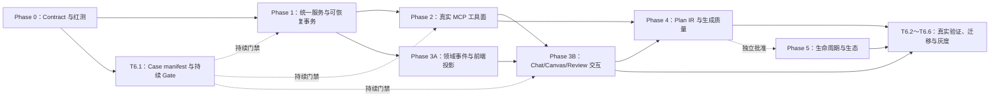

# aiops-v2 Workflow 画布 MCP 控制面实施 TODO 清单

> 状态：🟨 实施中
>
> 编写日期：2026-07-21
>
> 设计依据：[`docs/2026-07-21-aiops-v2-workflow-canvas-mcp-control-plane-design.zh.md`](../../2026-07-21-aiops-v2-workflow-canvas-mcp-control-plane-design.zh.md)
>
> 编写基线：分支 `fix/ci-fixture-head-isolation`，提交 `4b07998b77c108d12afc3162798a38e59d45d599`
>
> 适用主链：`MCP Registry/Agent Assembler -> RuntimeKernel -> ToolDispatcher -> Workflow MCP Adapter -> WorkflowEditApplicationService -> Runner CommitStore -> Domain Event Projection -> WorkflowWorkspaceProvider -> Canvas/Chat/Review`
>
> 核心约束：Runner Graph 是唯一事实源；MCP 是语义事务控制面；页面只消费服务端事实，不得自行伪造 Tool、Apply、Validation 或 Completed；每个非机械性 commit 最多修改 5 个生产文件且生产代码 churn 不超过 500 行。

## 0. 文档使用和状态更新规则

### 0.1 编写时已确认的代码事实

- [x] `web/src/pages/RunnerStudioPage.tsx` 当前约 3,754 行，并包含本地生成节奏、固定等待、默认 `script.python` 和 local patch 路径；后续只能减责。
- [x] `internal/workfloweditor/service.go` 当前持有 `MemoryWorkflowStore/appliedPatchIDs/undoSnapshots/patchQueue`，`session.go` 使用进程内 map；不能作为生产事务与恢复基础。
- [x] `internal/server/http.go` 当前 production 默认组装 `workfloweditor.NewService(nil)`，Runner、HTTP 和 MCP 尚未共享唯一 service/store。
- [x] `internal/integrations/workfloweditor/tools.go` 当前工具声明面大于真实实现面，缺少 v2 strict schema/structured result；未实现工具必须退出注册。
- [x] `internal/workfloweditor/planner.go` 当前可直接通过 ModelRouter 调模型；v2 必须把这条生产路径收回唯一 RuntimeKernel lifecycle。
- [x] Runner `workflowstore` 当前以裸 workflow name 定位文件；若要支持 tenant，必须先引入 canonical WorkflowKey 与 tenant namespace，不能只把 tenant 加进进程锁。
- [x] 当前 MCP Registry 的 Resource 主要是全局静态内容；current Workflow Resource 不能直接缓存其中，必须使用 request-scoped provider。
- [x] `pkg/runner/server/service/workflow_service.go`、`visual_workflow_service.go` 和 `cmd/ai-server/main.go` 分别约 991、1,908、1,320 行，只允许机械抽取和最小接线。
- [x] `pkg/runner` 是 nested Go module；Runner 测试必须在 `pkg/runner/` 工作目录执行。
- [x] `web/tests/e2e/workflow-ai-real-user.spec.js` 当前对关键 Chat/Workflow/MCP/Event API 使用 `page.route()`，只能算 mocked fixture，不能作为真实全栈证据。
- [x] `web/playwright.config.js` 当前只有 Chromium；`.github/workflows/aiops-v2-hardening.yml` 当前只跑 Web unit/build，没有运行 Playwright。
- [x] `internal/featureflag/flags.go` 明确禁止长期 migration old/new switch；本计划采用 capability exposure，唯一 Store/写路径不受 Flag 控制。

以上事实以编写基线为准；T0.1 必须在实施开始时重新核对并更新。

### 0.2 状态图例

| 状态 | 含义 |
|---|---|
| `⬜ 未开始` / `[ ]` | 尚未进入实施 |
| `🟨 进行中` / `[-]` | 已有代码或测试，但完成定义尚未全部满足 |
| `🟥 阻塞` / `[!]` | 存在明确外部阻塞；必须记录 owner、原因和解除条件 |
| `✅ 已完成` / `[x]` | 代码、测试、证据、文档和门禁全部满足 |
| `⏸ 延后` | 当前里程碑明确不实施，不能算作完成 |

### 0.3 每完成一个任务必须同步更新本文

- [ ] 把任务标题的状态从 `⬜` 更新为 `🟨` 或 `✅`，并勾选其全部子项。
- [ ] 在任务的“实施记录”中填写实际 commit、完成日期、负责人、真实修改文件和设计偏差。
- [ ] 在任务的“验证证据”中记录实际执行命令、退出码、测试数量和产物路径；未运行的检查必须写“未运行”和原因，禁止写成通过。
- [ ] UI 任务必须记录 Playwright trace/screenshot；达到 Phase exit、发布候选或改变 Workflow 主交互时，还必须记录 browser-in-app 的 build SHA、viewport、截图/录像、console 和最终 revision。
- [ ] 任何 schema/golden/screenshot baseline 更新必须单独审阅，并使用仓库要求的 `AIOps-Change-Exception`、`AIOps-Change-Reason`、`AIOps-Change-Review` trailers。
- [ ] 只有本 Phase 所有必做任务及退出门禁都完成，才能更新 Phase 状态；Phase 5 的延后项不能混入 MVP 完成率。
- [ ] 实施期间若 HEAD、目录边界或基础能力发生变化，先完成 `T0.1` 重新基线，再继续任务，不得照抄过期文件列表。

### 0.4 总体进度

| Phase | 目标 | 任务数 | 当前状态 | 退出证据 |
|---|---|---:|---|---|
| Phase 0 | Contract、失败基线和测试基础设施 | 5 | ✅ 已完成 | Schema golden、红测、manifest、基线报告 |
| Phase 1 | 唯一事实源和可恢复事务 | 11 | 🟨 进行中 | reload 一致、CAS/WAL/Outbox/Undo 全部通过 |
| Phase 2 | 真实 MCP 工具面和 Runtime 安全 | 8 | 🟨 进行中 | Core 5 tools 真实读/预览/应用/验证 Runner |
| Phase 3 | 原生实时画布和简单准确 UX | 13 | 🟨 进行中 | 真实 Candidate/receipt/event、Playwright 和 browser-in-app |
| Phase 4 | Plan IR、生成质量和 Dry-run 闭环 | 7 | 🟨 进行中 | valid/preview/placeholder 指标达标 |
| Phase 5 | 生命周期和外部生态 | 4 | ⏸ 延后 | 独立 ADR 和产品需求批准后执行 |
| Phase 6 | 迁移、灰度、全量验证和交付 | 6 | 🟨 进行中 | PR/Nightly/RC 门禁及回滚演练 |

合计 54 项：Phase 0～4 与贯穿式 Phase 6 共 50 项 MVP/交付任务；Phase 5 共 4 项明确延后任务。

### 0.5 2026-07-22 增量集成检查点

- 当前结论仍为 **🟨 实施中**，不能把本轮实现等同于 Phase 3/4/6 全部完成；Phase 5 继续 ⏸ 延后。
- 当前 54 项任务状态汇总：`31 ✅ / 19 🟨 / 4 ⏸`；33 个阶段性 Playwright Case 为 `27/33`。T4.7 在真实 Live Eval 失败后已从 ✅ 恢复为 🟨，不得用 recorded 结果代替真实模型门禁。
- 最新 Web 全量：Vitest `155 files / 1169 tests`、两个显式 `node:test` helper 文件 `8/8`、typecheck、production build 全部 exit 0；本轮先用已过期的固定 Candidate fixture 真实复现 7 个失败，再把有效候选过期时间改为稳定未来值后定向 `11/11`、全量转绿，未修改生产审批过期语义。构建有既存大 chunk 警告，未作为本任务内的隐性性能完成声明。
- 最新 Root Go normal/vet：`internal/appui`、`internal/integrations/workfloweditor`、`internal/server`、`internal/runtimekernel`、`internal/resourcebinding`、`internal/store`、`cmd/ai-server` 全部 exit 0；race：前四个目标包 exit 0。Runner normal/race/vet：`pkg/runner/workflow/edit`、`pkg/runner/workflowstore`、`pkg/runner/server/service`、`pkg/runner/server/api`、`pkg/runner/server/app` 全部 exit 0。
- 最新 Playwright：`runner-studio + workflow snapshot + accessibility + responsive` 在 Chromium/Firefox/WebKit 共 `69/69`；真实无 route mock full-stack harness 为 `3/3`，33 个阶段性 `PW-*` 已有 `27/33` 条真实实现与通过证据，剩余 `PW-001/011/029/030/032/033` 共 6 条。批量 13 条证据目录为 `${TMPDIR}/workflow-canvas-evidence/full-stack-20260722T030607Z-92820/`，`PW-009` 为 `full-stack-20260722T031749Z-32126/`，`PW-004` 为 `full-stack-20260722T032809Z-59609/`，`PW-019` 稳定复跑为 `full-stack-20260722T034443Z-7184/`，`PW-012` 的完整 History Undo/Redo 精确审批旅程为 `full-stack-20260722T040727Z-48763/`，`PW-014` 的请求后取消与刷新持久化旅程为 `full-stack-20260722T040750Z-49372/`，`PW-002` 的自然语言阈值修改、审批 Apply 与刷新持久化旅程为 `full-stack-20260722T054132Z-60638/`（42 个文本文件通过脱敏扫描），`PW-008/017/022/025` 的布局安全 rebase、断线恢复、精确字段修订与保留/放弃旅程为 `full-stack-20260722T054901Z-74272/`（118 个文本文件通过脱敏扫描），`PW-026` 的 disabled rollout 人工插入/连线/校验旅程为 `full-stack-20260722T054103Z-59441/`（28 个文本文件通过脱敏扫描），`PW-028` 的 500 节点/700 连线、100 项 Candidate 审阅与 99 次连续导航旅程为 `full-stack-20260722T060944Z-31300/`（66 个文本文件通过脱敏扫描），`PW-015` 的成功 Preview→typed Tool failure/repair exhausted 保留→同 thread 替换 Candidate 旅程为 `full-stack-20260722T064939Z-73363/`（63 个文本文件通过脱敏扫描），`PW-006` 的 Agent Candidate v1→Inspector v2→键盘布局 v3→最后版本精确审批→单卡确认→Apply→刷新持久化旅程为 `full-stack-20260722T070614Z-6368/`（44 个文本文件通过脱敏扫描）。
- 最新 Gate：PR profile `active=10 / planned=159 / expected-red=8 / pass=2 / fail=0 / missing=0 / skip=0`，manifest `169 cases / 26 fixtures`；未激活的 33 个 `PW-*` 仍不计入通过率。
- Codex 内置浏览器先在 `1280×720` 验证权威 `runner-blank` 为 `3 nodes / 2 edges`、自动保存、唯一 ContextDock，以及动作面板只展示 Shell/Python、不展示策略拒绝的 TCP Ping；随后在重新构建部署后模拟真实用户从 AI 作用域 `runner-blank` 切换到 `8-redis` 再切回，URL、页面标题与对话作用域同步一致，DOM 中无重复审批卡/框架错误层，console warn/error 为 0，最终移动端画布截图 `.data/evidence/workflow-canvas-20260722/browser-in-app-final.png`（真实 PNG，`425×863`，SHA256 `9bf12c07cef86f1076b14472e323d3afbc5c6acabcddc8b0f0e41004b92b16fb`）。2026-07-22 最新部署又在 `1095×863` 完成结构大纲收起/恢复：Outline `216→0px`、Canvas `429→645px`、恢复后回到 `429px`，按钮焦点和 `aria-expanded/aria-controls` 正确，console log 为 0、错误层为 0；最终页保留收起状态供验收。探索测试创建的 `runner-blank-2` 及活跃 Undo Candidate 已清理。
- 最新产品反馈已用“当前路由即 AI Workflow”取代 Composer 二次作用域选择；topbar slot + Portal 保持 lifecycle 单一 owner，并删除 Shell 第二行与“本次发送范围”模块。定向自动化为 Chromium `22/22`、Firefox/WebKit `20/20`；内置浏览器 `1095×863` 复验 lifecycle topbar/Shell 计数 `1/0`、scope 控件 `0`、水平溢出 `0`、console `0`，截图为 `.data/evidence/workflow-canvas-20260722/browser-in-app-topbar-ai-scope-final.png`。
- 2026-07-22 最新可用性反馈已继续收口：结构大纲与 Follow AI 状态条从生产 DOM 删除，Canvas 直接回收宽度；Header 的标题、保存/检查状态、唯一生命周期动作和工具栏在桌面保持同一行；命令失败改为右上角可关闭浮层，不再撑高或挤压画布。旧 YAML 工作流首次 typed command 会在语义/布局 identity 精确匹配时原子建立 CommitStore baseline，随后仍按 CAS/Receipt/Event 对账；不匹配继续返回 `STALE_REVISION`，没有降级成本地成功。Web 全量仍为 `155 files / 1169 tests`，新增相关 Go app/service/root regression 全部通过，最新 Runner UX Playwright 在 Chromium/Firefox/WebKit 为 `63/63`。内置浏览器在真实 `8-redis` 上从节点库新增 Shell Script，节点 `2→3`，最终“已自动保存”、错误浮层 `0`、console warn/error `0`；本次真实写入同时闭合了用户报告的 legacy add-node 失败。
- 本轮真实页面及 full-stack Case 还完成了 Add Python、键盘 Move、快速切换后 Delete、刷新 revision 对账、durable History Undo/Redo 的两次 Transport-owned 精确审批 Apply、高风险删除、双击 Apply 单事务、requested approval 的真实取消与刷新持久化、typed Preview 失败后保留并替换 Candidate、布局安全 rebase、断线后单一 Receipt 恢复、键盘精确字段编辑、Candidate 保留/放弃、Agent Candidate 两次直接修订后仅批准最后版本、500 节点/700 连线下 100 项 Candidate 连续审阅，以及 Agent capability 全关闭时的人工节点插入/自动连线/服务端校验；未完成项仍包括完整冲突选择与重算、五类 Artifact browser-in-app 全矩阵、故障注入、剩余 6 条 `PW-*`、5～8 位用户验收、灰度观察周期和远端 CI/RC URL。

### 0.6 2026-07-23 节点操作与工作流操作分层检查点

- 总体结论继续为 **🟨 实施中**；54 项任务状态和 33 个阶段性 `PW-*` 完成数不变，本检查点只闭合最新侧栏交互反馈，不能替代剩余 6 条 `PW-*`、外部用户验收、远端 CI/RC 或 Phase 5。
- 桌面交互已从“配置与全局工具混在一个 Dock”改为两个明确 owner：节点选择只挂载 `workflow-node-sidebar`；工作流级 AI/审阅/运行/历史使用默认收起的 overlay drawer，工作流 tabs 不再包含“配置”。工作流 drawer 打开时节点侧栏保持 mounted 但设为 `inert/aria-hidden`，关闭后原节点、Inspector 草稿和焦点恢复。
- 全局 drawer 开关和 AI→审阅→运行→历史切换不改变 Canvas 布局：内置浏览器无节点时 Canvas `x/width=101/1158`，drawer 开关差值均为 `0px`；节点侧栏打开时 Canvas `x/width=101/730`、节点侧栏 `420px`，再打开/关闭工作流 drawer 的 Canvas 差值仍为 `0px`。
- 移动端保留 `画布/AI/审阅/运行` 四模式，节点配置继续使用独立 full-screen sheet。真实首次点击暴露并修复了“配置请求先于 Inspector slot 挂载”的一帧时序问题；现在第一次点击 `Shell Script` 即打开节点配置，关闭后焦点返回 `canvas-node-script-shell`，390×844 水平溢出为 `0`。
- 验证：Web 全量 Vitest `155 files / 1171 tests`、typecheck、production build、diff-check 均通过；相关 Playwright 在 Chromium/Firefox/WebKit 为 `72/72`，更新并审阅的三浏览器视觉基线为 `3/3`，axe critical/serious 为 `0`。内置浏览器真实部署 URL `http://127.0.0.1:18080/runner/8-redis`，title `AIOps Codex MVP`，非空 DOM、alert/框架错误层/水平溢出/console warn-error 均为 `0`。

实施任务优先级（与 Case priority 分开）：

| 任务范围 | 实施优先级 |
|---|---|
| `T0.*～T3.*` | P0；对应 Phase 退出前必须完成 |
| `T4.1～T4.4/T4.6/T4.7` | P0；Phase 4 capability 打开前必须完成 |
| `T4.5` | P1；不阻塞 Phase 2/3，Phase 4 ELK capability 打开前必须完成 |
| `T6.1/T6.2/T6.3/T6.5/T6.6` | P0；按各 Phase checkpoint 增量完成 |
| `T6.4` | P1 交付基础设施；Nightly/RC 前必须完成 |
| `T5.*` | Deferred；仅在独立批准后激活 |

## 1. 实施目标、范围和不可破坏约束

### 1.1 本计划要交付的用户结果

- [x] 用户在当前 Workflow 页面中用自然语言描述修改；Composer 不再要求二次选择 Workflow/范围/环境，发送时由当前路由、当前选区和受信环境自动冻结 typed scope，已发送 Turn 仍显示其不可变“本轮基于”摘要。
- [ ] AI 通过真实 MCP Tool 读取 Runner Graph、Action Catalog，生成可审阅 Candidate；浏览器不再本地模拟 700ms 进度或伪造 Tool timeline。
- [ ] Canvas、Chat 和 Review 对同一个 Candidate、ChangeSet、transaction 和 revision 做双向定位，数量与对象一致率为 100%。
- [ ] 默认流程只有一个可持续修订的 Candidate Workspace；用户最后只做一次明确 Apply，Apply 后才改变 committed Graph。
- [ ] 页面分别表达“候选修改、已保存、待检查、还需配置、已发布、运行结果”，不再用一个“已完成”混淆生命周期。
- [ ] 手工画布编辑与 AI 修改使用同一 Application Service、revision、lock、validation、history 和 event 机制，不发生静默覆盖。
- [ ] 刷新、断线、重试、服务重启和进程崩溃后可以从持久化 snapshot/receipt/WAL/Event Log/outbox 恢复，不重复节点、不伪成功。
- [ ] 生成使用真实 Action Catalog、严格 Plan IR 和确定性编译器；通用 `script.python` 占位节点数量为 0。
- [ ] 关闭 Workflow Agent flag 后，人工画布仍正常工作，数据仍由 server-authoritative Store 管理。

### 1.2 明确非目标

- [ ] MVP 不把鼠标移动、拖拽帧、选中状态或 React Flow 内部事件做成 MCP Tool。
- [ ] MVP 不一次性增加几十个 `add_node/update_node/delete_node` 小工具；多步变更由一个严格、原子的 ChangeSet 承载。
- [ ] MCP 后端不再调用第二个 LLM“重新提议 Patch”；推理属于 Agent，后端只做确定性 compile/preview/validate/layout/apply。
- [ ] Phase 0～4 不引入 Yjs、MCP Apps、MCP Tasks 或外部 Streamable HTTP endpoint；它们属于 Phase 5 独立决策。
- [ ] 不迁移或信任旧进程内 `MemoryWorkflowEditor` 数据；localStorage 草稿只能由用户显式导入。
- [ ] 不借本项目重写 Runner 执行引擎、Chat transport 或整个 React Shell。

### 1.3 硬性架构不变量

1. **唯一事实源**：`VisualWorkflowService/WorkflowService` 管理的 Runner Graph、revision 和持久化文件是唯一 committed truth；HTTP、MCP、手工画布不得各自维护可写副本。
2. **唯一生命周期驱动**：Agent 回合仍由 `runtimekernel` 驱动；Workflow 页面不得创建第二套 Agent loop、页面私有 WS/SSE/polling 或直接绕过 `ToolDispatcher`。
3. **唯一 Chat 生产链**：Workflow Chat 复用 `TurnItem -> AiopsTransportState -> AssistantTransport -> assistant-ui`；不新增页面本地消息协议。
4. **语义事务**：Preview 与 Apply 引用同一个不可变 ChangeSet；Apply 必须绑定 `workflowId + candidateId/changeSetId + previewHash + expectedRevision + idempotencyKey`。
5. **明确授权**：`WorkflowEditGrant` 仅授权 Candidate 内连续修订；最终 `WorkflowApplyApproval` 一次性、不可转移、可过期/撤销，且不能由 MCP annotation 替代。
6. **提交准确性**：结构校验/compile 在 commit 前失败时 Graph 不变化；commit 后环境检查失败为 `saved_with_issues`，绝不能显示 `completed`。
7. **可恢复原子性**：所有写入口经过跨进程 lock、Store CAS、WAL/manifest、receipt、audit 和 transactional outbox；完成这些能力前只能标记为 single-process best effort。
8. **版本门禁**：save/check/dry-run/publish gate 绑定完整 ValidationBasis；语义修改使门禁 stale。layout-only commit 只有在服务端证明语义与其余 basis digest 未变后，才能为新 resourceVersion 重签/重发 artifact，不能直接复用旧版本 artifact。
9. **不可变运行目标**：普通“运行”默认使用 published revision；“试运行当前草稿”必须明确标注草稿和环境。
10. **事实只存一次**：前端 `WorkflowWorkspaceState` 只保存 raw facts；`WorkflowInteractionView` selector 派生 task/candidate/approval/connection/validation/lifecycle 轴，不维护第二份可写 UI 状态。
11. **用户语言优先**：默认界面不显示 MCP Tool 名、协议 envelope、原始 JSON、hash、revision 或 Secret；技术详情按需展开且必须脱敏。
12. **页面只减责**：现有约 3,754 行 `RunnerStudioPage.tsx` 不得承接新领域职责；涉及该文件的任务必须使其净减责或只做薄 composition。
13. **安全回退**：服务端失败时前端显示失败、离线草稿或待恢复，不得本地应用后伪装为已保存。
14. **通用能力**：不得为某个演示 Prompt、固定主机或关键词写特殊分支；能力以 schema、catalog、validator 和通用 fixture 验证。

## 2. 依赖顺序和可并行实施边界

### 2.1 关键依赖图



### 2.2 并行工作流和文件所有权

| 工作流 | 独占生产边界 | 可并行内容 | 禁止事项 |
|---|---|---|---|
| A：纯领域 | `pkg/runner/workflow/edit/**` | Contract、typed operation、diff、inverse、Plan IR/compiler | 不持久化、不调用模型、不修改 MCP/前端 |
| B：Runner 事务 | `pkg/runner/server/service/*workflow*`、`pkg/runner/workflowstore/**`、`pkg/runner/workflow/visual/**`、`pkg/runner/server/app/**` | Graph/validator/catalog、Candidate、CommitStore/WAL/Event facade | 不复制 edit 规则，不直接调用模型 |
| C：Root adapter/MCP | `internal/workfloweditor/**`（迁移兼容 owner）、`internal/integrations/workfloweditor/**`、`internal/mcp/runtime/**` | schema、adapter、tool handler、protocol result、删除旧内存/直调模型路径 | 不直接写 Runner Store |
| D：事件/HTTP 组装 | `internal/server/**`、`cmd/ai-server/main.go` | main `/ws` projection、startup wiring、兼容 HTTP | 不新增 Workflow 页面私有 socket |
| E：前端状态/Transport | `web/src/runner/workspace/**`、`web/src/api/runnerStudioClient.js`、必要的 `web/src/transport/**` | raw facts、selector、event reconcile、turn scope | 不持久化 committed truth |
| F：前端 UI | `web/src/runner/context/**`、`web/src/components/runner/**` | ContextDock、ghost diff、config/review/run panel | 不重新定义领域状态 |
| G：页面集成 | `web/src/pages/RunnerStudioPage.tsx`、旧 `WorkflowAi*` 迁移 | 薄 composition 和删除旧逻辑 | 单一 owner；该文件只减责 |
| H：测试/基线 | `testdata/workflow_canvas_mcp/**`、`web/tests/**`、Go `_test.go` | manifest、fixtures、golden、Playwright | 未评审不得更新 baseline |

并行规则：

- [ ] Phase 0 contract 合并前，各工作流只能增加失败测试/fixture，不得分别发明同名字段。
- [ ] 每个任务在开始时登记“文件租约”；同一文件只允许一个 active owner。
- [ ] 启动组装、生成类型和 `RunnerStudioPage.tsx` 由集成 owner 串行合并，其他 Agent 通过接口或 fixture 对接。
- [ ] 表内“建议生产文件”超过 5 个时必须按 `a/b` 子任务或多个 commit 拆分；测试文件不计生产预算，但仍要独立审查。
- [ ] 禁止以 `AIOps-Change-Exception` 掩盖行为变更超预算；超预算就继续拆分。

### 2.3 每个实施提交的固定门禁

```bash
export AIOPS_HARNESS_BASE_REF=<该任务开始前的已提交基线>
scripts/test-aiops-harness-contract-boundaries.sh
scripts/test-aiops-change-budget.sh
scripts/check-aiops-harness-contract-boundaries.sh
scripts/check-aiops-change-budget.sh
```

- [ ] 生产行为改动先提交能证明旧路径错误的 red test，再提交最小 green 实现。
- [ ] runtime 生产路径变化必须在同一 review range 修改包含 `RunTurn(` 或 `AssistantTransport` 的 story/integration test。
- [ ] 可见 UI 变化必须在同一 review range 修改含 `toHaveScreenshot(...)` 的 Playwright spec，并人工审查差异。
- [ ] 触及超过 800 行的核心文件时只允许抽取职责或修复现有责任，禁止继续塞入新职责。
- [ ] 发现重大 bug 时按仓库规范创建/更新 `fixbug.md`，记录根因、复现、修复和回归测试。

## 3. Phase 0：Contract、失败基线与测试基础设施

> 状态：✅ 已完成
>
> 目标：先把同一个 Graph、ChangeSet、Candidate、Receipt、Event 和 UI 状态说清楚，并让当前 split-brain、fake success 和本地模拟路径在测试中稳定失败。

### T0.1 ✅ 重新审计实施基线和现有分叉

**依赖**：无。

**建议文件**：只更新本文、测试证据或审计报告；不得修改生产代码。

- [x] 记录实际 HEAD、branch、dirty files、Go/Node/npm/Playwright 版本和启动方式。
- [x] 证明当前 HTTP WorkflowEditor、Runner Workflow service、MCP tools、浏览器本地 AI loop 的读写关系。
- [x] 记录 `RunnerStudioPage.tsx` 行数、fake delay、默认 `script.python`、本地 patch 和 production `NewService(nil)` 的精确位置。
- [x] 记录当前 `get_context -> preview/apply -> reload -> validate -> undo` 的真实/缺失能力矩阵。
- [x] 采集空画布、生成中、Preview、Apply、冲突、窄屏现状截图与 console/network 基线。
- [x] 测量首反馈、Apply-to-event、`W4` 大图、第一轮 preview valid rate、最终 valid rate、placeholder 数和 Preview/committed 误判基线。

**完成定义**：审计证据可复现设计文档第 2 节结论；如果代码已修复某个根因，后续任务必须据此删改，不能保留虚假 TODO。

**验证命令**：

```bash
git status --short
git rev-parse HEAD
rg -n "700|script\.python|NewService\(nil\)|propose_patch|apply_patch" \
  web/src/pages/RunnerStudioPage.tsx internal/workfloweditor internal/integrations/workfloweditor internal/server
```

**实施记录**：commit `未提交`；审计日期 `2026-07-21`；负责人 `root`。基线为 branch `fix/ci-fixture-head-isolation`、HEAD `4b07998b77c108d12afc3162798a38e59d45d599`；开始前 dirty 仅 `.gitignore` 和两份本设计/TODO 文档。版本：Go `1.26.1`、Node `24.14.0`、npm `11.9.0`、Playwright CLI `1.61.1`；启动命令 `AIOPS_STORE_DRIVER=json ./scripts/start.sh`，HTTP `127.0.0.1:18080`。

**分叉证据**：`RunnerStudioPage.tsx` 为 `3754` 行；fake delay 在 `:164`、`:502`，默认 `script.python` 在 `:544`、`:775`，本地 patch loop 在 `:2870`、`:3216`，API 失败后本地成功 fallback 在 `:3126-3143`、`:3358-3377`。生产 HTTP 在 `cmd/ai-server/main.go:362` 注入 `workfloweditor.NewService(nil, ...)`，默认 HTTP server 也在 `internal/server/http.go:177` 新建内存 Service；MCP `Register/Tools` 在生产组装中无调用。实测 Runner `GET /api/runner-studio/workflows/8-redis/graph` 返回 `resourceVersion=sha256:c567…`、3 nodes/2 edges，而同一 workflow 的 `POST /api/runner-studio/workflow-ai/snapshot` 返回 HTTP 400 `workflow not found`。因此当前矩阵为：Runner HTTP get/reload=真实；WorkflowEditor snapshot/preview/apply/undo=独立进程内存；patch validate=仅局部结构校验；MCP=未生产注册；浏览器确认计划后=本地逐步改 Graph、未发 apply/validate/reload 请求。

**UI 证据**：Playwright 产物位于 `output/playwright/workflow-baseline-{desktop,narrow,empty-canvas,ai-drawer,generating,preview,apply,conflict,w4}.png`；真实流程 network 仅出现 `workflow-ai/sessions` 与 `workflow-ai/plan`，确认后没有 apply/validate/reload，因此权威 Apply-to-event 为“未产生”；console 正常流程 0 error/0 warning，强制 409 conflict 基线产生 1 条 fetch error。CLI 首反馈全链路上界为 `7.4s`（页面先出现“正在思考”）；当前抽样中 3/3 AI 生成节点均为 `script.python`，可验证 Preview/最终 valid rate 均为 0%（未调用权威 validate），一次确认流程 1/1 把未提交本地 Graph 显示成“已完成修改”。临时 W4 真实图为 500 nodes/700 edges，导航到画布可见 `1401ms`，DOM 计数 499 node markers/699 edges；测量后已通过 DELETE 清理临时 workflow。

### T0.2 ✅ 建立机器可读 Case manifest 与公共 Fixture

**依赖**：T0.1。

**建议文件**：

- 新增 `testdata/workflow_canvas_mcp/test-manifest.json`
- 新增 `testdata/workflow_canvas_mcp/fixtures/*.json`
- 新增 `testdata/workflow_canvas_mcp/README.md`
- 新增 `internal/workflowtestmanifest/manifest.go`
- 新增 `cmd/workflow-test-manifest/main.go`
- 新增 `scripts/check-workflow-canvas-case-manifest.sh`
- 新增 `pkg/runner/testsupport/workflowfixtures/loader.go`
- 新增 `web/tests/helpers/workflowCanvasFixtures.js`

按 manifest/data、root loader/gate、Runner/Web consumers 三个提交拆分；任何单个提交仍需遵守文件预算。统一使用 JSON，避免 Web 为测试清单额外引入 YAML runtime 依赖。

- [x] 为每个 ID 写入 `priority/activationPhase/activationState/suite/selector/fixtures/browsers/capabilityTags/owner/evidence`；manifest 顶层写受保护的 `currentActivationPhase`。
- [x] 按 **case/tag** 激活而不是按前缀组；写入 `MCP-007/015`、`TXN-016`、`SEC-008/009/010`、`UI-025/026/027`、`PW-031/032/033`、`PERF-*`、`FI-*` 的例外 Phase。
- [x] 建立 `W0～W6`、`U-view/U-edit/U-publish/U-admin`、`Tenant-A/B`、`G-low/G-delete/G-expired/G-revoked`、`R17/R18`、`FP-*` fixture。
- [x] Phase 0 red regression 使用 `expectedOutcome=known_failure + expectedFailureSignature + greenActivationPhase`；Gate 只有在得到预期失败签名时整体成功，到 green Phase 后必须转换为普通 pass，不能让真正失败的 active Case 混入通过率。
- [x] Manifest 测试拒绝重复 ID、未知 fixture、缺少优先级、Phase 倒退、active -> planned、priority 降级、Case 删除和设计中存在但清单缺失的 ID。
- [x] 本地环境变量只允许把 current Phase 向上预演，不能降低仓库受保护的 `currentActivationPhase`；CI 与 review base 比较防降级。
- [x] Phase 5 Case 必须同时满足 `activationState=active` 和已批准 `capabilityTag`，不能因 Phase 数字到 5 一次激活所有可选生态。
- [x] 尚未激活 Case 明确显示 `planned`，不得计入通过率。

**完成定义**：169 个设计 Case 全部可被机器枚举；最小 loader/validator/selector/gate 能精确选择 `activationState=active && activationPhase <= currentActivationPhase` 的 P0/P1 Case，并正确处理预期 red。

**验证命令**：

```bash
go test ./internal/workflowtestmanifest -count=1
go run ./cmd/workflow-test-manifest validate \
  --manifest testdata/workflow_canvas_mcp/test-manifest.json
scripts/check-workflow-canvas-case-manifest.sh
(cd pkg/runner && go test ./testsupport/workflowfixtures -count=1)
(cd web && npx vitest run \
  tests/workflowCanvasMcpManifest.test.ts \
  tests/helpers/workflowCanvasFixtures.test.js)
```

**实施记录**：commit `未提交（按用户要求统一集成后再决定）`；完成日期 `2026-07-21`；负责人 `phase0_manifest / root 复核`；Case 数 `169`；Fixture 数 `26`。验证：`scripts/check-workflow-canvas-case-manifest.sh` exit 0（`cases=169 fixtures=26 active=11 phase=0`）；`go test ./internal/workflowtestmanifest -count=1` exit 0；`(cd pkg/runner && go test ./testsupport/workflowfixtures -count=1)` exit 0；Vitest `2 files / 6 tests` exit 0；`git diff --check` exit 0。

### T0.3 ✅ 冻结 v2 领域、MCP 与前端 Contract

**依赖**：T0.1、T0.2。

**建议生产文件（提交 A）**：

- 新增 `pkg/runner/workflow/edit/model.go`
- 新增 `pkg/runner/workflow/edit/errors.go`
- 新增 `internal/integrations/workfloweditor/schema_v2.go`

**建议生产文件（提交 B）**：

- `web/src/runner/workflowAiTypes.ts`（过渡兼容层，只允许减责）
- 新增 `web/src/runner/workspace/workflowContracts.generated.ts`
- 新增 schema codegen script/config

- [x] 决定 Go-first、JSON Schema-first 或单一 IDL 的 codegen 方向，并在 README/ADR 中记录唯一编辑源；不得让 `internal/workfloweditor` 和 Runner module 各自定义一套领域结构。
- [x] 定义严格 discriminated `WorkflowOperation` union；未知 operation/field 必须拒绝，禁止落入任意 `UI` map。
- [x] 定义 canonical `WorkflowKey{TenantID, WorkflowID}`，作为 Graph path、lock、Candidate、Approval、Receipt、WAL、Event、Resource URI 和 audit 的共同键；tenant/user 只能来自认证后的 trusted context。
- [x] 定义 `WorkflowContext`、revision 三元组、`ChangeSet`、Candidate、Grant、ApplyApproval、Receipt、Diagnostic、Conflict、Lifecycle Gate。
- [x] 定义 `ValidationBasis{resourceVersion, semanticHash, catalogVersion/actionSchemaDigest, referenceSnapshotHash, environmentBindingVersion}`；preview/validation/dry-run/post-check/publish artifact 绑定完整 basis，而不是只绑 Graph hash。
- [x] 定义 `WorkflowDomainEvent` envelope：`eventId/sequence/workflowId/resourceVersion/semanticHash/layoutHash/transactionId/candidateRevision/type/payload/occurredAt`。
- [x] 定义 Tool input/output schema、typed error code、`structuredContent` 与向旧 TextContent 的兼容摘要。
- [x] 明确 Secret 只允许 `secretRef`；schema/golden 中不得出现明文凭据字段。
- [x] 建立 Go ↔ JSON Schema ↔ TypeScript golden round-trip 与 backward-compat tests。

**完成定义**：前后端针对同一 fixture 序列化完全一致；Schema 之外字段和旧 `{status:"ok"}` 假成功会被测试拒绝。

**验证命令**：

```bash
go test ./internal/workfloweditor ./internal/integrations/workfloweditor -run 'Contract|Schema|Golden'
(cd web && npx vitest run src/runner/workspace/workflowContracts.test.ts)
(cd web && npm run typecheck)
```

**实施记录**：commit A/B `未提交（按审阅预算分为 model 与 schema/tool 两个切片）`；完成日期 `2026-07-21`；codegen 决策 `Go-first`，唯一编辑源记录于 `pkg/runner/workflow/edit/README.md`。验证：Runner contract tests exit 0；root WorkflowEditor/integration tests exit 0；Go↔TypeScript golden round-trip exit 0；Vitest `2 files / 13 tests`；`npm run typecheck` exit 0；secret/unknown op/unknown field/旧 `{status:"ok"}` 反例均被拒绝。

### T0.4 ✅ 冻结 UI 词汇、并行状态轴和交互验收契约

**依赖**：T0.3。

**建议文件**：设计/fixture/test 文件；本任务不实现生产 UI。

- [x] 固定 `task/candidate/approval/connection/validation/lifecycle` 六个正交状态轴及非法组合。
- [x] 固定用户词汇：`正在准备修改/待审阅/应用修改/已保存/待检查/还需配置/已发布/已保存但有问题/需要解决冲突`。
- [x] 固定 Candidate Apply 覆盖生命周期主操作的优先级，任意页面状态最多一个视觉主操作。
- [x] 固定 `ContextDock` 桌面 tabs：`AI/配置/审阅/运行`；移动端 modes：`画布/AI/审阅/运行`，节点配置为 full-screen sheet。
- [x] 固定 Chat/Review/Canvas 双向定位、scope chip、Follow AI 暂停、直接编辑 ghost Candidate 和冲突三方 diff 的交互语义。
- [x] 为“现在看到的是已保存版本吗”“是否检查过”“能否发布/运行”分别定义可测试页面答案。

**完成定义**：UI fixture 可以覆盖设计文档 8.10～8.15、10.7～10.14；文案无需技术字段即可表达真实状态。

**验证命令**：

```bash
(cd web && npx vitest run \
  src/runner/workspace/workflowWorkspaceSelectors.test.ts \
  src/runner/workflowAiViewModel.test.ts)
```

**实施记录**：commit `未提交`；完成日期 `2026-07-21`；负责人 `phase0_frontend_contract / root 复核`。`workflowInteractionContract` 冻结 6 个状态轴、非法组合、唯一主操作优先级、桌面/移动端模式、双向定位/Follow AI/三方 Diff、truth answers、稳定 testid/键盘/ARIA；Vitest 交互契约与 MCP contract 合计 `13 tests`，官方 typecheck 通过。

### T0.5 ✅ 建立当前错误路径的 red story/integration tests

**依赖**：T0.2、T0.3、T0.4。

**建议测试文件**：

- `internal/workfloweditor/*_test.go`
- `internal/integrations/workfloweditor/tools_test.go`
- `internal/server/*workflow*_test.go`
- `web/src/runner/*test*`
- `web/tests/e2e/workflow-ai-real-user.spec.js`

- [x] Red：MCP `get_context` 与 Runner HTTP 返回不同 Graph/revision。
- [x] Red：MCP apply 返回 ok 但 Runner reload 不变化，或 server 失败后浏览器本地显示已保存。
- [x] Red：Preview 被当成 committed、结构验证失败仍 completed、post-check 失败仍 completed。
- [x] Red：duplicate apply 生成重复节点；两个进程相同 expected revision 都成功。
- [x] Red：Tenant-A/B 的相同 workflowId 解析为同一文件，或无权限用户可 list/probe 另一 tenant 的 Workflow Resource。
- [x] Red：并发 Candidate revise、Approval revoke/apply 或双击批准导致两个 commit，或批准失败后被错误提前消费。
- [x] Red：刷新/断线后 Candidate/receipt 丢失，或旧 Candidate previewHash 仍可 Apply。
- [x] Red：页面 fake timer/default `script.python` 在未调用真实 MCP 时产生 Candidate。
- [x] Red：Chat、Review、Canvas 显示不同变更数或对象。
- [x] Red：高风险删除没有有效 Grant/ApplyApproval 仍落库。

**完成定义**：失败原因指向生产缺口而非测试环境；每条 red test 标注其 Case ID，Phase 1～4 按任务逐步转绿。

**验证命令**：

```bash
go test ./internal/workfloweditor ./internal/integrations/workfloweditor ./internal/server
cd web && npm test -- --run 'workflow|RunnerStudio'
npx playwright test e2e/workflow-ai-real-user.spec.js --project=chromium
```

**实施记录**：commit `未提交`；完成日期 `2026-07-21`；负责人 `root`。`AIOPS_WORKFLOW_KNOWN_FAILURE=1 go test ./internal/workfloweditor ./internal/server -run TestKnownFailure -count=1` 稳定 exit 1，精确命中 `TXN-002`（双 Service CAS）、`SEC-015`（Approval 重用）、`SEC-003`（tenant 碰撞）、`VAL-005`（无效结构 Preview）、`TXN-006`（重启后 Receipt 丢失）、`SEC-009`（高风险删除无 Grant/绑定 Approval）以及 Runner Graph 与 WorkflowEditor Snapshot 分裂；默认未设置环境时相同测试 exit 0/skip。Playwright `UI-012` 证明页面在零 authoritative apply 请求时显示“已完成修改”；`UI-005` 使用重复 change ID 证明 Chat/Review 两项与 Canvas 一个对象不一致；两条均为 `test.fail` expected-failure，定向 suite exit 0。所有 red 的失败文本均指向生产缺口，后续任务转绿时必须移除 expected-failure 标记并激活对应 manifest Case。

### Phase 0 退出门禁

- [x] `T0.1～T0.5` 全部完成，Phase 0 激活 Case 均有 owner 和自动化入口。
- [x] Schema/golden 通过；旧错误 regression 在未实现前稳定 red，且不是 flaky。
- [x] 首轮质量、性能、可用性和现状截图基线已归档。
- [x] 后续所有团队只从同一个 contract 生成/消费类型。

## 4. Phase 1：唯一事实源与可恢复事务

> 状态：🟨 进行中
>
> 目标：所有 HTTP、MCP 和手工画布写入最终都经过同一个 Runner facade、Application Service 和 CommitStore；先实现可靠数据面，再开放 Agent mutation。

### T1.1 ✅ 修正 semantic/layout hash 并暴露 Runner 窄 Facade

**依赖**：T0.3、T0.5。

**建议生产文件（提交 A：Hash）**：

- 新增 `pkg/runner/server/service/visual_workflow_hash.go`
- `pkg/runner/server/service/visual_workflow_service.go`（只机械迁出 helper）

**建议生产文件（提交 B：Facade）**：

- 新增 `pkg/runner/server/app/workflow_edit_facade.go`
- 新增 `internal/workfloweditor/runner_adapter.go`
- `pkg/runner/server/app/runtime.go`
- `internal/runnerembed/runtime.go`

- [x] 建立字段分类表：ports、edge handles、条件、变量绑定、Action 参数进入 semantic/contract hash；坐标、折叠、viewport 才进入 layout hash。
- [x] 证明修改端口会改变 semanticHash，纯节点移动只改变 layoutHash；旧 validation artifact 不得因懒重算被误标为有效。
- [x] Facade 只暴露 `GetGraph/GetHashes/ListActions/Validate/Compile` 和后续 Commit 接口，不向上层导出裸 Store。
- [x] Facade 和所有下游 API 接受 canonical WorkflowKey，不再用裸 workflow name；同 workflowId 的 Tenant-A/B 得到不同存储命名空间且互不可枚举。
- [x] 同一 Workflow 经 Facade 与 Visual API 读取的 Graph/revision/hash 完全相同。
- [x] `visual_workflow_service.go` 已超过 1,900 行，本任务在该文件只能删除/转调，不得新增领域逻辑。

**完成定义**：Runner adapter 成为后续 Application Service 的唯一 Graph 入口；hash 能准确区分语义和布局冲突。

**验证命令**：

```bash
cd pkg/runner
go test ./server/service -run 'TestVisualWorkflow.*Hash' -count=1
go test ./server/app -run 'TestWorkflowEditFacade' -count=1
cd ../..
go test ./internal/workfloweditor ./internal/runnerembed -run 'TestRunnerAdapter' -count=1
```

**实施记录**：commit A/B `未提交`；完成日期 `2026-07-21`；负责人 `phase0_manifest / root 复核`。Hash red 精确命中 port/sourceHandle/targetHandle 未改变 semantic hash 及旧 validation artifact 被复用，green 后定向与 `server/...` 全包通过；Facade/adapter 定向测试与相关全包通过。`visual_workflow_service.go` 机械净删 149 行，hash owner 新文件 180 行；Facade/adapter 生产约 203 行。v2 tenant namespace 不自动读取旧裸-name 数据，迁移留给 T6.6。

### T1.2 ✅ 实现 Typed Operations、Diff 与 inverse engine

**依赖**：T1.1。

**建议生产文件**：

- 新增 `pkg/runner/workflow/edit/apply.go`
- 新增 `pkg/runner/workflow/edit/diff.go`
- 新增 `pkg/runner/workflow/edit/inverse.go`

- [x] 在 isolated Graph clone 上 normalize/apply operation，输出 stable IDs、touched paths、Graph delta 和 inverse operations。
- [x] 第一切片支持 add/update node、add/update edge 和带明确 cascade policy 的安全 delete；其余 operation 保持 schema-level `planned`，不得注册假实现。
- [x] 同一 ChangeSet 内的 `clientRef` 可稳定引用前面新建的节点/边。
- [x] 更新只改变声明字段，完整保留 Node Type、ports、hidden End、layout、verified reference 和未触及参数。
- [x] 非法 port、悬空引用、unknown field/op 和任意字段落 `UI` 全部返回 typed diagnostics。
- [x] `apply(inverse(apply(G)))` 恢复相同 semanticHash；同路径后来被改动时 inverse 返回冲突而不是覆盖。

**完成定义**：`DOM-001～DOM-012` 激活并通过；Patch 规则只存在一份。

**验证命令**：

```bash
cd pkg/runner
go test ./workflow/edit -run 'TestApply|TestDiff|TestInverse|DOM-' -count=1
```

**实施记录**：commit `未提交`；完成日期 `2026-07-21`；负责人 `phase0_contract / root 复核`。新增 `apply.go/diff.go/inverse.go` 及测试，首批开放 add/update/delete node、add/update/delete edge；删除必须显式 `cascadeEdges`。`clientRef`、stable ID、typed diagnostic、端口/悬空引用校验、touched paths、Graph delta 和 path-guarded inverse 均由定向测试覆盖；`update_workflow/update_layout/attach_manual_binding` 保持未实现并返回 `OPERATION_NOT_IMPLEMENTED`，没有假注册。验证：定向测试与 `go test ./workflow/edit -count=1` 均 exit 0，`go vet ./workflow/edit` 和 `git diff --check -- workflow/edit` exit 0；生产边界 3 文件、500 行。

### T1.3 ✅ 持久化 Candidate Workspace、Grant 与 ApplyApproval

**依赖**：T1.2。

**建议生产文件（提交 A：Candidate CAS Store）**：

- 新增 `pkg/runner/server/service/workflow_candidate_store.go`
- 新增 `pkg/runner/server/service/workflow_candidate_file_store.go`

**建议生产文件（提交 B：Approval Store）**：

- 新增 `pkg/runner/server/service/workflow_approval_store.go`

- [x] Candidate revision 不可变，保存 base revision/hashes、normalized operations、previewHash、validation/risk/diff、actor/session/tool IDs、state 和 expiresAt。
- [x] Candidate 以 WorkflowKey 分区；`currentCandidateRevision` 使用 CAS。并发 `revise` 只能一个基于同一 current revision 成功，失败方得到可 rebase 的 typed conflict。
- [x] `revise` 产生 V2/V3 并把旧版本标记 superseded；旧 previewHash、过期或 abandoned Candidate 不能 Apply。
- [x] Candidate/Grant 跨刷新和服务重启可恢复；TTL/revoke 清理不删除长期 transaction audit。
- [x] `WorkflowEditGrant` 绑定 tenant/workflow/session/planHash/risk scope；不可转移，越界必须重新审批。
- [x] RuntimeKernel 的 blocked tool call + 用户批准是唯一交互批准；Dispatcher 把 server-owned、已验证的 approval binding 注入 trusted execution context，模型参数中的 tenant/user/approval 永远不被信任。
- [x] `WorkflowApplyApproval` 绑定最终 WorkflowKey/candidate/changeSet/previewHash/expectedRevision/actor，只能消费一次；不再额外弹出第二套 Workflow UI 审批。
- [x] Approval 的 issue/revoke/expire/revise/apply race 在同一 per-workflow correctness lock 下重验；最终 consume 由 T1.9 写入同一 WAL/Receipt commit，不在 preview 或 handler 预先消费。
- [x] 所有持久化内容做 secretRef 校验和 redaction；明文 Secret 测试必须失败。

**完成定义**：Candidate 可以连续修订但 committed Graph 不变；最终批准与最后展示的 Preview 精确绑定。

**验证命令**：

```bash
cd pkg/runner
go test ./server/service -run 'TestWorkflowCandidate|TestWorkflowEditGrant|TestWorkflowApplyApproval' -count=1
```

**实施记录**：commit A/B `未提交`；完成日期 `2026-07-21`；负责人 `phase0_frontend_contract / root 复核`。Candidate Store 使用 `<root>/<base64url tenant>/<base64url workflow>/<base64url candidate>/current.json` 与 immutable `revisions/%020d.json`，目录/文件权限 0700/0600；支持 tenant 分区、current CAS、并发 revise 单赢家、V1/V2/V3 supersede、TTL/abandon、精确 preview/changeSet eligibility、重启恢复和 inline credential fail-closed。Approval Store 持久化 Grant/ApplyApproval 全字段与 risk/operation budget 绑定，使用 server HMAC 验证的私有 trusted binding；issue/revoke/expire 与 `ConsumeWithCommit` 在 per-workflow lock 内重验，只有未来 Commit/WAL 回调成功才消费，失败可重试，并发双 consume/revoke 仅一个终态赢家。Candidate 定向/race/全包与 vet 在提交 A 完成时通过；Approval 隔离文件集 7 tests（15 项字段/预算表驱动）和 race/vet exit 0，生产 A/B 各 2/1 文件、499/499 行。跨进程最终原子消费由 T1.4/T1.9 接入同一 Commit transaction，不在本任务提前声称完成。

### T1.4 ✅ 实现跨进程锁、Store CAS 与幂等 Receipt

**依赖**：T1.1、T1.3。

**建议生产文件（提交 A：Commit contract/snapshot）**：

- 新增 `pkg/runner/server/service/workflow_commit_store.go`
- 新增 `pkg/runner/workflowstore/transaction_snapshot.go`

**建议生产文件（提交 B：atomic/lock）**：

- 新增 `pkg/runner/workflowstore/atomic.go`
- 新增 `pkg/runner/workflowstore/lock_unix.go`
- 新增 `pkg/runner/workflowstore/lock_windows.go`

- [x] 采用 immutable versioned transaction directory + atomic current-manifest pointer；所有 reader 只通过 CommitStore snapshot 读取，不能直接拼 YAML/meta/history 路径。
- [x] `Commit` 输入覆盖 WorkflowKey、expected version、Graph YAML、meta/history/import/rollback 结果、receipt、validation basis、checkpoint/inverse、approval consume、audit、event-log/outbox record。
- [x] 使用基于 WorkflowKey 的跨进程 lock、temp file、file fsync、atomic rename 和 parent-directory fsync；Store-level compare expected version，不能依赖先 `Get` 后 `Update`。
- [x] 先按 `(WorkflowKey,idempotencyKey)` 查询持久 Receipt；同 key + 同 request digest 返回旧 Receipt，同 key + 不同 candidate/preview/actor/payload 返回 `IDEMPOTENCY_KEY_REUSED`。
- [x] 两个 Store 实例对同一 expected revision 并发提交时只能一个成功，另一个返回 typed `STALE_REVISION`。
- [x] Tenant-A/B 使用相同 workflowId 时 path、lock、receipt 和 revision 仍完全隔离；测试禁止跨 tenant 枚举或探测存在性。
- [x] Unix/Windows lock 实现分别编译并有平台契约测试。

**完成定义**：`TXN-001～TXN-007` 的 CAS/幂等基础通过；不再存在“两个请求都越过预检查”的写入窗口。

**验证命令**：

```bash
cd pkg/runner
go test -race ./workflowstore ./server/service \
  -run 'TestWorkflowCommit.*(CAS|Idempot)|TXN-00[1-7]' -count=1
GOOS=windows GOARCH=amd64 go test -c ./workflowstore \
  -o "${TMPDIR:-/tmp}/workflowstore-windows.test.exe"
```

**实施记录**：commit A/B `未提交`；完成日期 `2026-07-21`；负责人 `phase0_manifest / root 复核`。提交 B 新增 canonical WorkflowKey SHA-256 namespace、traversal/symlink 防护、temp→file fsync→rename→parent fsync 原子写、Unix `flock` 和 Windows `LockFileEx`；真实子进程互斥、tenant/delimiter 隔离通过。提交 A 新增完整 `WorkflowCommitInput`、immutable version transaction snapshot、digest 校验的 atomic current manifest、Store CAS、持久 receipt replay/reuse guard 与 tenant 隔离；所有复合对象以 strict typed envelope 纳入同一 snapshot。主线复核 `go test -race ./workflowstore -count=1`、CommitStore 隔离 race test、Linux/Windows amd64 `go test -c` 均 exit 0；生产 A/B 分别 2/3 文件、424/412 行。WAL 多阶段恢复和 failpoint 属于 T1.5，不混入本任务完成声明。

### T1.5 ✅ 增加 WAL、Durable Event Log、delivery outbox 和 audit

**依赖**：T1.4。

**建议生产文件（提交 A：WAL/recovery）**：

- 新增 `pkg/runner/server/service/workflow_commit_wal.go`
- 新增 `pkg/runner/server/service/workflow_commit_recovery.go`
- `pkg/runner/server/service/workflow_commit_store.go`

**建议生产文件（提交 B：Event Log/outbox）**：

- 新增 `pkg/runner/server/service/workflow_event_log.go`
- 新增 `pkg/runner/server/service/workflow_outbox.go`

- [x] 实现 `prepared -> snapshot_committed -> committed` manifest，保存 immutable snapshot digest、receipt、validation basis、approval consume、checkpoint、audit、event log 和 outbox。
- [x] 启动恢复时 current pointer 已切换则补齐 receipt/event/outbox；未切换则安全丢弃 prepared。并发 reader 在任一 failpoint 只能看到旧完整 snapshot 或新完整 snapshot。
- [x] Durable Event Log 是 replay source；delivery outbox 只保存待投递状态，不能承担历史回放。两者共享稳定 eventId 但有不同生命周期。
- [x] Candidate revise transaction 原子写 Candidate revision + candidate event；Graph commit 原子写 snapshot + transaction event；manual/MCP/undo 共用 per-WorkflowKey sequencer。
- [x] Outbox 以 eventId/transactionId 去重，可重试发布；发布失败不回滚已提交 snapshot，也不能提前显示 completed。
- [x] 通过注入接口实现仅测试可用的 failpoint：prepared、snapshot/current-pointer commit、receipt、event-log/outbox ACK、磁盘满、rename/fsync 失败。
- [x] ImportBundle、Rollback、meta/history/current pointer 和 parent-dir fsync 全部进入 manifest/recovery 测试，不能只测单个 Graph 文件。
- [x] Audit 关联 tenant/user/session/turn/toolCall/changeSet/transaction/before-after revision，不记录 Secret 或完整敏感输入。

**完成定义**：`TXN-008～TXN-012/TXN-017/FI-008` 全通过；任何 crash point 重启后 Graph、receipt、outbox 收敛一致。

**验证命令**：

```bash
cd pkg/runner
AIOPS_WORKFLOW_FAILPOINT_TEST=1 go test ./server/service \
  -run 'TestWorkflowCommit(Recovery|Multiprocess|Failpoint)|FI-008' -count=1
```

**实施记录**：commit A/B `未提交`；完成日期 `2026-07-21`；负责人 `phase0_manifest / root`。提交 A 已实现 500 行生产预算内的 WAL/recovery：`prepared -> snapshot_committed -> committed/discarded`、immutable snapshot digest、current-pointer 判定、receipt/event/outbox 幂等恢复 callback、测试专用 failpoint及 disk-full/rename/fsync 分类；提交 B 已实现按 WorkflowKey 分区的 Durable Event Log 和独立 Outbox，并以 immutable Candidate fact 原子保存 revision + candidate event、幂等恢复 manifest/event projection。manual/MCP/undo 共用 durable per-WorkflowKey sequencer；Audit 完整关联身份与 revision 且递归脱敏/省略原始输入。新增 failpoint 证明 current pointer 切换后崩溃重启仍完整保留 Graph、meta/history、Import/Rollback。根级复核 `AIOPS_WORKFLOW_FAILPOINT_TEST=1 go test -race ./server/service -run 'TestWorkflowCommit(Recovery|Multiprocess|Failpoint)|FI-008|TestWorkflowCommitStore' -count=1`、Candidate/Event/Audit 定向 race、`go test -race ./workflowstore -count=1`、`go vet ./server/service ./workflowstore` 和 diff-check 均 exit 0。

### T1.6 ✅ 把 Visual SaveGraph 和全部 Graph 写入口收口到 CommitStore

**依赖**：T1.4、T1.5。

**建议生产文件（提交 A：Visual）**：

- 新增 `pkg/runner/server/service/visual_workflow_write.go`
- `pkg/runner/server/service/visual_workflow_service.go`（只删除旧写逻辑并代理）
- `pkg/runner/server/app/runtime.go`

**建议生产文件（提交 B：边界）**：

- 新增 `pkg/runner/server/service/workflow_write_paths.go`
- `pkg/runner/server/service/workflow_service.go`（只机械收口）
- `pkg/runner/workflowstore/store.go`

- [x] `SaveGraphWithOptions` 在 compile 后把 expected version、Graph、validation artifact 交 CommitStore。
- [x] Create/Update/Rollback/ImportBundle/人工 command 的 Graph mutation 全部进入同一 CommitStore。
- [x] Get/List/History/Reload 同步改为读取 tenant-namespaced current snapshot；没有 reader 可在 pointer 切换期间观察 YAML/meta/history 混合版本。
- [x] 增加 AST/boundary test：除 CommitStore/atomic store 外，不允许直接 `store.Put`、`os.WriteFile` 或绕过 CAS 的 Graph write。
- [x] `workflow_service.go` 已约 991 行、`visual_workflow_service.go` 已约 1,908 行；两个文件都只能净减责。
- [x] 本任务只改变写入所有权，不同时改变 API payload 或 UI 行为。

**完成定义**：人工 HTTP、兼容 API 和将来的 MCP mutation 使用同一 lock/CAS/WAL；没有第二条生产写路径。

**验证命令**：

```bash
cd pkg/runner
go test -race ./server/service ./server/api ./workflowstore \
  -run 'TestVisualWorkflow.*(Concurrent|ResourceVersion)|TestWorkflowWriteBoundary|TestWorkflow.*(Rollback|Import)' -count=1
```

**实施记录**：commit A/B `未提交`；完成日期 `2026-07-21`；负责人 `phase0_manifest / root`；收口入口 `SaveGraphWithOptions/Create/Update/Delete/ImportBundle/Rollback/Publish/Validate/DryRun/人工 command`。VisualWorkflow 与 WorkflowService 写路径统一进入 `WorkflowCommitStore`；Get/List/History/GetVersion/Reload commit-first，legacy YAML 仅作只读迁移回退。CAS、opaque resourceVersion、tenant 隔离、幂等、tombstone 删除/复活、完整 history 与 import/rollback/validation/lifecycle typed artifact 均来自原子 snapshot；Runtime 只组装一个 CommitStore，legacy `workflowstore.Put` fail-closed，AST boundary 禁止重新引入直接文件写。生产增量 498 行且两个巨型 service 均净减责；在 T1.9 中间态开始前，全四包、定向 race、边界、vet、build 与 diff-check 均通过，T1.9 收口后将再次执行全量回归。

### T1.7 ✅ 实现 Application Service 读侧和真实 Validate/Compile

**依赖**：T1.1、T1.6。

**建议生产文件**：

- 新增 `pkg/runner/server/service/workflow_edit_application.go`
- 新增 `pkg/runner/server/service/workflow_edit_queries.go`
- `pkg/runner/server/app/workflow_edit_facade.go`

- [x] 实现 `GetContext` 的 summary/selection/neighborhood/full 分级和 cursor/pagination；默认不把大 Graph 全量复制进 prompt。
- [x] Selection context 包含选择时的 workflow/revision/node/edge/neighborhood/environment，并能报告 stale selection。
- [x] `GetActionCatalog` 使用真实 Action Catalog、参数 schema、ports、权限和 capability，不返回固定模板。
- [x] `Validate` 同时调用真实 visual validator、compile、Action 参数和 reference guard；不再硬编码 `Valid:true`。
- [x] 读结果返回 resourceVersion/semanticHash/layoutHash，且与 Runner API 相同。

**完成定义**：W0～W6 经统一 service 读取和校验；hidden End、ports、reference、缺 Secret 等信息不丢失。

**验证命令**：

```bash
cd pkg/runner
go test ./server/service ./server/app \
  -run 'TestWorkflowEdit.*(Context|Catalog|Validate)|TestWorkflowFixtureContract' -count=1
```

**实施记录**：commit `未提交`；完成日期 `2026-07-21`；负责人 `phase0_contract / root`。读侧 Application Service 已实现 authoritative snapshot/hash、分级 Context、真实 Catalog/access、真实 validate/compile/reference guard；生产 Facade 编译期实现该 backend，并由 Runtime 唯一组装/复用同一 Application。默认 action/reference adapter 均 fail-closed，真实 checker 使用 canonical tenant storage name。根级复核 `go test -race ./server/service ./server/app -run 'TestWorkflowEdit.*(Context|Catalog|Validate)|TestWorkflowEditFacade|TestRuntime.*WorkflowEdit' -count=1`、`go test ./server/service ./server/api ./server/app -count=1`、`go vet ./server/app` 均 exit 0。

### T1.8 ✅ 实现 Preview、Candidate revise 和安全 layout rebase

**依赖**：T1.2、T1.3、T1.7。

**建议生产文件**：

- 新增 `pkg/runner/server/service/workflow_edit_preview.go`
- `pkg/runner/server/service/workflow_edit_application.go`

- [x] 流程固定为 normalize operations -> isolated apply -> real validate/compile -> diff/risk/inverse -> persist Candidate。
- [x] Preview 绝不改变 committed resourceVersion；返回 `candidateRevision/previewHash/validationBasis/diagnostics/risk/diff`，previewHash 覆盖 normalized operations 与完整 basis。
- [x] 用户直接修改 ghost node/edge 时以 `baseChangeSetId + additionalOperations` 生成新不可变 Candidate revision。
- [x] 只对 allowlist 中 semanticHash 不变的 layout drift 自动 rebase；same-field、port 或语义 drift 生成结构化三方冲突。
- [x] 新 Candidate 完成后旧 Candidate 立即 superseded，但保留审计链和可比较 diff。

**完成定义**：Candidate V1/V2/V3 可恢复、可审阅，committed Graph 始终不变；旧 previewHash 无法进入 Apply。

**验证命令**：

```bash
cd pkg/runner
go test ./server/service \
  -run 'TestWorkflowEditPreview|TestWorkflowCandidateRevision|TestWorkflowLayoutRebase' -count=1
```

**实施记录**：commit `未提交`；完成日期 `2026-07-21`；负责人 `phase0_frontend_contract / root`；rebase allowlist `semanticHash 未变且仅涉及不相交 position/viewport 的 layout drift，或 committed Graph 无漂移`。已实现服务端生成完整 `ValidationBasis`，按 normalize → isolated apply → 真实 validate/compile → diff/risk/inverse → Candidate persist 的单一路径工作；Preview 不修改 committed Graph，Candidate JSON 不携带完整 Graph。`baseChangeSetId + additionalOperations` 生成不可变 V1/V2/V3 并使旧版本 superseded，旧 revision/previewHash 无法进入 Apply；same-field、port、semantic 和未分类 Graph drift 均返回 typed three-way conflict。专项、race、vet 与 diff-check 均通过；全量 service 当前暴露的写入口回归归属 T1.6，并已单独跟踪。

### T1.9 ✅ 实现精确 Apply、pre-commit gate 和 post-check 状态

**依赖**：T1.5、T1.6、T1.8。

**建议生产文件**：

- 新增 `pkg/runner/server/service/workflow_edit_apply.go`
- 新增 `pkg/runner/server/service/workflow_postcheck.go`
- `pkg/runner/server/service/workflow_edit_application.go`

- [x] 从 trusted execution context 校验 WorkflowKey/actor/candidate/changeSet/previewHash/expectedRevision/idempotency/Grant/ApplyApproval/reference lock 的完整绑定；模型参数只能与 trusted identity 比较，不能补全它。
- [x] 在 working copy 上完整 validate/compile；失败时不写 Graph、不消费可重试的幂等结果为 success。
- [x] 使用 CommitStore 原子提交 snapshot、Receipt 和 Approval consume；revoke/apply race 在锁内重验。失败前不消费，成功后不能二次使用。
- [x] 重复请求只有在 WorkflowKey/idempotency/request digest 全相同时返回同一 transaction/revision；不同 payload 使用同 key 明确拒绝。
- [x] commit 后进入 `verifying`；只有完整 ValidationBasis 相同的 validation/post-check artifact 才能进入 `completed/ready`。
- [x] 缺环境/secret 返回 `configuration_required`；post-check/Dry-run 失败返回 `saved_with_issues`，Graph 保留但 publish/run gate 关闭。
- [x] UI/Agent 最终状态只能从 Receipt/ValidationArtifact 推导，不能从模型 final 文本推导。

**完成定义**：invalid apply 不落库；响应丢失可查 receipt；不再出现 invalid completed 或重复 transaction。

**验证命令**：

```bash
cd pkg/runner
go test -race ./server/service -run 'TestWorkflowEditApply|TestWorkflowPostCheck|TXN-' -count=1
```

**实施记录**：commit `未提交`；完成日期 `2026-07-21`；负责人 `phase0_frontend_contract / root`；状态映射 `verifying -> completed | completed_with_warnings | configuration_required | saved_with_issues`。Apply 从 immutable Candidate、持久 Grant/ApplyApproval 与认证 selector 服务端投影全部可信字段，模型参数只能相等匹配；working copy 通过真实 validate/compile/hash gate 后，CommitStore 与 ApprovalStore 在同一 WorkflowKey 锁内原子提交 snapshot/Receipt/消费记录。幂等 replay、同 key 异 payload、revoke/apply race、响应恢复和 post-check basis CAS 均由 race test 覆盖；失败不落 Graph、不提前消费、不产生 completed。`go test -race ./server/service -run 'TestWorkflowEditApply|TestWorkflowPostCheck|TestWorkflowValidateChange|TestWorkflowResolveTrustedApplyContext|TestWorkflowApproval|TestWorkflowCommitStore' -count=1`、service 全包、vet 与 diff-check 通过。

### T1.10 ✅ 实现 durable History、Undo 和 Redo

**依赖**：T1.2、T1.5、T1.9。

**建议生产文件**：

- 新增 `pkg/runner/server/service/workflow_edit_history.go`
- `pkg/runner/server/service/workflow_edit_application.go`

- [x] 每个 transaction 持久化 inverse operations、touched paths 和 checkpointId。
- [x] Undo/Redo 自身都是新 ChangeSet/transaction，重新经过 preview、approval、CAS 和 validate。
- [x] Undo 触及后来已被修改的同一路径时返回 conflict；不允许无条件覆盖整个旧 Graph snapshot。
- [x] “撤销本次 AI 会话”按 transaction 逆序生成组合 inverse ChangeSet，并支持先审阅再 Apply。
- [x] 服务重启后 history/undo/redo 仍可用且 audit 链连续。

**完成定义**：`TXN-013～TXN-016` 通过；Undo 不破坏后续合法修改。

**验证命令**：

```bash
cd pkg/runner
go test ./server/service -run 'TestWorkflowEdit(History|Undo|Redo)|TXN-01[3-6]' -count=1
```

**实施记录**：commit `未提交`；完成日期 `2026-07-21`；负责人 `workflow_history / root`；保留策略 `CommitStore current generation 以内的 immutable transaction snapshots，按 transactionId 去重并验证路径与内容身份`。History 从持久 snapshot 关联 Candidate/audit/receipt；Undo/Redo 只生成新 Candidate，不直接 commit 或伪造 receipt；支持单 transaction 和 AI session 逆序组合 inverse，同路径后续修改返回 typed `STALE_REVISION`，不相交修改保留。`go test -race ./server/service -run 'TestWorkflowEdit(History|Undo|Redo)|TXN-01[3-6]' -count=1`、service 全包与 `go vet ./server/service` 均 exit 0。

### T1.11 ✅ 统一兼容 HTTP 与手工 Canvas command

**依赖**：T1.6～T1.10。

**建议生产文件（提交 A：HTTP/manual adapter）**：

- 新增 `internal/server/workflow_edit_commands.go`
- `internal/server/runner_studio_workflow_ai.go`
- `internal/server/http.go`

**建议生产文件（提交 B：旧 service 退为兼容层）**：

- `internal/workfloweditor/service.go`
- `internal/workfloweditor/session.go`
- `internal/workfloweditor/patch.go`
- `internal/workfloweditor/types.go`

**建议生产文件（提交 C：Client）**：`web/src/api/runnerStudioClient.js`。

- [x] 旧 HTTP endpoint 仅做 request/response 兼容适配，注入统一 Application Service，不再 `NewService(nil)`。
- [x] `internal/workfloweditor` 旧 `MemoryWorkflowStore/appliedPatchIDs/undoSnapshots/patchQueue/SessionStore` 退出生产状态所有权；仅测试 fixture 可显式构造 Memory 实现。
- [x] 旧 `patch.go/types.go` 代理或转换到 canonical `runner/workflow/edit` contract，不再允许任意 `Fields map` 写入 `Graph.UI`。
- [x] 手工 add/update/delete/connect/move 命令携带 expected revision/idempotency，并获得同类型 Receipt/Event。
- [x] move/viewport 命令按 layout-only 分类，drag-stop 一次提交，不把拖拽帧做成 MCP。
- [x] 服务端失败时返回 typed error，前端不得 fallback 为本地已保存。
- [x] 增加 boundary test，证明 HTTP、MCP（下一 Phase）和人工 command 无独立 Store。

**完成定义**：Agent 工具尚未开放时，人工画布已完整运行在唯一数据面上；关闭 AI 不影响人工编辑。

**验证命令**：

```bash
go test ./internal/server ./internal/workfloweditor \
  -run 'TestWorkflow.*(Command|Compatibility|SingleService|NoMemoryFallback)' -count=1
cd web && npx vitest run src/api/runnerStudioClient.test.js
```

**实施记录**：commit A/B/C `未提交`；完成日期 `2026-07-21`；负责人 `legacy_http_compatibility / root`。旧 `snapshot/validate/preview/apply` 严格解码并代理唯一 Runner `WorkflowEditApplication`；`plan/patch/sessions/undo/create-draft` 等不能安全转换的入口返回 typed 410。trusted tenant/actor/canvas/session 仅来自 HTTP resolver；full Graph、UI/runtime map、任意 Fields、伪造身份和 Secret 均被拒绝。手工命令使用 expected revision/idempotency 和同一 Receipt/Event；旧内存 Service 仅可显式用于测试且 production fail closed。修复批量重复 operation kind 被误当成重复审批消费的问题：审批 envelope 使用稳定去重 kind 集合，独立 `OperationCount` 执行真实数量上限并兼容旧记录。兼容 endpoint 集成故事完成旧 preview/apply → 新 manual command → Runner reload → 重放，重放不推进 revision。验证 `go test -race ./internal/server -run 'TestWorkflowCompatibility|TestWorkflowCompatible|TestWorkflowControlPlane' -count=1`、Runner service 定向 race/full、root boundary/vet、`npx vitest run src/api/runnerStudioClient.test.js` 和 diff-check 均 exit 0（Client 4 tests）。

### Phase 1 退出门禁

- [ ] `T1.1～T1.11` 全部完成；`DOM-*`、`TXN-*`、`FI-008` 已激活 P0/P1 全通过。
- [ ] MCP/HTTP/manual 未来共用的 facade 和 CommitStore 已在 production wiring 中唯一实例化；Memory Store 不再是生产 fallback。
- [ ] Apply 后 Runner API、磁盘 Store、服务重启后的 Graph/revision 完全一致。
- [ ] 双进程 CAS、全部 WAL failpoint、idempotency、Undo/Redo 和 Secret redaction 通过。
- [ ] 本阶段没有对用户宣称“完整原子性”而仍保留未收口写入口。

## 5. Phase 2：真实 MCP 工具面与 Runtime 安全

> 状态：🟨 进行中
>
> 目标：把 Core 5 tools 真正接到 Phase 1 的统一 Application Service，并由 Registry/RuntimeKernel/ToolDispatcher 执行；未实现工具不注册。

### T2.1 ✅ 扩展统一 ToolResult 和 MCP lifecycle negotiation

**依赖**：T0.3、T1.7。

**建议生产文件（提交 A：Canonical Result/Dispatcher）**：

- `internal/tooling/types.go`
- 新增 `internal/tooling/result_validator.go`
- `internal/runtimekernel/dispatch.go`

**建议生产文件（提交 B：MCP adapter）**：

- `internal/mcp/runtime/client.go`
- `internal/mcp/runtime/tool_adapter.go`

**建议生产文件（提交 C：Protocol）**：

- `internal/mcp/runtime/http_client.go`
- `internal/mcp/runtime/runtime.go`
- `internal/mcp/runtime/client.go`

- [x] ToolResult 新增 typed `structuredContent/isError`，保留短 Content/Error 和现有 `References`；Resource Link 映射到 `References`，不新增第二份易漂移的 resourceLinks。
- [x] 共享 validator 同时覆盖本地 StaticTool/Core 5 与动态 MCP adapter；所有声明 outputSchema 的工具都在 Dispatcher 边界校验。
- [x] Dispatcher 把 `isError=true` 作为 tool execution failure，保留 typed diagnostics 到 lifecycle/transport，不能按 Content 非空误判成功。
- [x] Adapter 保留 structured result，调用方不再二次解析 JSON string；Tool execution error 与 protocol/transport error 分离。
- [x] Client 维护 supported protocol versions，完成 initialize -> notifications/initialized；后续 Streamable HTTP 请求携带协商版本。
- [x] 兼容 `2025-03-26`，新 capability 只在协商后使用；不假设所有 server 支持文档最新版本。
- [x] 支持 progress/cancellation 的稳定 token 传递，取消不会误写 completed。

**完成定义**：旧工具仍可读取 Content；本地 Core tool 与动态 MCP tool 都获得同一结构化结果/错误语义，protocol golden 通过。

**验证命令**：

```bash
go test ./internal/tooling ./internal/runtimekernel ./internal/mcp/runtime \
  -run 'Test.*(StructuredContent|OutputSchema|IsError|Protocol|Initialize|Progress|Cancel)' -count=1
```

**实施记录**：commit A/B/C `未提交`；完成日期 `2026-07-21`；负责人 `root / phase0_frontend_contract`。Canonical `ToolResult`、共享 output-schema validator、Dispatcher `isError`、标准 MCP content/resource-link adapter 已统一；Client 完成 `initialize -> initialized -> list`、`2025-03-26/2025-06-18` 白名单协商、session/protocol header、stable request/progress token、cancel notification 和显式 legacy fallback。根级复核 `go test ./internal/tooling ./internal/runtimekernel ./internal/mcp/runtime -run 'Test.*(StructuredContent|OutputSchema|IsError|Protocol|Initialize|Progress|Cancel)' -count=1`、`go test ./internal/mcp/... -count=1`、`go vet ./internal/mcp/runtime ./internal/tooling ./internal/runtimekernel` 均 exit 0。

### T2.2 ✅ 实现只读 Core tools 与 Workflow Resources

**依赖**：T1.7、T2.1。

**建议生产文件（提交 A：Workflow read tools）**：

- 新增 `internal/integrations/workfloweditor/tools_v2_read.go`
- 新增 `internal/integrations/workfloweditor/resources_v2.go`
- `internal/integrations/workfloweditor/schema_v2.go`
- `internal/integrations/workfloweditor/register.go`

**建议生产文件（提交 B：通用 scoped Resource Provider）**：

- 新增 `internal/mcp/resource_provider.go`
- `internal/mcp/registry.go`
- `internal/integrations/mcpresources/tools.go`

- [x] 实现 `workflow.get_context` 与 `workflow.get_action_catalog`，每次读取真实 Runner facade。
- [x] Context 支持 selection/neighborhood/full 预算和 stale revision；大对象通过分页 Resource/Resource Link 返回。
- [x] 实现 request-scoped ResourceProvider：从 trusted WorkflowKey/user scope 每次调用 Application Service；当前 draft 正文不得缓存到全局静态 Registry。
- [x] Workflow context/catalog/change-set/transaction 使用 revision-addressed opaque/signed URI，声明真实 read/pagination 能力；无权限用户既不能读取、list，也不能从错误差异推断资源存在。
- [x] 默认 TextContent 只给用户可读摘要，Graph 不重复塞进原始 JSON 文本。
- [x] 所有请求以认证后的 WorkflowKey 做 tenant/RBAC/scope 校验；只读工具的模型可见 schema 不暴露 tenant/workflow/user/session，mutation/compile 的显式身份字段只能匹配 trusted context，不能改变 scope。
- [x] 将 `MCP-004/SEC-003` 从 Phase 0 expected-red 转绿，并用 W0～W6 公共 Fixture 证明 MCP 与 Runner HTTP 的 Graph/revision/hash 一致及跨 tenant 不泄漏。

**完成定义**：MCP get_context 与 Runner HTTP 对 W0～W6 返回相同 Graph/revision/hash；Resource 不泄漏其他 tenant。

**验证命令**：

```bash
go test ./internal/integrations/workfloweditor \
  -run 'TestWorkflow(GetContext|ActionCatalog|Resources)|MCP-|SEC-' -count=1
```

**实施记录**：commit A/B `未提交`；完成日期 `2026-07-21`；负责人 `phase0_contract / workflow_test_matrix / root`；Resource URI `AES-256-GCM 自包含 opaque revision URI`。只注册真实 `workflow.get_context/get_action_catalog`；只读工具从不可变 Turn Artifact/认证上下文注入 trusted tenant/workflow/user/session，模型可见 schema 仅接受业务查询字段并使用严格 `summary/selection/neighborhood/full` view enum，任何显式身份字段或非法 view 均在 schema 层拒绝。mutation/compile 仍逐项匹配可信身份。Context 支持 stale/cursor/budget，TextContent 仅摘要。通用 request-scoped ResourceProvider 和 Workflow adapter 已实现 List/Read/Authorize、加密分页 cursor、revision/catalog 寻址与真实 capabilities；Provider 不缓存 draft 正文或 descriptor。真实 `glm-5.1` 浏览器轮次 `turn-1784639548937088000` 成功调用 `workflow.get_context`，模型参数不含身份字段并读取当前 `runner-blank` 的 3 节点/2 连线权威 revision。公共 W0～W6 已通过真实 Runner HTTP/Facade 与 MCP Graph、resourceVersion、semantic/layout hash 严格一致校验；W4 覆盖 500 节点/700 连线分页，SEC-003 覆盖 tenant/user/session/workflow 四维跨 scope 同质拒绝。`MCP-004/SEC-003` 已由 expected-red 转为 pass；workfloweditor 全包约 49 秒、定向 race、workfloweditor/workflowtestmanifest vet、manifest validate/check 和 PR gate 均 exit 0，gate 结果 `pass=2 / expected-red=8 / fail=0 / missing=0 / skip=0`。

### T2.3 ✅ 实现 preview_patch、apply_patch 与 validate

**依赖**：T1.8、T1.9、T2.1、T2.2。

**建议生产文件**：

- 新增 `internal/integrations/workfloweditor/tools_v2_mutation.go`
- `internal/integrations/workfloweditor/schema_v2.go`
- `internal/integrations/workfloweditor/register.go`
- `internal/integrations/workfloweditor/tools.go`（只移除假注册或保留显式 compatibility alias）

- [x] `preview_patch` 只创建/修订 Candidate，返回严格 diff/risk/validation/previewHash；不改变 committed Graph。
- [x] `apply_patch` 强制 expected revision、idempotency、最终 ApplyApproval 和 previewHash，返回持久 Receipt。
- [x] `validate` 只认真实 Runner validator/compile 和完整 ValidationBasis。
- [x] output 严格符合 outputSchema；typed diagnostics 可供 Agent 修正，`isError` 与业务状态一致。
- [x] 未实现的旧 21-tool surface 从 `tools/list` 移除；compatibility alias 只能代理同一 executor，绝不能 `{status:"ok"}`。

**完成定义**：Core 5 tools 可完成真实 read -> preview -> approval -> apply -> validate；任何一步失败都不产生本地或文本伪成功。

**验证命令**：

```bash
go test ./internal/integrations/workfloweditor \
  -run 'TestWorkflowCoreTools|TestWorkflowToolSchemas|TestUnimplementedToolsHidden|MCP-' -count=1
```

**实施记录**：commit `未提交`；完成日期 `2026-07-21`；负责人 `phase0_contract / root`；已注册 tools `workflow.get_context/workflow.get_action_catalog/workflow.compile_plan/workflow.preview_patch/workflow.apply_patch/workflow.validate`，旧 21-tool 伪实现已退出。Preview 只持久 immutable Candidate；Apply 强绑 expected revision/previewHash/explicit idempotency/Runtime verified approval，使用服务端可信投影后返回持久 Receipt，包括 approval consumed 后严格相同请求的幂等回放；Validate 调用真实 Runner validator/compile。根级 workfloweditor 定向 race/全包/vet 及 Runner ResolveCandidate/ResolveTrusted/EditApply race 均 exit 0。

### T2.4 ✅ 定义 ResourceLock、Idempotency、Rollback 与 PostCheck 元数据

**依赖**：T1.9、T2.3。

**建议生产文件**：

- `internal/integrations/workfloweditor/register.go`
- `internal/tooling/static.go`
- `internal/runtimekernel/dispatch.go`
- 新增 `internal/integrations/workfloweditor/safety.go`

- [x] 新增通用 `ResourceLockResolver(args, trusted ToolExecutionContext)`；Dispatcher 在 safety gate/acquire 前解析 canonical WorkflowKey，空 key、非 canonical key 或与 trusted tenant 不符时拒绝。
- [x] Mutation tool 声明动态 `workflow:<tenant>:<workflowId>` lock、explicit idempotency、inverse rollback、post-check 和 result budget。
- [x] Dispatcher lock 只是进程内调度优化；CommitStore 的跨进程 lock + CAS 才是 manual/MCP correctness boundary，测试必须分别覆盖。
- [x] annotations 仅表达行为提示，不承担授权；Tool handler 仍执行 RBAC/scope/Grant/Approval/reference guard。
- [x] RuntimeKernel PendingApproval/VerifiedActionToken 是唯一用户批准交互；Dispatcher 将验证后的 binding 传给 handler，模型不能在 tool args 中自行声明 approval/tenant/user。
- [x] Read-only tool 不伪标 destructive；mutation tool 不伪标 read-only/idempotent。
- [x] Result budget 超限时返回 Resource Link/摘要，不截断关键 receipt/error。
- [x] ToolDispatcher 的安全元数据测试覆盖静态注册和动态 MCP adapter 两条路径。

**完成定义**：两个并发 Agent/人工写入由同一 lock/CAS 仲裁；权限和审批无法通过伪造 annotation 绕过。

**验证命令**：

```bash
go test ./internal/integrations/workfloweditor ./internal/tooling ./internal/runtimekernel \
  -run 'TestWorkflow.*(Safety|Lock|Approval|Dispatcher)|SEC-' -count=1
```

**实施记录**：commit `未提交`；完成日期 `2026-07-21`；负责人 `workflow_safety_metadata / root`；lock key 规则为 `workflow:<canonical tenant>:<canonical workflowId>`，由 server-owned `ResourceLockResolver` 在 Dispatcher safety gate 和进程内 acquire 前解析，空值、非规范空白、跨 tenant 或与 trusted Turn Artifact 不一致均 fail closed。Mutation metadata 已声明 explicit idempotency、inverse rollback、post-check 与 result budget；授权继续由 RuntimeKernel verified ActionToken、handler RBAC/Grant/Approval/reference guard 和 CommitStore 跨进程 lock + CAS 共同执行，annotation 不承担授权。静态注册与动态 MCP adapter、伪造 annotation/approval/tenant、结果外置及双 Store CAS 均有回归覆盖。根级执行定向 race、`internal/runtimekernel/internal/integrations/workfloweditor/internal/tooling/internal/mcp/runtime` 全包非 race 和 `go vet`，全部 exit 0；全量 runtimekernel race 仍有 3 个实施前 streaming 测试直接读取可变状态的既有竞争，已单独记录且不计入本任务通过证据。

### T2.5 ✅ 用通用不可变 Turn Artifact 绑定 Workflow context

**依赖**：T0.4、T2.2、T2.4。

**建议生产文件**：

- 新增 `internal/appui/workflow_turn_context.go`
- `internal/appui/contracts.go`
- 新增 `internal/runtimecontract/turn_artifact.go`
- 新增 `internal/runtimekernel/turn_artifacts.go`
- `internal/runtimekernel/runtime_kernel.go`（只调用通用 helper，不解释 Workflow）

- [x] 定义通用 immutable artifact envelope：kind/schemaVersion/digest/inline-or-resource-ref；持久化到 TurnRequest/TurnSnapshot，支持 restart/approval resume。
- [x] Workflow adapter 在 Chat 发送时冻结 WorkflowKey/revision/selection/neighborhood/environment 并解释该 artifact；RuntimeKernel 不出现 Node/Edge/Canvas 字段。
- [x] Runtime admission 的 tenant/user 只来自认证 context；tool args 只能与 trusted identity 比较，不能在 trusted 字段为空时补权。
- [x] 后续 MCP 调用默认从该 artifact 解析范围，显式参数越界时拒绝或要求确认；不能只把 scope chip 文案拼进 prompt。
- [x] 发送后用户改变选区不影响当前 Turn；stale revision 有确定的 refresh/rebase/conflict 结果。
- [x] RuntimeKernel 只传递通用 typed context，不包含页面选择器或 React 语义。

**完成定义**：`turn selection artifact 固定在发送时`、服务重启/审批恢复后 digest 不变；伪造 tenant/user、跨租户和越界工具调用失败。

**验证命令**：

```bash
go test ./internal/appui ./internal/runtimecontract ./internal/runtimekernel \
  -run 'TestWorkflowTurnContext|TestWorkflowSelectionScope|SEC-' -count=1
```

**实施记录**：commit A/B `未提交`；完成日期 `2026-07-21`；负责人 `root / phase0_contract`；artifact schema version `aiops.turn.artifact.v1`。已新增通用 digest-addressed immutable envelope（inline JSON/resource ref 严格二选一、tamper validation、deep clone）和 Workflow freeze adapter（trusted tenant/workflow/actor/session 全字段匹配；revision/selection/neighborhood/environment 排序去重并冻结）；ChatCommand/HTTP typed input 在发送边界完成冻结。`TrustedIdentity` 仅从请求 context 进入 TurnRequest/TurnSnapshot 并支持 restart/resume；RuntimeKernel 只传递通用 artifact context。读/预览/应用/校验工具现在都从冻结 artifact 复核 revision、environment 及 selection/neighborhood；跨选区 node/edge/layout/workflow-wide operation 均 fail closed，clientRef 新增对象可在同一 ChangeSet 中引用，Apply/Validate 会再解析 immutable Candidate 防止 TOCTOU。定向/race、完整 runtimecontract/runtimekernel/appui/workfloweditor、vet 和 diff-check 均通过；production 组装单独由 T2.6 验收。

### T2.6 ✅ 完成生产唯一组装和兼容入口迁移

**依赖**：T1.11、T2.3～T2.5。

**建议生产文件**：

- 新增 `cmd/ai-server/workflow_wiring.go`
- `cmd/ai-server/main.go`（只调整顺序并调用 helper）
- `internal/server/http.go`
- `internal/server/runner_studio_workflow_ai.go`
- `internal/integrations/workfloweditor/register.go`

- [x] 启动顺序改为 Runner Runtime -> Workflow Application Service -> MCP register -> MCP Runtime -> RuntimeKernel/HTTP。
- [x] HTTP 与 MCP 注入同一个 Application Service；production 启动不再出现 `workfloweditor.NewService(nil)`。
- [x] Workflow tools 经 Registry/Assembler 进入 RuntimeKernel/ToolDispatcher；业务代码不得直接 Execute 或 loopback HTTP。
- [x] `main.go` 已约 1,320 行，本任务只做最小接线并净迁出职责。
- [x] 旧 endpoint 兼容只做适配；服务失败时禁止 fallback 到 Memory/local apply。

**完成定义**：production bootstrap story 能枚举并执行真实 Core 5；所有 adapter 看到相同 Graph/revision/CommitStore。

**验证命令**：

```bash
go test ./cmd/ai-server ./internal/server ./internal/runtimekernel \
  -run 'TestWorkflow.*(Wiring|Dispatcher|Bootstrap|NoMemoryFallback)' -count=1
```

**实施记录**：commit `未提交`；完成日期 `2026-07-21`；负责人 `root / legacy_http_compatibility`。新增 `workflow_control_plane_wiring.go` 将 Runner 唯一 Application、稳定 Resource signer、request-scoped ResourceProvider 和 Core 6 注册集中组装；`main.go` 顺序为 Runner -> Workflow Application/register -> MCP Runtime -> RuntimeKernel/HTTP，HTTP manual/compat 与 MCP 共用同一实例。Workflow route 的 `workflow_agent` profile 只暴露 workflow_editor pack，关闭 public web/host exec；生产源码边界测试拒绝 `NewService(nil)`、直接 Execute 和 loopback。真实 Chat story 还发现并修复 apply tool 因非标准 permission scope 被隐藏、workflow route 混入 web/ops pack，以及 typed domain error/structured receipt 在 Dispatcher、model feedback、AgentItem 三处被 generic side-effect error 覆盖的问题。验证生产 wiring、server/runtime 定向测试与 Core story、race、vet、diff-check 均 exit 0。

### T2.7 ✅ 完成 MCP conformance 和端到端故事测试

**依赖**：T2.1～T2.6。

**建议测试文件**：

- `internal/integrations/workfloweditor/contract_test.go`
- `internal/integrations/workfloweditor/schema_golden_test.go`
- `internal/mcp/runtime/http_client_test.go`
- `internal/server/assistant_transport_story_test.go`
- `internal/server/testdata/assistant_transport_story/workflow_*.json`

- [x] 覆盖本地 Core tool contract、outbound MCP client 的 initialize/initialized/version、tools/list、strict schema、structuredContent、typed error、Resource Link、progress/cancel。
- [x] Inbound external Streamable HTTP 的 Origin/Auth/session conformance 属于 T5.2/MCP-015，Phase 2 不用尚不存在的外部 endpoint 冒充通过。
- [x] Golden 拒绝通用 `{"type":"object"}`、空 outputSchema、假 `{status:"ok"}` 和未实现 tool 再注册。
- [x] 完整生产故事：Chat request -> RuntimeKernel -> ToolDispatcher -> MCP handler -> approval/checkpoint -> Receipt -> AiopsTransportState。
- [x] 覆盖 conflict、apply response lost、duplicate retry、cancel、Grant expired/revoked、Secret redaction。
- [x] 最终文本不被反解析为 transaction 状态；Receipt/Event 是事实。

**完成定义**：Phase 2 激活的 `MCP-*`、`SEC-*` P0/P1 全通过；`MCP-007 compile_plan` 保持 planned 到 Phase 4，`MCP-015` 保持 planned 到 T5.2。

**验证命令**：

```bash
go test ./internal/integrations/workfloweditor ./internal/mcp/runtime ./internal/server \
  -run 'TestWorkflow.*(Contract|Schema|Protocol|Story)|MCP-|SEC-' -count=1
```

**实施记录**：commit `未提交`；完成日期 `2026-07-21`；负责人 `workflow_mcp_conformance / root`；conformance fixture `testdata/workflow_canvas_mcp/conformance/core6-v1.json`。覆盖 Core 6 精确工具面、strict schema、typed error/Resource Link/stale conflict/丢响应精确重试，MCP `2025-06-18` 与 `2025-03-26` initialize→initialized、session/version headers、list/progress/cancel，以及真实 ChatService→RuntimeKernel→Dispatcher→Workflow MCP→Runtime approval/checkpoint→业务 grant/approval→Receipt→AiopsTransportState。最终文本中的伪 transaction 不决定事实，过期/撤销 Grant 保持 `APPROVAL_REQUIRED`，Secret 全链脱敏。三个相关包全量测试、三组定向 race、`go vet` 与 diff-check 均 exit 0。

### T2.8 ✅ 接入 Trace、指标、审计查询和告警

**依赖**：T1.5、T2.4、T2.6。

**建议生产文件**：

- 新增 `pkg/runner/server/service/workflow_edit_observer.go`
- 新增 `internal/observability/workflow_observer.go`
- `internal/observability/ops_metrics.go`
- `cmd/ai-server/workflow_wiring.go`

- [x] 贯通 session/turn/toolCall/changeSet/candidate/transaction/event/run trace 关联；span attribute 不含 Graph body、Prompt、Secret 或高基数原始参数。
- [x] 指标覆盖 preview/apply/validate latency、conflict、receipt replay、WAL recovery、event lag/gap、Candidate abandonment、authorization deny 和 invalid-completed guard。
- [x] Audit 查询可以按 tenant/workflow/transaction/actor/time 查找 before/after revision、risk、approval 和结果；默认页面仍不展示协议细节。
- [x] 对半提交恢复失败、duplicate transaction、unauthorized mutation、event gap unrecoverable、invalid completed 建立零容忍告警。
- [x] Observer 失败不能中断 CommitStore 的正确性；审计持久化属于 commit 协议，遥测 export 属于 best-effort out-of-band。

**完成定义**：一条真实故事可从 Turn 追到 Receipt/Event；安全告警 fail-closed 路径和 telemetry redaction 测试通过。

**验证命令**：

```bash
go test ./internal/observability ./cmd/ai-server \
  -run 'TestWorkflow.*(Observer|Metrics|Audit|Redaction|Wiring)' -count=1
cd pkg/runner && go test ./server/service -run 'TestWorkflowEditObserver' -count=1
```

**实施记录**：commit A/B `未提交`；完成日期 `2026-07-21`；负责人 `root`。Runner 定义不含 Graph/Prompt/args/Secret 字段的 bounded observation contract，并在 Preview/Apply/Validate/PostCheck/WAL recovery/Event delivery/Candidate abandon 记录 correlation、latency、typed outcome；observer error 与 panic 均被旁路隔离，CommitStore 仍成功。Apply audit 改用 durable typed/redacted envelope，`QueryAudit` 直接从 transaction snapshots 按 WorkflowKey/transaction/actor/time 查询 before/after、risk、approval/result，不建第二 Store。Root OTel observer 记录 session/turn/toolCall/candidate/changeSet/transaction/event/run ID；metrics snapshot 覆盖任务要求的 latency/signal，零容忍 alerts 为 `workflow_partial_commit_recovery_failed/workflow_duplicate_transaction/workflow_unauthorized_mutation/workflow_event_gap_unrecoverable/workflow_invalid_completed`。main 在 Application 创建后、Facade/HTTP 之前注入唯一 observer。dashboard/alert 证据由 `CurrentWorkflowMetricsSnapshot()` 的 operations/signals/alerts 三层快照及 OTel spans 提供；定向 redaction/metrics/audit/wiring/panic 测试、root 全包、Runner service 全包、race、vet 与 diff-check 均 exit 0。

### Phase 2 退出门禁

- [ ] `T2.1～T2.8` 全部完成；Core 5 tools 的 schema、handler、权限、执行和输出均真实。
- [ ] Agent 能通过 RuntimeKernel/ToolDispatcher 完成读取、预览、应用和验证真实 Runner Workflow。
- [ ] MCP/HTTP/manual reload 一致，duplicate retry 只生成一个 transaction。
- [ ] 未实现 tool 不在列表；默认用户 UI 不依赖 Tool 名或原始 JSON。
- [ ] Phase 2 激活 Case 全通过，MCP protocol downgrade/conformance 有证据。

## 6. Phase 3：原生实时画布、Chat 联动与简单准确 UX

> 状态：🟨 进行中
>
> 目标：浏览器只投影真实 Transport、Candidate、Receipt、Domain Event 和 Runner snapshot；用户用“描述 → 查看 → 修订 → 应用 → 检查”完成任务，并始终知道当前是否已保存。

### T3.1 ✅ 建立 Workflow Domain Event、Replay 和 Gap Recovery

**依赖**：T1.3、T1.5、T1.8、T1.9、T2.6。

**建议生产文件（提交 A：Runner event facade）**：

- 新增 `pkg/runner/server/service/workflow_domain_event.go`
- 新增 `pkg/runner/server/service/workflow_outbox_dispatcher.go`
- 新增 `pkg/runner/server/app/workflow_event_facade.go`

**建议生产文件（提交 B：Root projection）**：

- 新增 `internal/appui/workflow_event_projector.go`
- `internal/server/app_snapshot_broadcaster.go`

- [x] 定义按 WorkflowKey 单调的 durable sequencer、稳定 eventId、transactionId/candidateRevision、resourceVersion/hashes 和 typed payload；manual/MCP/Candidate/undo 共用序列。
- [x] Candidate transaction 持久化后发布 `candidate.revised`；Graph current pointer 切换后才发布 `transaction.applied`。两者从 durable Event Log 读取并经 delivery outbox 投递，不能把未提交状态广播为 applied。
- [x] `afterSequence` replay 读取 retained Event Log，不读取只含待投递项的 outbox；支持 event/transaction 去重、乱序缓冲、gap 检测和 snapshot resync。
- [x] Runner event facade 明确 subscription/replay/shutdown/recovery 边界，把 nested module 的 event log 接入 root app；主进程关闭时不丢已持久事件。
- [x] 服务端复用现有主 `/ws` 和 AppSnapshot broadcaster 把事件归并进 canonical app/transport state，再由 `AiopsTransportState -> AssistantTransport` 提供给 React；Workflow 页面不得直接订阅 `/ws`、AppSnapshot、SSE、WebSocket 或 polling。
- [x] 慢订阅、重连和 event 丢失后最终 state 与 Runner snapshot/revision 一致。

**完成定义**：`EVT-*` 后端部分和 `FI-003` 通过；Apply receipt 与页面收到 committed event 的因果关系可追踪。

**验证命令**：

```bash
cd pkg/runner && go test ./server/service -run 'TestWorkflow(Event|OutboxDispatcher)|EVT-' -count=1
cd ../.. && go test ./internal/appui ./internal/server -run 'TestWorkflowEvent(Projector|Replay|Gap)' -count=1
```

**实施记录**：commit A/B/root wiring `未提交`；完成日期 `2026-07-21`；负责人 `workflow_event_projection / root`；event retention 为按 WorkflowKey 的持久 Event Log，当前不做有损截断。Runner facade 提供 Recover/Replay/Snapshot/Subscribe/Dispatch/Shutdown；Event Log/outbox 从 current-pointer 之后的 WAL 事实恢复，WAL 重放按 snapshot generation 排序。Root projector 处理去重、乱序、gap/snapshot resync，并只写入 canonical AppSnapshot。主进程启动时创建 facade；用户首次打开 authoritative graph 或成功提交 manual command 时惰性绑定工作区，进程关闭按 subscription→facade→Runner 顺序释放。页面没有新增传输。Runner service、app facade、root appui/server 的定向 race、main wiring、vet 和 diff-check 均 exit 0。

### T3.2 ✅ 建立前端三层 Workspace facts 和派生 selector

**依赖**：T0.3、T0.4、T3.1。

**建议生产文件**：

- 新增 `web/src/runner/workspace/workflowWorkspaceTypes.ts`
- 新增 `web/src/runner/workspace/workflowWorkspaceReducer.ts`
- 新增 `web/src/runner/workspace/workflowWorkspaceSelectors.ts`

- [x] Raw state 只存 committed snapshot、Candidate facts、ephemeral selection/viewport、receipts、events、validation/lifecycle artifacts 和 connection facts。
- [x] Selector 派生 task/candidate/approval/connection/validation/lifecycle 六轴与唯一主操作；不得把派生状态再写回 reducer。
- [x] Candidate validation 不点亮 committed validation；selection/viewport 不改变 semantic revision。
- [x] 以 typed IDs/sequence/hash 去重，不按可见文案、Tool 名或数组位置去重。
- [x] 覆盖 duplicate receipt、Candidate supersede、event gap、stale validation、apply unknown outcome 和 published-vs-draft run target。

**完成定义**：W0～W6 和所有合法组合的 selector 输出与 T0.4 契约一致；非法组合会被测试发现。

**验证命令**：

```bash
cd web
npx vitest run src/runner/workspace/workflowWorkspaceReducer.test.ts \
  src/runner/workspace/workflowWorkspaceSelectors.test.ts
npm run typecheck
```

**实施记录**：commit `未提交`；完成日期 `2026-07-21`；负责人 `root`；状态矩阵版本 `aiops.workflow.workspace.v1`。三层 Raw facts 明确区分 committed snapshot、Candidate、ephemeral selection/viewport，并独立保存 receipt/event/validation/lifecycle/approval/connection；reducer 以 transactionId/eventId/sequence/candidateRevision/previewHash 去重，支持乱序缓冲、gap 与 snapshot resync。Selector 只从 facts 派生六轴、唯一主操作、apply outcome 和 published/draft run revision；Candidate validation 不影响 committed validation，stale basis 被忽略。17 个 Vitest 覆盖 duplicate receipt、supersede/stale/conflict、event gap、apply unknown、approval expiry、run target 与 W0～W6；`npm run typecheck` 和 diff-check 通过，3 个生产文件共 385 行。

### T3.3 ✅ 机械抽离 Editor Shell 和 Node Inspector

**依赖**：T3.2；本任务必须先于任何 Provider/命令行为改造，以建立可信 UI 基线。

**建议生产文件（提交 A：Shell）**：

- `web/src/pages/RunnerStudioPage.tsx`
- 新增 `web/src/runner/WorkflowEditorShell.tsx`
- `web/playwright.config.js`
- `web/vitest.config.js`
- `web/package.json`

**建议生产文件（提交 B：Inspector）**：

- `web/src/pages/RunnerStudioPage.tsx`
- `web/src/runner/WorkflowEditorShell.tsx`
- 新增 `web/src/runner/RunnerNodeInspector.tsx`
- 新增 `web/src/runner/workflowNodeInspectorModel.ts`

- [x] Shell 只接收状态和 callback，不 fetch、不持有 reducer、不生成 Workflow。
- [x] 机械迁出节点配置表单和 tab；Inspector 只发 typed callback，不直接改 Graph。
- [x] 系统节点保护、script/IO/branch 表单能力和 tab 恢复行为保持不变。
- [x] 建立 fixture-driven `web/tests/workflow-studio.snapshot.spec.js` 基线；首次 baseline 必须人工确认。
- [x] 同步增加 `test:ui:workflow-snapshots` 和 `test:ui:workflow-snapshots:update`，把 spec 加入 Playwright `testMatch` 并从 Vitest exclude；不能等到 Phase 6 才让基线可执行。
- [x] 两个提交都使 `RunnerStudioPage.tsx` 净减责；不得用复制 helper 的方式制造新旧两份逻辑。

**完成定义**：页面只做 composition；当前编辑路径无功能或视觉回归。

**验证命令**：

```bash
cd web
npx vitest run src/pages/RunnerStudioPage.workflow.test.tsx \
  src/runner/RunnerNodeInspector.test.tsx
npx playwright test workflow-studio.snapshot.spec.js --project=chromium
```

**实施记录**：commit A/B `未提交`；完成日期 `2026-07-21`；负责人 `workflow_shell_inspector / root`；页面行数 before/after `3754/3065`。已抽出纯 props/callback 的 `WorkflowEditorShell`、带本地表单草稿但只输出 typed action 的 `RunnerNodeInspector` 与唯一 model helper；系统节点、script/IO/branch 与 tab 恢复保持原行为。`npx vitest run src/pages/RunnerStudioPage.workflow.test.tsx src/runner/RunnerNodeInspector.test.tsx` 22/22、`npm run typecheck`、`npm run build` 和 reviewed snapshot 均 exit 0。1440×900 baseline 已人工审阅，SHA256 `6e5b42c819d15bd60b1ae06d5760b13346091a895c43cd81ec2dc8d8049b31e1`；截图位于 `web/tests/__screenshots__/workflow-studio.snapshot.spec.js/workflow-editor-shell-inspector.png`。后续集成已迁移旧 `runner-studio.spec.js` 断言；最终 Workflow 定向 Playwright 在 Chromium/Firefox/WebKit 共 `69/69` 通过，没有通过放宽生产 fail-closed 行为规避失败。

### T3.4 🟨 接入 WorkflowWorkspaceProvider 和服务端权威手工命令

**依赖**：T1.11、T3.1～T3.3。

**建议生产文件（提交 A：Provider/Client）**：

- 新增 `web/src/runner/workspace/WorkflowWorkspaceProvider.tsx`
- `web/src/runner/workspace/workflowWorkspaceReducer.ts`
- `web/src/api/runnerStudioClient.js`

**建议生产文件（提交 B：Shell integration）**：

- `web/src/runner/WorkflowEditorShell.tsx`
- `web/src/pages/RunnerStudioPage.tsx`

- [x] Provider 是唯一 Workspace reducer owner；页面只传 workflowId、初始装配和路由依赖。
- [x] 手工 add/update/delete/connect/move 发送 typed command，optimistic state 必须等待 Receipt/Event reconcile。
- [x] drag-stop 只发一次 MoveNodes command；重复 receipt/event 只应用一次。
- [x] 服务端失败时 committed Graph 不变，保留本地表单草稿并明确“未保存”；不走 local success fallback。
- [x] 页面不新增 `fetch/requestJson/useEffect` 业务编排；所有调用集中到 `runnerStudioClient`。
- [x] `RunnerStudioPage.tsx` 完成本任务后净行数和职责下降；任一提交预计超过 500 production churn 时继续拆分。
- [ ] browser-in-app 逐一完成 add/update/delete/connect/disconnect/move、刷新一致性和 API 失败无假保存旅程，并记录 before/after revision。

**完成定义**：新增、编辑、连接、移动、删除后刷新与服务端一致；断 API 时无假保存。

**验证命令**：

```bash
cd web
npx vitest run src/runner/workspace/WorkflowWorkspaceProvider.test.tsx \
  src/api/runnerStudioClient.test.js
npx playwright test runner-studio.spec.js workflow-studio.snapshot.spec.js --project=chromium
```

**实施记录**：commit A/B/root projection `未提交`；实现日期 `2026-07-21～22`；负责人 `workflow_workspace_page_integration / workflow_command_fix / root`；当前状态 `🟨，代码、权威全栈 smoke、刷新一致性与部分真实写旅程完成，等待覆盖全部手工命令矩阵及提交边界审查`。Provider 是唯一 reducer owner，手工 add/update/delete/connect/disconnect/move 均发送 expected revision + idempotency 的 typed command，drag-stop 多节点只产生一次 Move；批量 command 现在严格 XOR `command/commands`、限制 `1～64` 并由服务端原子提交。Receipt/Event/AppSnapshot 对账前不显示已保存，失败保留 Inspector 草稿；命令错误现由可关闭浮层展示，绝不进入 Canvas grid flow。过期 Candidate 可续订，键盘移动同样持久化到权威 revision。应用级 `AppSnapshotProvider` 独占现有主 `/ws`、自动重连并把 `config.workflowWorkspace` 经路由传给页面，页面没有 socket/polling/fetch 编排。旧 file-backed YAML workflow 若尚无 transaction snapshot，会在 semantic/layout identity 与请求 expected revision 全部匹配时由 Application Service fail-closed 建立一次 baseline；幂等重放返回同一结果，陈旧或不一致命令返回 `STALE_REVISION`。Go regression 覆盖断旧边→加 Shell 节点→连两条新边、幂等重放和 stale 拒绝；`server/app`、`server/service` 及 root `internal/server` 定向测试均通过。Web 全量 `155 files / 1169 tests`、三浏览器本轮 UX Playwright `63/63` 通过。browser-in-app 已真实完成 Add Python、ArrowRight Move、快速切换后 Delete、刷新对账，并于 `8-redis` 复现旧 generic 500 后验证 Add Shell `2→3`、最终自动保存、错误浮层和 console warn/error 均为 0。尚未逐一用指针完成独立 connect/disconnect 与 API 故障旅程，因此 checkbox 和任务保持 🟨。

### T3.5 🟨 Workflow AI 迁移到 AssistantTransport 单路径

**依赖**：T2.5、T2.7、T3.2～T3.4，以及 T6.2 的真实 full-stack harness scaffold。

**建议生产文件**：

- `web/src/transport/aiopsTransportTypes.ts`
- 新增 `web/src/runner/transport/workflowTransportSelectors.ts`
- 新增 `web/src/runner/WorkflowAiTransportPanel.tsx`
- `web/src/runner/WorkflowEditorShell.tsx`
- `web/src/runner/workspace/workflowWorkspaceTypes.ts`

- [x] 复用页面上层唯一的 `ChatTransportProvider/Assistant runtime`；按 workflow/session 选择上下文，不嵌套或并行创建 Provider。
- [x] 只按 `turn.blockOrder + turn.blocksById` 渲染 commentary/tool/artifact/final；一次发送只产生一次 transport request。
- [x] Busy/stop/resume 来自 Transport task state，不来自本地 `stage`、卡片文案或 timer。
- [x] Composer 不显示会与当前页面产生歧义的 Workflow/范围/环境选择器；发送时从当前路由 Workflow、当前 selection 和受信 environment 固化 typed turn artifact。
- [x] 发送后改变选区不改变当前 Turn scope；下一 Turn 才使用新选区。
- [x] 禁止 page-local `/api/v1/state`、polling、SSE、WebSocket、final Markdown parser、intent regex 和第二套 transcript reducer。
- [x] 普通问答、MCP Tool、approval、cancel、retry 和 final 保持 Transport 真实顺序。

**完成定义**：Workflow Chat 与全站 Chat 使用同一生产链；刷新后可从 transport/session resume；DOM 中只有一个 Assistant runtime/provider owner。

**验证命令**：

```bash
cd web
npx vitest run src/runner/WorkflowAiTransportPanel.test.tsx \
  src/transport/aiopsTransportConverter.test.ts \
  src/transport/aiopsTransportRuntime.test.ts
rg -n '/api/v1/state|WORKFLOW_AI_CHAT_POLL|new WebSocket|EventSource' \
  src/pages/RunnerStudioPage.tsx src/runner
npx playwright test e2e/workflow-ai-real-user.spec.js \
  workflow-studio.snapshot.spec.js --project=chromium \
  --grep 'transport order|stop|resume|scope'
```

上面的禁止路径 `rg` 期望无匹配并返回退出码 `1`；Gate 应显式把“无匹配”转换为成功。

**browser-in-app checkpoint**：在真实部署执行只读问答、编辑请求、Stop、刷新 Resume；检查 DOM 顺序、唯一 Provider、console/network 和截图，并记录 session/turn ID。

**实施记录**：commit `未提交`；实现日期 `2026-07-21～22`；负责人 `workflow_ai_transport_panel / workflow_ai_composer_simplify / root`；当前状态 `🟨，单 Transport 生产入口、可信 Turn scope、resume 投影、当前路由自动绑定和真实只读 MCP 轮次完成，仍等待完整 stop/resume/mutation 浏览器旅程`。Runner 路由只装配一个按 workflow 隔离的 `ChatTransportProvider`，sessionStorage 仅保存不透明 sessionId；面板严格按 `blockOrder/blocksById` 渲染，并使用 typed stop/retry/approval command。2026-07-22 根据真实用户反馈取消 Composer 内二次选择：删除“本次发送范围”整块及 Workflow/selection/environment 控件，页面装配也不再传入切换回调；发送仍从 route workflowId、Workspace committed revision/current selection 与受信 environment 冻结 `workflow.context`，测试证明 UI 无选择器但 payload 仍精确绑定当前工作流和选区。resume 只投影 workflow/revision/selection/environment，测试确认不泄漏 tenant/actor/session。环境 bindingVersion 使用与 Runner `json.Marshal([ValidationEnv, EnvPackages, Inventory])` 相同输入计算，摘要不可用时发送 fail closed。生产范围禁用路径 source scan 无匹配；真实 `glm-5.1` 轮次通过 RuntimeKernel/ToolDispatcher 调用 `workflow.get_context` 并按 `commentary -> tool -> final` 顺序呈现。最终 full-stack 还验证纯 Workflow 请求会剥离 host-only scope/risk/capability，短命令分类按完整 token 匹配，不会再把 revision digest 中的 `df` 误判成主机执行意图，并为冻结上下文生成可信 `workflow` resource binding。相关 Web/Go 单测、typecheck/build 与三浏览器定向 Playwright 均通过；完整 stop/resume/mutation checkpoint 尚未闭合，故保持 🟨。

### T3.6 🟨 注册 typed Workflow Artifact renderer

**依赖**：T2.7、T3.5。

**建议生产文件**：

- `web/src/transport/aiopsTransportTypes.ts`
- `web/src/lib/agentUiCardDefinitions.ts`
- `web/src/lib/agentUiCardRegistry.tsx`
- 新增 `web/src/components/chat/WorkflowChangeArtifact.tsx`

- [x] Plan、Preview、Receipt、Validation、Conflict 通过稳定 `type + renderer + schemaVersion` 路由，不根据 Tool name/MCP server/type prefix 猜测。
- [x] Artifact 重放不生成重复卡片；按钮动作来自 typed action，不从正文解析。
- [x] 默认层只显示对象、修改、风险、校验和下一步；详细层显示字段 diff；技术层才显示脱敏 ID/trace。
- [x] 默认不显示 MCP Tool 名、hash、revision、protocol envelope 或原始 JSON。
- [x] 未知 schemaVersion 使用局部安全 fallback，不破坏整轮 Chat。
- [x] 现有 `WorkflowResultArtifact.tsx` 继续只承载既有运行结果；编辑 Plan/Preview/Receipt/Validation/Conflict 统一由新的 Change Artifact 负责，并有 `workflow_result` 不回归测试。
- [ ] browser-in-app 逐一显示 Plan/Preview/Receipt/Validation/Conflict 五类 Artifact，验证默认无协议噪声、技术详情脱敏和对象定位。

**完成定义**：Chat Artifact 与 Candidate/Receipt 对象完全一致；`UI-001～UI-006/UI-024` 对应单测通过。

**验证命令**：

```bash
cd web
npx vitest run src/components/chat/WorkflowChangeArtifact.test.tsx \
  src/components/chat/WorkflowResultArtifact.test.tsx \
  src/lib/agentUiCardRegistry.test.tsx
npx playwright test workflow-studio.snapshot.spec.js --project=chromium
```

**browser-in-app checkpoint**：检查 Plan、Preview、Receipt、Validation、Conflict 五种 artifact；默认无协议噪声，技术详情脱敏，点击对象可定位画布，并保存截图/console。

**实施记录**：代码 commit `未提交`；实现日期 `2026-07-21～22`；负责人 `workflow_change_artifact / workflow_artifact_projection / workflow_v2_display_contract / root`；当前状态 `🟨，代码、契约、单 Transport 页面接入和真实 Preview/Conflict 卡片已完成，等待五种 Artifact 的完整 browser-in-app 可见验收`。稳定 renderer IDs：`workflow.change.plan.v2`、`workflow.change.preview.v2`、`workflow.change.receipt.v2`、`workflow.change.validation.v2`、`workflow.change.conflict.v2`，分别与精确 artifact type/schemaVersion triplet 绑定；Go Transport 忽略 payload 伪造 renderer/schema，其他 Workflow 类型保持空值安全降级。Preview/Apply/Validate MCP 结果现在携带与 typed envelope 一致的 Display；只有严格 `STALE_REVISION` 且可完整解码、内容自洽的 `WorkflowConflict` 才能生成 `workflow_conflict` Display，伪造或普通错误不会获得 renderer。新 `WorkflowChangeArtifact` 提供用户/字段 diff/脱敏技术三层和精确 typed action allowlist；冲突默认层明确“候选未保存、未覆盖当前画布”，并显示脱敏 base/current、冲突路径与安全 rebase 数，既有 `workflow_result` 不回归。根级 Go/AppUI、Web renderer 定向测试、typecheck/build/diff-check 与真实 `PW-009` 冲突保留旅程通过；五类卡片尚未在 browser-in-app 逐一完成默认/技术层验收，因此保持 🟨。

### T3.7 🟨 实现 committed + Candidate Canvas Projection

**依赖**：T3.2、T3.6。

**建议生产文件**：

- 新增 `web/src/components/runner/workflowCanvasProjection.ts`
- `web/src/components/runner/RunnerCanvas.tsx`
- `web/src/components/runner/RunnerCanvasNode.tsx`
- `web/src/components/runner/RunnerCanvasEdge.tsx`
- 新增 `web/src/components/runner/workflowCanvasPreview.css`

- [x] 以 committed Graph + Candidate Delta 生成 view projection，不用 Candidate 全图替换正式 Graph。
- [x] 新增、修改、删除、warning、conflict 使用颜色 + 图标 + 文案/aria label，不只靠颜色。
- [x] Ghost selection/focus 不写领域 revision；Candidate validation marker 不污染 committed validation。
- [x] 点击 Chat/Review item 定位对应 node/edge；隐藏 End 仍保留在完整 Context 和结构化大纲。
- [x] 放弃 Candidate 后 projection 消失，committed Graph/hash 完全不变。

**完成定义**：用户同时看清原图和候选差异；`UI-007～UI-014` 和视觉 snapshot 通过。

**验证命令**：

```bash
cd web
npx vitest run src/components/runner/workflowCanvasProjection.test.ts \
  src/components/runner/RunnerCanvasNode.test.tsx
npx playwright test workflow-studio.snapshot.spec.js --project=chromium
```

**browser-in-app checkpoint**：检查新增/修改/删除/冲突四类 Candidate、选择与缩放；放弃后正式 Graph 不变，记录 committed/candidate revision 和截图。

**实施记录**：commit `未提交`；实现日期 `2026-07-21～22`；负责人 `workflow_candidate_projection / workflow_playwright_cases / root`；当前状态 `🟨，typed projection、Workspace→Canvas 接线和 Chat→Canvas→Review 精确定位已完成，等待 Candidate 四态完整 browser-in-app 验收`。Projection 始终以 committed Graph 为基线且忽略 Candidate 全图，逐条解释 canonical operations；过期 revision、身份不一致、重复/悬空对象、未知诊断或非法操作整体 fail closed。新增/修改/删除/warning/conflict 以图标、中文文案、样式和 aria 同时表达；Candidate 活跃时禁用拖拽、连接、删除、添加和自动布局写入。W0/W1/W2/W3/W4（500 node/700 edge）/W6 覆盖；组件定向 3 files/11 tests、Runner 组件全量 16 files/74 tests、typecheck/build/diff-check 与三浏览器可见回归均通过。`PW-004` 以 fresh server/browser 验证服务端 `workflow.focus_object`（`mutation=false`、精确 node/operationIndex）从 Chat 定位 `action` 节点并进入 Review，字段 diff 精确显示 `/nodes/action/label` 的 old/new，REST committed revision/label 保持不变；证据为 `${TMPDIR}/workflow-canvas-evidence/full-stack-20260722T032809Z-59609/`。新增/删除/冲突等四态尚未在 browser-in-app 全部逐一验收，故不标 ✅。

### T3.8 🟨 实现 Candidate 审阅、直接修改和精确 Apply

**依赖**：T1.8、T1.9、T3.4、T3.7。

**建议生产文件（提交 A：Review UI）**：

- 新增 `web/src/runner/WorkflowChangeReview.tsx`
- 新增 `web/src/runner/WorkflowCandidateActionBar.tsx`
- `web/src/runner/WorkflowEditorShell.tsx`

**建议生产文件（提交 B：Candidate command）**：

- `web/src/runner/workspace/WorkflowWorkspaceProvider.tsx`
- `web/src/api/runnerStudioClient.js`

- [x] Review 显示变更轨迹、字段 diff、风险和上一处/下一处；与 Chat/Canvas 双向定位。
- [x] 用户编辑 Ghost 参数、连线或位置时创建新 Candidate revision；旧 previewHash 立即 superseded。
- [ ] Candidate Inspector 明确显示“尚未应用”；Review 已显示，放弃命令与 committed resourceVersion 的真实页面验证待完成。
- [x] Apply 只绑定最后显示的 candidate/changeSet/previewHash/expectedRevision；重复点击只批准同一 Runtime PendingApproval 一次，网络丢响应只查询 receipt。
- [x] 高风险删除展示精确对象和影响；ApplyApproval 过期/撤销/越界时给唯一恢复动作。
- [x] UI 批准现有 RuntimeKernel PendingApproval，不直接签发可伪造 token，也不与 generic approval 叠加二次弹窗；批准/撤销/双击 race 只由 server Receipt 决定。
- [x] Apply response lost 时查询 receipt，不本地重放 mutation。
- [x] 提交 A/B 各自先 red -> green；Review/ActionBar 与 Transport artifact/Provider/Panel 分开验证，未使用跨责任例外。

**完成定义**：用户可以修改 AI Candidate 后一次 Apply，刷新得到相同结果，且 Chat/Review/Canvas 对象一致率 100%。

**验证命令**：

```bash
cd web
npx vitest run src/runner/WorkflowChangeReview.test.tsx \
  src/runner/workspace/WorkflowWorkspaceProvider.test.tsx
npx playwright test e2e/workflow-ai-real-user.spec.js \
  workflow-studio.snapshot.spec.js --project=chromium
```

**browser-in-app checkpoint**：真实执行“生成 Candidate -> 修改 ghost 参数/位置 -> 审阅最后版本 -> Apply -> 刷新 -> Undo”，核对唯一 transaction、最终值、console/network 和截图。

**实施记录**：commit A/B `未提交/未提交`；实现日期 `2026-07-21～22`；负责人 `workflow_run_gate_panel / workflow_legacy_ai_removal / workflow_playwright_cases / final_root_go_validation / root`；当前状态 `🟨，Review/ActionBar、canonical Transport artifact 对账、Ghost revise、Discard、Runtime 精确批准 Apply、直接修改后最新 Candidate 再授权，以及 History Undo/Redo 复用同一审批链的真实浏览器事务旅程已实现；等待完整 browser-in-app checkpoint`。Review 按 typed operations 顺序展示轨迹、字段 before→after、校验 code/field、精确删除对象和上一/下一定位；`WorkflowEditorShell` 已把 operation-index 精确的 node/edge/workflow/layout/manual-binding `fieldDiffs` 接入 Review，敏感字段递归脱敏且 raw diagnostic message 不进 DOM。Shell 将 Candidate Graph 的参数/连线/位置修改归一为单一 typed operation，并由 Provider 调用服务端 revise，成功结果必须推进 candidateRevision/previewHash 且使旧版本 superseded；跨 scope、扩大 operation 或 500 均 fail closed。ActionBar 只接受 candidate/changeSet/previewHash/expectedRevision 四元 binding 与 server/Transport approval fact，缺 approvalId 或 binding 不匹配 fail closed，过期/撤销/冲突只有一个恢复动作，pending ref 防双击；response lost 只能查询 Receipt。Discard 绑定同一四元组且不改变 committed Graph。`PW-010` 已证明高风险删除在批准前零 mutation、一次精确 Runtime approval 后提交；`PW-016` 已证明双击批准只有一个 approval request 和一个 durable transaction；异步批准 ack 会保持 canonical block 为 running，server 不再用旧 suspended snapshot 提前关闭 stream。Runner 授权还将 RuntimeSession 与持久化 Candidate 的 AgentSession 精确绑定，CanvasSession 只能取 Candidate；Apply adapter 现从受信 Candidate 传递 CanvasSession，禁止 Runtime session 冒充画布身份。`PW-012` 已以两次持久编辑→Undo Candidate→请求并确认精确审批→刷新→Redo Candidate→再次请求并确认→刷新闭合完整链路，浏览器两次请求均只含 Candidate selector、不含 mutation hash 或 ActionToken；证据为 `${TMPDIR}/workflow-canvas-evidence/full-stack-20260722T040727Z-48763/`。`PW-006` 又以 Agent Candidate v1→Inspector 脚本修改 v2→ArrowRight 布局修改 v3→Meta+Enter 发起精确审批→单一审批卡确认→Apply→刷新完成闭环；请求只携带 v3 服务端 selector，v1/v2 均不能被批准，证据为 `${TMPDIR}/workflow-canvas-evidence/full-stack-20260722T070614Z-6368/`，44 个文本文件通过脱敏扫描。任务仍等待完整 browser-in-app checkpoint，故保持 🟨。

### T3.9 🟨 拆分节点侧栏、工作流 Overlay Drawer 和真实 Split Pane

**依赖**：T3.3、T3.5、T3.8。

**建议生产文件（提交 A：Dock/Split Pane）**：

- 新增 `web/src/runner/WorkflowContextDock.tsx`
- `web/src/runner/WorkflowEditorShell.tsx`
- 新增 `web/src/runner/workflowWorkspace.css`

**建议生产文件（提交 B：旧页面/Inspector 接线）**：

- `web/src/runner/RunnerNodeInspector.tsx`
- `web/src/pages/RunnerStudioPage.tsx`
- `web/src/runner/WorkflowEditorShell.tsx`

- [x] 节点级操作与工作流级操作使用两个明确 owner：`workflow-node-sidebar` 只承载当前节点配置；唯一工作流 drawer 只承载 AI/审阅/运行/历史，不再提供“配置”tab。
- [x] Node click 打开节点侧栏，Preview 打开审阅，AI/运行详情打开工作流 drawer；两个 surface 持续 mounted，以 hidden/inert 切换，不丢 transcript、Candidate、selection 或表单草稿。
- [x] 工作流 drawer 默认收起并以 overlay 打开，不参与 Grid 宽度计算；开关和切换 tab 前后 Canvas `x/width` 差值 ≤1px。节点侧栏仍使用可调整 split pane，支持指针/键盘 separator、ResizeObserver 和 Canvas resize 事件。
- [x] 根据 2026-07-22 可用性反馈删除桌面结构大纲及恢复入口，Canvas 直接占用释放后的空间，不保留第二套节点导航 owner。
- [x] 删除常驻 Follow AI 状态条与“定位变更”按钮；生成不得自动抢夺用户 viewport/selection，候选定位只由审阅动作显式触发。
- [x] `RunnerStudioPage.tsx` 只删除旧浮层装配，不接管 Dock 状态，完成后继续净减责。
- [x] Chromium/Firefox/WebKit 覆盖 1440/1280/1024/820/768/390、drawer 几何不变、键盘/焦点、移动配置 sheet、axe 与视觉 baseline；Codex 内置浏览器完成 1280×720 桌面和 390×844 移动真实操作复验。
- [ ] 继续完成真实指针拖动 separator、显式 Candidate 定位、1440/1024 人工视口、network/trace 归档的完整 Phase checkpoint。

**完成定义**：1440/1280/1024 下节点操作和工作流操作 owner 清晰分离；工作流 drawer 收起时不占 Canvas，打开时只 overlay、不触发布局重排，节点 selection/草稿/焦点不丢。

**验证命令**：

```bash
cd web
npx vitest run src/runner/WorkflowContextDock.test.tsx
npx playwright test workflow-studio.snapshot.spec.js --project=chromium
```

**browser-in-app checkpoint**：选择节点验证独立节点侧栏；依次打开 AI/审阅/运行/历史并收起工作流 drawer，核对 Canvas 开关前后几何不变；再验证节点 separator、显式 Candidate 定位、焦点、console/network 和桌面/移动截图。

**实施记录**：commit A/B `未提交/未提交`；实现日期 `2026-07-21～23`；负责人 `root / outline_collapse_impl / context_dock_simplify / sidebar_architecture_audit / sidebar_unit_tests / sidebar_page_tests / sidebar_playwright_tests`；当前状态 `🟨，节点 Split Pane 与工作流 overlay drawer 已分层，完整 Phase browser-in-app checkpoint 尚未闭合`。节点选择、诊断字段和关闭行为只由节点 sidebar owner 处理；AI/Preview/运行详情/History 只定位唯一工作流 drawer，工作流 drawer 默认收起、可由 Escape/按钮关闭并恢复触发焦点，节点侧栏在其打开期间保持 mounted/inert。移动端配置请求可跨 Inspector 下一帧挂载，不再需要第二次点击。早期单一 Dock、Outline/Follow 方案只作为历史记录，当前生产 DOM 中 configuration workflow tab、outline/collapse/expand/follow 计数均为 `0`。组件 `11/11`、Web 全量 `155 files / 1171 tests`、typecheck/build/diff-check、三浏览器相关 Playwright `72/72` 和视觉 baseline `3/3` 通过；内置浏览器真实桌面/移动复验的 Canvas drawer 开关差值 `0px`、console/error overlay/overflow 均为 `0`。任务仍未完成指针拖动、显式 Candidate 定位、1440/1024 全人工检查及 network/trace 归档，因此保持 🟨。

### T3.10 🟨 实现状态驱动 Header、Validation 与 Run Panel

**依赖**：T1.9、T3.2、T3.9。

**建议生产文件（提交 A：Header/主操作 selector）**：

- 新增 `web/src/runner/WorkflowLifecycleHeader.tsx`
- `web/src/runner/workspace/workflowWorkspaceSelectors.ts`
- `web/src/runner/WorkflowEditorShell.tsx`

**建议生产文件（提交 B：Validation）**：

- 新增 `web/src/runner/WorkflowValidationPanel.tsx`
- `web/src/runner/workspace/WorkflowWorkspaceProvider.tsx`
- `web/src/runner/WorkflowEditorShell.tsx`

**建议生产文件（提交 C：Run）**：

- 新增 `web/src/runner/WorkflowRunPanel.tsx`
- `web/src/runner/WorkflowEditorShell.tsx`
- `web/src/runner/workspace/WorkflowWorkspaceProvider.tsx`

- [x] 映射：未检查 -> 检查；blocking -> 修复 N 个问题；validated -> 试运行；ready -> 发布；published clean -> 运行；published dirty -> 发布更改。
- [x] Active Candidate 时“应用修改”覆盖生命周期主按钮；Header 将实际主操作委托给 Review Bar，紧凑布局才由 Header 持有。
- [x] 删除常驻“保存”主按钮，改为准确展示自动保存/未保存/应用中/已保存但有问题。
- [x] validation issue 点击定位 node/field；Candidate validation 与 committed authority 分区，不能使 committed publish 可用。
- [x] 普通 Run 明确使用 published revision；草稿 Dry-run 是单独动作并标明环境。
- [x] Phase 3 只用 fixture 锁定未来 `saved_with_issues/configuration_required/published` 展示契约；真实 semanticHash/Dry-run gate 仍由 T4.6 事实输入控制，缺失时 fail-closed。
- [ ] A/B/C 每批单独 red -> green、截图审查和 ≤500 production churn。

**完成定义**：页面不再用“已完成”混淆保存、检查、发布与运行；`UI-025～027` 仍按 Phase 4 激活。

**验证命令**：

```bash
cd web
npx vitest run src/runner/WorkflowLifecycleHeader.test.tsx \
  src/runner/WorkflowValidationPanel.test.tsx \
  src/runner/WorkflowRunPanel.test.tsx
npx playwright test runner-studio.spec.js workflow-studio.snapshot.spec.js --project=chromium
```

**browser-in-app checkpoint**：依次验证未检查、阻断、通过、待配置、已保存但有问题、已发布草稿已变；每个状态检查唯一主按钮、定位、DOM 和截图。

**实施记录**：commit A/B/C `未提交/未提交/未提交`；组件与页面接线日期 `2026-07-21～22`；状态文案表 `WorkflowLifecycleHeader.tsx::VALIDATION_LABEL`。Header、Committed/Candidate Validation、草稿 Dry-run/Published Run 分区已装入唯一 Shell；AppSnapshot 的 `runGateFacts/validationArtifacts/lifecycleArtifacts/durableHistory` 为唯一事实输入，页面已用严格 `/workflow-dry-run` envelope 且不发送 Graph。修复历史 `verifying` Receipt 误导 Header 永久显示“正在应用”的问题：只有 `selectApplyOutcome(state) === "pending_event"` 才显示应用中，已对账 revision 显示“自动保存”。2026-07-22 又把原先占据画布上方整行的 Lifecycle Header 通过明确 topbar slot + React Portal 合并到 AppShell 顶部栏；派生 selector、Candidate 主操作委托和 action handler 继续只由 `WorkflowEditorShell` 持有，未在页面复制第二套状态。最新反馈进一步删除旧 `draft/未保存` 重复标签并强制桌面 topbar 单行；命令失败只展示可关闭的右上角浮层，Lifecycle 同步显示未保存，但 Canvas 高度/布局不变。compact 形态不重复标题/环境，保留自动保存、检查状态与唯一主操作。最新回归为 Web `155 files / 1169 tests`，三浏览器相关 Playwright `63/63`；browser-in-app 在 `1095×863` 验证 topbar 三个直接子组中心线差 `0px`、高度 `38px`，topbar 内 lifecycle `1`、Shell 内 `0`、页面水平溢出 `0`、console `0`。阻断、待配置、已保存但有问题和已发布草稿已变等多状态 checkpoint 尚未逐一完成，故保持 🟨。

### T3.11 🟨 完成安全画布编辑、History 和 Undo/Redo（结构大纲已移除）

**依赖**：T1.10、T3.4、T3.7、T3.8。

**建议生产文件（提交 A：键盘/边）**：

- `web/src/components/runner/RunnerCanvas.tsx`
- `web/src/components/runner/RunnerCanvasNode.tsx`
- `web/src/components/runner/RunnerCanvasEdge.tsx`
- 新增 `web/src/components/runner/workflowCanvasKeyboard.ts`

**建议生产文件（提交 B：History/Outline）**：

- 新增 `web/src/runner/WorkflowHistoryPanel.tsx`
- 新增 `web/src/runner/WorkflowOutline.tsx`
- `web/src/runner/WorkflowContextDock.tsx`
- `web/src/runner/WorkflowEditorShell.tsx`

- [x] 双击边不直接删除；不兼容连线在释放前显示原因且不产生无效 edge。
- [x] Delete、Cmd/Ctrl+Z、Redo、Enter、Esc、F、候选上一处/下一处的作用域明确，不劫持输入框。
- [x] 删除后提供 Undo；引用级或高风险删除才确认。
- [x] History 显示 durable transaction，不显示内存 snapshot；Undo/Redo conflict 给出三方恢复路径。
- [x] 根据最终产品反馈删除 Outline；History 只属于工作流 drawer，Canvas/Inspector 只驱动节点 sidebar。两个 owner 作用域明确，不再把节点配置混入工作流 tabs。
- [x] 节点/边键盘选择和可访问名称由 Canvas 保留，读业务名称、类型、状态，不朗读 UUID。
- [x] Outline、收起/恢复入口及其布局列已从生产 DOM 删除，释放空间全部归还 Canvas。

**完成定义**：只用键盘可完成选择、配置、删除、撤销、候选导航和 Apply 主路径。

**验证命令**：

```bash
cd web
npx vitest run src/components/runner/workflowCanvasKeyboard.test.ts \
  src/components/runner/RunnerCanvasNode.test.tsx \
  src/runner/WorkflowHistoryPanel.test.tsx
npx playwright test runner-studio.spec.js workflow-studio.snapshot.spec.js --project=chromium
```

**browser-in-app checkpoint**：完全使用键盘执行选择、配置、删除、Undo/Redo 和 Candidate 导航；检查 focus ring、读屏名称、History/Dock 唯一性与截图。

**实施记录**：commit A/B `未提交/未提交`；实现日期 `2026-07-21～22`；负责人 `workflow_run_gate_panel / workflow_playwright_cases / outline_collapse_impl / context_dock_simplify / root`；当前状态 `🟨，安全交互、durable History/Undo/Redo 投影，以及 History Candidate 审批后写入与 Redo 已完成；Outline 已按最终产品反馈删除，等待全键盘验收`。React Flow 内建 Delete 已关闭；边双击只选择并打开动作，不删除；`isValidConnection` 在释放前复用 typed 连接规则并显示真实原因。统一 keyboard resolver 对输入、button、dialog、IME fail-closed，支持 Delete/Undo/Redo/Enter/Esc/F/Candidate 导航/Apply，且缺少真实 callback 时不劫持快捷键。早期可收起 Outline 方案不再是当前契约；生产 DOM、可访问树和布局列均已删除，Canvas 继续提供业务名称与键盘选择。AppSnapshot/Workspace 只投影持久化 transaction，并提供 restart-safe `undoable/redoable`；伪造 intent 不能改写服务端事实，冲突提供重新加载、重做与放弃三方路径。browser-in-app 真实删除后打开 History，生成包含 4 项 operation 的 Undo Candidate ghost；`PW-020` 进一步在 fresh full-stack 中证明双击边不删除、显式删除产生持久 transaction、History 提供“撤销此操作”并生成尚未保存的 Undo Candidate，committed revision/edges 在批准前不变。`PW-010` 已覆盖引用级/高风险删除的精确 Runtime 批准；`PW-012` 已证明 Undo/Redo 都经服务端持久 Candidate、Transport-owned PendingApproval 和精确 Apply 写入，Receipt 与 revision 在两次刷新后保持一致。尚未完成全程纯键盘旅程，故任务仍保持 🟨。

### T3.12 🟨 完成响应式、触摸、视觉与无障碍

**依赖**：T3.9～T3.11。

**建议生产文件（提交 A：响应式结构）**：

- `web/src/runner/WorkflowEditorShell.tsx`
- `web/src/runner/WorkflowContextDock.tsx`
- `web/src/runner/workflowWorkspace.css`

**建议生产文件（提交 B：触摸/状态语义）**：

- `web/src/components/runner/workflowCanvasPreview.css`
- `web/src/runner/RunnerNodeInspector.tsx`

**测试依赖文件另一个机械提交**：`web/package.json`、`web/package-lock.json`（添加 `@axe-core/playwright`）。

- [x] 覆盖 1440×900、1280×720、1024×768、820×863、768×1024、390×844，无水平页面滚动、遮挡和滚动陷阱。
- [x] 手机使用“画布/AI/审阅/运行”模式；选择节点打开 full-screen config sheet，返回后焦点和未保存字段不丢。
- [x] 触摸边无需 hover 即可操作；主要 target ≥44×44；MiniMap 手机默认隐藏。
- [x] 软键盘打开时 composer 输入框和发送按钮可见并适配 safe area；取消 scope 选择器后无空白占位。
- [ ] reduced-motion/200% zoom/色觉模拟/读屏主路径通过，axe critical/serious = 0。
- [ ] 中文用户层文案不残留 `Send/Apply/Reject/Conflict/operations` 等内部英文。
- [ ] A/B 和测试依赖三个提交分别审查；任一提交预计超过 500 production churn 时继续按 viewport、touch 或 a11y 拆分。

**完成定义**：`RWD-*`、`VIS-*`、`A11Y-*` 激活用例按优先级通过；关键状态不只靠颜色。

**验证命令**：

```bash
cd web
npm run typecheck
npx playwright test e2e/workflow-canvas-accessibility.spec.js \
  e2e/workflow-canvas-responsive.spec.js \
  workflow-studio.snapshot.spec.js --project=chromium
```

**browser-in-app checkpoint**：分别以 1440×900、1024×768、820×863、390×844 操作核心旅程；检查软键盘/触摸替代入口、焦点、无水平滚动、console 和各视口截图。

**实施记录**：commit A/B `未提交/未提交`；测试依赖 commit `未提交`；实现日期 `2026-07-21～23`。六视口 RWD、移动四模式、AI 草稿跨模式保留、全屏配置 dialog/Escape/焦点回归、44px 触控、手机隐藏 MiniMap、safe-area composer、reduced-motion 与 axe critical/serious 已实现。桌面端现采用“节点 Split Pane + 工作流 overlay drawer”：选中节点才占用固定节点栏，AI/审阅/运行/历史默认收起并覆盖显示，drawer 打开、切换 tab、关闭时 Canvas 的 `x/width` 差值均为 `0px`；移动端仍只显示“画布/AI/审阅/运行”，配置由节点点击打开全屏 sheet，并已修复配置请求先于 Inspector slot 挂载时首击失效的竞态。早期 Outline/Follow 和统一五 tab Dock 只作为历史证据保留，当前生产 DOM 中 configuration workflow tab、outline/follow 均为 `0`。Web 全量 `155 files / 1171 tests`、typecheck/build/diff-check、Chromium/Firefox/WebKit 相关 Playwright `72/72` 与三浏览器视觉 baseline `3/3` 通过，axe critical/serious 为 `0`；Codex 内置浏览器完成 `1280×720` 桌面和 `390×844` 移动真实复验，页面水平溢出、console/error overlay 均为 `0`。200% zoom、色觉模拟、完整读屏人工主路径、中文全量审查及 1440/1024 人工视口仍待最终验收，故保持 🟨。

### T3.13 🟨 删除 Fake Generation、本地成功 fallback 和旧 Drawer 生产路径

**依赖**：T3.5～T3.12、T6.2，以及 T6.6C 内部 Apply canary 完成一个观察周期。

**建议生产文件（提交 A：Fake loop）**：

- `web/src/pages/RunnerStudioPage.tsx`
- `web/src/api/runnerStudioClient.js`
- `web/src/components/runner/ai/aiRunnerApi.js`

**建议生产文件（提交 B：Drawer）**：

- `web/src/pages/RunnerStudioPage.tsx`
- `web/src/runner/WorkflowAiDrawer.tsx`（删除或退出生产引用）
- `web/src/runner/WorkflowEditorShell.tsx`

- [x] 删除 plan item 本地循环、固定 delay、通用 Python 占位、伪 Tool log、local patch success 和旧 Drawer local transcript/stage。
- [ ] Backend preview/apply 500 时节点数不变、状态 failed、有恢复动作，无“已完成修改”。
- [x] Production source 不再包含 `workflowAiStepDelayMs/workflowAiVisibleStepPatch/workflow.generate_step` 等旧执行标记。
- [x] 生产入口只引用 `WorkflowAiTransportPanel + ContextDock`；resume 来自 AssistantTransport。
- [x] Flag 关闭只隐藏 Agent 编辑能力，不恢复 `/api/v1/state`、polling、Memory/local write。
- [ ] 每个删除提交仍须 ≤500 production churn；超限拆批，不能以“纯删除”跳过 review。

**完成定义**：浏览器无法再伪造 Tool/Candidate/Completed；页面只有一份 transcript、一份 Busy 和一份 Workspace state。

**验证命令**：

```bash
cd web
npx vitest run src/pages/RunnerStudioPage.workflow.test.tsx \
  src/runner/WorkflowAiTransportPanel.test.tsx
rg -n 'workflowAiStepDelayMs|workflowAiVisibleStepPatch|workflow\.generate_step|WORKFLOW_AI_CHAT_POLL|/api/v1/state' src
npm run typecheck && npm run build
```

上面的旧路径 `rg` 期望无匹配并返回退出码 `1`；Gate 应把“无匹配”视为成功。

**browser-in-app checkpoint**：故障注入 preview/apply 500、刷新、断线恢复和新会话；画布不得变化或出现重复消息/Busy，必须有可恢复错误并保存 console/network/screenshot。

**实施记录**：commit A/B `未提交`；实现日期 `2026-07-21`；负责人 `workflow_legacy_ai_removal / root`；当前状态 `🟨，本地未提交工作树已删除旧 loop/Drawer 且 capability fail-closed，等待权威 preview/apply 500、内部 canary 观察周期与提交拆分审查`。`RunnerStudioPage.tsx` 从本任务开始时 `3069` 行降到 `1731` 行，净删 `1338` 行；生产入口只保留 `WorkflowAiTransportSlot`→`WorkflowAiTransportPanel` 与唯一 ContextDock，resume 来自 AssistantTransport。旧 Drawer/Event stage、固定 delay、本地 patch/success、默认 Python placeholder、伪 `workflow.generate_step`、`/api/v1/state` 轮询、AI create fallback 和 `/workflow-ai` client 方法均删除。Flag 关闭只隐藏 Agent mutation capability，后端/前端均不会恢复 Memory/local write。相关单测、三浏览器定向 Playwright、typecheck/build/diff-check 与 scoped legacy source scan 均通过。现有 500 Playwright 覆盖 AssistantTransport，不等同权威 preview/apply 500；T6.6C 未完成一个观察周期，因此该删除只用于本地集成验证、不得作为可发布状态；当前未提交工作树也无法证明每个删除提交 ≤500 churn，故不标 ✅。

### Phase 3 退出门禁

- [ ] `T3.1～T3.13` 全部完成；Phase 3 激活 P0/P1 Case 达到对应门禁。
- [ ] 作为交叉阶段基础设施，T6.1 与 Phase 3 范围的 T6.2/T6.3/T6.5 必须在本 Exit 前完成；不能等 Phase 4 以后再补真实 Playwright/browser-in-app。
- [ ] 每个 Candidate 变化都能关联真实 toolCall/changeSet/candidateRevision；最终 Apply 关联唯一 transaction/committed revision。
- [ ] Chat、Review、Canvas 的变更数量和对象一致率 100%；Preview/committed 误判率 0。
- [ ] 页面没有 page-local event transport、fake generation、local success fallback、重复 transcript 或多个 Dock owner。
- [ ] Chromium 真实全栈 P0 通过，无固定延时、无目标 API mock、无未解释 console/network error。
- [ ] browser-in-app 完成 `PW-001/002/006/009/013/018/023/024/029`，归档 build SHA、URL、viewport、截图/录像、console、before/after revision 和 transactionId。
- [ ] 1440/1024/820/390 关键视口与 axe/键盘/读屏主路径通过。

## 7. Phase 4：WorkflowPlanIR、生成质量与 Dry-run 闭环

> 状态：🟨 进行中
>
> 目标：把“模型猜一个 Graph”改成“真实上下文与 Catalog grounding → 结构化 Plan IR → 确定性编译 → Preview/Validate → 最多两轮修复”，并以语义测试而不是节点数评估质量。

### T4.1 ✅ 冻结 WorkflowPlanIR、生成诊断和评测契约

**依赖**：T0.3、T1.2、T2.7。

**建议生产文件**：

- 新增 `pkg/runner/workflow/edit/plan_ir.go`
- 新增 `pkg/runner/workflow/edit/plan_diagnostic.go`
- `internal/integrations/workfloweditor/schema_v2.go`

- [x] IR 覆盖 workflow goal、step、branch、success/failure/always、parallel/join、loop、approval、subflow、aggregation、variables、environment requirement 和 unresolved input。
- [x] Step 引用 Action Catalog ID、版本、参数和 ports；禁止把任意 script/text 当作已解析 Action。
- [x] 定义 stable clientRef、required paths、forbidden placeholders、risk/approval expectation、semantic invariants。
- [x] Diagnostic 能表达 unknown action、参数类型、port mismatch、missing secret/environment、illegal cycle、unresolved ambiguity 和 reference lock。
- [x] Schema 禁止明文 Secret；缺配置输出 `secretRef` requirement，不把占位值编入 Graph。

**完成定义**：`GEN-001～GEN-014` fixture 都可表达预期语义；同一 IR 可稳定 round-trip。

**验证命令**：

```bash
cd pkg/runner && go test ./workflow/edit -run 'TestWorkflowPlanIR|TestPlanDiagnostic|GEN-' -count=1
cd ../.. && go test ./internal/integrations/workfloweditor -run 'TestWorkflowPlanIRSchema' -count=1
```

**实施记录**：commit `未提交`；完成日期 `2026-07-21`；负责人 `root / phase0_contract`；IR schema version `aiops.workflow.plan.v1`。Runner contract 已新增 typed union IR、versioned Catalog action/ports、stable clientRef、控制流/环境/变量/unresolved/风险/不变量、8 类 repair diagnostic，以及 inline secret/forbidden placeholder fail-closed 校验；`GEN-001～GEN-014` 语义表达与 10 次稳定序列化测试通过。`schema_v2.go` 已接入严格 typed-union input/output schema 和 golden，拒绝明文 Secret、通用 object 与 placeholder。根级复核 Runner 定向/全包、workfloweditor schema/compile 定向与 race、vet、diff-check 均 exit 0。

### T4.2 ✅ 实现确定性 compiler 和第六个 Core tool `compile_plan`

**依赖**：T4.1、T1.7、T2.3。

**建议生产文件**：

- 新增 `pkg/runner/workflow/edit/compiler.go`
- 新增 `pkg/runner/workflow/edit/compiler_diagnostics.go`
- 新增 `internal/integrations/workfloweditor/tools_v2_compile.go`
- `internal/integrations/workfloweditor/register.go`

- [x] Compiler 只做确定性转换，不调用 LLM；相同 IR + Catalog + options 重复 10 次得到相同 normalized operations/hash。
- [x] 依据真实 Action schema/ports/Node Type 编译稳定 clientRef、branch path、join/loop/reference。
- [x] Unknown action、port mismatch、missing required input 只返回 typed diagnostic，不创建可 Apply placeholder。
- [x] 注册 `workflow.compile_plan` 的严格 input/output schema、Resource budget 和结构化结果。
- [x] 激活 `MCP-007`；前端仍按 artifact type/schemaVersion 渲染，不按 Tool 名写新分支。

**完成定义**：`GEN-013` 确定性和 `MCP-007` 通过；通用 `script.python` placeholder 为 0。

**验证命令**：

```bash
cd pkg/runner && go test ./workflow/edit -run 'TestCompilePlan|GEN-013' -count=1
cd ../.. && go test ./internal/integrations/workfloweditor \
  -run 'TestWorkflowCompilePlanTool|MCP-007' -count=1
```

**实施记录**：commit `未提交`；完成日期 `2026-07-21`；负责人 `root / phase0_contract`；determinism runs `10`。Runner 侧 deterministic compiler 已将 typed IR + versioned Catalog + environment options 编译为稳定 node/edge operations，校验 required args/JSON types/required ports/environment/unresolved secret，并对 unknown action、port/argument mismatch、missing environment/secret 返回 typed diagnostic 且 operations 为空；支持 action/branch/parallel/join/loop/approval/subflow/aggregation。Registry 现注册真实 `workflow.compile_plan`，从同一 Application 分页读取 Action Catalog，输出经过共享 schema validator；`MCP-007`、`GEN-013`、workfloweditor 全包/定向 race、Runner 全包、tooling/MCP 回归和 vet 均通过。环境版本仍只接受显式 requirement 并在缺失/不匹配时返回 diagnostic；权威环境快照在 T4.3/T4.6 接入。

### T4.3 ✅ 让 Planner 使用 Turn Context 和按需 Action Catalog grounding

**依赖**：T2.5、T4.1、T4.2。

**建议生产文件**：

- `internal/runtimekernel/agent_runtime_profile.go`
- `internal/agentassembly/tool_surface.go`
- `internal/agents/registry.go`
- `internal/workfloweditor/planner.go`（删除直接 ModelRouter/Generate 生产路径）
- `pkg/runner/server/service/visual_workflow_ai.go`（只删除固定模板/代理）

- [x] 现有 `workflow_agent` RuntimeKernel profile 是唯一 LLM lifecycle；Agent 产出 typed PlanIR artifact/`compile_plan` 参数，并继续经 ToolDispatcher 调 context/catalog/compile/preview。
- [x] `internal/workfloweditor` 和 Runner service 只保留确定性 adapter/contract，不直接调用 ModelRouter/Generate，不启动第二轮模型生命周期。
- [x] Agent 输入来自冻结的 turn artifact，并通过 tools 按需读取 neighborhood、Catalog page 和用户约束。
- [x] 先判断信息是否足够；生产参数、阈值、目标或环境有关键歧义时只询问必要问题，不猜值。
- [x] Catalog 无匹配能力时明确 `capability_gap`，不自造 Action 或通用 Python 节点。
- [x] 删除固定主机资源模板和场景关键词特殊分支；W0～W6 通过同一通用路径。
- [x] 大 Catalog 按需 search/page，不全量塞 prompt；记录使用的 Catalog version/action IDs。
- [x] Boundary test 扫描 Workflow service/adapter，除 RuntimeKernel 允许位置外出现直接模型生成调用即失败。

**完成定义**：`GEN-006/011/012` 通过；用户选区和补充约束准确进入 Plan IR。

**验证命令**：

```bash
go test ./internal/runtimekernel ./internal/agentassembly ./internal/agents ./internal/workfloweditor \
  -run 'TestWorkflowAgentPlanIRProfile|TestPlannerGrounding|TestNoDirectWorkflowModelCall|GEN-' -count=1
cd pkg/runner && go test ./server/service -run 'TestVisualWorkflowAI.*NoTemplate' -count=1
```

**实施记录**：commit `未提交`；完成日期 `2026-07-21`；负责人 `root`。`workflow_agent` execute profile 成为唯一 lifecycle，authoritative workflow_editor tool pack 提供 context/catalog/compile/preview/apply/validate；Prompt fragment 要求以冻结 scope 和按需 Catalog grounding 生成 typed PlanIR，信息不足只询问必要问题，能力缺失返回 `capability_gap`。`internal/workfloweditor/planner.go` 的直接 ModelRouter/Generate 生产入口已 fail closed；Runner `visual_workflow_ai.go` 的固定场景/主机模板已删除并返回显式迁移错误。AST/source boundary、profile、prompt 和 no-template 定向测试均通过；验证命令中各相关包 exit 0。

### T4.4 🟨 实现 bounded validation repair 和取消/预算控制

**依赖**：T4.2、T4.3、T1.8。

**建议生产文件**：

- `internal/runtimekernel/agent_runtime_profile.go`
- `internal/agentassembly/types.go`
- 新增 `internal/runtimekernel/step_budget.go`
- `internal/runtimekernel/runtime_kernel.go`（仅增加通用 step/repair budget hook）
- `internal/workfloweditor/session.go`（退出生产 repair loop，保留兼容 DTO/adapter）

- [x] 流程由同一 Runtime turn 驱动：compile tool -> preview/validate tool -> typed diagnostics -> Agent 下一步，repair tool-loop 最多两轮；service/Compiler/Store 不内嵌模型重试。
- [x] Repair 只修改 diagnostic 涉及的 IR path，保留用户 constraints、pinned layout、verified reference 和未触及语义。
- [x] 每轮记录 token/time/attempt budget 和 cancellation；取消后不得继续调用 mutation 或显示 completed。
- [x] Repair budget/cancel/resume/replay 属于 Runtime task state；刷新或审批恢复后不能重置预算或开启第二个 session loop。
- [x] 两轮后仍失败时返回具体阻断项、可恢复动作和保留 Candidate，不无限循环。
- [ ] 补充约束到达时 supersede 旧 Candidate；Apply 进行中到达的新请求显式排队到 receipt 后。当前仅有 `TurnSnapshot.PendingInputs` 追加事实，没有活动 loop 的安全边界 consumer、durable queue/lease、Receipt gate、`revisionAfter` 可信重绑定、重启恢复和结构化 UI 投影；不得用浏览器内存队列或 provider delay 假装完成。

**完成定义**：`PW-029/030` 和 repair 相关 GEN Case 通过；repair attempt 永不超过 2。

**验证命令**：

```bash
go test ./internal/runtimekernel ./internal/agentassembly ./internal/workfloweditor \
  -run 'TestWorkflowRepair|TestWorkflowGenerationBudget|TestWorkflowRepairResume' -count=1
cd web && npx playwright test e2e/workflow-canvas-mcp.spec.js \
  --project=chromium --grep 'PW-029|PW-030'
```

**实施记录**：commit `未提交`；实现日期 `2026-07-21～22`；负责人 `workflow_repair_budget / workflow_preview_parser_fix / pending_input_consumer_audit / root`；当前状态 `🟨，后端预算/取消和真实待审批取消旅程完成；PW-029/PW-030 经生产链审计确认仍缺 consumer 与持久调度能力，不只是缺 Playwright 证据`。预算配置为初始失败后最多 `2` 个不同模型 iteration 的 repair，版本化 JSON 持久化在 `TurnSnapshot.Metadata`，记录 attempt/token/model duration/wall elapsed/diagnostics/cancel/history。仅 `workflow_agent` 且 Tool Discovery operation kind 为 compile/preview/validate 才计入，不依赖 Tool 名；第二轮仍失败立即 blocked/TurnLifecycleFailed、无 FinalOutput，并保留 Candidate TurnArtifact。toolCall replay 幂等，resume metadata 不能重置预算；模型返回与 mutation dispatch 之间取消会在派发前终止。Prompt 限制只改 diagnostic path，并保留 constraints/pinned layout/verified references/未触及语义。`PW-014` 已真实创建 requested approval，使用唯一 Assistant runtime 的 cancel/stop 路径取消，刷新后仍为 canceled 且没有 mutation；证据为 `${TMPDIR}/workflow-canvas-evidence/full-stack-20260722T040750Z-49372/`。审计确认浏览器活动流命令当前只进入 `@assistant-ui/react` 内存队列，刷新会丢；直接并发 POST 只会追加无人消费的 `PendingInputs`，且会与活动 SessionState 产生竞态。生产闭环必须新增独立 append-only PendingInputQueue、完整冻结请求与 payload 幂等、safe-boundary steer consumer、Candidate 稳定 lineage/replace revision、Receipt 后 `revisionAfter` 重绑定、lease/restart recovery 和可恢复 Transport 投影。精确 blocker 为 `PW-029=ACTIVE_TURN_COMMAND_NOT_DELIVERED_OR_CONSUMED_AND_CANDIDATE_REPLACEMENT_MISSING`、`PW-030=DURABLE_RECEIPT_GATED_QUEUE_AND_SCOPE_REBIND_MISSING`；实现前保持未勾选，不能以页面假队列或测试延时补绿。

### T4.5 🟨 实现确定性 ELK layout adapter

**依赖**：T1.2、T4.2、T3.7。

**建议生产文件**：

- 新增 `web/src/runner/layout/workflowElkLayout.ts`
- 新增 `web/src/runner/layout/workflowLayoutWorker.ts`
- `web/src/components/runner/RunnerCanvas.tsx`
- `web/package.json`
- `web/package-lock.json`

依赖文件更新作为独立机械提交；layout/worker/Canvas 行为提交仍须 ≤5 个生产文件、≤500 production churn。

- [x] 映射 Node Type/ports，支持 RIGHT/DOWN、parallel/join/group/subflow、pinnedNodeIds 和 scope.nodeIds。
- [x] 输出严格 `update_layout` operations，不直接写 Graph；同 Graph + options 结果稳定。
- [x] 只布局新增子图或明确 scope，不覆盖用户锁定节点；当前 depth layout 保留为能力关闭时的人工 fallback。
- [x] Layout-only Apply 保持 semanticHash；服务端证明其余 ValidationBasis 未变后为新 resourceVersion 重签 artifact，不能让前端直接沿用旧 artifact。
- [x] `W4/W6` 大图和多端口 fixture 无重叠、错误 handle 或明显不稳定抖动。

**完成定义**：ELK 可独立关闭；关闭后不回退旧数据面，只使用原布局能力。

**验证命令**：

```bash
cd web
npx vitest run src/runner/layout/workflowElkLayout.test.ts \
  src/components/runner/workflowCanvasProjection.test.ts
npx playwright test workflow-studio.snapshot.spec.js --project=chromium --grep 'layout|W4|W6'
```

**browser-in-app checkpoint**：在真实页面加载 W4/W6，执行自动布局、fit、缩放和固定节点再布局；核对无重叠、handle 正确、pinned 节点不动、console/network 和截图差异。

**实施记录**：behavior/dependency commit `未提交`；实现日期 `2026-07-21`；负责人 `workflow_elk_layout / root`；当前状态 `🟨，ELK/worker/大图测试和 Apply 自动重签完成，等待页面 capability/scope 接线和浏览器证据`。固定依赖 `elkjs 0.12.0`；支持 RIGHT/DOWN、scope、pinned、parallel/join/group/subflow 与 stable ports，异步结果遇 Graph 投影变化会丢弃，失败或 capability 关闭回到原 depth layout。Layout-only Apply 在 durable commit 后只根据服务端 History/touched paths 与完整 ValidationBasis 自动生成新 artifact；不满足条件时保持 verifying 并要求重新检查，不能把已提交事务伪装成失败。自动重签定向测试与既有门禁回归通过。W4 500-node/700-edge 与 W6 multi-handle 7/7、typecheck/build 通过，RunnerCanvas 净减 50 行，生产 churn 364。

### T4.6 🟨 绑定 semanticHash 的 Dry-run、post-check 和生命周期门禁

**依赖**：T1.9、T3.10、T4.2。

**建议生产文件（提交 A：后端 artifact/gate）**：

- 新增 `pkg/runner/server/service/workflow_edit_dry_run.go`
- `pkg/runner/server/service/workflow_postcheck.go`
- `pkg/runner/server/service/workflow_edit_application.go`

**建议生产文件（提交 B：前端 selector/view）**：

- `web/src/runner/workspace/workflowWorkspaceSelectors.ts`
- `web/src/runner/WorkflowRunPanel.tsx`

- [x] Dry-run 绑定完整 ValidationBasis：resourceVersion/semanticHash/catalog actionSchemaDigest/referenceSnapshotHash/environmentBindingVersion，不允许把旧结果用于任何 basis 变化。
- [x] 语义 mutation、Catalog schema、reference/guard snapshot 或 environment binding 变化都使 check/dry-run/publish gate stale；layout-only 只有其余 basis 字段完全相同时才由服务端为新 resourceVersion 重签，不直接复用旧 artifact。
- [ ] Apply 后环境检查失败返回 `saved_with_issues`；页面刷新 committed Graph，同时禁用 publish/run 并提供修复动作。状态持久化与 UI gate 已实现，但生产 executor 对合法 Graph 只返回成功，尚无自然可达的环境失败路径。
- [ ] `configuration_required` 明确缺少的 secretRef/environment，不把 Secret 值交给模型或 DOM。W5 已仅保存 `secret_ref=null`，但尚无 server-owned configuration resolver、可信 SecretRef 选择/绑定 API 或生产 dry-run 结果入口。
- [ ] 普通 Run 始终选择 immutable published revision；草稿 Dry-run 明确标识非生产执行。草稿 Dry-run 已区分；immutable published snapshot、独立 published-run command 和权限/审批属于延后的 Phase 5，当前普通 Run 仍可能提交当前草稿。
- [x] 后端 A 和前端 B 分别 red -> green，不在一个 commit 跨 Go/React 责任边界；前端 fixture 覆盖 saved-with-issues/configuration-required/stale。
- [ ] 页面 DOM、console、trace 和 screenshot 只出现 secretRef/配置名称，不出现 Secret value。

**完成定义**：激活并通过 `UI-025/026/027`、`PW-031/033`、`PERF-005`；`PW-032` 保留到 Phase 5 publish 完成。

**验证命令**：

```bash
cd pkg/runner && go test ./server/service -run 'TestWorkflow(DryRun|PostCheck|SemanticGate)' -count=1
cd ../../web && npx vitest run src/runner/WorkflowRunPanel.test.tsx \
  src/runner/workspace/workflowWorkspaceSelectors.test.ts
npx playwright test e2e/workflow-canvas-mcp.spec.js \
  --project=chromium --grep 'PW-031|PW-033'
```

**browser-in-app checkpoint**：真实执行“检查/试运行通过 -> 修改语义参数 -> gate 立即 stale”和“Apply 成功 -> 环境检查失败”；验证已保存但有问题、禁用发布/运行、无 Secret 泄漏并保存截图/console/revision。

**实施记录**：backend/frontend/AppSnapshot commit `未提交/未提交/未提交`；实现日期 `2026-07-21～22`；负责人 `workflow_dryrun_gate / workflow_run_gate_panel / remaining_case_blocker_audit / root`；当前状态 `🟨，ValidationBasis、状态持久化、UI gate 与脱敏门禁已实现；生产 post-check/Secret/published-run 闭环仍缺失，不能只称“等待浏览器证据”`。Dry-run 前后会重算完整 basis，固定 `draft_non_production` 且环境只取当前 Graph；layout-only 只有 durable History 证明且其他 basis 相等时服务端重签。Runner Snapshot -> AppSnapshot -> Workspace 已投影 gate/receipt/validation/lifecycle/history，严格 `/api/runner-studio/workflow-dry-run` 服务端重取当前 transaction，浏览器不提供 transaction/Graph。后端、Workspace、Page 定向测试、typecheck/build 通过；Page 测试证明请求无 Graph/旧 dry-run 路径，已有证据目录 57 个文本文件通过 fail-closed 脱敏扫描。生产审计确认 `WorkflowEditFacade` 当前把 Visual simulator 仅映射为 passed/failed，合法 Graph 没有自然失败 executor；W5 虽以 `http.request + secret_ref=null` materialize，却没有 server-owned resolver 或可信 SecretRef ingress；普通 Run 仍使用当前草稿，immutable published revision path 明确延后到 Phase 5。因此 `PW-011=TRUSTED_SECRET_CONFIGURATION_INGRESS_MISSING`、`PW-033=POSTCHECK_FAILURE_EXECUTOR_PATH_MISSING`、`PW-032=PUBLISHED_REVISION_CONTROL_PLANE_PATH_DEFERRED`，对应三项恢复为未勾选，不能通过 outcome injection、测试 Secret 或 legacy publish 假造完成。

### T4.7 🟨 建立版本化生成评测、性能基线与 CI gate

**依赖**：T4.1～T4.6、T0.2。

**建议生产文件**：

- 新增 `internal/eval/workflow_scorer.go`
- `internal/eval/types.go`
- `cmd/agent-eval/main.go`
- 新增 `scripts/workflow-generation-eval.sh`

**测试/fixture**：`testdata/eval_cases/workflow_canvas/*.json`、scorer tests、benchmarks。

- [x] GEN scorer 断言 Node Type、Action、参数 schema、ports、required/forbidden paths、validation、risk/approval 和 semantic invariants，不只比较文本/节点数。
- [x] Recorded Planner 每 PR 确定性运行；Live Model 只在 Nightly/RC，至少 3 次重复并报告均值/方差/失败样本。
- [ ] 真实 Live Model 达到：最终 compile/validate ≥95%、第一轮 preview ≥75%、placeholder action/script = 0；recorded 结果只能证明 scorer/fixture 确定性，不能替代此门槛。
- [ ] 真实 Live `W4` preview/validate p95 达标且 Graph 不复制进 TextContent；记录首反馈、repair 次数和 token/context budget。Recorded `W4` 已达标，但当前 live `PERF-005` 为 provider EOF。
- [x] Secret 只从 CI environment 读取，eval artifact 和日志统一脱敏。

**完成定义**：`GEN-001～014/PERF-005` 达标；低于门槛时不打开 Phase 4 capability flag。

**验证命令**：

```bash
go test ./internal/eval -run 'TestWorkflowScorer|GEN-' -count=1
go run ./cmd/agent-eval \
  -agent mock \
  -cases testdata/eval_cases/workflow_canvas \
  -priority P0 \
  -out "${TMPDIR:-/tmp}/workflow-canvas-evidence/eval-recorded"
```

**实施记录**：commit `未提交`；实现日期 `2026-07-21～22`；负责人 `workflow_candidate_projection / live_eval_contract_fix / root`；当前状态 `🟨，recorded 门禁通过但真实 Live Eval 未通过`。Recorded valid/preview/placeholder 为 `100%/93%/0`、`15/15`；Recorded W4 `500 nodes/700 edges`，preview/validate/first-feedback p95 `880/940/620ms`，scorer benchmark 约 `7.19ms/op`。真实 `3 repetitions × 15 cases = 45 attempts` 报告 `${TMPDIR}/workflow-canvas-evidence/eval-live-final-GF00ep/report.json` 为 `0/15`、mean `0.461111`、first/final valid `0%/0%`、gate failed：42 次模型响应未满足严格版本化结构（主要为未知 `kind`、risk/diagnostics/node shape 类型错误），`PERF-005` 3 次均为 provider `unexpected EOF`。该 live adapter 直接要求模型输出完整评测 Graph，并未经过生产 Workflow MCP/Plan IR/repair 主链，因此失败既不能被 recorded 掩盖，也不能直接归因成生产 Agent 已失败；必须修正 live 评测边界并重新通过门禁后才能恢复 ✅。现有报告/命令未落盘用户凭据。

### Phase 4 退出门禁

- [ ] `T4.1～T4.7` 全部完成；Phase 4 激活的 P0/P1 Case 通过。
- [ ] 固定 IR 编译确定，repair ≤2，Catalog 无能力时不造 Action，placeholder = 0。
- [ ] 最终 valid ≥95%，首轮 preview ≥75%；W4 性能达到经 Phase 0 校准的基线。
- [ ] `saved_with_issues/configuration_required/completed` 与服务端 receipt/artifact 一致。
- [ ] browser-in-app 在 Phase 3 core 基础上追加 `PW-031/033` 并归档证据。

## 8. Phase 5：生命周期扩展与外部生态（默认延后）

> 状态：⏸ 延后
>
> 进入条件：Phase 0～4 稳定运行，存在明确产品需求，并为每项提交独立 ADR、威胁模型、容量预算和回滚方案。以下任务不得为了宣称“全完成”而提前实施。

### T5.1 ⏸ Publish MCP facade 与发布/执行权限分离

- [ ] MCP publish 仅调用真实 Runner publish gate/reference guard，不复制发布规则。
- [ ] `U-edit` 不能 publish/run；`U-publish` 只能发布已通过且绑定当前 semanticHash 的 revision。
- [ ] 普通 Run 使用 published revision，激活并通过 `PW-032`。
- [ ] 发布和执行继续是独立高风险批准，不被 Candidate Grant 覆盖。

### T5.2 ⏸ External Streamable HTTP MCP endpoint

- [ ] 独立完成 Origin/Auth/session/version/capability negotiation、tenant isolation、rate/result budget 和 SSRF 威胁模型。
- [ ] 默认关闭，对外暴露的 tools/resources 只来自同一 Registry/Application Service。
- [ ] 外部 endpoint 关闭不影响内置 Agent 或人工画布。

### T5.3 ⏸ MCP Apps 与 Tasks capability

- [ ] MCP Apps 只作为可选编辑器/可视化 surface，不成为第二事实源或绕过审批。
- [ ] Tasks 只用于真正需要 durable async 的长任务；不能替代现有 RuntimeKernel turn/task lifecycle。
- [ ] Client 不支持时能降级到 structuredContent/Resource Link。

### T5.4 ⏸ 多人/离线需求达到阈值后评估 Yjs

- [ ] 先证明存在同时多人编辑、长时间离线或字段级 merge 的真实需求与指标。
- [ ] Yjs 只负责协作数据同步；Runner validate/guard/CommitStore 仍为最终语义裁决和 committed truth。
- [ ] 迁移必须有独立冲突模型、审计映射、容量测试和非 CRDT 客户端兼容方案。

### Phase 5 退出门禁

- [ ] 仅对实际批准并实施的子项打勾；未批准项保持 `⏸`，不阻塞 Phase 0～4 MVP 上线。
- [ ] 每个子能力具有独立 capability flag、security test、browser-in-app 旅程和回滚演练。
- [ ] 不产生第二 Store、第二 Agent lifecycle 或第二页面 Chat/event transport。

## 9. Phase 6：测试门禁、迁移、灰度与最终交付

> 状态：🟨 进行中
>
> 目标：把各 Phase 的测试从“文档编号”变成可选择、可重复、可归档的 PR/Nightly/RC 门禁，并完成不回退旧 Store 的灰度和回滚。

Phase 6 是**贯穿式交付工作流，不是等 Phase 5 后才开始的串行阶段**：T6.1 从 Phase 0 开始；Phase 3 exit 前必须完成 T6.2/T6.3/T6.5 的 Phase 3 子集；T6.4 随 Phase 4 扩展；T6.6 在每次 capability 灰度时增量执行。

### T6.1 ✅ 加固 Case Gate、Profile 和防降级比较

**依赖**：T0.2，随每个 Phase 增量更新。

**建议生产/脚本文件**：

- `internal/workflowtestmanifest/manifest.go`
- `cmd/workflow-test-manifest/main.go`
- `scripts/check-workflow-canvas-case-manifest.sh`
- 新增 `scripts/workflow-canvas-test-gate.sh`

- [x] 在 T0.2 最小 loader 上增加 `pr/nightly/rc/red-evidence` profile、并发执行、JUnit/JSON report 和 base/head 比较。
- [x] 禁止把已激活 Case 提高 activationPhase、降优先级、改 active -> planned、标 skip 或从 manifest 删除。
- [x] Gate 输出 active/planned/expected-red/missing/pass/fail/skip；`passed` 不写回仓库。
- [x] 测试标题包含 Case ID；尚未激活显示 `planned`，不能显示 pass。
- [x] CI 只读取仓库 `currentActivationPhase`；本地 override 只能向上预演，尝试降低必须失败。
- [x] 对 Phase 5 按 approved capabilityTag 选择，未批准子能力维持 planned。

**完成定义**：Manifest 与设计 Case 一一对应；CI 无法通过漏测或 skip 冒充成功。

**验证命令**：

```bash
go test ./internal/workflowtestmanifest -count=1
go run ./cmd/workflow-test-manifest validate \
  --manifest testdata/workflow_canvas_mcp/test-manifest.json
scripts/check-workflow-canvas-case-manifest.sh
```

**实施记录**：commit `未提交`；完成日期 `2026-07-21～22`；负责人 `root`。新增完整 Gate report/profile 与 `scripts/workflow-canvas-test-gate.sh`：并发运行 Go/Runner/Web fixture 基础检查，报告 active/planned/expected-red/missing/pass/fail/skip，输出到 `${RUNNER_TEMP:-${TMPDIR:-/tmp}}` 下的 JSON/JUnit，不写回仓库。防降级新增 pass→known_failure、selector 必含 Case ID、unknown/duplicate result、skip/missing 拒绝；既有 activationPhase/priority/active-state/delete/base-head、向上 override 和 Phase 5 approved tag 规则保留。最新 manifest 为 `169 cases / 26 fixtures / phase 0 / active=11 / planned=158`；PR profile 为 `active=10 / planned=159 / expected-red=8 / pass=2 / fail=0 / missing=0 / skip=0`，门禁按预期 exit 0。证据位于 `${TMPDIR}/workflow-canvas-evidence/case-gate-{pr,red-evidence}/`。

### T6.2 🟨 建立真实 full-stack Playwright harness

**依赖**：T2.7、T3.1、T6.1；Harness 先建立，随后随 T3.2～T3.13 增量添加 UI Case。

**建议文件**：

- 重写 `web/tests/e2e/workflow-ai-real-user.spec.js`
- 新增 `web/tests/e2e/workflow-canvas-mcp.spec.js`
- 新增 `web/tests/helpers/recordedWorkflowModelServer.js`
- 新增 `web/tests/helpers/workflowCanvasServerHarness.js`
- 新增 `scripts/run-workflow-canvas-e2e.sh`

- [x] 把现有 `page.route()` 模拟用例改名/迁移为 fixture UI test，不能计入 full-stack。
- [x] 真实用例启动 `ai-server`、真实 MCP adapter/Application Service/Store/Domain Event，目标 Chat/Workflow/Validate/Event API 禁止 route mock。
- [x] Planner 可使用本地录制的 OpenAI-compatible stub 以获得确定性，但必须经过真实 RuntimeKernel/ToolDispatcher。
- [ ] 使用隔离数据目录和 W0～W6；禁止固定 timeout，等待 tool receipt/revision/event/DOM state。
- [x] 每例检查无 framework error layer、无未解释 console error、无失败网络请求，并保存 trace/screenshot。
- [ ] 实现 Phase 3 `PW-001～030`、Phase 4 `PW-031/033`、Phase 5 `PW-032` 的按 Case 激活。

**完成定义**：在 T3.13 删除旧路径之前，自动化已经能够证明 MCP -> Store -> Event -> UI，而不是只证明 mocked UI。

**验证命令**：

```bash
scripts/run-workflow-canvas-e2e.sh
```

**实施记录**：commit `未提交`；实现日期 `2026-07-21～22`；负责人 `workflow_fullstack_harness / workflow_playwright_cases / history_candidate_web_integration / final_root_go_validation / pw028_review_navigation / root`；当前状态 `🟨，真实 harness、三条 smoke 和 27/33 个阶段性 Case 已完成，剩余 Case 随产品能力继续激活`；fixture UI 与 full-stack 分级保持独立，33 条 manifest-driven Case 缺实现时会硬 `fixme` 而不会 fake-pass。隔离启动器拉起真实 `ai-server`、Runner Application/CommitStore/Event/AppSnapshot 和 OpenAI-compatible 录制模型；HARNESS-001 覆盖 Graph→Validate→typed Command→Receipt→Revision→Domain Event→主 `/ws`→Canvas DOM，HARNESS-002 覆盖 Chat UI→RuntimeKernel→录制 provider→AssistantTransport→DOM，HARNESS-003 覆盖生产 Workflow Chat→Turn Artifact→RuntimeKernel→ToolDispatcher→真实 `workflow.get_context` MCP→final DOM，并验证可信 `workflow` resource binding；目标 API 无 `page.route`，实现中也无固定 sleep。当前真实通过 Case 为 `PW-002/003/004/005/006/007/008/009/010/012/013/014/015/016/017/018/019/020/021/022/023/024/025/026/027/028/031`；剩余 `PW-001/011/029/030/032/033` 共 6 条。新增 `PW-002` 证明自然语言阈值修改只作用目标字段，经过真实 context→preview→审批绑定 Apply→receipt 并在刷新后持久，证据位于 `${TMPDIR}/workflow-canvas-evidence/full-stack-20260722T054132Z-60638/`，42 个文本文件通过脱敏扫描；`PW-008/017/022/025` 证明布局安全 rebase、断线后恢复单一 Receipt、键盘精确字段修订以及 Candidate 保留/放弃，证据位于 `${TMPDIR}/workflow-canvas-evidence/full-stack-20260722T054901Z-74272/`，118 个文本文件通过脱敏扫描；`PW-026` 以真实 disabled rollout 启动服务，验证 AI 入口全部关闭、用户从可见边插入节点、服务端原子断线/加点/重连、持久化及校验通过，证据位于 `${TMPDIR}/workflow-canvas-evidence/full-stack-20260722T054103Z-59441/`，28 个文本文件通过脱敏扫描；`PW-028` 在 W4 规模下验证 500 节点/700 连线、100 项 Candidate、36 次真实 revise、99 次连续 Next、`update_layout` 精确聚焦与 committed Graph 零变化，证据位于 `${TMPDIR}/workflow-canvas-evidence/full-stack-20260722T060944Z-31300/`，66 个文本文件通过脱敏扫描；`PW-015` 验证成功 Preview 后真实 typed Tool failure/repair exhausted 保留旧 Candidate，随后同一稳定 thread 的新 Preview 以不同 Candidate 精确替换且 committed Graph 零变化，证据位于 `${TMPDIR}/workflow-canvas-evidence/full-stack-20260722T064939Z-73363/`，63 个文本文件通过脱敏扫描；`PW-006` 验证 Agent Candidate 连续创建 v2/v3，只有 v3 获得 exact selector 审批，页面只渲染一张确认卡，Apply 后脚本与布局在刷新后均持久化，证据位于 `${TMPDIR}/workflow-canvas-evidence/full-stack-20260722T070614Z-6368/`，44 个文本文件通过脱敏扫描。尚未满足 33 条全部按阶段激活，故 checkbox 和任务保持 🟨。

**剩余 Case 的精确激活边界**：`PW-001=AUTHORITATIVE_W0_REVISION_UNAVAILABLE`（生产 CreateGraph 在零节点草稿取得权威 revision 前即拒绝，故 W0 暂不能进入 `workflow.compile_plan → preview_patch`）；`PW-011=TRUSTED_SECRET_CONFIGURATION_INGRESS_MISSING`；`PW-029=ACTIVE_TURN_COMMAND_NOT_DELIVERED_OR_CONSUMED_AND_CANDIDATE_REPLACEMENT_MISSING`；`PW-030=DURABLE_RECEIPT_GATED_QUEUE_AND_SCOPE_REBIND_MISSING`；`PW-032=PUBLISHED_REVISION_CONTROL_PLANE_PATH_DEFERRED`；`PW-033=POSTCHECK_FAILURE_EXECUTOR_PATH_MISSING`。这些边界不能用测试路由、空 Secret、固定延时或 outcome injection 伪造通过。

### T6.3 🟨 接入 PR 的 P0、Chromium、axe 和 snapshot 门禁

**依赖**：T0.2、T6.1；Phase 0 先接 manifest/golden，Phase 3 再加入 T6.2 与 T3.12 的 Chromium/axe/snapshot。

**建议文件**：

- `.github/workflows/aiops-v2-hardening.yml`
- `web/playwright.config.js`
- `web/vitest.config.js`
- `web/package.json`
- `web/tests/workflow-studio.snapshot.spec.js`

- [x] 当前 `.github/workflows/aiops-v2-hardening.yml` 只跑 Web unit/build；增加当前 active Phase 的 P0 Domain/MCP/transaction/security/Vitest/Chromium full-stack。
- [x] 加 axe critical/serious = 0、console/network guard、schema/golden drift 审查和 fixture validation。
- [ ] 所有可见 UI 改动都有 fixture-driven `toHaveScreenshot`；不直接用 `--update-snapshots` 修失败。
- [x] CI 输出 Case summary 与 artifact，P0 失败/skip/重复重跑不能合并。
- [x] 保留现有 harness/change-budget 门禁并以正确 base/head 运行。
- [x] 新 full-stack job 使用 `actions/checkout` 的 `fetch-depth: 0`，隔离端口/数据目录、health wait 和 `trap` 清理；`upload-artifact@v4` 以 `if: always()` 上传证据。
- [x] Workflow paths 包含 `testdata/workflow_canvas_mcp/**`、`testdata/eval_cases/workflow_canvas/**` 和 `scripts/workflow-canvas-*`，fixture-only 改动不能绕过 CI。
- [x] `workflow-studio.snapshot.spec.js` 加入 Playwright `testMatch` 并从 Vitest exclude；package scripts在 T3.3 已建立，不允许出现“no tests found”被误判为通过。
- [ ] 提交 Workflow/基线后取得真实远端 PR run URL，证明当前 active P0、Chromium full-stack、axe、snapshot 和 artifact gate 会阻止合并。

**完成定义**：每个 PR 自动阻止 split-brain、fake success、视觉漂移和未覆盖的 active P0。

**验证命令**：

```bash
scripts/workflow-canvas-test-gate.sh pr
(cd web && npm run test:ui:workflow-snapshots)
```

**实施记录**：commit `未提交`；实现日期 `2026-07-21`；负责人 `root`；当前状态 `🟨，PR job 与本地等价门禁完成，真实远端 PR 运行和全部 UI baseline 尚未完成`。`workflow-canvas-pr` job 使用 full-history checkout、隔离 recorded model/ai-server/数据目录和动态端口，执行 manifest gate、Domain/MCP/transaction/security、Vitest/typecheck/build/reviewed screenshot、axe、console/network guard、schema/golden/fixture 校验和真实 Chromium full-stack，并 always 上传 14 天证据；paths 覆盖 workflow fixture/eval/scripts。本地 `scripts/workflow-canvas-test-gate.sh pr` 通过：PR profile 为 `active=10 / planned=159 / expected-red=8 / pass=2 / fail=0 / missing=0 / skip=0`；最终三浏览器定向 Playwright `69/69`、axe critical/serious `0`，证据位于 `${TMPDIR}/workflow-canvas-evidence/case-gate-pr/`。当前工作树未提交/未推送，因此远端 CI URL 明确为“未运行”；T3.4～T3.13 仍有未完成可见 checkpoint，不能宣称所有 UI 都有 reviewed baseline，故不标 ✅。

### T6.4 🟨 建立 Nightly/RC 跨浏览器、恢复、性能和 Live Eval

**依赖**：T4.7、T6.2、T6.3。

**建议文件**：

- 新增 `.github/workflows/workflow-canvas-nightly.yml`
- 新增 `.github/workflows/workflow-canvas-rc.yml`
- `web/playwright.config.js`
- `scripts/workflow-generation-eval.sh`
- 新增 `scripts/check-workflow-evidence-redaction.sh`

- [ ] Playwright 增加 Chromium/Firefox/WebKit project；P0/P1 在 Nightly/RC 全部通过。
- [ ] 运行全部 WAL failpoint、双进程 CAS、W4、大量 event、200-turn/2h 长会话和内存/listener 检查。
- [ ] 运行 recorded + live generation eval；Live provider secret 仅来自 CI environment，至少 3 repetitions。
- [ ] RC 禁止用 retry 掩盖稳定失败；flaky rate <1%，隔离 Case 不计通过率。
- [x] PR/Nightly/RC artifact 分别保留 14/30/90 天且统一脱敏。
- [x] Fork PR 不注入 live provider secret；Live Eval 只在 protected Nightly/RC environment 运行，录制前净化 Authorization/header/body。
- [x] Artifact 上传前运行 evidence redaction；`environment.json` 用 allowlist 生成，禁止直接 dump `env`。

**完成定义**：已激活 P1 100% 通过；环境确实不可用时阻塞发布或关闭对应 capability，不能普通豁免。

**验证命令**：

```bash
scripts/workflow-canvas-test-gate.sh nightly
scripts/workflow-canvas-test-gate.sh rc
scripts/check-workflow-evidence-redaction.sh \
  "${RUNNER_TEMP:-${TMPDIR:-/tmp}}/workflow-canvas-evidence"
```

**实施记录**：commit `未提交`；实现日期 `2026-07-21～22`；负责人 `workflow_legacy_ai_removal / gate_eval_validation / ai_server_cpu_diagnosis / root`；Nightly/RC URLs `本地验证/尚无远端 run`。PR/Nightly/Release 三层 workflow 已配置 Chromium/Firefox/WebKit、recorded + protected live ≥3 repetitions、可信 default-branch Nightly baseline 零回退、14/30/90 天 artifact 和上传前 fail-closed redaction；actionlint、bash/YAML、manifest、recorded `15/15`（平均/最小得分均 `1.00`，62 个文本文件通过脱敏扫描）、baseline 正反例、Go/Runner/Workflow race 子集、typecheck/build 通过。此前定向 Workflow Playwright 在 Chromium/Firefox/WebKit 共 `69/69` 通过，最新响应式子集为 `27/27`。真实 Live 三次重复已完成但为 `0/15`，T4.7 已恢复 🟨。本机长会话前置诊断又发现 `.data/sessions` 已有 `866` 个顶层 Session JSON/`439MB`：`GET /api/v1/state` 约 `2.013s`、`GET /api/v1/sessions` 约 `4.039s`，均会因全库多轮 JSON 深拷贝把 ai-server 推到约 `95%～131% CPU`；Workflow event subscriber 每 `100ms` 从历史起点 reconcile/replay 是次要持续负载。尚未修复并通过 200-turn/2h listener/memory 门禁、Nightly/RC 全部 active P0/P1、远端 run URL 与 flaky rate <1%，因此保持 🟨。

### T6.5 🟨 执行 Playwright、browser-in-app 与真实用户可用性验收

**依赖**：对应 Phase exit 的全部开发任务、T6.2。

- [ ] Phase 3 browser-in-app：`PW-001/002/006/009/013/018/023/024/029`。
- [ ] Phase 4 追加：`PW-031/033`；Phase 5 若实施再追加 `PW-032`。
- [ ] 每次 Phase exit、发布候选和 Workflow 主交互改变后，在 Codex 内置浏览器用真实部署 URL 重新执行。
- [ ] 每次记录 commit SHA、active Phase、capability 快照、URL/title、viewport、非空 DOM、console/network、before/after revision、changeSetId、transactionId 和截图/录像。
- [ ] 证据记录 manifest digest、currentActivationPhase、active/planned/expected-red/pass/fail/skip；环境与 network/trace 在落盘前做 allowlist/redaction。
- [ ] 邀请 5～8 位未参与开发的目标用户完成：改阈值、加失败分支、审阅并修 Candidate、处理冲突、修阻断问题、判断保存/检查/发布状态。
- [ ] 达到：无指导核心任务完成率 ≥80%、Preview/committed 误判率 0、冲突恢复率 ≥90%、首次有效操作和求助次数不劣于 Phase 0 基线。

**完成定义**：自动化和真实浏览器/用户证据结论一致；browser-in-app 不能复现自动化结果时阻塞发布。

**证据目录**：`${TMPDIR:-/tmp}/aiops-v2-workflow-evidence/<sha>/<run-id>/browser-in-app/`，不提交运行 trace、Cookie、Token、API key 或生产数据。

**实施记录**：开始日期 `2026-07-21`；执行人 `root`；当前状态 `🟨，自动化、27/33 个真实阶段性 full-stack Case 与两轮 browser-in-app 真实交互完成，尚不能计入 Phase exit`。Build identity 为基线 HEAD `4b07998b77c108d12afc3162798a38e59d45d599 + 未提交工作树`；部署 URL `http://127.0.0.1:18080/runner/runner-blank`，title `AIOps Codex MVP`，首轮 viewport `1280×720`。真实页面显示 3 节点/2 连线和权威 revision；依次验证动作面板策略过滤（Shell/Python 可见，TCP Ping 不可见）、Add Python、自动保存、ArrowRight 持久化 Move、快速切换后 Delete、刷新对账、唯一 Dock、停止生成，以及 durable History 的 4-operation Undo Candidate ghost。Undo Candidate 的最终清理请求返回 200，探索工作流 `runner-blank-2` 已删除，交付工作流 `runner-blank` 保持 3 节点/2 连线。首轮最终页面截图 `.data/evidence/workflow-canvas-20260721/browser-in-app-workflow-final.jpg`（SHA256 `8121c7aa6a26226d7c860c9134a9b5ebf85534a70ca0942256f9d87b3ea7290a`）；真实 full-stack 现覆盖 3 条 harness 和 27/33 条 `PW-*`，其中 `PW-002` 证明自然语言阈值精确修改、真实审批 Apply 及刷新持久化，`PW-006` 证明 Agent Candidate 直接修改到 v3 后只能批准最后版本且确认卡唯一，`PW-008/017/022/025` 证明布局安全 rebase、断线恢复、精确字段编辑及 Candidate 保留/放弃，`PW-015` 证明 typed Preview 失败后旧 Candidate 保留并由同 thread 新 Candidate 精确替换，`PW-026` 证明 disabled rollout 下 AI 入口关闭而人工节点插入、连线、权威持久化与校验仍完整可用，`PW-028` 证明 W4 规模下 100 项审阅连续导航、布局操作精确定位与 committed Graph 隔离。仍未按正式 Phase exit 完成剩余 6 条 `PW-*`、完整冲突选择重算、全量视口/故障注入，以及 5～8 位外部用户和指标统计，因此所有验收 checkbox 保持未勾选。

**2026-07-22 增量 browser-in-app 复验**：重新部署当前未提交工作树后，在真实页面用工作流作用域选择器执行 `runner-blank → 8-redis → runner-blank`，URL、标题和 AI 对话作用域均同步；返回交付页后为 `runner-blank` 草稿画布，Start→Shell Script 可见，自动保存可见，审批卡 `0`、框架错误层 `0`、console warn/error `0`。截图 `.data/evidence/workflow-canvas-20260722/browser-in-app-final.png`（真实 PNG，`425×863`，SHA256 `9bf12c07cef86f1076b14472e323d3afbc5c6acabcddc8b0f0e41004b92b16fb`）；服务进程继续监听 `:18080/:18090`，`GET /api/runner-studio/workflows` 为 `200`。该增量复验闭合了本次主交互变更后的 browser-in-app 检查，但不替代剩余 Case、全视口/故障矩阵和外部用户验收，所以 T6.5 仍保持 🟨。

**2026-07-22 顶部栏与 AI 当前路由绑定复验**：产品交互已调整为“进入哪个 Workflow，AI 就绑定哪个 Workflow”，此前的页面内作用域切换 checkpoint 作为历史证据保留但不再是当前 UI 契约。重新构建并启动 `.data/bin/ai-server` 后，在 Codex 内置浏览器 `1095×863` 打开 `runner-blank`：Lifecycle 在 topbar 内 `1`、Shell 内 `0`，topbar 文本包含“已自动保存/检查已过期/检查工作流”；AI 面板内 Workflow selector、selection control 和“本次发送范围”模块均为 `0`，输入框可见，页面水平溢出 `0`，console 日志 `0`。截图 `.data/evidence/workflow-canvas-20260722/browser-in-app-topbar-ai-scope-final.png`（PNG，`1095×863`，SHA256 `7997908846d57239de7654b4067c1307527634bb394b38a5962feb5e64c3534c`）。自动化同时证明隐藏控件后 payload 仍绑定 route `workflowId`、committed revision、当前 selection 和受信 environment；改由顶部“返回工作流”触发的 `PW-025` Candidate Keep/Discard 真实全栈旅程 `1/1` 通过，证据目录 `${TMPDIR}/workflow-canvas-evidence/full-stack-20260722T115620Z-90713/`，44 个文本文件通过脱敏扫描。该复验不替代剩余 6 条 Case、完整多状态矩阵与外部用户验收，T6.5 继续保持 🟨。

**2026-07-22 画布精简与 legacy Add Node 复验**：按最新页面反馈删除结构大纲、收起/恢复入口、Follow AI 状态条和“定位变更”，错误信息改为不参与布局的可关闭浮层，Header 合并为桌面单行。生产重启后在 Codex 内置浏览器 `1095×863` 打开真实 `8-redis`：outline/follow/旧 inline error 计数均为 `0`，topbar 三组中心线差 `0px`；先真实复现旧 Add Shell generic 500，再以修复版本从节点库点击 Shell Script，Canvas 节点 `2→3`，最终节点文本为 `Start / 打印hello / Shell Script`、状态“已自动保存”、错误浮层 `0`、console warn/error `0`。对应三浏览器 Playwright `63/63`、Web 全量 `155 files / 1169 tests`、typecheck/build 和 Go app/service/root regression 全部通过。该复验闭合本次用户报告，但不替代剩余 6 条 `PW-*`、完整冲突/故障矩阵和 5～8 位外部用户验收，T6.5 继续保持 🟨。

**2026-07-23 节点/工作流侧栏分层复验**：按最新交互反馈将节点配置与工作流级 AI/审阅/运行/历史拆成两个独立 owner。桌面无节点时 Canvas 为 `x=101,width=1158`；工作流 drawer 打开、逐 tab 切换及关闭的 Canvas 差值均为 `0px`。选中 `Shell Script` 后 Canvas 为 `x=101,width=730`、节点侧栏宽 `420px`；工作流 drawer 覆盖打开时节点侧栏保持 mounted 但为 `inert/aria-hidden`，关闭后节点选择和未保存字段仍在。移动 `390×844` 下只有“画布/AI/审阅/运行”，configuration workflow tab 为 `0`，首次点击节点即可打开“节点配置”全屏 dialog，关闭后焦点返回原节点，水平溢出为 `0`。最终真实 `8-redis` 页面保持桌面普通视口、节点侧栏可见且工作流 drawer 收起，URL/title/非空 DOM 正确，alerts、框架错误层和 console 日志均为 `0`。Web 全量 `155 files / 1171 tests`、三浏览器相关 Playwright `72/72`、视觉 baseline `3/3`、typecheck/build/diff-check 全部通过。该复验闭合本次侧栏架构变更，但不替代剩余 6 条 `PW-*`、远端 CI/RC、完整冲突/故障旅程、5～8 位外部用户及延后 Phase 5，因此 T6.5 继续保持 🟨。

### T6.6 🟨 完成 capability 灰度、迁移、回滚演练和旧路径清理

**依赖（分段）**：A 依赖 T1.11/T6.1；B 依赖 T2.7/A；C 依赖 T3.12/T6.2/T6.3/T6.5；D 依赖 T4.7/T6.4/C。不得等全部开发结束后才补做前面阶段的迁移。

**建议生产文件（提交 A：服务端 capability）**：

- 新增 `internal/workfloweditor/rollout.go`
- `internal/store/runtime_settings.go`
- `internal/appui/contracts.go`
- `internal/appui/settings_service.go`
- `cmd/ai-server/workflow_wiring.go`

**建议生产文件（提交 B：前端 capability）**：

- 新增 `web/src/runner/workflowFeatureFlags.ts`
- `web/src/api/runnerStudioClient.js`
- `web/src/runner/WorkflowEditorShell.tsx`

实际 rollout 如需更多文件，继续拆成独立任务/commit；禁止把 flag、settings、UI 和 main wiring 塞进一个超预算提交。

- [x] 实现服务端 typed rollout stage、tenant 稳定 hash/allow-deny/salt version 和派生 capability；前端只投影，不自行授权。
- [ ] **T6.6A / Phase 1 数据面**：备份 Runner Workflow，HTTP/manual 全部进 CommitStore；不开放 Agent mutation，连续验证 reload/WAL/CAS。
- [ ] **T6.6B / Phase 2 read-only shadow**：内部 tenant 开 get_context/catalog/preview/validate，不 Apply、不双写。
- [ ] **T6.6C / Phase 3 internal Apply canary**：仅低风险 draft add/update；delete/publish/execute 保持关闭；完成一个观察周期后才允许 T3.13 删除旧 UI。
- [ ] **T6.6D / 扩档与 Phase 4 capability**：按 5% -> 25% -> 100% 扩档，每档至少观察一个业务周期；Plan IR/ELK/Grant 分别扩档，扩档前跑 P0 Gate、browser-in-app core 和回滚演练。
- [ ] 连续两个稳定发布、100% 开启且无回滚后删除旧 UI/tool 和临时 capability flag；不形成永久 old/new switch。
- [ ] 回滚只关闭外部/Plan IR/ELK/Grant/Agent mutation/event UI，保留 CommitStore、history、audit 和人工画布；Event 异常退到 receipt 后重读 snapshot。
- [ ] CommitStore 异常时进入 Workflow read-only/maintenance，绝不回退 Memory/localStorage/双写。

**完成定义**：所有扩档指标、安全停止条件和回滚步骤均演练；旧 fake/Memory 写路径从生产代码删除。

**实施记录**：开始日期 `2026-07-21`；负责人 `root`；当前状态 `🟨，typed capability 与本地测试阶段投影完成，迁移/观察周期/回滚演练未完成`。服务端 rollout 使用稳定 tenant bucket、allow/deny、salt/version 和 server-derived capability，前端仅消费 `AppSnapshot`；当前 `environment=local/test` 快照为 `stage=internal_apply`、`decision=allow_list`、`percentage=100`，UI/read/preview/mutation/domain-events 开启，destructive/publish/execute/delete 保持关闭，`rolloutEvidence=false`。该快照只验证 typed 投影，不是灰度证据。A 仅完成 typed 能力和本地数据面验证，不等同备份/连续观察；B 尚未完成 read-only shadow 观察；C 未完成一个业务观察周期；D 未执行 5%→25%→100% 各档观察。无 migration 或 rollback 演练证据，故对应复选框全部保持未勾选。

### Phase 6 退出门禁

- [ ] `T6.1～T6.6` 全部完成；对应 active Phase 的 P0/P1 全部通过。
- [ ] PR/Nightly/RC、Playwright、browser-in-app、可用性、性能、恢复和生成评测证据齐全。
- [ ] 生产灰度达到目标比例，无安全停止事件；回滚演练无需恢复旧 Store。
- [ ] 本文所有已完成任务有真实 commit/命令/证据，所有未运行项仍明确标注。

## 10. Case 激活、测试分层与追踪矩阵

### 10.1 Case/tag 级 activation 规则

| Case/tag | Activation Phase | 必要说明 |
|---|---:|---|
| Schema golden、旧错误 regression、manifest/fixture | 0 | Red regression 以 `known_failure + signature` 取证；到 greenActivationPhase 后必须转普通 pass |
| `DOM-*`、`TXN-*`、WAL/CAS/Undo | 1 | `FI-008` 在本阶段激活 |
| 基础 `MCP-*`、`SEC-*` Tool safety | 2 | `MCP-007 compile_plan` 例外延至 Phase 4 |
| `TXN-016` | 2 | 需要 MCP/HTTP/兼容入口等价，Phase 1 尚无真实 MCP |
| `UI-*`、`EVT-*`、Canvas 协作 `PW-*`、`RWD-*`、`VIS-*`、`A11Y-*` | 3 | `UI-025/026/027`、`PW-031/032/033` 按下述例外 |
| `SEC-008/009` | 3 | DOM Secret/XSS 需要真实前端路径 |
| `PERF-001～004`、`FI-001～007` | 3 | 实时 UI/大图/长会话与浏览器故障 |
| `GEN-*`、Plan IR、Catalog grounding、Live Model eval | 4 | `PERF-005` 同阶段激活 |
| `MCP-007`、`UI-025/026/027`、`PW-031/033` | 4 | compile plan 与 semantic gate/post-check |
| `SEC-010` | 4 | validate/dry-run 外部连接器边界随 Phase 4 激活；若依赖外部 endpoint 则随批准 capability |
| Publish/lifecycle extension、`PW-032`、`MCP-015` | 5 | External inbound Origin/Auth/session 只在 T5.2 实际批准后激活 |

规则：

- [ ] 选择条件为 `activationState=active && activationPhase <= currentActivationPhase`；P0 在每个 PR/RC 100% 通过，P1 在 Nightly/RC 100% 通过。
- [ ] Phase 0 known-failure 只在失败签名精确匹配时计为 red evidence；意外通过或以其他原因失败都使 Gate 失败，到 greenActivationPhase 后必须成为普通通过 Case。
- [ ] `currentActivationPhase` 从受保护 manifest 读取；本地 override 只允许向上预演，CI 拒绝降低和 base/head 防退化。
- [ ] Phase 5 还必须匹配显式批准的 capabilityTag，不能一次激活全部 Deferred Case。
- [ ] P1 不接受普通功能、时间压力或 flaky 豁免；环境不可用时阻塞发布或关闭对应 capability。
- [ ] P2 仅允许 owner、原因、风险、期限和批准人齐全的显式豁免。
- [ ] Case 一旦激活，不得为了当前 PR 方便而降级、后移、删除或 skip。
- [ ] 测试标题必须包含 Case ID，例如 `[PW-006] edits latest candidate` 或 `t.Run("TXN-009", ...)`。
- [ ] 文档中的宽泛 `go test -run` 只作开发 smoke；正式 Case 计数必须使用 manifest 的完整 parent/subtest selector，防止 Go 先过滤父测试导致 Case 未执行。

### 10.2 公共 Fixture 唯一来源

| Fixture | 必须覆盖的语义 |
|---|---|
| `W0` | 空白草稿 |
| `W1` | Start -> Action -> End 线性图 |
| `W2` | if/else、success/failure 和完整结束路径 |
| `W3` | parallel、join、loop、approval、subflow、manual reference |
| `W4` | 500 nodes、700 edges、20 issues 的复杂大图 |
| `W5` | 云连接器且缺少 secretRef/environment |
| `W6` | 多端口、隐藏 End、locked/pinned node、verified reference |
| Actor | `U-view/U-edit/U-publish/U-admin` 与 `Tenant-A/Tenant-B` |
| Grant | `G-low/G-delete/G-expired/G-revoked` |
| Revision | `R17/R18` 制造布局 drift、same-field drift 和 stale selection |
| Failpoint | WAL prepared、Graph commit、Receipt、Outbox、磁盘满、rename/response loss |

- [ ] Go、Vitest 和 Playwright 读取同一份 Graph/Actor/Grant JSON/YAML，不维护三套语义 fixture。
- [ ] Fixture 在加入 manifest 前先通过 visual parse/validate/compile 或明确声明 expected invalid diagnostics。
- [ ] 测试数据不得含真实生产主机、API key、SSH 密码、Cookie 或 Secret。

### 10.3 每层测试必须证明什么

| 层级 | 必须证明 | 不能替代的验证 |
|---|---|---|
| Domain unit | operation、hash、diff、inverse、Candidate、conflict | 不能证明生产 wiring/持久化 |
| Transaction/failpoint | CAS、WAL、receipt、outbox、recovery、Undo | 不能证明用户看到的状态 |
| MCP contract | schema、protocol、tool result、security metadata | 不能用 handler mock 证明 Runner mutation |
| Backend story | RuntimeKernel -> ToolDispatcher -> MCP -> Store -> transport | 不能用 final text 反解析状态 |
| Frontend unit | reducer facts、selector、projection、interaction | 不能把 Local Storage 直接注入当用户操作 |
| Playwright fixture | 局部渲染、文案、视觉 baseline | 明确标记 mocked，不算 full-stack |
| Playwright full-stack | 真实 server/MCP/Store/Event/DOM 路径 | 目标 API 禁止 `page.route()` |
| browser-in-app | Codex 内置浏览器真实部署的用户体验 | 不能只看截图，必须操作并检查 console/revision |
| Usability | 首次用户是否简单、准确、可恢复 | 自动化通过不能替代真人任务完成率 |

### 10.4 Full-stack Playwright 与 browser-in-app 固定断言

每个 Case 至少检查：

- [ ] URL/title 正确、应用 DOM 非空、无框架错误层。
- [ ] Console 无未解释 error/warn；目标请求无未解释 4xx/5xx。
- [ ] 不使用固定 sleep；等待真实 task state、tool receipt、event sequence、revision 或可见 UI。
- [ ] Candidate 前 committed revision 不变；Apply 后只有一个 transaction，刷新仍一致。
- [ ] 默认页面无 raw Tool 名/JSON/Secret；技术详情脱敏且可读。
- [ ] 关键状态和恢复动作可见，主按钮只有一个。
- [ ] 视觉用例使用 `toHaveScreenshot`；snapshot 更新前人工审查 diff。
- [ ] 失败时保留 trace、DOM snapshot、console/network、before/after revision 和 screenshot。

## 11. Capability Flag、迁移和回滚契约

### 11.1 采用 capability exposure，不采用 old/new 数据路径 Flag

仓库 `internal/featureflag/flags.go` 已明确：migration-only flags 不应长期存在，旧路径应删除而不是藏在 old/new switch 后。因此设计文档建议的 `workflow_server_authoritative_canvas` **不得实现成可回退 Memory/local Store 的 Flag**；server-authoritative CommitStore 是 Phase 1 完成后的系统不变量。

| Capability | Off/低阶段行为 | On/高阶段行为 | 回滚动作 |
|---|---|---|---|
| `workflow_agent_stage`：`disabled/read_only/internal_apply/canary/general` | `disabled` 不暴露 Agent；`read_only` 只开放 context/catalog/preview/validate | 后续阶段逐步派生 UI、mutation、delete、publish 能力 | 先退到 read_only，再 disabled |
| `workflow_domain_events_enabled` | Receipt 后显式重读 snapshot | 消费 sequence/replay event projection | 关闭 event UI，保留 Store/outbox |
| `workflow_plan_ir_enabled` | 使用 Phase 2 typed operations | 启用 deterministic `compile_plan` | 关闭 Plan IR capability |
| `workflow_edit_grants_enabled` | 每次 Apply 一次性审批 | 有界 Candidate Grant + 最终 ApplyApproval | 关闭 Grant，保留一次性 Apply |
| `workflow_elk_layout_enabled` | 保留当前/人工 layout | 启用 ELK layout patch | 关闭自动布局 |
| `workflow_external_mcp_enabled` | 不开放外部 endpoint | 开放受控 Streamable HTTP MCP | 关闭 endpoint |
| `workflow_mcp_apps_enabled` | structuredContent/Resource Link | 加载 MCP App surface | 关闭 App surface |

`workflow_agent_stage` 必须由服务端按 tenant allow/deny list + 稳定 hash + rollout salt/version 计算，并派生 `workflow_agent_ui/workflow_mcp_read/workflow_mcp_mutation/workflow_delete/workflow_publish`。前端只消费服务端 capability snapshot，不能用环境变量、本地 hash 或 UI flag 决定权限；Receipt、Audit 和证据都记录 stage/salt version 的脱敏快照。

Flag 关闭时绝对禁止：

- [ ] 回退 `MemoryWorkflowEditor/MemoryWorkflowStore`。
- [ ] 恢复浏览器 fake generation/local success。
- [ ] 把 localStorage 变成在线 committed truth。
- [ ] 新旧 Store 双写或两边各自生成 revision。
- [ ] 绕过 Application Service、ToolDispatcher、approval、CAS 或 validation。

### 11.2 数据迁移步骤

1. [ ] 备份并校验 Runner 已保存 Workflow；Graph 格式本身不因 v2 强制重写。
2. [ ] 把旧裸 workflow-name 数据显式归入配置的 default tenant namespace；迁移前检测同名碰撞并生成审计报告，禁止运行时猜 tenant。
3. [ ] 为首次 v2 读取懒计算 semantic/layout hash；懒计算不等于已 validation。
4. [ ] 从启用 CommitStore 第一天起持久化新 transaction/audit/event-log/outbox；旧 Memory 数据不迁移为可信记录。
5. [ ] 旧 localStorage 未保存草稿只显示“导入为草稿”，用户确认后创建 Candidate，不能自动覆盖服务端。
6. [ ] 兼容 HTTP 先切统一 service；确认无旁路后再开放只读 MCP、内部 Apply 和用户 UI。
7. [ ] 删除旧路径前扫描 production reference、运行真实回归和一个完整观察周期。

### 11.3 灰度指标

每档 5% -> 25% -> 100% 前必须满足：

- [ ] Active P0/P1 门禁通过，browser-in-app core 通过，回滚演练通过。
- [ ] 未授权 mutation、Secret 泄漏、半提交、duplicate transaction/node、lost update、invalid completed 均为 0。
- [ ] Event gap recovery = 100%；Apply -> event p95 ≤500ms（同机/内网目标，Phase 0 基线可校准非安全阈值）。
- [ ] 最终 valid ≥95%、首轮 preview ≥75%、placeholder = 0。
- [ ] 前端 framework error、未解释 console error 和主流程失败率不高于既有基线。
- [ ] 每档至少观察一个完整业务周期，高风险 delete、Grant、ELK、Plan IR 分别扩档。

### 11.4 回滚顺序

1. [ ] 关闭 external MCP/MCP Apps。
2. [ ] 关闭 Plan IR、ELK、Candidate Grant，保留 typed operations 和一次性 ApplyApproval。
3. [ ] 关闭 Workflow Agent mutation/tool exposure，撤销 outstanding Grants/ApplyApprovals；人工画布继续用统一 Store。
4. [ ] Event UI 异常时退到“Receipt 后重读 snapshot”，保留 outbox/transaction。
5. [ ] 保留 CommitStore、history、audit、published Workflow 和人工画布。
6. [ ] CommitStore 自身异常时进入 read-only/maintenance，禁止恢复旧 Store 或客户端本地落库。

## 12. 立即停止实施或灰度的条件

出现以下任一项，当前任务不得标记完成；生产灰度必须立即关闭新的 Workflow Agent mutation 面：

- [ ] 未授权、跨 tenant、过期/撤销 Grant 或伪造 Approval 仍可 mutation。
- [ ] Secret 出现在模型上下文、DOM、日志、trace、Tool output 或测试 artifact。
- [ ] Graph 半提交、重启/reload 后丢失，或 WAL 无法判断提交状态。
- [ ] 相同 idempotency key 产生重复 transaction/node/event。
- [ ] 用户与 AI 并发修改被静默覆盖，或 same-field conflict 被当作 layout rebase。
- [ ] 服务端 validation invalid，而 UI/Agent 显示 completed/ready/published。
- [ ] Undo/Redo 覆盖后续合法修改或破坏 reference lock。
- [ ] Event gap 无法 replay/resync，页面仍继续显示自己为最新。
- [ ] Active P0 失败、被 skip 或靠反复 retry 才通过。
- [ ] browser-in-app 无法复现自动化结果，或真实页面依然运行 fake/local fallback。

阻塞记录模板：

```text
状态：🟥 阻塞
发现时间：
Case/任务：
可复现命令：
影响版本/租户：
当前 owner：
临时安全动作：
解除条件：
```

## 13. 验证命令总表

> 以下命令是目标形态，并假定每段都从仓库根目录独立执行。尚未创建的 manifest/gate/spec/script 在对应任务完成前必须记录为“未运行/文件尚不存在”，不能伪装为通过。

### 13.1 Harness 和变更预算

```bash
export AIOPS_HARNESS_BASE_REF=<review base>
scripts/test-aiops-harness-contract-boundaries.sh
scripts/test-aiops-change-budget.sh
scripts/check-aiops-harness-contract-boundaries.sh
scripts/check-aiops-change-budget.sh
scripts/aichat-harness-hardening-gate.sh
```

### 13.2 Root Go packages

```bash
go test ./internal/workfloweditor \
  ./internal/integrations/workfloweditor \
  ./internal/mcp/runtime \
  ./internal/appui \
  ./internal/runtimekernel \
  ./internal/server \
  ./cmd/ai-server \
  -count=1
```

### 13.3 Runner nested module

```bash
(
  cd pkg/runner
  go test ./workflow/visual ./workflow/edit ./workflowstore ./server/service ./server/app ./server/api -count=1
  go test -race ./workflow/edit ./workflowstore ./server/service -count=1
  GOOS=windows GOARCH=amd64 go test -c ./workflowstore \
    -o "${TMPDIR:-/tmp}/workflowstore-windows.test.exe"
)
```

Cross-compile 只证明 Windows 实现可编译；Nightly 仍需 Windows runner 执行 lock/CAS 行为测试，不能用 `-race` cross-compile 代替。

### 13.4 Manifest、事务和 MCP 定向验证

```bash
go run ./cmd/workflow-test-manifest validate \
  --manifest testdata/workflow_canvas_mcp/test-manifest.json

(
  cd pkg/runner
  AIOPS_WORKFLOW_FAILPOINT_TEST=1 \
  go test ./server/service \
    -run 'TestWorkflowCommit(Store|Recovery|Multiprocess|Failpoint)' \
    -count=1
)

go test ./internal/integrations/workfloweditor ./internal/mcp/runtime \
  -run 'TestWorkflow.*(Contract|Schema|Protocol|Resource|Progress|Cancel)' \
  -count=1
```

注意：Runner 是 nested Go module；所有 Runner 定向测试都必须在 `pkg/runner/` 工作目录执行。

### 13.5 Frontend unit/type/build

```bash
(
  cd web
  npx vitest run src/runner src/components/runner src/transport \
    src/pages/RunnerStudioPage.workflow.test.tsx
  npm run typecheck
  npm run build
)
```

### 13.6 Playwright PR 和 Snapshot

```bash
(
  cd web
  npx playwright install chromium
  npx playwright test \
    e2e/workflow-ai-real-user.spec.js \
    e2e/workflow-canvas-mcp.spec.js \
    e2e/workflow-canvas-accessibility.spec.js \
    e2e/workflow-canvas-responsive.spec.js \
    --project=chromium
  npm run test:ui:workflow-snapshots
)
```

Linux CI 使用 `npx playwright install --with-deps chromium`；本地 macOS 不使用 `--with-deps`。

仅在视觉差异完成设计审查后运行：

```bash
(cd web && npm run test:ui:workflow-snapshots:update)
```

### 13.7 Nightly/RC 和生成评测

```bash
(
  cd web
  npx playwright install chromium firefox webkit
  PLAYWRIGHT_CROSS_BROWSER=1 \
  npx playwright test e2e/workflow-ai-real-user.spec.js e2e/workflow-canvas-*.spec.js
)

scripts/workflow-canvas-test-gate.sh nightly
scripts/workflow-canvas-test-gate.sh rc

AIOPS_WORKFLOW_LIVE_EVAL=1 \
go run ./cmd/agent-eval \
  -agent server \
  -server-url http://127.0.0.1:18080 \
  -cases testdata/eval_cases/workflow_canvas \
  -priority P0 \
  -repetitions 3 \
  -out "${RUNNER_TEMP:-${TMPDIR:-/tmp}}/workflow-canvas-evidence/eval-live"

scripts/check-workflow-evidence-redaction.sh \
  "${RUNNER_TEMP:-${TMPDIR:-/tmp}}/workflow-canvas-evidence"
```

## 14. 证据归档和任务完成记录

### 14.1 运行证据目录

运行 trace、Playwright HTML report、browser-in-app screenshot 和真实环境结果不提交仓库；CI/本地使用：

```text
${RUNNER_TEMP:-${TMPDIR:-/tmp}}/workflow-canvas-evidence/<sha>/<run-id>/
  manifest-report.json
  commands.txt
  environment.json
  go-test.json
  vitest.json
  playwright/
    junit.xml
    report/
    trace/
    screenshots/
  browser-in-app/
    session.json
    console.json
    network.json
    before.png
    candidate.png
    applied.png
    revision-before.json
    revision-after.json
  recovery/
  performance/
  eval-recorded/
  eval-live/
```

建议 Artifact 保留：PR 14 天、Nightly 30 天、RC 90 天。任何 artifact 不得包含真实 API key、Authorization header、SSH 密码、生产 Cookie、Secret 或未脱敏 Graph 参数。

- [ ] `environment.json` 只能由显式 allowlist 生成，禁止直接保存 `env`。
- [ ] `commands.txt`、trace、network body/header 和 Live Eval 输出在落盘/上传前运行 `scripts/check-workflow-evidence-redaction.sh`。
- [ ] Report 至少包含 commit SHA、manifest digest、currentActivationPhase、capability snapshot、命令/退出码和 active/planned/expected-red/pass/fail/skip 明细。

### 14.2 单任务实施记录模板

```markdown
#### <任务 ID> 实施记录

- 状态：✅ 已完成
- Owner：
- 开始/完成日期：
- Review base / head：
- Commits：
- 实际生产文件（数量）：
- 生产 churn：
- Red test 及失败原因：
- Green 命令、退出码、测试数：
- Playwright/browser-in-app 证据：
- Schema/snapshot diff 审查：
- 设计偏差与 ADR：
- 未运行检查及原因：
- 遗留风险/后续任务：
```

### 14.3 Phase exit 记录模板

```markdown
#### Phase <N> Exit

- 状态：✅ 已完成
- Exit commit：
- Active Phase / P0 / P1：
- Case summary（active/planned/expected-red/pass/fail/skip）：
- Full-stack Playwright run：
- browser-in-app evidence：
- 性能/质量/可用性指标：
- Feature capability snapshot：
- 回滚演练：
- 未关闭风险：
- 下一 Phase 是否批准：
```

## 15. 风险登记与防错检查

| 风险 | 早期信号 | 强制对策 | 对应任务 |
|---|---|---|---|
| 新旧事实源并存 | HTTP/MCP revision 不同 | 先收口 CommitStore，禁止双写/Memory fallback | T1.1、T1.6、T1.11、T2.6 |
| ChangeSet 过宽 | update 任意 map、未知字段被吞 | strict union/additionalProperties false | T0.3、T1.2 |
| Preview/Apply 漂移 | 审 A 做 B | immutable Candidate + previewHash + one-time approval | T1.3、T1.8、T1.9 |
| 文件提交半成功 | Graph 有、Receipt/事件无 | lock + CAS + WAL + recovery + outbox | T1.4、T1.5 |
| 页面假成功 | API 失败但节点变化 | server-authoritative command + 删除 local fallback | T3.4、T3.13 |
| 第二套 Chat/event | Drawer/polling/页面 socket | AssistantTransport + main `/ws` projection | T3.1、T3.5、T3.13 |
| 用户误认 Candidate 已保存 | Ghost 无显著状态、按钮含糊 | 三层投影、单主操作、明确文案 | T3.7～T3.10 |
| 大页面继续膨胀 | Page 新增 reducer/fetch/JSX | 单 owner、只减责、Shell/Provider/Dock 拆分 | T3.3、T3.4、T3.9 |
| 模型制造占位 Action | default Python、关键词模板 | Catalog grounding + Plan IR + deterministic compiler | T4.1～T4.4 |
| 旧 validation 被复用 | Graph 未变但 Catalog/reference/environment 已变仍 ready | 完整 ValidationBasis + 服务端重签 | T0.3、T1.9、T4.6 |
| Feature Flag 变永久双轨 | Off 回到旧 Store | capability-only，稳定两版后删除 | T6.6、§11 |
| Mocked E2E 冒充真实 | `page.route()` 目标 API | fixture/full-stack 分级与真实 server harness | T6.2 |

## 16. 推荐实施批次与首个可交付垂直切片

### 16.1 建议批次

1. [ ] **Batch A：契约与证据** — T0.1～T0.5。
2. [ ] **Batch B：可靠数据面** — T1.1～T1.6；此时不开放 Agent mutation。
3. [ ] **Batch C：可用事务 API** — T1.7～T1.11。
4. [ ] **Batch D：真实 MCP** — T2.1～T2.8。
5. [ ] **Batch E：事件与状态 Owner** — T3.1～T3.5。
6. [ ] **Batch F：Candidate UX** — T3.6～T3.10。
7. [ ] **Batch G：编辑质量与清理** — T3.11～T3.13。
8. [ ] **Batch H：生成质量** — T4.1～T4.7。
9. [ ] **Batch I：门禁与灰度** — T6.1～T6.6。
10. [ ] **Batch J：可选生态** — 仅经批准执行 T5.*。

### 16.2 首个垂直切片

第一条可交付闭环严格限制为：

```text
打开一个已有 Workflow
  -> workflow.get_context
  -> workflow.get_action_catalog
  -> workflow.preview_patch（首批 add/update node + add/update edge）
  -> Canvas 显示真实 ghost diff
  -> 用户一次 Apply
  -> Runner CommitStore 持久化并发出 Event
  -> workflow.validate
  -> durable Undo
  -> 刷新后 Graph/history 一致
```

首切片明确不包含 publish、execute、MCP Apps、Tasks、Yjs、全量 Node Type、ELK 或 Live LLM。该切片必须证明：

- [ ] 真实 Agent Tool Call，而非页面伪造。
- [ ] 真实 Runner transaction，而非 Memory/local apply。
- [ ] 真实 Canvas delta/event，而非 timer。
- [ ] 真实 validation 和 durable undo，而非文字总结。

## 17. 最终完成定义

只有以下全部满足，本文状态才能从 `⬜/🟨` 更新为 `✅ 已完成`；Phase 5 未批准项保留 `⏸` 并在最终状态中单独说明：

- [ ] Runner Graph/CommitStore 是 HTTP、MCP、人工 Canvas 唯一事实源和写入口。
- [ ] Core 5 + Phase 4 `compile_plan`（若 Phase 4 完成）均为真实、严格 schema 的 MCP Tool，未实现工具不注册。
- [ ] 所有 Agent Tool 经 Registry/RuntimeKernel/ToolDispatcher，权限、Grant、Approval、lock、idempotency、rollback/post-check 生效。
- [ ] Candidate 可持续修订，最终 Apply 精确绑定最后 previewHash，只产生一个 transaction。
- [ ] Validate/compile 失败不落库；post-check 失败为 `saved_with_issues`，不显示 completed。
- [ ] CAS/WAL/recovery/Event Log/outbox/receipt/audit/Undo/Redo 跨进程、崩溃和重启测试通过。
- [ ] 手工与 AI 修改不静默覆盖；layout-only 可安全 rebase，same-field 可视化冲突。
- [ ] Workflow Chat 只走 AssistantTransport；页面无 fake generation、local success、私有 socket/polling 或重复 transcript。
- [ ] Chat、Review、Canvas 的对象/数量/状态一致率 100%，可双向定位。
- [ ] 页面分别表达 Candidate、已保存、待检查、待配置、已发布和运行结果，任意状态一个主操作。
- [ ] ContextDock 不遮画布，Desktop/Tablet/Mobile、键盘、读屏、触摸和 reduced-motion 主路径通过。
- [ ] 默认 UI 无 raw MCP/JSON/hash/revision/Secret，技术详情脱敏。
- [ ] Plan IR/Catalog/compiler/repair 指标达到 valid ≥95%、首轮 preview ≥75%、placeholder = 0、repair ≤2。
- [ ] Active P0/P1、Chromium/跨浏览器、axe、snapshot、performance、fault injection 和 generation eval 达标。
- [ ] browser-in-app 固定 core、5～8 人可用性验收、RC 回滚演练和证据归档完成。
- [ ] 关闭 Agent capability 后人工 Workflow 正常；任何回滚都不恢复 Memory/localStorage/双写。
- [ ] 未授权 mutation、Secret 泄漏、半提交、duplicate、lost update、invalid completed、Undo corruption 均为 0。
- [ ] 本文每个完成任务均已写明 commit、命令、退出码、证据和偏差；未运行项无虚假通过记录。
