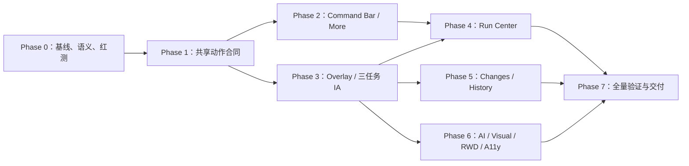

# aiops-v2 Workflow Studio 方案 C 视觉与交互重设计实施 TODO 清单

> 状态：🟨 进行中
>
> 编写日期：2026-07-24
>
> 设计依据：[`docs/2026-07-23-aiops-v2-workflow-studio-visual-interaction-redesign.zh.md`](../../2026-07-23-aiops-v2-workflow-studio-visual-interaction-redesign.zh.md)
>
> 上位实施计划：[`docs/superpowers/plans/2026-07-21-aiops-v2-workflow-canvas-mcp-control-plane-implementation-todo.zh.md`](./2026-07-21-aiops-v2-workflow-canvas-mcp-control-plane-implementation-todo.zh.md)
>
> 编写基线：分支 `fix/ci-fixture-head-isolation`，HEAD `4b07998b77c108d12afc3162798a38e59d45d599`；当前工作树包含大量尚未提交的 Workflow 控制面改动，实施前必须执行 T0.1 重新基线。
>
> 适用页面：`/runner/:workflowId`
>
> 方案范围：本文的“方案 C”指设计文档第 4 节采用的“状态驱动顶部栏 + Overlay 工作流面板”整体方案，不是只实施设计文档中的“Phase C：Run Center”。
>
> 核心约束：Canvas 是视觉主角；普通生命周期动作由 Command Bar 唯一持有，Candidate 动作由 Workspace Action Bar 唯一持有，确认动作由 Dialog 唯一持有；阻断状态允许 `0` 个 Primary，任何状态不得超过 `1` 个实心 Primary；页面不得伪造环境配置、运行成功、Candidate Apply 或服务端 capability。

本文是对上位 Workflow MCP 控制面计划的**视觉与交互增量实施计划**，不替代 Runner Graph、Candidate、Approval、Receipt、AssistantTransport、持久事务和运行门禁的既有事实源与安全约束。

---

## 0. 文档使用和状态更新规则

### 0.1 当前代码事实与实施基线

以下事实已在 2026-07-24 编写时核对；它们不是任务完成证明：

- [x] `web/src/pages/RunnerStudioPage.tsx` 当前约 `2060` 行，仍包含运行记录、发布审阅、工具栏动作和页面级组合职责；后续任务只能使其减责或保持为薄组合层。
- [x] `web/src/runner/WorkflowLifecycleHeader.tsx` 已消费 `selectWorkflowRunView`，但仍自行组合 Header 状态和动作，并支持 `candidateActionOwner="review_bar" | "header"`；尚未形成全页面唯一的 `WorkflowPrimaryActionViewModel`。
- [x] `web/src/runner/workspace/workflowInteractionContract.ts` 和 `workflowWorkspaceSelectors.ts` 已有状态轴、Primary selector 与 Run selector，是新 Action Contract 的起点，不得在 Page、Panel 或 CSS 中再推导第二套状态。
- [x] `web/src/runner/WorkflowContextDock.tsx` 当前类型仍包含 `configuration / review / history`；桌面工作流入口仍为 `AI / 审阅 / 运行 / 历史`，移动端为 `画布 / AI / 审阅 / 运行`。
- [x] 节点配置已使用独立 Node Sidebar / Mobile Sheet，Workflow Panel 为 Overlay；打开、切换和关闭工作流 Drawer 不应改变 Canvas 容器几何。
- [x] `web/src/runner/WorkflowRunPanel.tsx` 当前仍直接渲染运行门禁、草稿与已发布目标、配置详情和面板动作；`WorkflowEditorShell.tsx` 仍把 Run 与 History 组合为独立区域。
- [x] 当前 `RunnerStudioPage.runWorkflow()` 仍向运行 API 提交当前 graph，Page 尚未给 Shell 接入可信的 `onRunPublishedWorkflow`；“运行已发布版本”语义必须先补权威接口，不能只改按钮文案。
- [x] `web/src/runner/WorkflowHistoryPanel.tsx` 只接受 durable transaction，但 Page 会话运行记录仍通过独立 `historyPanel` 插槽与它固定上下组合。
- [x] `WorkflowCandidateWorkspaceActionBar.tsx` 已存在，应成为 Candidate Ready / Conflict 时的唯一动作 owner；不得在变更面板 Footer、Header 或移动端再复制 Apply / Reject。
- [x] 当前 `runGateFacts.environment` 是服务端事实投影，不是可编辑环境选择器；现有“去配置”行为不能被当作可信环境绑定 mutation。
- [x] 当前 `configuration_required` 的恢复回调只会重新打开 Run Panel；在真实环境绑定命令、权限和新 Snapshot 闭环完成前必须保持无 CTA 的诚实阻断。
- [x] Workflow AI 尚未具备独立的服务端 Prompt Preset 目录；Runner Action Catalog 不能直接充当 AI Prompt Catalog。
- [x] `web/src/components/ui/` 已提供 Button、Badge、DropdownMenu、Tabs、Alert、Tooltip、ScrollArea、Dialog 和 Sheet，应优先复用。
- [x] `web/src/components/runner/runnerStudio.css` 与 `web/src/runner/workflowWorkspace.css` 合计超过 `7000` 行；实际全局入口是 `web/src/index.css`，未被 import 的 `web/src/style.css` 不能作为新 Token 基础。
- [x] 仓库已有 Vitest、Playwright、Workflow snapshot、responsive、accessibility 和真实 full-stack harness；UI 改动必须更新可失败的 `toHaveScreenshot(...)` 覆盖并审查差异。
- [x] 当前工作树非常脏；本文只新增计划文档，不能把未提交代码视为本文任务已完成。

T0.1 必须在正式实施开始时重新核对行数、文件、测试、HEAD、部署和未提交变更，并把变化写入本文。

### 0.2 状态图例

| 状态 | 含义 |
|---|---|
| `⬜ 未开始` / `[ ]` | 尚未实施 |
| `🟨 进行中` | 已有代码或测试，但完成定义未全部满足 |
| `🟥 阻塞` | 有明确外部阻塞；必须记录 owner、原因、临时安全动作和解除条件 |
| `✅ 已完成` / `[x]` | 代码、测试、证据、文档和门禁全部满足 |
| `⏸ 延后` | 经批准不进入当前里程碑，不计入完成率 |

Checklist 只使用标准 `[ ]` 与 `[x]`；进行中和阻塞状态写在任务标题及实施记录中。

### 0.3 每完成一个任务必须同步更新本文

- [x] 将任务标题、Phase 状态、总体进度表和子项复选框同步更新。
- [ ] 填写实际 Owner、开始/完成日期、review base/head、commit、真实生产文件、生产 churn 和设计偏差。
- [ ] 记录真实执行命令、退出码、测试数和证据路径；未运行必须明确写“未运行”及原因。
- [ ] UI 任务必须保存 Playwright trace 与 `toHaveScreenshot(...)` diff 审查记录。
- [x] 本轮重要交互变更已使用 Codex 内置浏览器操作真实部署并记录资源标识、URL、viewport、Workflow、Primary、Canvas/Drawer 几何、焦点、console 和截图；完整 network waterfall/Phase exit/RC 仍由 T0.1/T7.2/T7.5 追踪。
- [ ] Schema、golden 或 screenshot baseline 更新必须单独审阅，并按仓库要求使用 `AIOps-Change-Exception`、`AIOps-Change-Reason`、`AIOps-Change-Review` trailers。
- [ ] 完成项如果同时关闭上位计划中的 T3.9、T3.10、T3.12、T6.3、T6.5 或 T6.6，只能在拥有相同证据时同步更新上位计划，不能双重计算或提前标绿。
- [ ] 若实施时 HEAD、组件边界、服务端 capability 或运行语义变化，先恢复 T0.1 为进行中并重新基线。

### 0.4 总体进度

| Phase | 目标 | 任务数 | 当前状态 | 退出证据 |
|---|---|---:|---|---|
| Phase 0 | 基线、P0 决策、Action Contract 和红测 | 5 | 🟨 进行中 | ADR、错误基线、UX Case fixture |
| Phase 1 | 共享状态、唯一动作 owner 和 executor | 4 | 🟨 进行中 | Primary 真值表、精确目标请求 |
| Phase 2 | Command Bar、生命周期轨道与 More | 4 | 🟨 进行中 | 单行顶部、无重复动作、键盘菜单 |
| Phase 3 | Overlay Workflow Panel 与三任务信息架构 | 4 | ✅ 已完成 | 三入口、几何与焦点合同 |
| Phase 4 | Run Center 与可信环境配置能力 | 5 | 🟨 进行中 | 草稿/已发布目标准确、单 RunInspector |
| Phase 5 | Changes、Candidate 与 History | 4 | 🟨 进行中 | 唯一 Candidate owner、历史分流 |
| Phase 6 | AI、视觉系统、响应式与无障碍 | 5 | 🟨 进行中 | Token、8 视口、axe/键盘/读屏 |
| Phase 7 | 全量验证、外部验收、灰度与交付 | 5 | 🟨 进行中 | Playwright、browser-in-app、用户与 RC |

合计 `36` 个任务：`23 ✅ / 10 🟨 / 0 🟥 / 2 ⏸ / 1 ⬜`。

### 0.5 2026-07-24 本轮实施证据总账

- **Review 基线**：分支 `fix/ci-fixture-head-isolation`，review base/head `4b07998b77c108d12afc3162798a38e59d45d599`；本轮未提交、未推送，继续保留用户已有 dirty worktree。
- **真实部署**：`http://127.0.0.1:18080/runner/8-redis`；最终生产构建资源为 `index-TweOFdjo.js` / `index-CgGcg5d1.css`。`ai-server` 已用最终代码重启，首页资源与 `/api/v1/state` 均由 curl 复验，状态接口返回 `200`。
- **Web 门禁**：Vitest `160` files / `1237` tests 全绿；最终 Workspace/Candidate/History 定向 `3` files / `61` tests、Candidate 组合定向 `4` files / `54` tests 全绿；`npm run typecheck`、`npm run build` 退出码均为 `0`。构建仅保留既有 chunk-size warning。
- **Go 门禁**：最终 Root `internal/appui + internal/server + cmd/ai-server` 与 Runner `server/api + server/app + server/service` 包测试均通过；精选契约 normal/race/vet 亦通过。首次沙箱内 `httptest` 绑定被拒后，已在允许监听的执行环境以相同代码复跑通过。
- **Playwright**：运行失败恢复 `UX-PW-008` 已在 Chromium/Firefox/WebKit `3/3` 通过；Candidate 最终确认 Dialog 三浏览器交互与 screenshot baseline `3/3` 通过；Firefox/WebKit accessibility `12/12` 通过；方案 C 代表性快照在三浏览器 `3/3` 通过。真实 full-stack `PW-006/PW-012` 在 Chromium `2/2` 通过，覆盖最新 Candidate 精确 Apply 与 Undo→刷新→Redo→再刷新；82 个证据文本脱敏扫描通过，最终证据目录为 `/var/folders/h4/g51xwt0s6sq18nfz0gt5q5wm0000gn/T/workflow-canvas-evidence/full-stack-20260724T075327Z-20170`。所有新增 baseline 均先逐张人工审查 actual，再执行 `update=missing`，并以无 update 复跑收口。
- **browser-in-app**：最终资源 `index-TweOFdjo.js` 在 1280×720 真实部署中加载；Canvas/Pane 打开 512px Overlay 前后均为 `x=101,width=1158,height=609`，Overlay 为 `x=739,width=512,height=593`；AI/变更/运行三 Tab 均可操作，技术 Hash 仅在展开后出现，关闭后焦点回“工作台”。More 只含文件/辅助/管理低频操作，Escape 后回焦触发器；旧 Toolbar DOM、Raw JSON 和可执行 Primary 数量均为 `0`，console 日志为 `[]`。
- **真实页面语义**：环境未绑定时 Primary 数量为 `0`，生命周期显示“静态检查通过 · 运行环境未绑定”；Run 默认 DOM 无 `sha256:`，展开“技术详情”后才显示并可复制；一级入口只有 `AI 协作 / 变更 / 运行`。
- **真实页面菜单**：内置浏览器发现并修复 More 内容横向挤压导致竖排的问题；最终 4 个菜单项均为 `210×36px` 单行横排，按文件/辅助/管理纵向分组，生命周期动作数量 `0`，Escape 关闭后焦点回触发器。浏览器 console 日志为 `[]`。
- **仍未完成**：真实环境配置 provider、真实 Prompt Preset provider、真实浏览器 200% zoom、人工读屏、触摸/软键盘、120 视觉矩阵、完整 AI→Candidate→Apply/Run/Undo browser-in-app 旅程、5～8 位外部用户验收、远端 CI/RC/灰度/回滚和两个稳定版本观察。

---

## 1. 实施目标、范围、非目标和不可破坏约束

### 1.1 本计划要交付的用户结果

- [ ] 用户 5 秒内能判断保存状态、草稿/已发布目标、检查/试运行状态和当前安全下一步。
- [x] 顶部保持一行；有文字的主要动作不超过“工作台、当前 Primary、More”3 个。
- [x] 自动保存正常时没有常驻 Save；不存在含义不明确的生命周期“运行”。
- [x] 任意状态最多一个实心 Primary；没有真实恢复能力的阻断状态允许没有 Primary。
- [x] Workflow Panel 只保留 `AI 协作 / 变更 / 运行`，并可随时关闭，不挤压 Canvas。
- [x] 节点配置继续只属于 Node Sidebar / Mobile Sheet，关闭 Workflow Panel 后选区和未保存字段仍在。
- [x] 草稿试运行与已发布版本运行在文案、请求 target、权限和结果中始终明确区分。
- [x] Durable History 归入“变更”，Page 会话运行记录归入“运行”，不再固定上下 50/50。
- [x] AI 空状态遵循真实 capability，不恢复 Workflow selector、“本次发送范围”或常驻 scope 栏。
- [x] 默认 UI 和可访问 DOM 不暴露完整 Hash、transactionId、Raw JSON、Tool 名或 Secret。

### 1.2 明确非目标

- [x] 不改变 Runner Graph、Candidate、Approval、Receipt、ValidationBasis 和 durable transaction 的事实源。
- [x] 不新建页面私有 WebSocket、SSE、polling、local reducer 或本地成功 fallback；新增运行接口属于权威服务端合同。
- [x] 不把草稿试运行和已发布版本运行合并为一个模糊动作。
- [x] 不把 Page 会话运行记录伪装为服务端持久历史。
- [x] 不把节点 Inspector 与工作流级 Panel 重新塞回同一个 Tab 容器。
- [x] 不为了“有按钮”而伪造环境绑定、AI Prompt Preset、复制、删除或发布 capability。
- [x] 不全局修改 shadcn `--primary`，不新建另一套 Button/Card/Tabs 基础组件。
- [x] 不借视觉重构修改 Workflow MCP、RuntimeKernel、Approval 或 CommitStore 的领域语义。

### 1.3 不可破坏的合同

1. **动作 owner 固定**：
   - 普通生命周期：`WorkflowCommandBar`；
   - Candidate Ready / Conflict：`WorkflowCandidateWorkspaceActionBar`；
   - 最终确认：Dialog；
   - 移动端：当前固定 owner 的响应式呈现；
   - Run Panel：永远不复制生命周期 Primary。
2. **单一动作事实源**：Page、Header、Candidate Bar、Dialog 和移动端消费同一个 `WorkflowPrimaryActionViewModel` 与 executor。
3. **精确运行目标**：草稿只走非生产 dry-run target；普通生产运行只指向 immutable published revision。
4. **Fail closed**：capability、权限、handler 或可信入口不存在时不渲染可执行 CTA。
5. **Canvas 几何不变**：Workflow Panel 开关和 Tab 切换前后 Canvas 容器 `x / width` 差值为 `0px`。
6. **选区状态不丢**：Panel 打开时 Node Sidebar 可 `inert / aria-hidden`，但保持 mounted；关闭后恢复选区、草稿和焦点。
7. **Candidate 自动进入变更**：Candidate 完成后沿用现有合同自动激活“变更”，同时保留 AI Transcript、Composer 草稿和冻结 Turn 上下文。
8. **当前路由就是 Workflow**：Panel 不显示 Workflow selector、“本次发送范围”或独立常驻上下文栏。
9. **技术信息渐进披露**：完整 Hash/ID 只在显式技术详情中按需展示并脱敏，不能出现在默认 DOM 的 text、title、aria-label 或 data 属性。
10. **触及大文件只减责**：`RunnerStudioPage.tsx`、`WorkflowEditorShell.tsx`、`runnerStudio.css` 不能继续承接新的独立领域职责。

---

## 2. 依赖顺序和并行文件边界

### 2.1 关键依赖图



Phase 1 完成前不得开始可见重构；否则 Command Bar、Run Panel 和 Candidate Bar 会继续各自推导动作。

### 2.2 并行工作流和文件所有权

| 工作流 | 独占生产文件 | 可并行范围 | 禁止并行重叠 |
|---|---|---|---|
| A：Contract / Selector | `workflowInteractionContract.ts`、`workflowWorkspaceSelectors.ts`、对应 tests | 与纯视觉 Token 审计并行 | 不同时修改 Lifecycle Header |
| B：Command Bar | 新 `WorkflowCommandBar*`、`WorkflowLifecycleTrace*`、`WorkflowActionMenu*` | A 完成后与 Run UI 并行 | `RunnerStudioPage.tsx` 由集成 owner 串行修改 |
| C：Workflow Panel | `WorkflowContextDock.tsx`、`WorkflowEditorShell.tsx`、`workflowWorkspace.css` | 与业务无关的 Header 组件并行 | 三个文件由一个 agent 独占 |
| D：Run Center | `WorkflowRunPanel.tsx`、新 `WorkflowTargetRow.tsx`、`WorkflowRunInspector.tsx` | 与 Changes/AI 独立组件并行 | 服务端 capability 投影单独提交 |
| E：Changes / History | `WorkflowHistoryPanel.tsx`、新 `WorkflowChangeList.tsx`、`WorkflowHistoryRow.tsx` | 与 Run/AI 并行 | Candidate Workspace Action Bar 由单独 owner 修改 |
| F：AI / Preset | `WorkflowAiTransportPanel.tsx`、服务端 preset capability 投影 | 与 History/Run 并行 | 不改 AssistantTransport 主链 |
| G：视觉 / 测试 | `runnerStudio.css`、snapshot/e2e specs | 生产结构稳定后执行 | baseline 由单一审阅人更新 |

`RunnerStudioPage.tsx`、`WorkflowEditorShell.tsx`、`WorkflowContextDock.tsx`、`runnerStudio.css` 和 `workflowWorkspace.css` 是高冲突文件，必须由主 agent 串行集成；子 agent 不应同时写入。

### 2.3 每个实施提交的固定门禁

- [ ] 修改前有明确用户可见现象、生产调用链、唯一事实源、保持不变行为和 red test。
- [ ] 非机械性提交最多修改 `5` 个生产文件，生产代码 churn 不超过 `500` 行；超过必须拆分。
- [ ] 任务外代码、依赖、snapshot、文案和格式不顺手修改。
- [ ] 先跑定向测试，再跑所属 Phase 门禁；退出码和数量写入实施记录。
- [ ] 任何 UI 改动在同一 review range 内增加或更新可失败的 screenshot snapshot。
- [ ] Snapshot update 前人工审查 diff，不能用直接更新 baseline 让失败消失。
- [ ] 新组件复用现有 UI primitives，不新增基础 Button/Card/Tabs。
- [ ] 不新增 `!important`；删除旧 selector 后再加入新规则。
- [ ] `git diff --check` 通过，且最终 diff 只包含本任务范围。

---

## 3. Phase 0：基线、P0 决策、Action Contract 和红测

> 状态：🟨 进行中
>
> 目标：在任何可见改动前冻结运行语义、动作 owner、capability 和失败测试。

### T0.1 🟨 重新审计当前实现、未提交变更和部署基线

**优先级**：P0
**依赖**：无
**文件 Owner**：主 agent；只读审计后更新本文
**建议修改文件**：仅本文、必要的基线报告

- [x] 记录实施时 branch、HEAD、review base、`git status --short` 和相关文件行数。
- [x] 核对 Lifecycle Header、Context Dock、Run、History、Candidate Bar、Page 与 CSS 的实际职责。
- [x] 核对旧顶部 `runWorkflow()`、`onDryRunWorkflow`、`onRunPublishedWorkflow` 的真实请求目标。
- [x] 记录当前部署 URL、build/resource 标识、Primary 数量、Tab、Canvas/Drawer 几何、console 和资源加载证据与截图。
- [x] 标出与当前 dirty changes 重叠的文件；不能确认来源时停止相应实施。

**完成定义**：本文 0.1 与实际代码、部署、测试完全一致，并有可复现基线证据。

**验证命令**：

```bash
git branch --show-current
git rev-parse HEAD
git status --short
wc -l web/src/pages/RunnerStudioPage.tsx web/src/runner/*.tsx \
  web/src/components/runner/runnerStudio.css web/src/runner/workflowWorkspace.css
```

**实施记录**：2026-07-24 完成实施前与实施后双基线。分支、review base/head 不变；实施后大文件行数为 Page `1966`、Shell `918`、`runnerStudio.css` `6852`、`workflowWorkspace.css` `592`。未提交重叠改动按后端、动作合同、Panel、测试和主集成边界分配，未覆盖或清理用户改动。
**验证证据**：已执行 Git/WC/diff 命令；改造前资源 `index-EO-CLEJn.js` 与问题截图已记录；改造后真实资源、URL、几何、焦点、console 和截图见 0.5 总账。静态资源由内置浏览器实际加载，服务端启动日志确认 HTTP/gRPC 监听。
**阻塞/偏差**：页面没有独立 commit build metadata，本轮只能以 review base/head + Vite content-hash 资源标识部署；尚缺完整可复现的 DevTools network waterfall 与落盘 build manifest，因此保持 `🟨`。

### T0.2 ✅ 冻结草稿试运行与已发布运行语义

**优先级**：P0
**依赖**：T0.1
**文件 Owner**：运行合同 owner
**建议文件**：

- `web/src/runner/workspace/workflowWorkspaceSelectors.ts`
- `web/src/pages/RunnerStudioPage.workflow.test.tsx`
- `web/src/runner/WorkflowRunPanel.test.tsx`
- 必要时补充一份 ADR

- [x] 明确草稿 dry-run 只能绑定当前保存草稿、当前 ValidationBasis 和非生产环境。
- [x] 明确普通运行只绑定 immutable published revision。
- [x] 未发布、basis stale、权限缺失、handler 缺失时 fail closed。
- [x] 对旧 `runWorkflow()` 与 published run 接线写 red integration test。
- [x] 记录发布和执行 capability 关闭时是隐藏还是明确阻断。

**完成定义**：每个运行入口的 target、API、权限和版本都可由测试精确断言，不存在只写“运行”的动作。

**验证命令**：

```bash
cd web
npx vitest run src/runner/workspace/workflowWorkspaceSelectors.test.ts \
  src/runner/WorkflowRunPanel.test.tsx \
  src/pages/RunnerStudioPage.workflow.test.tsx
```

**实施记录**：新增权威 `workflow-dry-run` 与 `workflow-published-run` 双接口；published request 只接受 immutable typed target，Graph 从 durable publish history/receipt/checksum 解析，拒绝客户端 Graph。Page 的检查、发布、草稿 dry-run、published run 都传精确 target 并在 stale target 时 fail closed。
**验证证据**：后端集成测试覆盖 graph 拒绝、revision 不存在/不匹配、provider 缺失和“新草稿存在时仍运行旧发布版本”；Web client/Page/Run selector 定向及全量测试通过，见 0.5。
**阻塞/偏差**：旧发布历史没有 durable transaction 时不会回退执行当前 Graph，而是返回阻断；这是预期安全行为。

### T0.3 ✅ 冻结 Primary Action 真值表与固定 owner

**优先级**：P0
**依赖**：T0.1、T0.2
**文件 Owner**：Contract / Selector owner
**建议文件**：

- `web/src/runner/workspace/workflowInteractionContract.ts`
- `web/src/runner/workspace/workflowWorkspaceSelectors.ts`
- 对应 test 文件

- [x] 把 `UX-HDR-001～010` 全部登记为命名纯函数 fixture。
- [x] 明确普通状态由 Command Bar 持有 Primary。
- [x] 明确 Candidate Ready / Conflict 由 Workspace Action Bar 持有。
- [x] 明确 Dialog 打开时背景 owner 隐藏或 `inert`。
- [x] 明确移动端只是同一 owner 的响应式呈现。
- [x] 明确无真实恢复能力的阻断状态 Primary 为 `0`。

**完成定义**：所有消费方可以依赖一个 typed view model 判断 label、target、enabled、owner、reason 和 capability；red test 能证明当前多处推导不满足合同。

**验证命令**：

```bash
cd web
npx vitest run src/runner/workspace/workflowInteractionContract.test.ts \
  src/runner/workspace/workflowWorkspaceSelectors.test.ts
```

**实施记录**：已实现共享 typed Primary ViewModel、固定 Command Bar/Candidate owner、移动端同 identity 呈现和 capability-off 的 0 Primary；删除旧第二套 selector；`UX-HDR-001～010` 已逐条登记为命名纯函数 fixture。
**验证证据**：Selector、Lifecycle Header、Command Bar、Candidate Bar、Dialog 和 action registry 测试纳入 Web `1237/1237` 全量通过；真实 Dialog 合同覆盖 owner `inert + aria-hidden`、Escape/取消/确认/审批失效回焦和一次性提交。
**阻塞/偏差**：无。

### T0.4 🟨 冻结 capability、AI Prompt Preset 和 Case manifest

**优先级**：P0
**依赖**：T0.1～T0.3
**文件 Owner**：服务端投影 / 测试基础设施 owner
**建议文件**：

- `pkg/runner/server/service/workflow_workspace_projection.go`
- `internal/appui/workflow_event_projector.go`
- `web/src/runner/workspace/workflowWorkspaceTypes.ts`
- `testdata/workflow_canvas_mcp/test-manifest.json`（若纳入上位 Case manifest）

- [x] 定义环境配置 capability、权限、可信入口和 capability-off 表达。
- [x] 定义 Workflow AI Prompt Preset 的 typed 投影，禁止把 Action Catalog 直接当 Prompt 目录。
- [ ] 定义 More 中复制、删除、导入、导出、手册等可选 capability。
- [x] 把 `UX-HDR / UX-IA / UX-RUN / UX-PW` Case 及优先级登记到机器可读 manifest 或独立追踪表。
- [x] capability fixture 覆盖当前真实 off、空列表、未知 schema 与入口缺失；真实 provider on/权限允许分支等待 T4.3/T6.2。

**完成定义**：页面只消费服务端投影的 capability；不存在 UI 自猜或占位按钮。

**验证命令**：

```bash
go test ./internal/appui ./internal/server -run 'Test.*Workflow.*(Projection|Capability)' -count=1
(
  cd pkg/runner
  go test ./server/service -run 'Test.*Workflow.*Projection' -count=1
)
go run ./cmd/workflow-test-manifest validate \
  --manifest testdata/workflow_canvas_mcp/test-manifest.json
```

**实施记录**：环境配置投影明确 `status=off/reason=provider_unavailable/handlerAvailable=false/configureAllowed=false`；AI Preset 使用 `aiops.workflow.prompt-presets.v1`，当前安全投影为 off + 空 presets，未知 schema fail closed。新增 `workflow-studio-redesign-cases.json`，逐条登记 44 个 UX-HDR/IA/RUN/PW Case 的优先级、owner、状态、自动化与 blocker；当前为 `30 implemented / 14 partial`。
**验证证据**：Root/Runner capability projection normal/race/vet 通过；`go test ./internal/workflowtestmanifest -count=1` 通过；原 169 Case MCP manifest 继续通过 CLI 校验；Web 真实部署未渲染假环境 CTA 或本地假快捷任务。
**阻塞/偏差**：More 仍由页面真实 handler 本地组装，尚未形成完整服务端 capability，因此保持 `🟨`。

### T0.5 🟨 建立错误、视觉、无障碍与回滚基线

**优先级**：P0
**依赖**：T0.1～T0.4
**文件 Owner**：测试 owner
**建议文件**：

- `web/tests/workflow-studio.snapshot.spec.js`
- `web/tests/e2e/workflow-canvas-responsive.spec.js`
- `web/tests/e2e/workflow-canvas-accessibility.spec.js`
- `web/tests/fixtures/workflow-studio.snapshot.fixture.json`

- [x] 用旧 UI 复现重复 Primary、四 Tab、Run 双区域、History 50/50 和 More 平铺问题。
- [ ] 记录 8 个 viewport 的初始截图、DOM、几何、焦点与 axe 结果。
- [x] 建立会失败的方案 C `toHaveScreenshot(...)` 回归合同；不把调试 `page.screenshot()` 当回归覆盖。
- [x] 定义短期展示 capability/flag 时的删除期限和回滚顺序。
- [x] 回滚不得恢复模糊“运行”、假“去配置”或重复 Primary。

**完成定义**：每个主要视觉/交互问题都有会失败的自动化断言或明确人工证据，且回滚不改变事实源和 action executor。

**验证命令**：

```bash
cd web
npm run test:ui:workflow-snapshots
npx playwright test e2e/workflow-canvas-responsive.spec.js \
  e2e/workflow-canvas-accessibility.spec.js --project=chromium
```

**实施记录**：2026-07-24 已用 Codex 内置浏览器复现旧顶部固定 Save/Run/Run Details/AI、四 Tab、Run 双区域和 More 平铺/竖排问题；已把方案 C Command Bar、三入口 Overlay、唯一 Primary、8 个基准 viewport、821/1023 断点、菜单横排及 Camera 安全区写入可失败 Playwright 断言。
**验证证据**：改造前 snapshot 如预期 RED；当前两张方案 C baseline 已人工查看，最终 Chromium `19/19` 通过，8 viewport、axe、键盘、reduced-motion 与移动 Bottom Sheet 均绿。
**阻塞/偏差**：未保存完整 8 viewport 旧 UI 的逐一 screenshot/axe 基线，也未完成 120 状态视觉矩阵，保持 `🟨`。

### Phase 0 退出门禁

- [ ] T0.1～T0.5 全部完成。
- [ ] 运行语义、Primary owner、capability 和回滚均无未决 P0。
- [ ] `UX-HDR-001～010`、`UX-IA-001～008`、`UX-RUN-001～008` 已登记并有 fixture。
- [ ] 当前错误可稳定复现；没有通过更新 snapshot 掩盖失败。
- [ ] 批准进入 Phase 1。

---

## 4. Phase 1：共享状态、唯一动作 owner 和 executor

> 状态：🟨 进行中
>
> 目标：所有可见区域消费同一个 Primary Action ViewModel 和精确 action executor。

### T1.1 ✅ 实现 `WorkflowPrimaryActionViewModel`

**优先级**：P0
**依赖**：Phase 0
**文件 Owner**：Contract / Selector owner
**建议文件**：

- `web/src/runner/workspace/workflowInteractionContract.ts`
- `web/src/runner/workspace/workflowWorkspaceSelectors.ts`
- 对应 tests

- [x] typed 结果包含 `id / label / target / owner / enabled / reason / capability`。
- [x] 合并 Lifecycle Header 与 Workspace selector 的重复推导。
- [x] stale basis、Candidate、Approval、save failure、offline 与 capability-off 全部 fail closed。
- [x] view model 不包含 JSX、DOM、页面文案解析或本地请求。

**完成定义**：Page、Command Bar、Candidate Bar、Dialog 和移动端无需重新计算业务状态。

**验证命令**：

```bash
cd web
npx vitest run src/runner/workspace/workflowInteractionContract.test.ts \
  src/runner/workspace/workflowWorkspaceSelectors.test.ts
```

**实施记录**：`workflowInteractionContract.ts` 与 `workflowWorkspaceSelectors.ts` 提供单一 typed Primary ViewModel；旧重复 selector 已删除，Page/Header/移动端通过同一 registry 消费。
**验证证据**：状态轴、stale、Candidate、offline、capability-off、阻断 0 Primary 与移动 identity 测试均纳入 Web 全量 `1201/1201`。

### T1.2 ✅ 实现生命周期状态轨道 ViewModel

**优先级**：P0
**依赖**：T1.1
**文件 Owner**：Contract / Selector owner
**建议文件**：

- `web/src/runner/workspace/workflowWorkspaceSelectors.ts`
- 新 `web/src/runner/WorkflowLifecycleTrace.tsx`
- 对应 tests

- [x] 保存、检查、草稿试运行、发布四阶段绑定当前精确 basis。
- [x] stale、checking、blocked、passed、not-run 使用明确语义，不仅靠颜色。
- [x] `<1180px` 紧凑摘要与完整轨道消费同一数据。
- [x] 完整 Hash 不进入默认 DOM。

**完成定义**：过期依据不能显示成功，桌面与紧凑模式对同一事实给出相同结论。

**验证命令**：

```bash
cd web
npx vitest run src/runner/workspace/workflowWorkspaceSelectors.test.ts \
  src/runner/WorkflowLifecycleHeader.test.tsx
```

**实施记录**：新增四阶段 `WorkflowLifecycleTrace` 与 compact aria label；环境未绑定时显示阻断而不是“可试运行”，完整 Hash 不出现在默认轨道。
**验证证据**：Lifecycle Trace/selector 单测、8 viewport Playwright、reduced-motion 与内置浏览器真实部署均通过。

### T1.3 ✅ 固定 Command Bar、Candidate Bar、Dialog 和移动端 owner

**优先级**：P0
**依赖**：T1.1、T1.2
**文件 Owner**：Candidate / Header integration owner
**建议文件**：

- `web/src/runner/WorkflowLifecycleHeader.tsx`
- `web/src/runner/WorkflowCandidateWorkspaceActionBar.tsx`
- 相关 Dialog 组件
- 对应 tests

- [x] 删除可漂移的 `candidateActionOwner="header"` 生产用法。
- [x] Candidate Ready / Conflict 时 Command Bar Primary 数量为 `0`。
- [x] Workspace Action Bar 是 Apply / Reject 唯一 owner。
- [x] Dialog 打开后背景动作不可交互，关闭后焦点回原 owner。
- [x] 移动端底部动作引用同一 action identity，不复制 handler。

**完成定义**：任意 fixture 下全页面实心 Primary 数量 `<=1`；双击不会重复提交。

**验证命令**：

```bash
cd web
npx vitest run src/runner/WorkflowLifecycleHeader.test.tsx \
  src/runner/WorkflowCandidateWorkspaceActionBar.test.tsx \
  src/runner/WorkflowCandidateActionBar.test.tsx
```

**实施记录**：Command Bar、Candidate Workspace Bar 与移动底部 Primary 的 owner 已固定；Candidate 状态禁止生命周期 Primary，action registry 复用同一 target/handler 并防双击。最终 Apply 使用独立 Radix Dialog，背景 Workspace owner 同时 `inert + aria-hidden`；Escape 只关闭内层 Dialog，取消、Escape 和确认均在关闭提交后回焦 Apply。
**验证证据**：Candidate/Dialog 相关 Vitest `4` files / `42` tests 通过；确定性真实浏览器 Case 覆盖唯一 owner、Tab 焦点环、Escape/取消/确认回焦、一次 approval decision 与三浏览器 screenshot baseline。
**阻塞/偏差**：无。

### T1.4 ✅ 建立统一 action executor contract 与精确 client target

**优先级**：P0
**依赖**：T0.2、T1.1
**文件 Owner**：Page integration owner
**建议文件**：

- 新 `web/src/runner/workflowStudioActionRegistry.ts`
- `web/src/pages/RunnerStudioPage.tsx`
- `web/src/api/runnerStudioClient.js`
- 对应 tests

- [x] 检查、dry-run、发布、运行 published、Undo/Redo 各有唯一 client executor contract。
- [x] executor 接受 typed target，不读取可见按钮文字决定行为。
- [x] handler/capability/permission 缺失时不注册动作。
- [x] client request contract 绑定精确 workflow、revision/basis、environment 和 idempotency 信息。
- [x] T4.1 权威服务端接口完成前，published run 生产 action 保持未注册；接口完成后只注册 immutable target。
- [x] `RunnerStudioPage.tsx` 只做 wiring，行数由基线 `2060` 降为 `1966`。

**完成定义**：同一 action 无论桌面、移动或 Dialog 触发，都生成相同 typed client target；生产注册仍受真实服务端接口和 capability 门禁。

**验证命令**：

```bash
cd web
npx vitest run src/api/runnerStudioClient.test.js \
  src/pages/RunnerStudioPage.workflow.test.tsx \
  src/runner/workspace/workflowWorkspaceSelectors.test.ts
```

**实施记录**：新增统一 action registry；Page 的 check/publish handler 接受冻结的 saved target 并在 revision/hash 漂移时拒绝，published run 只接收 immutable revision target。
**验证证据**：`runnerStudioClient`、Page integration、selector/registry 测试通过；后端精确 target 接口 normal/race 验证通过。

### Phase 1 退出门禁

- [x] T1.1～T1.4 全部完成。
- [ ] Primary 真值表 `UX-HDR-001～010` 全部通过。
- [x] 页面任何状态 Primary `<=1`，阻断状态可为 `0`。
- [x] 草稿 dry-run 与 published run 的 client target contract 测试通过；生产可执行性等待 T4.1。
- [x] Phase 2～6 只能消费共享 view model/executor，不能另建 action 推导。

---

## 5. Phase 2：Command Bar、生命周期轨道与 More

> 状态：🟨 进行中
>
> 目标：把顶部收敛为一行、一个状态轨道和一个当前主操作。

### T2.1 ✅ 实现 `WorkflowCommandBar`

**优先级**：P0
**依赖**：Phase 1
**文件 Owner**：Command Bar owner
**建议文件**：

- 新 `web/src/runner/WorkflowCommandBar.tsx`
- 新 `web/src/runner/WorkflowPrimaryAction.tsx`
- `web/src/runner/WorkflowLifecycleHeader.tsx`
- `web/src/pages/RunnerStudioPage.tsx`
- 对应 tests

- [x] 左侧仅返回、Workflow 名称和生命周期小标签。
- [x] 中间仅生命周期轨道。
- [x] 右侧仅 Undo、Redo、工作台、当前 Primary、More。
- [x] 自动保存正常时常驻 Save 为 `0`。
- [x] 删除“运行详情”和含义不明确的“运行”。
- [x] 顶部 Header 总高度不超过 `96px`，桌面保持单行。

**完成定义**：顶部有文字的主要动作不超过 3 个，状态与动作形状可明确区分。

**验证命令**：

```bash
cd web
npx vitest run src/runner/WorkflowLifecycleHeader.test.tsx \
  src/pages/RunnerStudioPage.workflow.test.tsx
```

**Playwright/browser-in-app**：在 1440、1280、1095、1024 宽度记录 Header 高度、换行、Primary 和截图。
**实施记录**：顶部改为单一 `WorkflowCommandBar`；Page 原工具栏/标题行不再重复身份、Save、Run、Run Details、AI 和 lifecycle action。
**验证证据**：桌面 1440/1280/1095/1024/1023/821 断言全绿；内置浏览器实测 Command Bar 高 `44px`，环境 off 时只有工作台/More，无假 Primary。2026-07-24 浏览器反馈复验继续确认旧 `runner-toolbar-save/run/run-details/ai-generate` 数量均为 `0`，工作流一级入口仍只有 `AI 协作 / 变更 / 运行`，没有把旧重复按钮重新引入。

### T2.2 ✅ 落地 `WorkflowLifecycleTrace`

**优先级**：P0
**依赖**：T1.2、T2.1
**文件 Owner**：Command Bar owner
**建议文件**：

- `web/src/runner/WorkflowLifecycleTrace.tsx`
- `web/src/runner/WorkflowCommandBar.tsx`
- 对应 tests / snapshots

- [x] 完整模式呈现“保存－检查－草稿试运行－发布”。
- [x] `<1180px` 收敛为一行短状态，但 aria 仍表达完整事实。
- [x] 成功绿、当前蓝、待处理琥珀、阻断红；文字和图标同时表达状态。
- [x] 无持续流动动画，reduced-motion 无功能差异。

**完成定义**：状态轨道成为页面唯一完整生命周期表达，其他区域不再复制一组彩色状态胶囊。

**验证命令**：

```bash
cd web
npx vitest run src/runner/WorkflowLifecycleHeader.test.tsx
npm run test:ui:workflow-snapshots
```

**实施记录**：四阶段轨道与 compact label 由同一 selector 输出；已修复“检查通过但无可信环境却显示可试运行”的真实页面误导。
**验证证据**：单元、responsive、accessibility/reduced-motion 与真实页面 aria“保存：已自动保存；检查：静态检查通过；草稿试运行：运行环境未绑定；发布：未发布”一致。

### T2.3 ✅ 使用 Radix DropdownMenu 重做 More

**优先级**：P1
**依赖**：T1.4、T2.1
**文件 Owner**：Command Bar owner
**建议文件**：

- 新 `web/src/runner/WorkflowActionMenu.tsx`
- `web/src/pages/RunnerStudioPage.tsx`
- 对应 tests

- [x] 文件组只显示当前已接线的导入/导出动作。
- [x] 辅助组只显示当前已接线的手册/快捷键动作。
- [x] 管理组只显示当前已接线的管理动作，危险动作独立分组。
- [x] 校验、试运行、变量、发布不出现在 More。
- [x] ArrowUp/ArrowDown/Escape、碰撞、关闭回焦和 aria 完整。

**完成定义**：`UX-IA-005/006` 与 `UX-PW-017` 通过；菜单不遮挡 Drawer 关键操作。

**验证命令**：

```bash
cd web
npx vitest run src/pages/RunnerStudioPage.workflow.test.tsx
npx playwright test e2e/workflow-canvas-accessibility.spec.js --project=chromium
```

**实施记录**：桌面使用 Radix DropdownMenu，移动端复用 Sheet Bottom Sheet；文件/辅助/管理分组、危险删除样式和生命周期动作过滤已落地。内置浏览器发现内容 class 与 trigger class 冲突导致竖排，已拆分 CSS class 并增加宽度/纵向顺序回归断言。
**验证证据**：Playwright 键盘 Case 通过；真实页面菜单项均为 `210×36px` 单行，Escape 后焦点返回触发器，生命周期重复项为 0。
**阻塞/偏差**：完整服务端 More capability 投影继续由 T0.4 追踪；本任务完成的是对当前真实 handler 集合的正确菜单呈现和交互合同。

### T2.4 🟨 删除旧顶部动作、错误布局和重复样式

**优先级**：P0
**依赖**：T2.1～T2.3
**文件 Owner**：Command Bar / CSS integration owner
**建议文件**：

- `web/src/pages/RunnerStudioPage.tsx`
- `web/src/components/runner/runnerStudio.css`
- `web/src/runner/workflowWorkspace.css`
- 相关 tests

- [x] 删除固定 Toolbar action 数组和旧 lifecycle slot 重复呈现。
- [x] 保存失败、离线、冲突使用不挤压 Canvas 的 Toast/Alert；已有真实恢复动作才显示。
- [x] 不再显示泛化 `workflow command could not be completed`。
- [ ] 删除旧 selector，不用 CSS 隐藏旧 DOM。
- [ ] Page 和 CSS 总职责同时净减少。

**完成定义**：DOM 中无旧 Save/Run/Run Details/重复 lifecycle；错误出现时 Canvas 几何不变。

**验证命令**：

```bash
cd web
npx vitest run src/pages/RunnerStudioPage.workflow.test.tsx \
  src/runner/WorkflowEditorShell.test.tsx
npm run typecheck
```

**实施记录**：旧顶部生产 DOM 已删除；保存错误改为 Overlay toast，不再占 Canvas 上方空间；Page 从 `2060` 行降至 `1966` 行。
**验证证据**：Page/Shell 单测、typecheck、snapshot/几何 Playwright 和内置浏览器均确认无旧 Save/Run/Run Details，错误布局不改变 Canvas。
**阻塞/偏差**：`runnerStudio.css` 从基线 `6612` 增至 `6852` 行，仍存在部分旧 selector/硬编码，CSS 总职责没有净下降，保持 `🟨`。

### Phase 2 退出门禁

- [ ] T2.1～T2.4 全部完成。
- [ ] Header 高度、动作数、Save 数和 Primary 数达到设计指标。
- [ ] More 完整键盘路径通过。
- [ ] 错误不挤压 Canvas。
- [ ] 相关 snapshot diff 已人工审查。

---

## 6. Phase 3：Overlay Workflow Panel 与三任务信息架构

> 状态：✅ 已完成
>
> 目标：工作流级工具只保留 AI、变更、运行三种任务模式，并保持 Canvas、节点侧栏和焦点合同。

### T3.1 ✅ 收敛 Dock Contract 为 AI / 变更 / 运行

**优先级**：P0
**依赖**：Phase 1
**文件 Owner**：Workflow Panel owner
**建议文件**：

- `web/src/runner/WorkflowContextDock.tsx`
- `web/src/runner/workspace/workflowInteractionContract.ts`
- `web/src/runner/WorkflowEditorShell.tsx`
- 对应 tests

- [x] Desktop Tab 仅 `ai / changes / run`。
- [x] `review` 迁移为用户文案“变更”，保留必要兼容事件映射。
- [x] `history` 不再是一级 Tab；durable history 挂载到“变更”，run records 挂载到“运行”。
- [x] `configuration` 不属于 Workflow Panel；节点配置仍由 Node Sidebar / Mobile Sheet 持有。
- [x] AI flag 关闭时入口自动收敛，不留空位或错误 Tab。
- [x] Candidate 完成后兼容事件映射自动激活 `changes`，不会落到已删除的 `review/history` Tab。

**完成定义**：`UX-IA-001～004/008` 通过，生产 DOM 只有 3 个 Workflow 一级入口。

**验证命令**：

```bash
cd web
npx vitest run src/runner/WorkflowContextDock.test.tsx \
  src/runner/WorkflowEditorShell.test.tsx \
  src/runner/workspace/workflowInteractionContract.test.ts
```

**实施记录**：Dock contract 收敛为 `ai/changes/run`；review/history/configuration 仅保留必要兼容映射，不再作为生产一级入口。
**验证证据**：Shell/Dock/contract 测试、Playwright 和内置浏览器均只观察到 `AI 协作 / 变更 / 运行` 三个 Tab。

### T3.2 ✅ 实现单层 Header、Line Tabs 和统一 Workbench Trigger

**优先级**：P0
**依赖**：T2.1、T3.1
**文件 Owner**：Workflow Panel owner
**建议文件**：

- `web/src/runner/WorkflowContextDock.tsx`
- `web/src/runner/WorkflowCommandBar.tsx`
- `web/src/runner/workflowWorkspace.css`
- 对应 tests

- [x] 删除“工作流工具”外层标题和第二层重复 Panel 标题。
- [x] 使用现有 Tabs `variant="line"`，不使用整块近黑色胶囊。
- [x] Command Bar“工作台”是桌面唯一打开入口。
- [x] 删除 Canvas 内重复 Launcher。
- [x] 不显示 Workflow selector、常驻选区栏或“本次发送范围”。
- [x] Close / Escape 后焦点返回 Workbench Trigger。
- [x] Tab 切换只改变可见面板，不卸载 AI Transcript、Composer draft 或节点 Inspector draft。

**完成定义**：Panel Header 总高度小于 `96px`，只有一层 Tabs 和关闭按钮。

**验证命令**：

```bash
cd web
npx vitest run src/runner/WorkflowContextDock.test.tsx \
  src/runner/WorkflowEditorShell.test.tsx
```

**Playwright/browser-in-app**：验证 Workbench Trigger、Tab 键盘、Escape、回焦及 DOM 中 selector/scope 数量为 0。
**实施记录**：完成统一 Workbench Trigger、单层 Line Tabs、关闭按钮与 mounted panel；删除 Canvas launcher、Workflow selector 和 scope 区块。Dock 已迁移到仓库共享 `Tabs / TabsList variant="line" / TabsTrigger / TabsContent` primitive，inactive panel 保持 mounted 且不可交互。
**验证证据**：Dock `15/15`、Shell、共享 contract 与 Playwright 键盘路径通过；内置浏览器关闭后 active element 为“打开工作台”，节点侧栏/选区恢复。
**阻塞/偏差**：无。

### T3.3 ✅ 保留 Overlay 几何、节点侧栏状态和 Canvas 安全区

**优先级**：P0
**依赖**：T3.1、T3.2
**文件 Owner**：Workflow Panel / Canvas integration owner
**建议文件**：

- `web/src/runner/WorkflowContextDock.tsx`
- `web/src/runner/WorkflowEditorShell.tsx`
- `web/src/runner/workflowWorkspace.css`
- `web/src/components/runner/RunnerCanvas.tsx`
- 对应 tests

- [x] Panel 开关和 Tab 切换前后 Canvas 容器 `x / width` 差值 `0px`。
- [x] Panel 打开时 Node Sidebar 保持 mounted，使用 `inert + aria-hidden`。
- [x] 关闭后节点选区、未保存字段、滚动和焦点恢复。
- [x] React Flow 使用右侧安全 inset；关键节点在 300ms 内不与 Overlay 相交。
- [x] 不通过改变 Canvas DOM 宽度实现避让。

**完成定义**：`UX-PW-001/007/016` 通过，几何、焦点和字段草稿均有真实浏览器证据。

**验证命令**：

```bash
cd web
npx vitest run src/runner/WorkflowContextDock.test.tsx \
  src/runner/WorkflowEditorShell.test.tsx \
  src/components/runner/RunnerCanvas.test.tsx
```

**实施记录**：Overlay 开启事件驱动 React Flow camera safe-inset，不改变 Canvas DOM；Node Sidebar 保持 mounted，并在 Overlay 期间 inert/hidden。2026-07-24 修复节点侧栏分隔条拖拽生命周期：只接受 primary 左键、校验 `pointerId/buttons`、处理 `lostpointercapture/window pointerup/pointercancel/blur`，节点侧栏卸载或切移动端时清理残留状态。
**验证证据**：纯函数/Canvas/Shell/Page/Playwright 全绿；真实部署中选中节点时 Canvas 开关前后均 `x=101,width=545`，Overlay `x=642`，节点右缘 `617`，300ms 后净空 `25px`。新增 Vitest 覆盖无按下移动、有效拖动、缺失 release 自愈、capture 丢失和侧栏卸载重建；新增 Playwright 在 `1274×964` 用真实鼠标验证“hover 不变、按住才变、release 后不再跟随”。内置浏览器实测纯移动后 `aria-valuenow` 保持 `420`。

### T3.4 ✅ 完成移动端四模式与节点配置 Sheet 合同

**优先级**：P0
**依赖**：T3.1～T3.3
**文件 Owner**：Workflow Panel owner
**建议文件**：

- `web/src/runner/WorkflowContextDock.tsx`
- `web/src/runner/WorkflowEditorShell.tsx`
- `web/src/runner/workflowWorkspace.css`
- 对应 tests

- [x] `<=820px` 保持 `画布 / AI / 变更 / 运行` 四个全屏模式。
- [x] 节点配置只通过 full-screen Sheet 打开。
- [x] 切换不丢 AI 草稿、Transcript、选区、滚动和节点草稿。
- [x] 当前 Primary 固定在底部导航上方，但仍复用同一 owner/action identity。
- [x] More 使用 Bottom Sheet；关闭后焦点回触发点。
- [x] safe area、软键盘可见区域与 44px 触控目标通过响应式浏览器合同。

**完成定义**：`UX-PW-011/012` 及移动端节点配置故事通过，页面无水平滚动。

**验证命令**：

```bash
cd web
npx playwright test e2e/workflow-canvas-responsive.spec.js \
  e2e/workflow-canvas-accessibility.spec.js --project=chromium
```

**实施记录**：实现移动端四模式、full-screen node Sheet、固定底部 Primary、More Bottom Sheet、safe-area padding 与 mounted state 保留。
**验证证据**：820/768/390/320 与 821/1023 Playwright 通过，覆盖输入/发送可见、节点 Sheet、焦点回归、Bottom Sheet 和无水平滚动。
**阻塞/偏差**：真实设备人工触摸/系统软键盘的扩展验收继续由 T6.5 追踪，不重复阻断本任务的布局合同。

### Phase 3 退出门禁

- [x] T3.1～T3.4 全部完成。
- [x] Workflow 一级入口为 3，节点配置入口不在 Workflow Panel。
- [x] Canvas 几何差值为 0，关键节点不被遮挡。
- [x] Candidate 自动激活“变更”；AI/节点组件保持 mounted，基础草稿与焦点合同不丢，完整 AI 往返语义由 T6.3 收口。
- [x] 桌面与移动端焦点、键盘、触控合同通过。

---

## 7. Phase 4：Run Center 与可信环境配置能力

> 状态：🟨 进行中
>
> 目标：用户能准确区分草稿试运行和已发布版本运行；环境能力不存在时诚实阻断。

### T4.1 ✅ 建立权威 published run 与 draft dry-run 接口

**优先级**：P0
**依赖**：T0.2、T1.4
**文件 Owner**：后端运行接口 owner
**建议文件**：

- `internal/server/runner_studio_api.go`
- `pkg/runner/server/api/visual_workflow_handler.go`
- `pkg/runner/server/service/workflow_edit_application.go`
- `web/src/api/runnerStudioClient.js`
- 对应 Go/Web tests

- [x] published run 请求必须绑定 `workflowId + immutable resourceVersion + semanticHash`。
- [x] draft dry-run 请求必须绑定当前已保存草稿、ValidationBasis 和非生产环境。
- [x] 禁止 Page 直接提交当前 graph 冒充 published revision。
- [x] capability、权限、版本或 handler 不存在时 fail closed。
- [x] 两条请求分别留下服务端集成测试和 Web client 参数断言。

**完成定义**：顶部、Run Panel 和移动端触发的同一 typed action 都进入唯一权威接口；`UX-RUN-002/003`、`UX-PW-003/004` 可证明不会串线。

**验证命令**：

```bash
go test ./internal/server -run 'Test.*RunnerStudio.*Run' -count=1
(
  cd pkg/runner
  go test ./server/api ./server/service -run 'Test.*Workflow.*Run' -count=1
)
(
  cd web
  npx vitest run src/api/runnerStudioClient.test.js \
    src/pages/RunnerStudioPage.workflow.test.tsx
)
```

**实施记录**：新增 `POST /api/runner-studio/workflow-published-run`，只接受 immutable target；Graph 从 durable published history 解析。既有 `workflow-dry-run` 继续绑定当前保存草稿、完整 basis 和非生产环境。
**验证证据**：Root/Runner normal/race/vet、服务端路由/handler/service 集成和 Web client/Page tests 全绿；客户端 target+graph 返回 400，新草稿存在时仍执行旧发布 revision。
**阻塞/偏差**：没有 durable transaction history 的旧发布版本 fail closed，不降级执行当前 Graph。

### T4.2 ✅ 实现环境 capability 投影与必做 fail-closed 表达

**优先级**：P0
**依赖**：T0.4、T1.1
**文件 Owner**：环境投影 / Selector owner
**建议文件**：

- `pkg/runner/server/service/workflow_workspace_projection.go`
- `internal/appui/workflow_event_projector.go`
- `web/src/runner/workspace/workflowWorkspaceTypes.ts`
- `web/src/runner/workspace/workflowWorkspaceSelectors.ts`
- 对应 tests

- [x] 服务端投影“是否允许配置、需要什么权限、可信入口是什么”，前端不得自猜。
- [x] capability-off、权限拒绝、入口缺失时 Primary 为 0，并展示可解释阻断。
- [x] `onConfigure` 不得只重新打开 Run Panel 并声称恢复。
- [x] capability-on 只有在 T4.3 完成后才可投影为可执行。
- [x] selector 和 UI fixture 覆盖当前真实 off、权限不可用与入口缺失阻断。

**完成定义**：capability-on 尚未实现也能安全发布；`UX-HDR-002`、`UX-RUN-001` 的 off 分支无假按钮、无本地假绑定。

**验证命令**：

```bash
(
  cd pkg/runner
  go test ./server/api ./server/service \
    -run 'Test.*(Environment|RunGate|WorkspaceProjection)' -count=1
)
go test ./internal/appui ./internal/server \
  -run 'Test.*Workflow.*(Environment|Projection)' -count=1
(
  cd web
  npx vitest run src/runner/workspace/workflowWorkspaceSelectors.test.ts \
    src/runner/WorkflowRunPanel.test.tsx
)
```

**实施记录**：环境 binding fact 与“可配置环境” capability 分离；真实 provider 不存在时投影明确 off/unavailable，无 handler、无 CTA、无本地假绑定。
**验证证据**：服务投影与 Web selector/RunPanel tests 通过；真实部署环境未绑定时 Primary 为 0，轨道和 Run Banner 均说明暂不可试运行。
**阻塞/偏差**：无；capability-on 分支由 T4.3 延后。

### T4.3 ⏸ 实现可选的可信环境配置 capability-on 闭环

**优先级**：P1，可经产品批准标记 ⏸
**依赖**：T4.2
**文件 Owner**：环境服务 / API owner
**建议文件**：

- `pkg/runner/server/service/environment_service.go`
- `pkg/runner/server/api/environment_handler.go`
- `pkg/runner/server/service/workflow_workspace_projection.go`
- `internal/server/runner_studio_api.go`
- `web/src/api/runnerStudioClient.js`
- 对应 tests

- [ ] 建立真实环境绑定 mutation/route、权限、审计和幂等合同。
- [ ] 配置完成后由服务端产生新的 bindingVersion/runGateFacts/Snapshot。
- [ ] “配置测试环境”只在 capability、权限和可信入口同时存在时显示。
- [ ] 配置失败不改变浏览器事实，不显示成功。
- [x] 本里程碑不伪造 provider，任务标记 ⏸，并保持 T4.2 的无 CTA 阻断。

**完成定义**：capability-on 时 `UX-HDR-002`、`UX-RUN-001`、`UX-PW-002` 的配置分支真实可执行；否则任务明确延后且不阻塞 capability-off 发布。

**验证命令**：

```bash
(
  cd pkg/runner
  go test ./server/api ./server/service -run 'Test.*Environment.*(Bind|Configure)' -count=1
)
go test ./internal/server -run 'Test.*RunnerStudio.*Environment' -count=1
(
  cd web
  npx vitest run src/api/runnerStudioClient.test.js \
    src/runner/WorkflowRunPanel.test.tsx
)
```

**实施记录**：2026-07-24 安全决策为 capability-off 发布；未创建环境 mutation/route 或 UI 占位按钮。
**验证证据**：off projection normal/race 测试及真实部署 0 CTA 通过；capability-on 测试未运行，因为 provider 不存在。
**阻塞/偏差**：Owner 为产品/平台环境服务；原因是当前没有真实环境绑定 provider、权限与审计闭环。临时安全动作是 `status=off`。解除条件是提供可信 mutation、权限、审计、幂等和新 bindingVersion Snapshot 后重新启用本任务。

### T4.4 ✅ 重做紧凑 Run Center、Target Row 与门禁摘要

**优先级**：P0
**依赖**：T4.1、T4.2、Phase 3；不依赖可选 T4.3
**文件 Owner**：Run UI owner
**建议文件**：

- `web/src/runner/WorkflowRunPanel.tsx`
- 新 `web/src/runner/WorkflowTargetRow.tsx`
- 新 `web/src/runner/WorkflowStateBanner.tsx`
- 对应 tests

- [x] 用一条紧凑门禁轨道替代大面积状态卡。
- [x] 当前草稿和已发布版本使用紧凑 Target Row，目标、环境和可用性明确；版本仅在技术详情中展示。
- [x] 已发布版本不存在时只显示说明，不渲染禁用 CTA。
- [x] Run Panel 不渲染生命周期 Primary，只呈现事实和真实辅助动作。
- [x] 完整 Hash 默认不在 DOM，技术详情显式展开后才可复制。
- [x] 用户不展开技术详情即可判断当前运行目标。

**完成定义**：`UX-RUN-004/005/008` 通过；草稿/已发布目标辨识误判为 0。

**验证命令**：

```bash
cd web
npx vitest run src/runner/WorkflowRunPanel.test.tsx \
  src/runner/workspace/workflowWorkspaceSelectors.test.ts
npm run test:ui:workflow-snapshots
```

**实施记录**：新增 `WorkflowStateBanner`、`WorkflowTargetRow` 和紧凑 Run Panel；移除默认截断 Hash，只有展开技术详情才渲染 resourceVersion/semanticHash。
**验证证据**：RunPanel `10` 项定向测试及 Web 全量通过；内置浏览器默认 Run text 无 `sha256:`，展开后才出现完整技术事实，环境未绑定文案诚实阻断。

### T4.5 ✅ 合并 RunInspector、运行记录与技术详情

**优先级**：P0
**依赖**：T4.4
**文件 Owner**：Run UI / Page integration owner
**建议文件**：

- 新 `web/src/runner/WorkflowRunInspector.tsx`
- `web/src/runner/WorkflowRunPanel.tsx`
- `web/src/runner/WorkflowEditorShell.tsx`
- `web/src/pages/RunnerStudioPage.tsx`
- 对应 tests

- [x] 当前运行、变量、路径、日志合并为一个 RunInspector。
- [x] 运行记录使用紧凑列表，点击后在同一面板展开。
- [x] Page 会话记录明确标记“当前会话”，不伪装为 durable history。
- [x] 删除固定 `1fr / 1fr`、重复 Debug Dock 和双滚动。
- [x] 失败状态说明失败动作、保存状态和真实恢复动作，Canvas/输入不丢。

**完成定义**：`UX-RUN-006/007`、`UX-PW-008/010` 通过；无记录时不占固定半屏。

**验证命令**：

```bash
cd web
npx vitest run src/runner/WorkflowRunPanel.test.tsx \
  src/runner/WorkflowEditorShell.test.tsx \
  src/pages/RunnerStudioPage.workflow.test.tsx
```

**实施记录**：RunInspector 成为变量/路径/日志/会话记录的单一容器，默认不选中记录；Shell/Page 不再渲染独立 history/debug 50/50 区域。Page 已接入真实 retry handler；失败记录冻结原 draft/node/published typed target 与 Graph snapshot，重试不读取已变化的当前 Canvas。
**验证证据**：RunPanel/Shell/Page tests 覆盖单 Inspector、点击展开、失败事实、会话标签与无记录空态；`workflow-studio-run-recovery.spec.js` 在 Chromium/Firefox/WebKit `3/3` 通过，精确断言两次 POST body 相同、AI 输入和 Canvas/选区状态不丢。
**阻塞/偏差**：无。

### Phase 4 退出门禁

- [x] T4.1、T4.2、T4.4、T4.5 全部完成；T4.3 已经批准明确标记 ⏸。
- [x] 草稿 dry-run 与 published run 的服务端请求目标完全不同且可审计。
- [x] capability-off 无 CTA；只有 T4.3 完成时 capability-on 才指向真实入口。
- [x] Run 无重复内容、无双滚动、无完整 Hash 默认暴露。
- [ ] Playwright `UX-PW-002/003/004/008/010` 通过。

---

## 8. Phase 5：Changes、Candidate 与 History

> 状态：🟨 进行中
>
> 目标：待审阅修改、持久事务和运行记录各归其位，Candidate 只有一个动作 owner。

### T5.1 ✅ 建立“变更”二级结构与对象定位

**优先级**：P0
**依赖**：Phase 3
**文件 Owner**：Changes owner
**建议文件**：

- 新 `web/src/runner/WorkflowChangeList.tsx`
- `web/src/runner/WorkflowChangeReview.tsx`
- `web/src/runner/WorkflowEditorShell.tsx`
- 对应 tests

- [x] 变更面板只包含“待审阅”和“已保存修改”。
- [x] Candidate 顶部显示新增/修改/删除/问题数。
- [x] Diff 使用紧凑列表，点击与 Canvas 对象双向定位。
- [x] Candidate 到达后自动激活“变更”，焦点行为确定。
- [x] Chat、变更列表、Canvas 使用同一 Candidate operations 投影对象与数量。

**完成定义**：Candidate 审阅无需理解 Tool 名/JSON；定位不会改变 committed revision。

**验证命令**：

```bash
cd web
npx vitest run src/runner/WorkflowChangeReview.test.tsx \
  src/runner/WorkflowEditorShell.test.tsx
```

**实施记录**：变更面板组合 Candidate 审阅和 durable 已保存修改；紧凑对象列表可定位 Canvas，Candidate 到达自动激活 changes。
**验证证据**：`WorkflowChangeReview`、Shell、Candidate activation 与对象脱敏/定位测试通过。

### T5.2 ✅ Candidate Workspace Action Bar 成为唯一 owner

**优先级**：P0
**依赖**：T1.3、T5.1
**文件 Owner**：Candidate owner
**建议文件**：

- `web/src/runner/WorkflowCandidateWorkspaceActionBar.tsx`
- `web/src/runner/WorkflowChangeReview.tsx`
- 相关 Dialog
- 对应 tests

- [x] Workspace Bar 承载 Apply N 项与放弃。
- [x] 变更面板不再复制 Sticky Footer。
- [x] Command Bar 在 Candidate Ready / Conflict 时不渲染生命周期 Primary。
- [x] Dialog 接管最终确认时背景 owner `inert`。
- [x] 双击、重复确认和 stale candidate 不会产生重复 transaction。

**完成定义**：`UX-HDR-007` 通过；任意 Candidate 状态页面 Primary `<=1`。

**验证命令**：

```bash
cd web
npx vitest run src/runner/WorkflowCandidateWorkspaceActionBar.test.tsx \
  src/runner/WorkflowChangeReview.test.tsx \
  src/runner/WorkflowLifecycleHeader.test.tsx
```

**实施记录**：Candidate Workspace Action Bar 为 ready/conflict 的唯一可见 owner，Command Bar 降级；首次 Apply 只请求服务端确认，精确同轮 live approval 到达后才允许同一 owner 打开最终 Dialog；双击、stale、乱序、错误轮次、缺失 liveness 与竞争 artifact 全部 fail closed。
**验证证据**：Candidate Workspace Bar、Dialog、Approval Card、AI Transport `54/54`，Lifecycle Header、Change Review 与 approval lineage normal/race 测试通过；真实 full-stack `PW-006/PW-012` `2/2` 证明 server-controlled approval、最新 Candidate Apply、Undo/Redo 各只发送一次精确 decision。三浏览器 Case 断言背景 `inert + aria-hidden`、焦点、无内联接受/拒绝和 approval decision 恰好一次。
**阻塞/偏差**：无。

### T5.3 ✅ 把 durable history 改为紧凑时间线

**优先级**：P1
**依赖**：T5.1
**文件 Owner**：History owner
**建议文件**：

- `web/src/runner/WorkflowHistoryPanel.tsx`
- 新 `web/src/runner/WorkflowHistoryRow.tsx`
- 对应 tests

- [x] 只呈现服务端 durable transaction。
- [x] 默认隐藏 transactionId，显示时间、业务动作、对象数和紧凑状态。
- [x] 最近一条可撤销记录直接展示 Undo，其余放行尾菜单/展开区。
- [x] 100 条记录单滚动、纯键盘可导航，不能每条使用大卡片。
- [x] 冲突展开三方 Diff 与真实恢复动作。

**完成定义**：最近一次 Undo 最多 2 次点击可达；`UX-PW-005/009` 和 100 条性能/键盘测试通过。

**验证命令**：

```bash
cd web
npx vitest run src/runner/WorkflowHistoryPanel.test.tsx
```

**实施记录**：durable history 改为紧凑行/时间线；只读服务端事务，最近可撤销项提供唯一 Undo，冲突区展示三方事实。每个列表项保留不可见的服务端 `data-transaction-id` 自动化挂点，但用户界面不显示内部 ID 或原始 JSON。
**验证证据**：HistoryPanel 测试覆盖 0/1/100 条、键盘、单滚动、Undo owner 和三方冲突；真实 full-stack `PW-012` 完成 Undo→刷新→Redo→再刷新，逐步断言 committed revision、节点值、持久历史和两次独立 approval。

### T5.4 ✅ 分离 durable history 与会话运行记录

**优先级**：P0
**依赖**：T4.5、T5.3
**文件 Owner**：Shell integration owner
**建议文件**：

- `web/src/runner/WorkflowEditorShell.tsx`
- `web/src/pages/RunnerStudioPage.tsx`
- `web/src/runner/WorkflowHistoryPanel.tsx`
- `web/src/runner/WorkflowRunInspector.tsx`
- 对应 tests

- [x] Durable History 只挂在“变更 → 已保存修改”。
- [x] 会话运行记录只挂在“运行”。
- [x] 删除 Phase 3 的临时 history/run compatibility adapter、`historyPanel` 50/50 组合和空白半屏。
- [x] 两类记录显示不同可靠性标签，不能暗示同一持久性。

**完成定义**：`UX-IA-003/004`、`UX-RUN-007` 通过；两类记录在 DOM 和数据 owner 上都不混合。

**验证命令**：

```bash
cd web
npx vitest run src/runner/WorkflowEditorShell.test.tsx \
  src/runner/WorkflowHistoryPanel.test.tsx \
  src/runner/WorkflowRunPanel.test.tsx
```

**实施记录**：Shell 用 `durableHistoryPanel` 与 `sessionRuns` 明确分流；旧 history 一级 Tab、run/history 固定上下布局与兼容插槽已退出生产组合。
**验证证据**：Shell/Page/History/RunPanel tests 均断言两类记录只在各自面板出现，RunInspector 明确“当前会话”。

### Phase 5 退出门禁

- [x] T5.1～T5.4 全部完成。
- [x] Candidate、durable transaction、session run records 三类事实不混淆。
- [x] Candidate 只有一个动作 owner，Apply 双击幂等。
- [x] 100 条历史记录仍可键盘导航，无双滚动。
- [ ] Preview/committed 用户误判率为 0。

---

## 9. Phase 6：AI、视觉系统、响应式与无障碍

> 状态：🟨 进行中
>
> 目标：完成任务导向 AI、局部视觉语言、全尺寸适配与无障碍收口。

### T6.1 ✅ 冻结 Workflow AI Prompt Preset capability 与必做 fail-closed 表达

**优先级**：P0
**依赖**：T0.4、Phase 3
**文件 Owner**：AI capability / Projection owner
**建议文件**：

- `internal/appui/snapshot_builder.go`
- `internal/server/runner_studio_api.go`
- `web/src/runner/workflowFeatureFlags.ts`
- `web/src/runner/workspace/workflowWorkspaceTypes.ts`
- 对应 tests

- [x] 定义 typed preset ID、label、intent、selection policy、权限、rollout 和 handler capability。
- [x] capability/preset 不存在时明确投影 off；前端不得本地造快捷任务。
- [x] 禁止通过 Action Catalog、工具名或用户文本关键词推断 Prompt。
- [x] fixture 覆盖 off、空 preset、未知 schema 与无 handler；权限允许分支等待真实 provider。

**完成定义**：即使 T6.2 延后，页面也能安全显示无快捷任务的真实空态，不存在字符串启发式 Prompt 或占位按钮。

**验证命令**：

```bash
go test ./internal/appui ./internal/server \
  -run 'Test.*Workflow.*(Preset|Capability|Snapshot)' -count=1
(
  cd web
  npx vitest run src/runner/WorkflowAiTransportPanel.test.tsx
)
```

**实施记录**：Snapshot 增加 `aiops.workflow.prompt-presets.v1` typed capability；真实投影为 off/空 preset/无 handler，未知 schema fail closed。
**验证证据**：Root snapshot/server projection normal/race/vet 和 AI Panel tests 通过；真实页面不出现本地伪快捷任务。
**阻塞/偏差**：无；capability-on provider 由 T6.2 延后。

### T6.2 ⏸ 实现可选的真实 Workflow AI Prompt Preset provider

**优先级**：P1，可经产品批准标记 ⏸
**依赖**：T6.1
**文件 Owner**：AI capability provider owner
**建议文件**：

- `internal/appui/snapshot_builder.go`
- `internal/server/runner_studio_api.go`
- 对应 capability/provider tests

- [ ] 服务端按 Workflow、权限、rollout 和节点显式映射返回最多 3 个 preset。
- [ ] 节点专属 preset 只有显式映射时才可关联 Action Catalog。
- [ ] 未知或不可执行 preset 不进入投影。
- [x] 本里程碑不伪造 provider，任务标记 ⏸；T6.3 完成无快捷任务空态。

**完成定义**：capability-on fixture 返回可执行、可审计 preset；capability-off 仍由 T6.1 fail closed。

**验证命令**：

```bash
go test ./internal/appui ./internal/server \
  -run 'Test.*Workflow.*(Preset|Capability|Snapshot)' -count=1
```

**实施记录**：2026-07-24 安全决策为 capability-off 发布；未把 Action Catalog、Tool 名或前端字符串改造成假 Prompt Preset。
**验证证据**：off/empty/unknown-schema projection 测试通过；provider-on 测试未运行，因为 provider 不存在。
**阻塞/偏差**：Owner 为 AI Platform/产品；解除条件是提供按 Workflow/权限/rollout/节点显式映射的真实 provider 与可审计 handler，届时再恢复本任务。

### T6.3 ✅ 重做 AI 空态并保留 Transcript、Composer 与 Turn 上下文

**优先级**：P0
**依赖**：T5.1、T6.1；不依赖可选 T6.2
**文件 Owner**：AI Panel owner
**建议文件**：

- `web/src/runner/WorkflowAiTransportPanel.tsx`
- `web/src/runner/WorkflowEditorShell.tsx`
- `web/src/runner/WorkflowContextDock.tsx`
- 对应 tests

- [x] 删除巨大虚线空态，显示任务标题、简短说明和真实状态。
- [x] T6.2 可用时最多显示 3 个服务端 preset；不可用时不显示快捷任务。
- [x] 无选区默认针对当前路由 Workflow，不增加 scope selector。
- [x] Transcript 是 AI Panel 唯一主滚动区，Composer 固定底部。
- [x] Tool 名、Raw JSON 和内部协议默认折叠。
- [x] Candidate 自动切到“变更”后，返回 AI 时 Transcript、输入草稿和滚动位置完整。
- [x] 已发送 Turn 使用冻结内部上下文，不显示常驻 scope 模块。
- [x] 长任务可停止；没有持久队列能力时不制造假排队体验。

**完成定义**：AI→变更→AI 往返不会丢数据、重复消息或错误 Busy。

**验证命令**：

```bash
cd web
npx vitest run src/runner/WorkflowAiTransportPanel.test.tsx \
  src/runner/WorkflowEditorShell.test.tsx \
  src/runner/WorkflowContextDock.test.tsx
```

**实施记录**：AI Panel 改为紧凑任务空态 + Transcript 主滚动 + 底部 Composer；嵌入模式删除重复标题/关闭 owner，不显示 Workflow selector、发送范围或常驻 scope。
**验证证据**：AI Transport/Dock/Shell tests 覆盖 mounted 往返、Composer draft、冻结上下文、stop/retry/approval 和 capability-off 空态；默认生产 DOM 的 scope selector 数为 0。

### T6.4 🟨 落地 Workflow 局部 Token 与统一组件规范

**优先级**：P1
**依赖**：Phase 2～5 的 DOM 稳定
**文件 Owner**：视觉 owner
**建议文件**：

- `web/src/index.css`
- `web/src/components/runner/runnerStudio.css`
- `web/src/runner/workflowWorkspace.css`
- 相关组件

- [x] 新增设计文档定义的 `--workflow-*` 局部 Token。
- [x] 蓝色只表示操作/选择，绿色只表示已确认事实，红色只表示危险/阻断。
- [x] 普通控件 8px、Panel 12px，内部列表用留白/分隔线而不是卡片套卡片。
- [x] 复用 DropdownMenu、Badge、Alert、Dialog、Sheet、Tabs 等既有 primitive。
- [ ] 删除旧硬编码与 selector，不新增 `!important`。
- [x] 不修改全站 shadcn primary，不使用未 import 的 `style.css`。

**完成定义**：视觉层级与设计 Token 一致，CSS 总职责下降，旧 UI 不是被隐藏而是真正移除。

**验证命令**：

```bash
rg -n '!important|--workflow-' web/src/components/runner/runnerStudio.css \
  web/src/runner/workflowWorkspace.css web/src/index.css
cd web
npm run typecheck
npm run test:ui:workflow-snapshots
```

**实施记录**：在 Workflow 局部加入 ink/muted/line/command/success/warning/danger 等 Token，统一 Command Bar、Overlay、菜单、Target Row 与移动 Bottom Sheet；未新增 `!important`。
**验证证据**：typecheck/build/snapshot 通过；内置浏览器视觉检查发现并修复 trigger/content class 冲突。
**阻塞/偏差**：旧 CSS 硬编码与 selector 尚未完成净删除，`runnerStudio.css` 总行数上升，完成定义未满足。

### T6.5 🟨 完成 8 视口、键盘、读屏、触摸和 reduced-motion

**优先级**：P0
**依赖**：T3.4、T6.3、T6.4
**文件 Owner**：响应式 / A11y owner
**建议文件**：

- `web/src/runner/workflowWorkspace.css`
- `web/src/components/runner/runnerStudio.css`
- `web/tests/e2e/workflow-canvas-responsive.spec.js`
- `web/tests/e2e/workflow-canvas-accessibility.spec.js`
- `web/tests/workflow-studio.snapshot.spec.js`

- [x] 覆盖 `1440 / 1280 / 1095 / 1024 / 820 / 768 / 390 / 320`。
- [x] 对应设计档位为 `>=1280`、`1024–1279`、`821–1023`、`<=820`。
- [x] 额外用 821 / 1023 做断点功能与几何断言；它们不计入 8 viewport / 120 baseline。
- [x] 自动化覆盖无页面水平滚动、Composer 可见、safe area 和关键 44px 目标。
- [ ] reduced-motion、纯键盘与 200% reflow 等价视口已自动化通过；真实浏览器 200% zoom 和人工读屏主路径待人工验收。
- [x] axe critical/serious 为 0，状态不只靠颜色。
- [x] Drawer/Sheet/Menu/Dialog 均已验证关闭回焦；Dialog 的 Escape 不会误关外层 Drawer。

**完成定义**：`UX-PW-011/012/013/014/015/018` 全部通过，三浏览器关键语义一致。

**验证命令**：

```bash
cd web
npx playwright test e2e/workflow-canvas-responsive.spec.js \
  e2e/workflow-canvas-accessibility.spec.js \
  workflow-studio.snapshot.spec.js --project=chromium
```

**实施记录**：responsive/a11y specs 覆盖 8 viewport、2 个边界、移动四模式、底部 Primary、More Sheet、axe、键盘、reduced-motion 和 720×450 的 200% reflow 等价逻辑视口。2026-07-24 增加反馈原始尺寸 `1274×964`、真实 pointer drag、桌面 Overlay 宽高/右侧留白及 Candidate Dialog 焦点合同。
**验证证据**：方案 C Chromium responsive + accessibility 定向 `20/20`；Firefox/WebKit accessibility `12/12`；Candidate Dialog Chromium/Firefox/WebKit `3/3`。三浏览器代表性 Studio 与 Dialog screenshot baseline 均先人工审查 actual，再 `update=missing`，最终无 update 复跑通过。axe serious/critical 为 0，Menu/Drawer/Sheet/Dialog 关闭回焦。
**阻塞/偏差**：尚缺真实浏览器 200% zoom、系统读屏、真实触摸/软键盘与完整 120 视觉矩阵，因此保持 `🟨`。

### Phase 6 退出门禁

- [ ] T6.1、T6.3、T6.4、T6.5 全部完成；T6.2 完成或经批准明确标记 ⏸。
- [ ] AI 往返状态、移动四模式和节点配置状态不丢。
- [ ] 8 视口无水平滚动；200% zoom、键盘、读屏、触摸、reduced-motion 通过。
- [ ] axe critical/serious 为 0。
- [ ] 所有 snapshot diff 已独立审查。

---

## 10. Phase 7：全量验证、外部验收、灰度与交付

> 状态：🟨 进行中
>
> 目标：用自动化、真实部署和外部用户证明方案 C 可安全发布、可回滚。

### T7.1 🟨 完成定向与全量单元、类型和构建验证

**优先级**：P0
**依赖**：Phase 2～6
**文件 Owner**：主 agent

- [x] 所有相关 Vitest 定向通过。
- [x] Web 全量 test、typecheck、production build 通过。
- [x] 若涉及服务端 capability/run 接口，对应 Root/Runner Go normal、race、vet 通过。
- [x] structured transport/harness 禁止路径扫描无新增生产命中；剩余 `agent_event` 为既有 Snapshot 忽略逻辑。
- [x] `git diff --check` 通过并完成人工 scoped diff 审查；dirty worktree 不做破坏性清理。

**完成定义**：每条命令有退出码、测试数和日志路径；未运行项不得写为通过。

**验证命令**：见第 15 节。
**实施记录**：完成前端定向/全量、typecheck/build，Root/Runner normal/race/vet，以及禁止路径与 scoped diff 审查。
**验证证据**：2026-07-24 最新 Web `160` files / `1237` tests；最终 Workspace/Candidate/History 定向 `3` files / `61` tests、Candidate 组合 `4` files / `54` tests、run recovery 三浏览器 `3/3`、Candidate Dialog 三浏览器 `3/3`、真实 full-stack `PW-006/PW-012` `2/2`、Firefox/WebKit accessibility `12/12`、三浏览器代表性 snapshot `3/3`，typecheck/build exit `0`；此前 Root 三包、Runner 三包测试 exit `0`，精选 race/vet exit `0`。通用“运行”扫描剩余项均为节点动作、Tab/面板标题或测试，不是模糊生命周期 Primary。
**阻塞/偏差**：命令输出保存在当前 Codex 任务记录，尚未按第 16 节目录落盘独立 commands/log manifest；dirty worktree 也无法生成单一干净 commit scoped diff 包，因此严格保持 `🟨`。

### T7.2 🟨 完成 Playwright、视觉矩阵和跨浏览器验证

**优先级**：P0
**依赖**：T7.1
**文件 Owner**：Playwright owner

- [ ] `UX-PW-001～018` 全部有真实实现与通过证据。
- [x] 本轮 P0 方案 C snapshot/responsive/accessibility 旅程在 Chromium 本地 Gate 运行。
- [x] Firefox/WebKit 已运行关键语义、键盘、失败恢复、Dialog 焦点和代表性截图。
- [ ] 15 个视觉状态 × 8 viewport 的完整矩阵为 120 个 Chromium baseline；若缩减，必须先修改设计并记录风险接受。
- [ ] 所有 trace、screenshot、console、network 和 fixture digest 归档。
- [x] 本轮两张方案 C Chromium baseline 已人工审查；未用盲目 update 掩盖失败。

**完成定义**：没有 route mock 的 Case 被冒充真实 full-stack；任何失败均有明确 owner。

**验证命令**：见第 15.4、15.5 节。
**实施记录**：实现并运行方案 C Chromium snapshot、8 viewport responsive、821/1023 边界、移动端、axe、键盘、reduced-motion、真实运行失败恢复和 Candidate 最终确认浏览器合同；代表性交互已扩展到 Chromium/Firefox/WebKit。
**验证证据**：run recovery 三浏览器 `3/3`；Candidate Dialog 三浏览器 `3/3`；真实 full-stack `PW-006/PW-012` Chromium `2/2`；Firefox/WebKit accessibility `12/12`；Studio 代表性 snapshot 三浏览器 `3/3`。Dialog baseline 路径为 `web/tests/__screenshots__/e2e/workflow-candidate-apply-dialog.spec.js/{chromium,firefox,webkit}/`；Studio baseline 位于 `web/tests/__screenshots__/workflow-studio.snapshot.spec.js/`，均已人工 diff 审查。Full-stack trace/fixture/redaction 证据位于 0.5 所列目录。
**阻塞/偏差**：仍未覆盖全部 `UX-PW-001～018`、15×8=120 baseline、完整 trace/network/fixture digest 归档与远端 PR Gate URL，因此保持 `🟨`。

### T7.3 🟨 使用 Codex 内置浏览器验收真实部署

**优先级**：P0
**依赖**：每个 Phase exit；最终依赖 T7.2
**文件 Owner**：主 agent

- [x] 打开当前真实部署 `/runner/:workflowId`，不使用静态截图替代操作。
- [x] 记录资源 build 标识、URL、viewport、Workflow 和脱敏版本事实。
- [x] 记录 Primary 数量/名称、Canvas/Drawer/节点 bounding box、Node Sidebar inert 状态。
- [x] 已操作 Workbench、三 Tab、Run 技术详情、History 和 More。
- [ ] 仍缺完整 AI→Candidate→Apply、真实 Run、Undo 与移动端 Sheet browser-in-app 旅程。
- [x] console 日志与 Workbench/More 焦点回归已记录。
- [ ] 仍缺完整失败请求/network waterfall 和最终 committed revision browser-in-app 归档。
- [ ] 自动化与真实页面结论不一致时停止交付。

**完成定义**：桌面、平板和移动端真实用户路径均完成，证据脱敏后归档。

**实施记录**：在 1095×863 内置浏览器真实操作 `index-fAhkrRDG.js` 完成首轮方案 C 验收；浏览器反馈修复后在 1274×964 复验分隔条与 Overlay；最终以 `index-TweOFdjo.js` 在 1280×720 再次操作 Workbench、三 Tab、技术详情、History 与 More。
**验证证据**：首轮几何和焦点数值见 0.5。最终实测旧 Toolbar DOM 数量 `0`、Primary 数量 `0`、Raw JSON 可见数 `0`；Canvas/Pane 打开 Overlay 前后几何不变，AI/变更/运行均可切换；History DOM 具有服务端事务挂点但界面不显示 ID；Run Hash 仅展开可见；Workbench 与 More 关闭均正确回焦，console warn/error 为 `[]`。
**阻塞/偏差**：没有真实环境/provider 可执行完整 Run；尚未在内置浏览器完成桌面/平板/移动的 AI→Candidate→Apply、Undo、移动 Sheet 全旅程，也未落盘 network/最终 revision manifest。

### T7.4 ⬜ 完成 5～8 位外部目标用户验收

**优先级**：P0
**依赖**：T7.3；环境配置任务依赖真实 capability
**文件 Owner**：产品/UX owner

- [ ] 招募 5～8 位未参与开发的 SRE、平台工程师或运维开发。
- [ ] 执行设计文档第 20 节 7 项任务，环境 capability 不可用时不得伪造任务 3 完成。
- [ ] 记录匿名角色、任务耗时、求助、误判、失败原因和主观反馈。
- [ ] 无指导完成率 `>=80%`。
- [ ] 草稿/published 和 Preview/committed 误判率均为 `0%`。
- [ ] 首次有效操作中位时间 `<=15s`，每项平均求助 `<=1`，冲突恢复成功率 `>=90%`。

**完成定义**：全部门槛达到；未达到时回到对应 Phase 修复并重测，不能只写解释。

**实施记录**：未开始。
**验证证据**：未运行。
**阻塞/偏差**：Owner 为产品/UX；需招募 5～8 位未参与开发的目标用户，并确定环境重置、隐私和指标采集方案。开发者/Agent 自测不能替代本任务。

### T7.5 🟨 接入 CI/RC、灰度、回滚演练和旧路径清理

**优先级**：P0
**依赖**：T7.1～T7.4
**文件 Owner**：主 agent / CI owner

- [x] 仓库已有 PR/P0 与 workflow canvas Nightly/Release 工作流及证据脚本基础。
- [ ] Nightly/RC 仍需在远端运行三浏览器、完整视觉矩阵、恢复与性能。
- [ ] 若使用 `workflowStudioPresentationV2`，只切换 UI composition，不切写路径，并规定两个版本内删除。
- [ ] 两个稳定版本观察期间 T7.5 和本文保持 `🟨 进行中`；只有 Flag 实际删除后才能更新为 `✅`。
- [ ] 每个 Phase 使用可独立回退提交，演练一次 UI 回滚和恢复。
- [ ] 回滚不恢复模糊“运行”、假“去配置”、重复 Primary 或旧事实源。
- [ ] 证据执行脱敏扫描；不上传 API key、Authorization、Cookie、Secret 或真实敏感参数。
- [ ] 删除旧 DOM、旧 selector、旧 Tab 和兼容 Flag，不用 CSS 隐藏。

**完成定义**：远端 CI/RC URL、回滚前后 SHA、截图、事实一致性和 redaction 结果全部归档。

**验证命令**：见第 15.6 节。
**实施记录**：保留并核对现有 workflow canvas CI/Nightly/Release 配置，本轮本地完成对应 Chromium、unit、build、axe 与 backend gates；未伪造远端成功。
**验证证据**：本地证据见 0.5；远端 CI/RC URL、灰度/回滚 SHA 与观察数据未运行。
**阻塞/偏差**：仍缺远端 CI/RC、三浏览器/完整矩阵、UI 回滚演练、两个稳定版本观察和最终旧 selector/临时 Flag 删除，保持 `🟨`。

### Phase 7 退出门禁

- [ ] T7.1～T7.5 全部完成。
- [ ] 所有 P0/P1 自动化、三浏览器、视觉、browser-in-app 和用户验收达到门槛。
- [ ] 灰度无停止信号，回滚演练完成。
- [ ] 旧 UI 路径和临时 Flag 已删除；不能用“已有到期 owner”替代删除，观察期未结束时本文保持 `🟨 进行中`。
- [ ] 本文与上位计划中的重叠状态已用同一证据同步更新。

---

## 11. 测试 Case 与任务追踪矩阵

### 11.1 Header / Primary

| Case | 核心断言 | 实施任务 | 状态 |
|---|---|---|---|
| UX-HDR-001 | 未检查唯一 Primary 为检查工作流 | T0.3、T1.1 | ✅ |
| UX-HDR-002 | 环境 capability off 为 0 CTA；on 为真实配置入口 | T0.4、T4.2、T4.3 | 🟨 off 已完成 / on ⏸ |
| UX-HDR-003 | 环境已绑定为试运行草稿 | T0.2、T4.1 | ✅ |
| UX-HDR-004 | 试运行通过为发布工作流 | T1.1、T2.1 | ✅ |
| UX-HDR-005 | 已发布无草稿变化为运行已发布版本 | T0.2、T4.1 | ✅ |
| UX-HDR-006 | 已发布有草稿变化为发布更改 | T1.1、T2.1 | ✅ |
| UX-HDR-007 | Candidate 时 Workspace Bar 唯一 owner | T1.3、T5.2 | ✅ |
| UX-HDR-008 | 自动保存正常时常驻 Save 为 0 | T2.1、T2.4 | ✅ |
| UX-HDR-009 | 保存失败显示真实恢复动作 | T2.4 | 🟨 部分恢复 handler 待补 |
| UX-HDR-010 | 任意状态 Primary `<=1` | T1.1～T1.3 | ✅ |

### 11.2 信息架构与 Run

| Case 范围 | 核心断言 | 实施任务 | 状态 |
|---|---|---|---|
| UX-IA-001～004 | 三入口、节点配置独立、历史分流 | T3.1、T5.4 | ✅ |
| UX-IA-005～006 | More 分组且无生命周期重复项 | T2.3 | ✅ |
| UX-IA-007～008 | 默认 DOM 无内部信息，无 scope selector | T3.2、T4.4、T6.3 | ✅ |
| UX-RUN-001 | 环境 off 必须 fail closed；on 仅在真实闭环存在时可执行 | T4.2、T4.3 | 🟨 off 已完成 / on ⏸ |
| UX-RUN-002～005 | 草稿/published 精确目标与紧凑 Target Row | T4.1、T4.4 | ✅ |
| UX-RUN-006～008 | 单 Inspector、空态、Hash 渐进披露 | T4.5 | ✅ |

### 11.3 Playwright 旅程

| Case | 场景 | 实施任务 | 状态 |
|---|---|---|---|
| UX-PW-001 | Panel 三 Tab 开关，Canvas 几何不变 | T3.2、T3.3 | ✅ |
| UX-PW-002 | 环境 capability on/off → dry-run | T4.2、T4.3 | 🟨 off 已测 / on ⏸ |
| UX-PW-003～004 | 草稿/published 不串线 | T4.1 | 🟨 契约全绿，完整浏览器旅程待补 |
| UX-PW-005 | durable Undo 产生 Candidate，不提前 commit | T5.3 | ✅ 真实 full-stack `PW-012` 覆盖 Undo/刷新/Redo/再刷新 |
| UX-PW-006 | AI preset 随选区更新，Turn 上下文冻结 | T6.1、T6.2、T6.3 | 🟨 off/冻结已测，provider on ⏸ |
| UX-PW-007 | Panel 打开时节点侧栏状态保留 | T3.3 | ✅ |
| UX-PW-008 | 运行失败可恢复，Canvas/输入不丢 | T4.5 | ✅ |
| UX-PW-009 | 历史冲突三方差异 | T5.3 | 🟨 单元覆盖，真实旅程待补 |
| UX-PW-010 | 默认无 Tool/JSON/Secret/完整 Hash | T4.4、T4.5、T6.3 | 🟨 当前部署已测，完整矩阵待补 |
| UX-PW-011～012 | 390px 核心旅程与 Bottom Sheet | T3.4、T6.5 | 🟨 布局/Sheet 已测，完整 AI/Run 待补 |
| UX-PW-013 | 纯键盘完成核心旅程 | T6.5 | 🟨 Menu/Tab 已测，完整生命周期待补 |
| UX-PW-014～015 | 8 视口、zoom、motion、axe | T6.5、T7.2 | 🟨 8 视口/motion/axe/reflow 等价视口及三浏览器代表性截图已测，真实 zoom/读屏与 120 矩阵待补 |
| UX-PW-016 | 300ms 内节点避开 Overlay | T3.3 | ✅ |
| UX-PW-017 | More 键盘与回焦 | T2.3 | ✅ |
| UX-PW-018 | AI flag 关闭无空位/错误入口 | T3.1、T6.1 | 🟨 fixture 已有，完整 manifest/浏览器证据待补 |

---

## 12. 响应式、视觉快照和无障碍矩阵

### 12.1 固定 viewport

| 档位 | 固定 viewport | 必测布局 |
|---|---|---|
| `>=1280` | 1440、1280 | 完整轨道、420–480px Overlay、节点安全 inset |
| `1024–1279` | 1095、1024 | 紧凑轨道、单行 Header、约 420px Overlay |
| `821–1023` | 补充 821 / 1023 边界断言；主视觉矩阵使用相邻 820 / 1024 | 全高 Overlay、节点与 Workflow Panel 不同时交互 |
| `<=820` | 820、768、390、320 | 四全屏模式、Bottom Sheet、44px target、safe area |

### 12.2 视觉状态

每个 viewport 至少覆盖：

1. AI 空状态；
2. AI 有对话；
3. Candidate Ready；
4. Candidate Conflict；
5. Run 未检查；
6. Run 环境 capability-off；
7. Run 可 dry-run；
8. 已发布且有草稿变化；
9. 运行中；
10. 运行失败；
11. 0 条 durable history；
12. 1 条 durable history；
13. 100 条 durable history；
14. More 打开；
15. Node Sidebar + Workflow Panel 同时存在。

完整矩阵为 `15 × 8 = 120` 个 Chromium baseline。PR 可运行高风险抽样；Nightly/RC 必须运行完整矩阵。若团队决定缩减，必须先修改设计文档并记录风险接受。

### 12.3 固定无障碍断言

- [x] axe critical/serious = 0。
- [x] 状态不只靠颜色，图标和文本同时存在。
- [ ] Tabs、Menu、Sheet 已覆盖标准键盘模型；Dialog 仍待补。
- [ ] 关闭 Overlay/Sheet/Menu 后焦点回正确 trigger；Dialog 仍待补。
- [ ] 200% zoom 不丢关键状态和 Primary。
- [x] reduced-motion 下关闭非必要动画。
- [ ] 读屏不朗读完整 UUID、Hash、Raw JSON 或 Secret。
- [ ] 用户可见中文不残留不必要的 Tool/Apply/Reject/Conflict 内部词汇。

---

## 13. 迁移、Capability 和回滚契约

### 13.1 迁移顺序

1. [ ] 先锁定 Action Contract、target 和 capability，不改视觉。
2. [ ] 新组件先消费旧事实源和新共享 view model，不新增写路径。
3. [ ] Command Bar 与 Panel 外壳分别接入，主 agent 串行修改 Page/Shell。
4. [ ] Run、Changes、AI 内容在稳定 Overlay 中独立迁移。
5. [ ] DOM 稳定后统一 Token/CSS 和 snapshot。
6. [ ] Canary 观察通过后删除旧 DOM、旧 selector、旧 Tab 和短期 Flag。

### 13.2 Capability 规则

- 使用 capability exposure，不建立 old/new 数据写路径 Flag。
- 环境配置、AI Prompt Preset、复制、删除、发布、执行均由服务端投影。
- capability 关闭时隐藏或明确阻断的策略必须由合同决定，不能各组件自行选择。
- `workflowStudioPresentationV2` 若存在，只允许切换 UI composition，并在两个稳定版本内删除。
- capability-off 不能恢复 Memory、localStorage、旧 Run、旧 Drawer 或本地成功 fallback。

### 13.3 回滚顺序

1. 停止 rollout / UI presentation capability。
2. 回滚新 composition，但保留共享 selector、精确运行 target 和 fail-closed 语义。
3. 验证 Runner Graph、Candidate、Receipt、history 和 run target 未变化。
4. 使用 browser-in-app 复验 Primary、Canvas 几何、运行目标和焦点。
5. 修复后重新灰度；不得恢复模糊“运行”、假“去配置”或重复 Primary。

---

## 14. 立即停止实施或发布的条件

出现任一情况立即停止当前任务或灰度，并把相关任务标记为 `🟥 阻塞`：

- 无法指出动作的唯一 owner 或 typed target。
- 草稿 dry-run 与 published run 请求可能串线。
- 页面出现 2 个及以上实心 Primary。
- Candidate Apply 可重复提交或提交的不是最后预览版本。
- 环境 capability 不存在却出现可点击“配置测试环境”。
- Workflow Panel 开关改变 Canvas 容器几何。
- AI 草稿、Transcript、节点字段或选区在切换后丢失。
- 默认 DOM、trace、截图或日志泄漏 Secret、Authorization、Cookie、完整敏感参数或 Raw JSON。
- axe critical/serious 非 0。
- 自动化与 browser-in-app 真实部署结论不一致。
- 需要同时修改超过 5 个生产文件或生产 churn 超过 500 行，却未拆任务。
- 目标文件有无法确认来源的未提交重叠修改。
- Snapshot 差异无法解释，或只能通过直接更新 baseline 让测试转绿。

阻塞记录至少包含：

```text
任务：
现象：
确认根因：
Owner：
临时安全动作：
解除条件：
复现命令：
证据路径：
```

---

## 15. 验证命令总表

> 命令为目标形态。尚未创建的文件或测试必须记录“未运行/文件尚不存在”，不能伪装为通过。

### 15.1 前端定向单元测试

```bash
(
  cd web
  npx vitest run \
    src/runner/workspace/workflowInteractionContract.test.ts \
    src/runner/workspace/workflowWorkspaceSelectors.test.ts \
    src/runner/WorkflowLifecycleHeader.test.tsx \
    src/runner/WorkflowContextDock.test.tsx \
    src/runner/WorkflowEditorShell.test.tsx \
    src/runner/WorkflowRunPanel.test.tsx \
    src/runner/WorkflowHistoryPanel.test.tsx \
    src/runner/WorkflowCandidateWorkspaceActionBar.test.tsx \
    src/runner/WorkflowAiTransportPanel.test.tsx \
    src/pages/RunnerStudioPage.workflow.test.tsx \
    src/api/runnerStudioClient.test.js
)
```

### 15.2 前端全量、类型与构建

```bash
(
  cd web
  npm test
  npm run typecheck
  npm run build
)
```

### 15.3 后端 capability 与运行接口

```bash
go test ./internal/appui ./internal/server ./internal/workfloweditor -count=1
go test -race ./internal/appui ./internal/server -count=1
go vet ./internal/appui ./internal/server

(
  cd pkg/runner
  go test ./server/api ./server/service -count=1
  go test -race ./server/service -count=1
  go vet ./server/api ./server/service
)
```

### 15.4 Chromium PR 与视觉快照

```bash
(
  cd web
  npx playwright install chromium
  npx playwright test \
    e2e/workflow-canvas-mcp.spec.js \
    e2e/workflow-ai-real-user.spec.js \
    e2e/workflow-canvas-responsive.spec.js \
    e2e/workflow-canvas-accessibility.spec.js \
    --project=chromium
  npm run test:ui:workflow-snapshots
)
```

只有视觉差异经过独立审查后才能执行：

```bash
(cd web && npm run test:ui:workflow-snapshots:update)
```

### 15.5 Nightly / RC 三浏览器

```bash
(
  cd web
  npx playwright install chromium firefox webkit
  PLAYWRIGHT_CROSS_BROWSER=1 \
  npx playwright test \
    e2e/workflow-canvas-mcp.spec.js \
    e2e/workflow-ai-real-user.spec.js \
    e2e/workflow-canvas-responsive.spec.js \
    e2e/workflow-canvas-accessibility.spec.js \
    workflow-studio.snapshot.spec.js
)
```

### 15.6 Gate、红action和 diff

```bash
scripts/workflow-canvas-test-gate.sh pr
scripts/workflow-canvas-test-gate.sh nightly
scripts/workflow-canvas-test-gate.sh rc

scripts/check-workflow-evidence-redaction.sh \
  "${RUNNER_TEMP:-${TMPDIR:-/tmp}}/workflow-studio-redesign-evidence"

git diff --check
git status --short
```

### 15.7 禁止路径扫描

```bash
rg -n "emit_response_events|StructuredResponsePatch|StructuredResponsePanel" internal web/src
rg -n "AgentEventProjection|agent_event|codexProcessTranscript|ChatProcessFold" web/src
rg -n "本次发送范围|workflow command could not be completed" web/src
rg -n '(^|[">[:space:]])运行([<"[:space:]]|$)' web/src/runner web/src/pages/RunnerStudioPage.tsx
```

前两条在 React Chat 生产路径中必须无新增命中；后两条需人工区分测试文案、精确目标文案和生产 UI。

---

## 16. 证据归档与实施记录模板

### 16.1 证据目录

```text
${RUNNER_TEMP:-${TMPDIR:-/tmp}}/workflow-studio-redesign-evidence/<sha>/<run-id>/
  manifest.json
  commands.txt
  environment.json
  unit/
  go/
  playwright/
    junit.xml
    report/
    traces/
    screenshots/
  browser-in-app/
    session.json
    console.json
    network.json
    before.png
    command-bar.png
    panel.png
    run.png
    mobile.png
    geometry.json
    focus.json
  visual-matrix/
  user-acceptance/
  rollback/
```

- [ ] `environment.json` 只使用显式 allowlist，禁止直接保存完整环境变量。
- [ ] trace、network、commands 和截图上传前运行 redaction。
- [ ] 记录 commit SHA、fixture digest、capability snapshot、viewport、命令/退出码和测试数。
- [ ] Browser evidence 记录 Workflow ID、revision/hash 摘要和最终 committed revision，不落盘 Secret。

### 16.2 单任务实施记录模板

```markdown
#### <任务 ID> 实施记录

- 状态：
- Owner：
- 开始/完成日期：
- Review base / head：
- Commits：
- 实际生产文件（数量）：
- 生产 churn：
- Red test 与失败原因：
- Green 命令、退出码、测试数：
- Playwright / browser-in-app 证据：
- Snapshot diff 审查：
- 设计偏差与 ADR：
- 未运行检查及原因：
- 遗留风险/后续任务：
```

### 16.3 Phase exit 记录模板

```markdown
#### Phase <N> Exit

- 状态：
- Exit commit：
- 完成任务数：
- UX Case summary：
- Unit / Go / build：
- Playwright / snapshot：
- browser-in-app evidence：
- 可用性指标：
- Capability snapshot：
- 回滚演练：
- 未关闭风险：
- 下一 Phase 是否批准：
```

---

## 17. 风险登记

| 风险 | 早期信号 | 强制对策 | 对应任务 |
|---|---|---|---|
| 多套 Primary 推导 | Header/Run/Candidate label 不同 | 先完成共享 ViewModel 和 executor | T0.3、T1.1～T1.4 |
| published run 仍执行当前 graph | 请求没有 immutable revision | 建立权威 published run 接口 | T0.2、T4.1 |
| 假环境配置 | 点击只重开 Run Panel | capability-off 无 CTA；有真实 mutation 才开放 | T0.4、T4.2 |
| Action Catalog 冒充 AI Prompt | 快捷任务由前端字符串生成 | typed Prompt Preset capability | T0.4、T6.1 |
| Candidate 动作重复 | Header/Footer/Dialog 同时有 Apply | Workspace Bar 唯一 owner | T1.3、T5.2 |
| Canvas 被 Overlay 遮挡 | 节点 bbox 与 Drawer 相交 | 几何不变 + camera safe inset | T3.3 |
| 历史可靠性混淆 | 会话记录显示为 durable | 数据 owner 分流并标识 | T4.5、T5.4 |
| 大文件继续膨胀 | Page/Shell/CSS 增加职责 | 先机械抽取、每提交预算、主 agent 串行集成 | 全阶段 |
| CSS 叠加债务 | 新 `!important`、旧 DOM 仅 hidden | DOM 稳定后删除旧 selector | T2.4、T6.3、T7.5 |
| Snapshot 假绿 | 未审查直接 update | 独立视觉 review 和 trailers | T0.5、T7.2 |
| 外部验收无法执行 | 无环境 capability/无人招募 | 提前明确 capability 与 UX owner | T4.2、T7.4 |
| 回滚恢复旧错误语义 | 模糊 Run/假配置再次出现 | 语义和 fail-closed 不随 UI 回滚 | T0.5、T7.5 |

---

## 18. 推荐批次与首个垂直切片

### 18.1 推荐实施批次

1. [ ] **Batch A：事实与红测** — T0.1～T0.5。
2. [x] **Batch B：共享动作合同** — T1.1～T1.4。
3. [ ] **Batch C：顶部单一操作** — T2.1～T2.4。
4. [x] **Batch D：三入口 Overlay** — T3.1～T3.4。
5. [ ] **Batch E：准确 Run Center** — T4.1～T4.5。
6. [x] **Batch F：Changes / History** — T5.1～T5.4。
7. [ ] **Batch G：AI / Visual / RWD / A11y** — T6.1～T6.5。
8. [ ] **Batch H：全量交付** — T7.1～T7.5。

### 18.2 首个可交付垂直切片

第一切片只做“准确顶部 + Overlay 外壳”，不同时重做 Run/History/AI 内容：

```text
当前服务端事实
  -> WorkflowPrimaryActionViewModel
  -> WorkflowLifecycleTrace
  -> WorkflowCommandBar 唯一 Primary
  -> Workbench Trigger 打开 AI / 变更 / 运行三入口 Overlay
  -> Candidate 时 Workspace Action Bar 接管
  -> 关闭后 Canvas 几何与焦点恢复
```

第一切片必须证明：

- [ ] `UX-HDR-001～010` 全部通过。
- [ ] 页面任何状态 Primary `<=1`。
- [ ] 自动保存正常时 Save 为 0。
- [ ] 无含义不明“运行”和重复生命周期入口。
- [ ] Panel 三入口、Canvas 几何和焦点合同通过。
- [ ] 未改变任何 Runner Graph、Candidate、Approval、Receipt 或运行接口语义。
- [ ] Chromium snapshot 和 browser-in-app 真实部署已审查。

---

## 19. 最终完成定义

只有以下全部满足，本文状态才能更新为 `✅ 已完成`：

- [ ] 36 个任务均为 ✅，或经批准的 capability-on 可选分支明确为 ⏸ 且不影响诚实阻断。
- [ ] 动作所有权已收敛；不存在重复检查、dry-run、发布、published run、Apply 或 Reject。
- [ ] 任意状态实心 Primary `<=1`；阻断状态允许 `0`。
- [ ] 顶部单行、文字主要动作不超过 3、自动保存正常时 Save 为 0。
- [ ] 生命周期轨道精确绑定当前 resourceVersion/semanticHash/basis。
- [ ] 草稿只走非生产 dry-run，普通运行只走 immutable published revision。
- [ ] Workflow Panel 只保留 AI / 变更 / 运行；节点配置继续独立。
- [ ] Workflow selector、“本次发送范围”、常驻 scope 栏、结构大纲和旧重复 Launcher 不在生产 DOM。
- [ ] Candidate 自动激活变更且只由 Workspace Action Bar 持有动作；AI/节点状态不丢。
- [ ] Run 无重复内容、无双滚动、无完整 Hash 默认暴露。
- [ ] Durable History 与会话运行记录分流，100 条历史仍可导航。
- [ ] More 完成能力分组、键盘模型和焦点恢复，无生命周期重复项。
- [ ] AI 快捷任务只来自真实 typed capability/preset，无字符串启发式或假入口。
- [ ] 8 viewport 无水平滚动，Canvas Drawer 几何差值 0，关键节点不被遮挡。
- [ ] 键盘、读屏、触摸、200% zoom、reduced-motion 通过，axe critical/serious 为 0。
- [ ] Unit、Go、typecheck、build、18 个 Playwright、三浏览器、120 个 Chromium 视觉状态或批准后的等价矩阵通过。
- [ ] Codex 内置浏览器在真实部署完成桌面、平板、移动核心旅程，console/network 无未解释错误。
- [ ] 5～8 位外部用户验收达到所有门槛。
- [ ] PR/Nightly/RC、证据脱敏、灰度和回滚演练完成。
- [ ] 旧 DOM、旧 selector、旧 Tab 和临时 Flag 已删除，不是 CSS 隐藏。
- [ ] 本文每个完成任务均记录真实 commit、文件、churn、命令、退出码、测试数、证据和偏差；未运行项没有虚假通过。
